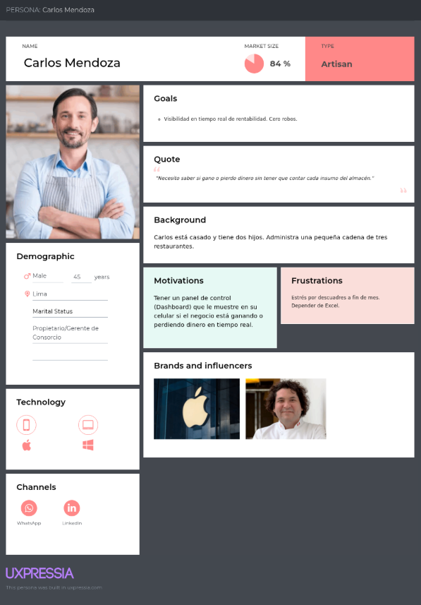
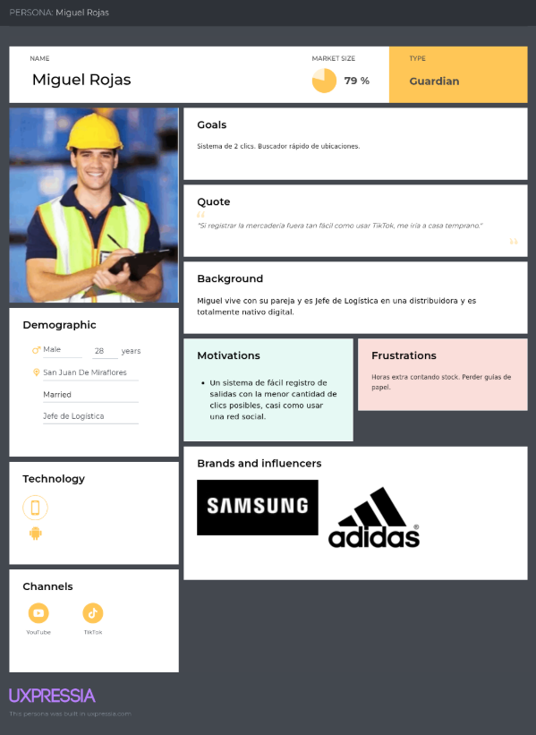
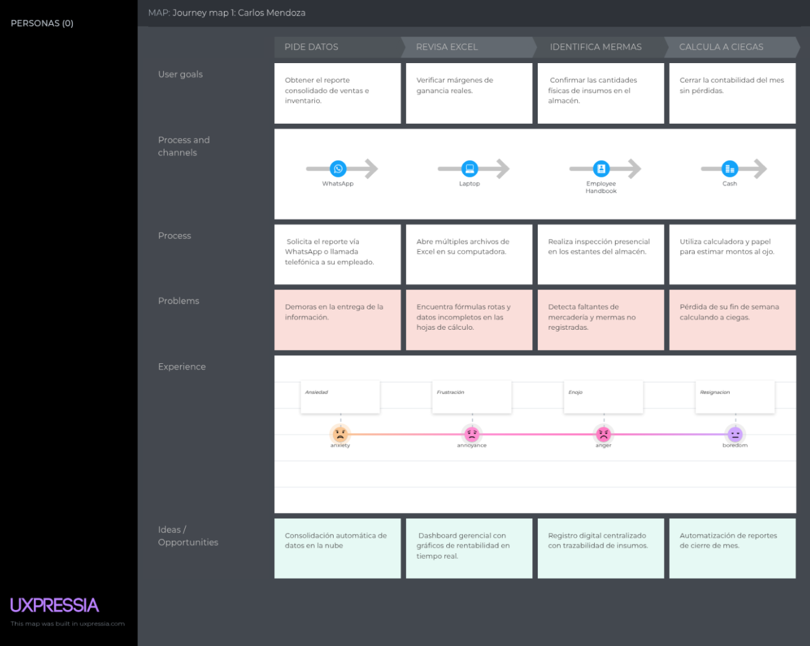
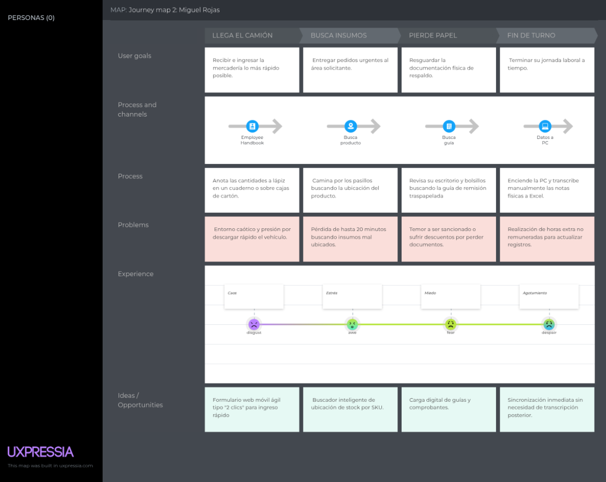
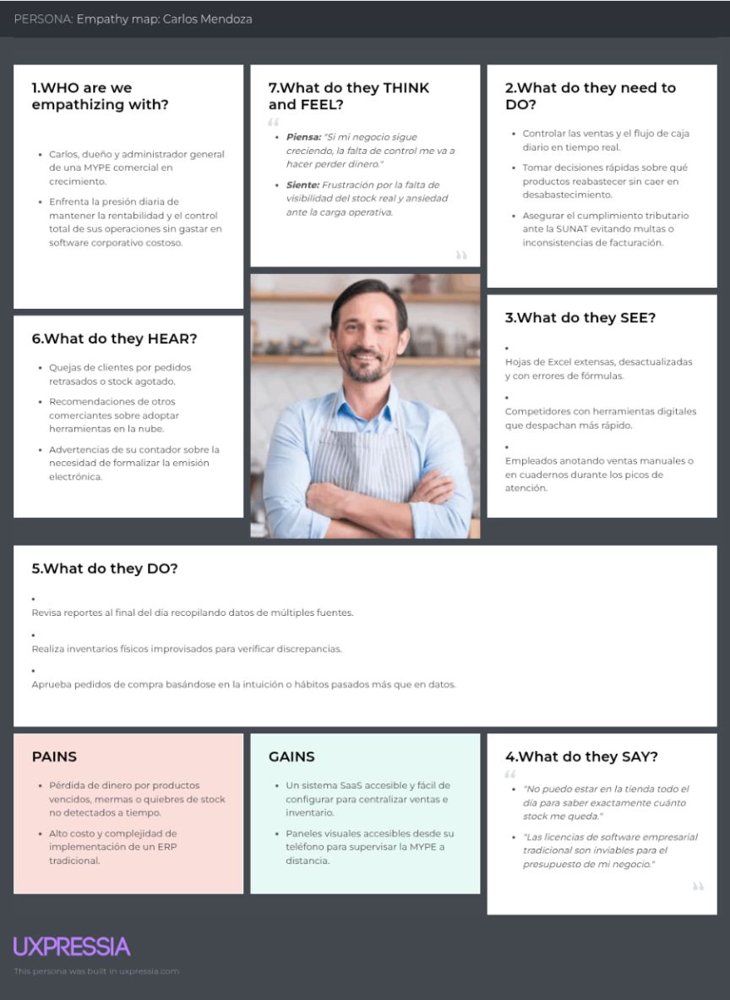
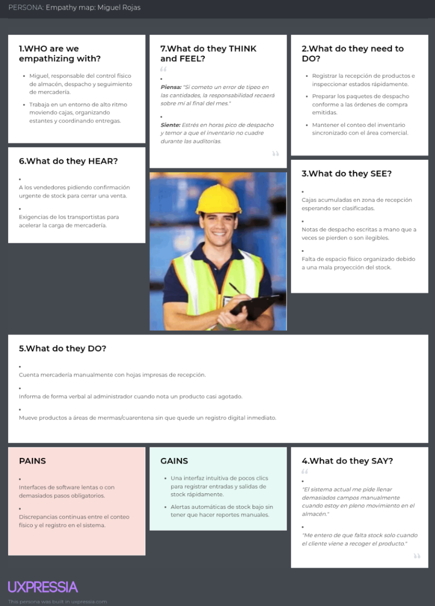
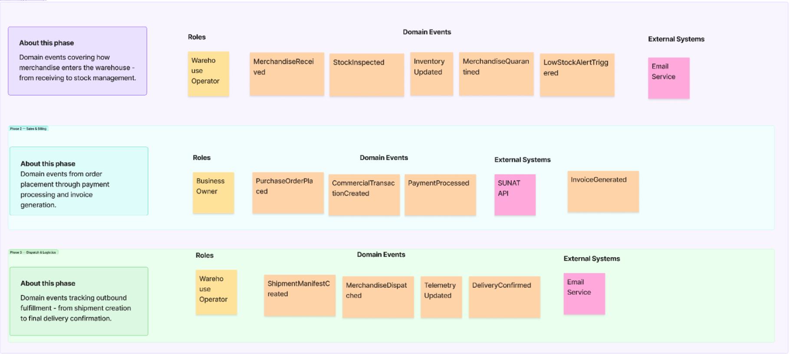

# Capítulo II: Requirements Elicitation & Analysis

[Competidores](#21-competidores) · [Entrevistas](#22-entrevistas) · [Needfinding](#23-needfinding) · [EventStorming](#24-big-picture-eventstorming) · [Lenguaje ubicuo](#25-ubiquitous-language)

## 2.1. Competidores

El análisis compara tres alternativas utilizadas como referencia funcional: Wally, Alegra y Odoo. Las capacidades que declara cada proveedor se distinguen de las hipótesis de diferenciación del equipo. La comparación no equivale a una prueba exhaustiva de esos productos.

1. **Wally:** solución de punto de venta, facturación electrónica y gestión de inventario. [Sitio oficial](https://miwally.com/).
2. **Alegra:** suite con soluciones de contabilidad, facturación y punto de venta para pequeñas empresas. [Planes de Contabilidad en Perú](https://www.alegra.com/peru/contabilidad/precios/).
3. **Odoo:** conjunto de aplicaciones de gestión empresarial, con opciones de contratación y alojamiento diferentes. [Planes oficiales](https://www.odoo.com/pricing).

### 2.1.1. Análisis competitivo

| Dimensión | Wally | Alegra | Odoo | CeTe de Nexxus |
| :--- | :--- | :--- | :--- | :--- |
| **Overview** | Punto de venta y gestión comercial. | Gestión contable y comercial mediante distintas soluciones. | Suite modular de gestión empresarial. | Incremento académico para conectar compras, stock, ventas y despachos en MYPES. |
| **Mercado de referencia** | Negocios que necesitan vender y emitir comprobantes en Perú. | Pequeñas empresas que requieren ordenar facturación, contabilidad e inventario. | Empresas que requieren integrar varias aplicaciones de gestión. | Dueños, administradores y personal operativo de pequeñas empresas con registros dispersos. |
| **Capacidades publicadas** | POS, facturación electrónica, inventario e indicadores. | Contabilidad, comprobantes, reportes e inventario, según solución y plan. | Ventas, inventario, compras y otras aplicaciones, según edición y configuración. | Catálogo, movimientos, recepción parcial, venta y boleta académica, despacho e indicadores; alcance detallado en el capítulo V. |
| **Modelo comercial** | Planes y condiciones que deben consultarse con el proveedor. | Planes con distintos límites de comprobantes, usuarios y funciones. | Opciones por aplicación y planes comerciales por usuario; revisar condiciones de alojamiento e implementación. | Hipótesis comercial de S/80 por empresa al mes; no hay suscripción ni cobro implementado. |
| **Fortalezas de referencia** | Oferta enfocada en operación comercial y comprobantes. | Funciones contables y comerciales documentadas. | Amplitud y modularidad de aplicaciones. | Trazabilidad del flujo compra–recepción–stock–venta–despacho en una misma demostración. |
| **Aspecto que debe evaluarse en una prueba** | Adecuación de la recepción parcial y los despachos al caso de la MYPE. | Facilidad de los flujos operativos para personal de almacén. | Configuración necesaria y esfuerzo de aprendizaje para el negocio. | Comprensión de la navegación, ingreso manual, conciliación de stock y utilidad de los indicadores. |
| **Oportunidad y riesgo para CeTe** | Diferenciar el recorrido logístico sin atribuir carencias no comprobadas al competidor. | Evaluar la experiencia del operario sin reducir la propuesta de Alegra a contabilidad. | Delimitar un alcance pequeño y validar su utilidad, sin afirmar que todos los despliegues requieren consultoría. | La utilidad percibida aún necesita medición de uso repetido y disposición a pagar; la emisión fiscal está fuera del incremento. |

Las tres referencias se consultan en sus sitios oficiales. Las valoraciones sobre aprendizaje, adecuación al flujo y diferenciación son **criterios de investigación del equipo**, no resultados de un estudio comparativo con usuarios.

#### 2.1.1.1. Análisis de Modelos Tarifarios (Pricing)

La comparación comercial requiere el mismo alcance: número de usuarios, volumen de comprobantes, funciones, impuestos, hardware, alojamiento y apoyo de implementación. No es válido concluir que abrir un segundo almacén duplica automáticamente el precio ni comparar una tarifa por usuario con una tarifa por empresa sin especificar esas condiciones.

* **Wally:** revisar la propuesta y las condiciones del plan aplicable al negocio en su [sitio oficial](https://miwally.com/). No se conserva como vigente el precio de S/149 consignado en una versión anterior porque no se dispone de una cotización fechada que lo respalde.
* **Alegra:** la [página oficial de planes para Perú](https://www.alegra.com/peru/contabilidad/precios/) diferencia límites de comprobantes, usuarios y funciones. Las cifras históricas de S/99 y S/249 se retiran de la comparación; los importes y condiciones deben consultarse antes de tomar una decisión comercial.
* **Odoo:** sus [planes oficiales](https://www.odoo.com/pricing) distinguen opciones por aplicación y planes comerciales. La moneda, periodicidad, usuarios, alojamiento y servicios de implementación deben especificarse en cualquier comparación de costo.
* **CeTe:** S/80 por empresa al mes es una **hipótesis de precio**, comunicada de forma uniforme en la landing. No acredita viabilidad financiera, usuarios ilimitados, instalación gratuita, una suscripción activa ni disposición de pago validada.

### 2.1.2. Estrategias y tácticas frente a competidores

| Estrategia del equipo | Acción propuesta | Evidencia para evaluarla |
| :--- | :--- | :--- |
| Enfocar el recorrido logístico de la MYPE | Mostrar el paso de orden a recepción parcial y su efecto en stock, venta y despacho. | Observar si un operario distingue esos conceptos y completa el caso sin ayuda. |
| Reducir la dificultad de entrada | Preparar un recorrido guiado con datos ficticios y acciones visibles según el rol. | Registrar errores y tiempo de primera ejecución; contrastar con el proceso actual del negocio. |
| Comunicar el alcance comercial con claridad | Mantener S/80 como propuesta de investigación y explicar las capacidades del incremento académico. | Entrevistar a dueños sobre utilidad, condiciones de contratación y disposición a pagar. |

## 2.2. Entrevistas

### 2.2.1. Diseño de entrevistas

Para recolectar información cualitativa y descubrir competidores reales, hemos diseñado una batería de preguntas para nuestros dos segmentos objetivos.

**Preguntas Generales (Demografía, Tecnología, Marcas):**
1. *Demografía y Perfil:* ¿Cuál es tu nombre, edad, rol en el negocio y cuánto tiempo llevas trabajando en tu rubro?
2. *Tecnología:* ¿Qué dispositivo usas más en tu día a día (celular, laptop), y cuáles son tus aplicaciones favoritas?
3. *Contexto:* Descríbeme brevemente cómo es un día normal de trabajo para ti, desde que llegas hasta que te vas.

**Preguntas de Problema (Core del Negocio):**
1. *Dolor:* Actualmente, ¿cómo llevas el control de lo que entra, lo que sale y lo que tienes en el almacén? (¿Cuadernos, Excel, memoria?)
2. *Dolor:* ¿Cuál es el mayor dolor de cabeza o problema que enfrentas al rastrear mercadería o hacer inventarios? ¿Cuánto tiempo pierdes en esto?
3. *Competencia:* ¿Alguna vez has buscado o intentado usar algún software para solucionar esto? Si es así, ¿cuál fue y por qué funcionó o no?
4. *Validación:* Si te presentamos una plataforma web (como una plantilla adaptable) fácil de usar que centralice tu almacén, ventas y despacho, ¿estarías dispuesto a probarla?

**Preguntas Específicas por Segmento:**
* **Para el Segmento 1 (Dueños, Administradores):**
    1. ¿Te genera desconfianza o estrés no saber a dónde se fue exactamente la mercadería o los insumos que compraste?
    2. ¿Sientes que hay un descuadre frecuente entre lo que inviertes y lo que rinde el negocio?
* **Para el Segmento 2 (Jefes de Logística, Operarios):**
    1. ¿Qué tan frustrante es para ti tener que contar producto por producto o transcribir apuntes de cuadernos a fin de mes?
    2. Cuando despachan o reparten mercadería, ¿cómo se aseguran de que no haya confusiones y llegue correctamente?

### 2.2.2. Registro de entrevistas

Se conservan ocho fichas de descubrimiento de las entregas anteriores. Su existencia no implica que todas dispongan de un video identificable y de una captura contrastada. El control de fuentes siguiente separa las fichas de la evidencia disponible; las entrevistas de validación de AV2 se registran en 5.3.

#### Segmento 1: Tomadores de Decisión (Dueños, Administradores, Gerentes)

| Campo | Detalle |
| :--- | :--- |
| **Nombres y Apellidos** | Carlos Mendoza |
| **ID** | E-S1-01 |
| **Edad / Distrito** | 45 años / Santiago de Surco |
| **Timing del video** | 00:00 - 04:15 min |
| **Evidencia fotográfica** | 

 |
| **Resumen descriptivo** | Carlos está casado y tiene dos hijos. Administra una pequeña cadena de tres restaurantes. Su dispositivo principal es una Laptop con Windows, pero revisa todo el día su celular (iPhone). Se informa vía LinkedIn y WhatsApp, y admira marcas que proyectan estatus como Apple y a referentes locales como Gastón Acurio. Sufre de estrés porque confía en reportes de Excel elaborados a mano por su administrador, lo que genera un descuadre constante (merma). Su mayor expectativa es un panel de control (Dashboard) que le muestre en su celular si el negocio está ganando o perdiendo dinero en tiempo real. |

| Campo | Detalle |
| :--- | :--- |
| **Nombres y Apellidos** | Lucía Valdivia |
| **ID** | E-S1-02 |
| **Edad / Distrito** | 38 años / San Borja |
| **Timing del video** | 04:16 - 08:30 min |
| **Evidencia fotográfica** | 

 |
| **Resumen descriptivo** | Lucía es soltera y fundadora de una MYPE textil. Pasa casi todo su día en su Smartphone (Android de gama alta) y utiliza mucho Instagram y WhatsApp Business para vender. Su mayor frustración es que se le ha paralizado la producción varias veces porque olvidó comprar hilos o botones específicos, ya que el control lo lleva en un cuaderno. Expresó que aprender sistemas nuevos le asusta un poco, por lo que pide que la solución tenga botones muy claros y alertas de colores cuando falte mercadería. |

| Campo | Detalle |
| :--- | :--- |
| **Nombres y Apellidos** | Diego Ramirez |
| **ID** | E-S1-03 |
| **Edad / Distrito** | 26 años / San Martín de Porres |
| **Timing del video** | 00:00 - 05:29 min |
| **Evidencia fotográfica** | 

 |
| **Resumen descriptivo** | Diego es dueño y administrador del restaurante familiar “Sabor Peruano”, ubicado en San Martín de Porres. Tiene cuatro años de experiencia administrando el negocio y se encarga de supervisar las compras, las ventas, los productos y la coordinación con los trabajadores. Actualmente controla el inventario mediante Excel, formatos de Google y apuntes en un cuaderno. Su principal problema es que algunas entradas y salidas no se registran a tiempo, lo que genera diferencias entre el inventario físico y la información digital, pérdidas por productos vencidos y compras innecesarias. Necesita una plataforma web sencilla y económica que le permita consultar las ventas del día, el stock disponible, los productos próximos a agotarse, las pérdidas y las ganancias. |

| Campo | Detalle |
| :--- | :--- |
| **Nombres y Apellidos** | Carmen Soto |
| **ID** | E-S1-04 |
| **Edad / Distrito** | 52 años / Los Olivos |
| **Enlace del video** | [Entrevista Drive](https://drive.google.com/file/d/1D22M_Bdm9QgKvZ8YXwEYe_2a9G290HcO/view?usp=sharing) |
| **Evidencia fotográfica** | 

 |
| **Resumen descriptivo** | Carmen administra su minimarket desde hace quince años. Su mayor desafío es el control visual del inventario, lo que le genera frustración al rastrear fechas de vencimiento y quiebres de stock. Tras abandonar Excel por ser lento, busca una solución ágil que le permita usar la cámara de su teléfono para escanear códigos y monitorear su negocio a distancia. |

| Campo | Detalle |
| :--- | :--- |
| **Nombres y Apellidos** | Raúl Delgado |
| **ID** | E-S1-05 |
| **Edad / Distrito** | 48 años / San Juan de Lurigancho |
| **Enlace del video** | [Entrevista Drive](https://drive.google.com/file/d/1f0I67_yf-Q2PPMHoIbk0-b8B4F1FAHAd/view?usp=sharing) |
| **Evidencia fotográfica** | 

 |
| **Resumen descriptivo** | Raúl dirige su propia pollería desde hace ocho años, gestionando su operación casi exclusivamente a través de su celular. Su mayor dolor de cabeza es el control manual del inventario mediante cuadernos y memoria, un método que le hace perder horas semanales y le genera descuadres financieros. Tras haber descartado un software de POS por ser complejo, busca una solución económica, móvil y sencilla que le envíe alertas automáticas de reabastecimiento. |

#### Segmento 2: Usuarios Finales (Jefes de Logística, Operarios de Almacén)

| Campo | Detalle |
| :--- | :--- |
| **Nombres y Apellidos** | María Morales |
| **ID** | E-S2-01 |
| **Edad / Distrito** | 24 años / Ate, Lima |
| **Enlace del video** | [Ver entrevista de María Morales](https://www.youtube.com/watch?v=-meI6Cyn0IA) |
| **Evidencia fotográfica** | 

 |
| **Resumen descriptivo** | María Morales tiene 24 años y trabaja como encargada de almacén y despachos en la distribuidora de productos alimenticios “Comercial Santa Rosa”. Sus principales actividades son recibir productos, verificar cantidades, ordenar la mercadería y preparar pedidos. Actualmente, el registro de entradas y salidas se realiza en cuadernos y luego se pasa a Excel. Debido a la cantidad de pedidos, algunas cantidades pueden registrarse tarde o incorrectamente. Su principal dificultad es realizar el inventario mensual y comparar las cantidades físicas con la información de Excel. Considera necesario contar con una aplicación sencilla para tablet o celular que permita registrar rápidamente las entradas y salidas, buscar productos por nombre o código y escanear códigos de barras para evitar errores. |

| Campo | Detalle |
| :--- | :--- |
| **Nombres y Apellidos** | Sebastián Ramírez |
| **ID** | E-S2-02 |
| **Edad / Distrito** | 22 años / La Victoria, Lima |
| **Enlace del video** | [Ver entrevista de Sebastián Ramírez](https://www.youtube.com/watch?v=AItYU4_ckvU) |
| **Evidencia fotográfica** | 

 |
| **Resumen descriptivo** | Sebastián Ramírez tiene 22 años y trabaja como vendedor y encargado de inventario en la tienda de ropa “Moda Urbana”. Durante su jornada atiende a los clientes y revisa las prendas disponibles. Actualmente, la tienda utiliza Excel, aunque cuando hay muchos clientes las ventas se anotan primero en un cuaderno. Esta situación genera diferencias entre el inventario registrado y las prendas disponibles, especialmente en tallas y colores. Sebastián considera útil una aplicación móvil con un buscador por modelo, talla y color, actualización automática del stock y alertas de pocas unidades. |

| Campo | Detalle |
| :--- | :--- |
| **Nombres y Apellidos** | Jorge Quispe |
| **ID** | E-S2-03 |
| **Edad / Distrito** | 31 años / Ate Vitarte |
| **Enlace del video** | Pendiente de identificar: el enlace anterior duplicaba el de Sebastián Ramírez. |
| **Evidencia fotográfica** | Pendiente de contrastar: se retiró la imagen cuyo archivo identifica a Raúl Delgado. |
| **Resumen descriptivo** | Jorge es encargado de despachos en un consorcio de alimentos. Tiene habilidades tecnológicas moderadas y prefiere herramientas simples. Su dolor principal radica en el registro de mermas y devoluciones: el trámite en papel es tan tedioso que a veces no lo anota, generando el descuadre. Desea un sistema que con dos toques le permita registrar una merma. |

### 2.2.3. Análisis de entrevistas

El análisis utiliza las ocho **fichas de descubrimiento** conservadas. Se trata de una lectura cualitativa de sus resúmenes, no de un análisis estadístico ni de una estimación representativa de todas las MYPES. No se mantienen porcentajes del 100% porque no hay una matriz de respuestas y codificación que permita reproducirlos.

| Segmento | Señales descritas en las fichas | Implicación para el diseño | Límite de interpretación |
| :--- | :--- | :--- | :--- |
| Dueños y administradores | Registros en cuadernos y Excel, preocupación por diferencias de inventario y necesidad de supervisar el negocio. | Priorizar indicadores comprensibles y trazabilidad de compras, ventas y existencias. | La expectativa no demuestra adopción, ahorro ni rentabilidad obtenida con CeTe. |
| Personal operativo | Transcripción manual, conciliación de cantidades, identificación de productos y dificultad para registrar movimientos en momentos de alta demanda. | Hacer visibles búsqueda, cantidades, motivos y confirmación del resultado; distinguir orden de compra de recepción. | Escaneo, variantes y merma como flujo propio continúan siendo oportunidades, no capacidades completadas. |

**Control de las fuentes de descubrimiento.**

| Ficha | Evidencia identificada | Aspecto que requiere confirmación |
| :--- | :--- | :--- |
| Carlos Mendoza, Lucía Valdivia y Diego Ramirez | Resúmenes, imágenes y tramos de video consignados en la entrega histórica. | No hay URL individual o consolidada identificable en estas fichas. Los tramos no sustituyen el enlace. |
| Carmen Soto y Raúl Delgado | Enlaces de Drive y capturas registradas. | Confirmar permisos de acceso al consolidar los videos. |
| María Morales y Sebastián Ramírez | Enlaces individuales de YouTube y capturas registradas. | Mantener la asociación de cada enlace con su entrevistado y distinguir descubrimiento de validación. |
| Jorge Quispe | Resumen histórico conservado. | Enlace y fotografía sin contrastar. No se contabiliza como sesión audiovisual verificada. |

Los User Personas y mapas siguientes sintetizan estas necesidades como artefactos de diseño. Sus descripciones no sustituyen los registros de entrevistas ni permiten completar metadatos ausentes. Los hallazgos de uso de la aplicación se contrastan por separado en 5.3 y en las conclusiones.

## 2.3. Needfinding

### 2.3.1. User Personas

**User Persona 1: Carlos Mendoza - El "Dueño Estresado" (Segmento 1)**
> *"Necesito saber si gano o pierdo dinero sin tener que contar cada tomate del almacén."*
* **Gains:** Quiere visibilidad en tiempo real (Dashboard) y seguridad (Roles y Permisos).
* **Pains:** Descuadres a fin de mes, estrés por depender de reportes en Excel.

**User Persona 2: Miguel Rojas - El "Almacenero Frustrado" (Segmento 2)**
> *"Si registrar un ingreso fuera tan fácil como subir un TikTok, saldría temprano a casa."*
* **Gains:** Desea un sistema extremadamente simple y un buscador inteligente.
* **Pains:** Hacer inventario de madrugada, perder hojas de despacho.

### 2.3.2. User Task Matrix

<table border="1" cellpadding="8" cellspacing="0" style="border-collapse: collapse; text-align: center; width: 100%;">
  <tr style="background-color:#f2f2f2;">
    <th rowspan="2">Task / Tarea</th>
    <th colspan="2">User Persona 1: Carlos (Dueño)</th>
    <th colspan="2">User Persona 2: Miguel (Almacenero)</th>
  </tr>
  <tr style="background-color:#f2f2f2;">
    <th>Frequency</th>
    <th>Importance</th>
    <th>Frequency</th>
    <th>Importance</th>
  </tr>
  <tr>
    <td style="text-align: left;">1. Registrar ingresos físicos de mercadería</td>
    <td>Baja</td>
    <td>Media</td>
    <td>Alta</td>
    <td>Alta</td>
  </tr>
  <tr>
    <td style="text-align: left;">2. Registrar salidas/despachos de mercadería</td>
    <td>Baja</td>
    <td>Media</td>
    <td>Alta</td>
    <td>Alta</td>
  </tr>
  <tr>
    <td style="text-align: left;">3. Buscar productos físicamente en estantes</td>
    <td>Rara vez</td>
    <td>Baja</td>
    <td>Alta</td>
    <td>Alta</td>
  </tr>
  <tr>
    <td style="text-align: left;">4. Calcular mermas / productos dañados</td>
    <td>Media</td>
    <td>Alta</td>
    <td>Media</td>
    <td>Media</td>
  </tr>
  <tr>
    <td style="text-align: left;">5. Elaborar cuadre financiero/inventario</td>
    <td>Media (Mensual)</td>
    <td>Alta</td>
    <td>Baja (a fin de mes)</td>
    <td>Alta</td>
  </tr>
  <tr>
    <td style="text-align: left;">6. Autorizar compras a proveedores</td>
    <td>Alta</td>
    <td>Alta</td>
    <td>Baja</td>
    <td>Baja</td>
  </tr>
  <tr>
    <td style="text-align: left;">7. Revisar estado general del negocio</td>
    <td>Alta (Diario)</td>
    <td>Alta</td>
    <td>Baja</td>
    <td>Baja</td>
  </tr>
</table>

 
**Análisis de la Matriz:**
La matriz evidencia que Miguel requiere interfaces móviles hiper-optimizadas para rapidez en tareas frecuentes (ingresos/salidas), mientras que Carlos requiere un Dashboard gerencial como pantalla principal para revisar el estado general. Ambos sufren con el cuadre de inventario, por lo que automatizarlo es una prioridad arquitectónica para CeTe.

### 2.3.3. User Journey Mapping

**Segmento 1: Oportunidad Carlos** (Automatizar la consolidación de datos y ofrecer Dashboard).

**Segmento 2: Oportunidad Miguel** (Reemplazar cuaderno por app móvil y buscador inteligente).

### 2.3.4. Empathy Mapping

**Empathy Map: Carlos Mendoza (Tomador de Decisión)**

**Empathy Map: Miguel Rojas (Usuario Final)**

## 2.4. Big Picture EventStorming

El tablero histórico explora la operación logística y sirve como insumo de descubrimiento. La revisión AV2 precisa la secuencia del negocio: **registrar una compra no equivale a recibirla**, y confirmar una venta produce una boleta académica, no una factura fiscal. Los avisos y vencimientos identificados durante el descubrimiento siguen siendo oportunidades de evolución.

*Vista conceptual del negocio contrastada con los casos de uso actuales. Los hechos no corresponden a eventos publicados en un bus de mensajería.* [Ampliar](diagrams/business-timeline.svg) · [Fuente editable](diagrams/business-timeline.mmd)

Ver tablero histórico de descubrimiento

El tablero se conserva como evidencia de la etapa de descubrimiento. La secuencia AV2 y el alcance implementado se explican en el diagrama anterior y en el capítulo IV.

## 2.5. Ubiquitous Language

El lenguaje ubicuo distingue la identidad del producto, la cantidad disponible y los documentos de cada operación. Los términos se usan según su contexto; no se interpreta cada sustantivo como un agregado o una tabla independiente.

| Término de negocio | Contexto | Significado y representación actual |
| :--- | :--- | :--- |
| **Empresa / tenant** | Identidad | Organización propietaria de los datos, representada por `Tenant`. `TenantId` delimita sus operaciones. |
| **Cuenta y sesión** | Identidad | `User` identifica a la persona que accede; `UserSession` determina vigencia y revocación. No son la misma entidad. |
| **Producto / artículo** | Inventario | `Product` conserva SKU, nombre, precio y estado. `InventoryItem` es un nombre de compatibilidad en DTO, no una entidad de la API. |
| **SKU** | Inventario | Código de producto único dentro de una empresa; puede repetirse en otra. |
| **Almacén** | Inventario | `Warehouse` identifica el lugar de operación. El saldo distingue producto y almacén. |
| **Saldo disponible** | Inventario | `StockBalance.Quantity`; cantidad que puede retirarse o venderse sin quedar negativa. |
| **Movimiento** | Inventario | `InventoryMovement`; variación con signo, motivo, usuario y fecha. No sustituye al producto ni al saldo. |
| **Ingreso / salida** | Inventario | Aumento o disminución física. La salida requiere motivo y saldo suficiente. |
| **Orden de compra** | Abastecimiento | `PurchaseOrder` y sus líneas representan lo pedido al proveedor; no aumentan existencias. |
| **Recepción física** | Abastecimiento | `GoodsReceipt` y sus líneas registran lo entregado; pueden cubrir solo parte de la orden. |
| **Pendiente de recepción** | Abastecimiento | Cantidad pedida menos cantidad acumulada recibida de una línea. |
| **Venta** | Ventas | `Sale` y `SaleLine` conservan la transacción comercial y sus precios históricos. |
| **Pago registrado** | Ventas | `Payment` anota método y monto; no ejecuta cobros en tarjeta ni transferencias bancarias. |
| **Boleta académica** | Ventas | `SalesReceipt` conserva datos comerciales para visualizar e imprimir el detalle de compra. Sin emisión fiscal. |
| **Anulación de venta** | Ventas | Cambio a `CANCELLED`, restitución única de stock y reversión del registro de pago; se rechaza si tiene asignación logística. |
| **Despacho / manifiesto** | Logística | `Dispatch` agrupa ventas completadas mediante `DispatchSale`; controla conductor, placa, estado e incidencias. No es una guía fiscal. |
| **Incidencia de ruta** | Logística | `DispatchIncident` documenta un contratiempo del despacho en tránsito. |
| **Quiebre de stock** | Inventario | Ausencia de unidades disponibles. La API impide confirmar una salida que exceda el saldo. |
| **Merma / cuarentena** | Evolución del inventario | Conceptos de descubrimiento. No existe todavía un flujo de cuarentena ni valoración contable de mermas. |

La correspondencia entre estos términos, clases y tablas se desarrolla en [DDD y diseño de datos](04-Chapter-4.md#46-domain-driven-software-architecture).
