# Capítulo II: Requirements Elicitation & Analysis

[Competidores](#21-competidores) · [Entrevistas](#22-entrevistas) · [Needfinding](#23-needfinding) · [EventStorming](#24-big-picture-eventstorming) · [Lenguaje ubicuo](#25-ubiquitous-language)

## 2.1. Competidores

Para validar nuestra propuesta de valor en el ecosistema B2B SaaS, hemos identificado a tres competidores principales que ofrecen soluciones de digitalización para MYPES en la región.

1. **Wally POS:** Startup peruana enfocada fuertemente en el punto de venta (POS) y facturación, orientada principalmente a restaurantes y *retail*.
2. **Alegra:** Plataforma SaaS colombiana enfocada principalmente en la contabilidad y administración financiera para pequeñas empresas, integrando módulos de inventario básicos.
3. **Odoo:** Un sistema ERP de código abierto con módulos para ventas, almacén y manufactura. Representa a la competencia de software robusto, complejo y de difícil adopción.

### 2.1.1. Análisis competitivo

**¿Por qué llevar a cabo este análisis?**
Entender el panorama actual para identificar cómo CeTe puede diferenciarse siendo una plataforma más generalizable, amigable y menos restrictiva que un ERP tradicional.

| | Nombre | Wally POS | Alegra | Odoo | CeTe (Nexxus) |
| :--- | :--- | :--- | :--- | :--- | :--- |
| **Perfil** | **Ventaja competitiva** | Súper simplificado para el punto de venta (POS) rápido. | Enfoque contable maduro, ideal para contadores. | Altamente modular y robusto (ERP completo). | "Plantilla" adaptable, unificando almacén y logística como sistema nervioso central intuitivo. |
| | **¿Qué valor ofrece?** | Vender rápido en tiendas y cumplir con la SUNAT. | Mantener las finanzas e impuestos en orden. | Tener todas las aplicaciones de gestión interconectadas. | Eliminar los cuadernos y excels, sabiendo exactamente dónde está la mercadería y ahorrando horas. |
| | **Mercado objetivo** | Restaurantes y tiendas minoristas en Perú. | MYPES que priorizan el orden contable. | Desde PYMES hasta grandes corporaciones globales. | Dueños y operarios de MYPES (consorcios, textiles, restaurantes) agobiados por procesos manuales. |
| **Producto** | **Productos & Servicios** | Punto de venta web, inventario básico, facturación. | Facturación, contabilidad, gestión de inventario. | CRM, eCommerce, Almacén avanzado, Contabilidad. | Gestión de Almacén, Ventas, Despacho, Dashboard en tiempo real y proyección IoT. |
| | **Precios & Costos** | Desde S/ 149.00/mes (Plan Básico 1 caja). Hardware y terminales extra se cotizan por separado. | Desde S/ 99.00/mes (Plan Pyme con límite de facturas). Plan Pro (inventario full) escala a S/ 249.00/mes. | Versión Standard Cloud: $24.90 (S/ 95 aprox.) por usuario/mes. Requiere alto costo de consultoría para la implementación inicial. | Tarifa plana MYPE: S/ 80.00/mes. Sin cobro por usuario adicional operativo. Implementación a costo cero (Plug & Play). |
| | **Distribución** | Web Application y App móvil POS. | Plataforma Web Cloud. | Plataforma Web, Apps móviles y software de escritorio. | Web Application (Cloud) responsiva (Mobile/Desktop). |
| **SWOT** | **Fortalezas** | Excelente usabilidad y presencia local. | Gran ecosistema de integraciones contables. | Código abierto, infinidad de funcionalidades. | Diseño inspirado en dolores reales, alta adaptabilidad (plantilla general). |
| | **Debilidades** | Módulo logístico básico, no apto para distribución compleja. | Enfoque muy administrativo, pesado para el almacenero. | Configuración inicial compleja, requiere consultores. | Startup emergente sin marca establecida aún. |
| | **Oportunidades** | MYPES buscando formalizarse y facturar rápido. | Leyes de facturación electrónica en LATAM. | Empresas en crecimiento que necesitan unificar sistemas. | Alta tasa de negocios que aún usan cuadernos y buscan dar su primer salto digital. |
| | **Amenazas** | Nuevos competidores POS de bajo costo. | Cambios en normativas tributarias. | Soluciones locales de nicho. | Resistencia al cambio del personal acostumbrado al papel. |

<em>Nota: Análisis competitivo de CeTe en comparación con las principales soluciones del mercado.</em>

### 2.1.1.1. Análisis de Modelos Tarifarios (Pricing)

Para sustentar la viabilidad comercial y el diseño de la tarifa plana de CeTe, se investigó el modelo de monetización de los competidores directos, evidenciando barreras económicas estructurales para la adopción tecnológica en el segmento MYPE:

* **Cobro por Terminal de Venta (Wally POS):** El mercado de POS tradicional exige un pago base aproximado de S/ 149.00 mensuales anclado a un único dispositivo o punto de emisión. Si una MYPE (ej. un consorcio de alimentos) necesita aperturar un almacén secundario o una segunda caja, el costo de suscripción se duplica automáticamente, penalizando la expansión física del negocio.
* **Cobro por Volumen de Transacciones (Alegra):** Los sistemas con enfoque contable atraen a las MYPES con planes de entrada (S/ 99.00/mes) que imponen límites estrictos en la cantidad de comprobantes emitidos. Para que un negocio acceda a métricas gerenciales completas y gestión multi-almacén, es forzado a migrar al plan Pro (S/ 249.00/mes), lo que representa un salto financiero superior al 150%.
* **Cobro por Usuario Nombrado (Odoo):** El modelo tradicional de ERP en la nube cobra una licencia individual por cada trabajador. Aunque la tarifa base ronda los S/ 95.00 mensuales ($24.90 USD), una pequeña empresa que requiera accesos para un administrador, dos almaceneros y dos vendedores enfrentaría un costo operativo de S/ 475.00 mensuales, sin contar las elevadas horas de consultoría necesarias para parametrizar el ecosistema.
* **Nuestra Propuesta de Valor (CeTe):** Se introduce un modelo SaaS de *Tarifa Plana* de S/ 80.00 mensuales diseñado para la realidad financiera peruana. CeTe absorbe la ventaja competitiva al no cobrar licencias adicionales por cada operario logístico registrado ni limitar el volumen de ingresos de SKUs. Esto elimina la fricción económica y permite que el dueño del negocio digitalice a toda su fuerza laboral de almacén bajo una sola suscripción centralizada.eTe en comparación con las principales soluciones del mercado.</em>

### 2.1.2. Estrategias y tácticas frente a competidores

A partir del análisis competitivo, el equipo de Nexxus ha identificado las siguientes estrategias para posicionar a CeTe en el mercado:

**Estrategia 1: Profundidad en el módulo logístico**
* *Frente a:* Wally POS.
* *Táctica:* Resaltaremos la profundidad de nuestro módulo logístico y de despacho, atrayendo a quienes la gestión de almacén de un POS básico ya les quedó corta (ej. Consorcios de alimentos).

**Estrategia 2: Accesibilidad y despliegue inmediato (Plug & Play)**
* *Frente a:* Odoo.
* *Táctica:* Promoveremos CeTe como un sistema "plantilla" lista para usar que no requiere semanas de parametrización ni consultores costosos, eliminando la fricción de entrada tecnológica.

**Estrategia 3: Usabilidad centrada en el operario logístico**
* *Frente a:* Alegra.
* *Táctica:* Centraremos nuestra usabilidad en el operario de almacén. Si el sistema es fácil para el usuario final (cero fricción), los reportes llegarán solos al dueño, diferenciándonos de los sistemas diseñados exclusivamente para contadores.

## 2.2. Entrevistas

### 2.2.1. Diseño de entrevistas

Para recolectar información cualitativa y descubrir competidores reales, hemos diseñado una batería de preguntas para nuestros dos segmentos objetivos.

**Preguntas Generales (Demografía, Tecnología, Marcas):**
1. *Demografía y Perfil:* ¿Cuál es tu nombre, edad, rol en el negocio y cuánto tiempo llevas trabajando en tu rubro?
2. *Tecnología:* ¿Qué dispositivo usas más en tu día a día (celular, laptop), y cuáles son tus aplicaciones favoritas?
3. *Contexto:* Descríbeme brevemente cómo es un día normal de trabajo para ti, desde que llegas hasta que te vas.

**Preguntas de Problema (Core del Negocio):**
1. *Dolor:* Actualmente, ¿cómo llevas el control de lo que entra, lo que sale y lo que tienes en el almacén? (¿Cuadernos, Excel, memoria?)
2. *Dolor:* ¿Cuál es el mayor dolor de cabeza o problema que enfrentas al rastrear mercadería o hacer inventarios? ¿Cuánto tiempo pierdes en esto?
3. *Competencia:* ¿Alguna vez has buscado o intentado usar algún software para solucionar esto? Si es así, ¿cuál fue y por qué funcionó o no?
4. *Validación:* Si te presentamos una plataforma web (como una plantilla adaptable) fácil de usar que centralice tu almacén, ventas y despacho, ¿estarías dispuesto a probarla?

**Preguntas Específicas por Segmento:**
* **Para el Segmento 1 (Dueños, Administradores):**
    1. ¿Te genera desconfianza o estrés no saber a dónde se fue exactamente la mercadería o los insumos que compraste?
    2. ¿Sientes que hay un descuadre frecuente entre lo que inviertes y lo que rinde el negocio?
* **Para el Segmento 2 (Jefes de Logística, Operarios):**
    1. ¿Qué tan frustrante es para ti tener que contar producto por producto o transcribir apuntes de cuadernos a fin de mes?
    2. Cuando despachan o reparten mercadería, ¿cómo se aseguran de que no haya confusiones y llegue correctamente?

### 2.2.2. Registro de entrevistas

Como evidencia de nuestra investigación cualitativa, hemos consolidado las entrevistas de nuestros dos segmentos

#### Segmento 1: Tomadores de Decisión (Dueños, Administradores, Gerentes)

| Campo | Detalle |
| :--- | :--- |
| **Nombres y Apellidos** | Carlos Mendoza |
| **ID** | E-S1-01 |
| **Edad / Distrito** | 45 años / Santiago de Surco |
| **Timing del video** | 00:00 - 04:15 min |
| **Evidencia fotográfica** | 

 |
| **Resumen descriptivo** | Carlos está casado y tiene dos hijos. Administra una pequeña cadena de tres restaurantes. Su dispositivo principal es una Laptop con Windows, pero revisa todo el día su celular (iPhone). Se informa vía LinkedIn y WhatsApp, y admira marcas que proyectan estatus como Apple y a referentes locales como Gastón Acurio. Sufre de estrés porque confía en reportes de Excel elaborados a mano por su administrador, lo que genera un descuadre constante (merma). Su mayor expectativa es un panel de control (Dashboard) que le muestre en su celular si el negocio está ganando o perdiendo dinero en tiempo real. |

| Campo | Detalle |
| :--- | :--- |
| **Nombres y Apellidos** | Lucía Valdivia |
| **ID** | E-S1-02 |
| **Edad / Distrito** | 38 años / San Borja |
| **Timing del video** | 04:16 - 08:30 min |
| **Evidencia fotográfica** | 

 |
| **Resumen descriptivo** | Lucía es soltera y fundadora de una MYPE textil. Pasa casi todo su día en su Smartphone (Android de gama alta) y utiliza mucho Instagram y WhatsApp Business para vender. Su mayor frustración es que se le ha paralizado la producción varias veces porque olvidó comprar hilos o botones específicos, ya que el control lo lleva en un cuaderno. Expresó que aprender sistemas nuevos le asusta un poco, por lo que pide que la solución tenga botones muy claros y alertas de colores cuando falte mercadería. |

| Campo | Detalle |
| :--- | :--- |
| **Nombres y Apellidos** | Diego Ramirez |
| **ID** | E-S1-03 |
| **Edad / Distrito** | 26 años / San Martín de Porres |
| **Timing del video** | 00:00 - 05:29 min |
| **Evidencia fotográfica** | 

 |
| **Resumen descriptivo** | Diego es dueño y administrador del restaurante familiar “Sabor Peruano”, ubicado en San Martín de Porres. Tiene cuatro años de experiencia administrando el negocio y se encarga de supervisar las compras, las ventas, los productos y la coordinación con los trabajadores. Actualmente controla el inventario mediante Excel, formatos de Google y apuntes en un cuaderno. Su principal problema es que algunas entradas y salidas no se registran a tiempo, lo que genera diferencias entre el inventario físico y la información digital, pérdidas por productos vencidos y compras innecesarias. Necesita una plataforma web sencilla y económica que le permita consultar las ventas del día, el stock disponible, los productos próximos a agotarse, las pérdidas y las ganancias. |

| Campo | Detalle |
| :--- | :--- |
| **Nombres y Apellidos** | Carmen Soto |
| **ID** | E-S1-04 |
| **Edad / Distrito** | 52 años / Los Olivos |
| **Enlace del video** | [Entrevista Drive](https://drive.google.com/file/d/1D22M_Bdm9QgKvZ8YXwEYe_2a9G290HcO/view?usp=sharing) |
| **Evidencia fotográfica** | 

 |
| **Resumen descriptivo** | Carmen administra su minimarket desde hace quince años. Su mayor desafío es el control visual del inventario, lo que le genera frustración al rastrear fechas de vencimiento y quiebres de stock. Tras abandonar Excel por ser lento, busca una solución ágil que le permita usar la cámara de su teléfono para escanear códigos y monitorear su negocio a distancia. |

| Campo | Detalle |
| :--- | :--- |
| **Nombres y Apellidos** | Raúl Delgado |
| **ID** | E-S1-05 |
| **Edad / Distrito** | 48 años / San Juan de Lurigancho |
| **Enlace del video** | [Entrevista Drive](https://drive.google.com/file/d/1f0I67_yf-Q2PPMHoIbk0-b8B4F1FAHAd/view?usp=sharing) |
| **Evidencia fotográfica** | 

 |
| **Resumen descriptivo** | Raúl dirige su propia pollería desde hace ocho años, gestionando su operación casi exclusivamente a través de su celular. Su mayor dolor de cabeza es el control manual del inventario mediante cuadernos y memoria, un método que le hace perder horas semanales y le genera descuadres financieros. Tras haber descartado un software de POS por ser complejo, busca una solución económica, móvil y sencilla que le envíe alertas automáticas de reabastecimiento. |

#### Segmento 2: Usuarios Finales (Jefes de Logística, Operarios de Almacén)

| Campo | Detalle |
| :--- | :--- |
| **Nombres y Apellidos** | María Morales |
| **ID** | E-S2-01 |
| **Edad / Distrito** | 24 años / Ate, Lima |
| **Enlace del video** | [Ver entrevista de María Morales](https://www.youtube.com/watch?v=-meI6Cyn0IA) |
| **Evidencia fotográfica** | 

 |
| **Resumen descriptivo** | María Morales tiene 24 años y trabaja como encargada de almacén y despachos en la distribuidora de productos alimenticios “Comercial Santa Rosa”. Sus principales actividades son recibir productos, verificar cantidades, ordenar la mercadería y preparar pedidos. Actualmente, el registro de entradas y salidas se realiza en cuadernos y luego se pasa a Excel. Debido a la cantidad de pedidos, algunas cantidades pueden registrarse tarde o incorrectamente. Su principal dificultad es realizar el inventario mensual y comparar las cantidades físicas con la información de Excel. Considera necesario contar con una aplicación sencilla para tablet o celular que permita registrar rápidamente las entradas y salidas, buscar productos por nombre o código y escanear códigos de barras para evitar errores. |

| Campo | Detalle |
| :--- | :--- |
| **Nombres y Apellidos** | Sebastián Ramírez |
| **ID** | E-S2-02 |
| **Edad / Distrito** | 22 años / La Victoria, Lima |
| **Enlace del video** | [Ver entrevista de Sebastián Ramírez](https://www.youtube.com/watch?v=AItYU4_ckvU) |
| **Evidencia fotográfica** | 

 |
| **Resumen descriptivo** | Sebastián Ramírez tiene 22 años y trabaja como vendedor y encargado de inventario en la tienda de ropa “Moda Urbana”. Durante su jornada atiende a los clientes y revisa las prendas disponibles. Actualmente, la tienda utiliza Excel, aunque cuando hay muchos clientes las ventas se anotan primero en un cuaderno. Esta situación genera diferencias entre el inventario registrado y las prendas disponibles, especialmente en tallas y colores. Sebastián considera útil una aplicación móvil con un buscador por modelo, talla y color, actualización automática del stock y alertas de pocas unidades. |

| Campo | Detalle |
| :--- | :--- |
| **Nombres y Apellidos** | Jorge Quispe |
| **ID** | E-S2-03 |
| **Edad / Distrito** | 31 años / Ate Vitarte |
| **Enlace del video** | [Ver entrevista de Jorge Quispe](https://www.youtube.com/watch?v=AItYU4_ckvU) |
| **Evidencia fotográfica** | 

 |
| **Resumen descriptivo** | Jorge es encargado de despachos en un consorcio de alimentos. Tiene habilidades tecnológicas moderadas y prefiere herramientas simples. Su dolor principal radica en el registro de mermas y devoluciones: el trámite en papel es tan tedioso que a veces no lo anota, generando el descuadre. Desea un sistema que con dos toques le permita registrar una merma. |

### 2.2.3. Análisis de entrevistas

Con base en la información cualitativa extraída de las 8 entrevistas registradas, hemos realizado un análisis estadístico para definir las características que moldearán nuestros User Personas.

**Análisis del Segmento 1: Tomadores de Decisión (Dueños/Administradores)**
* **Demografía y Perfil:** El 100% de los entrevistados tiene entre 26 y 52 años. La mayoría tiene responsabilidades familiares y administra su propio negocio.
* **Tecnología y Canales:** El 100% utiliza Smartphones para la supervisión diaria. WhatsApp es la herramienta de comunicación dominante para negocios.
* **Dolores (Pain Points):** El 100% coincide en que la **"falta de transparencia en los datos"** y los **"descuadres entre compras y caja"** son su mayor dolor. El alto nivel de estrés por registros manuales es una constante.
* **Expectativas (Gains):** El 100% espera visibilidad del negocio a distancia (Dashboard) y alertas automáticas para evitar quiebres de stock.

**Análisis del Segmento 2: Usuarios Finales (Operarios/Logística)**
* **Demografía y Perfil:** Un público más joven, oscilan entre los 22 y 31 años.
* **Tecnología y Canales:** El 100% utiliza dispositivos móviles Android. Son receptivos a interfaces visuales modernas (similares a redes sociales).
* **Dolores (Pain Points):** El 100% considera que los **reportes manuales (cuadernos/papeles)** son su mayor pérdida de tiempo y frustración, propiciando errores en tallas, colores o cantidades.
* **Expectativas (Gains):** El 100% exige una herramienta que reduzca su carga de trabajo (simplicidad extrema, pocos clics, buscadores ágiles y escaneo de códigos).

## 2.3. Needfinding

### 2.3.1. User Personas

**User Persona 1: Carlos Mendoza - El "Dueño Estresado" (Segmento 1)**
> *"Necesito saber si gano o pierdo dinero sin tener que contar cada tomate del almacén."*
* **Gains:** Quiere visibilidad en tiempo real (Dashboard) y seguridad (Roles y Permisos).
* **Pains:** Descuadres a fin de mes, estrés por depender de reportes en Excel.

**User Persona 2: Miguel Rojas - El "Almacenero Frustrado" (Segmento 2)**
> *"Si registrar un ingreso fuera tan fácil como subir un TikTok, saldría temprano a casa."*
* **Gains:** Desea un sistema extremadamente simple y un buscador inteligente.
* **Pains:** Hacer inventario de madrugada, perder hojas de despacho.

### 2.3.2. User Task Matrix

<table border="1" cellpadding="8" cellspacing="0" style="border-collapse: collapse; text-align: center; width: 100%;">
  <tr style="background-color:#f2f2f2;">
    <th rowspan="2">Task / Tarea</th>
    <th colspan="2">User Persona 1: Carlos (Dueño)</th>
    <th colspan="2">User Persona 2: Miguel (Almacenero)</th>
  </tr>
  <tr style="background-color:#f2f2f2;">
    <th>Frequency</th>
    <th>Importance</th>
    <th>Frequency</th>
    <th>Importance</th>
  </tr>
  <tr>
    <td style="text-align: left;">1. Registrar ingresos físicos de mercadería</td>
    <td>Baja</td>
    <td>Media</td>
    <td>Alta</td>
    <td>Alta</td>
  </tr>
  <tr>
    <td style="text-align: left;">2. Registrar salidas/despachos de mercadería</td>
    <td>Baja</td>
    <td>Media</td>
    <td>Alta</td>
    <td>Alta</td>
  </tr>
  <tr>
    <td style="text-align: left;">3. Buscar productos físicamente en estantes</td>
    <td>Rara vez</td>
    <td>Baja</td>
    <td>Alta</td>
    <td>Alta</td>
  </tr>
  <tr>
    <td style="text-align: left;">4. Calcular mermas / productos dañados</td>
    <td>Media</td>
    <td>Alta</td>
    <td>Media</td>
    <td>Media</td>
  </tr>
  <tr>
    <td style="text-align: left;">5. Elaborar cuadre financiero/inventario</td>
    <td>Media (Mensual)</td>
    <td>Alta</td>
    <td>Baja (a fin de mes)</td>
    <td>Alta</td>
  </tr>
  <tr>
    <td style="text-align: left;">6. Autorizar compras a proveedores</td>
    <td>Alta</td>
    <td>Alta</td>
    <td>Baja</td>
    <td>Baja</td>
  </tr>
  <tr>
    <td style="text-align: left;">7. Revisar estado general del negocio</td>
    <td>Alta (Diario)</td>
    <td>Alta</td>
    <td>Baja</td>
    <td>Baja</td>
  </tr>
</table>

 
**Análisis de la Matriz:**
La matriz evidencia que Miguel requiere interfaces móviles hiper-optimizadas para rapidez en tareas frecuentes (ingresos/salidas), mientras que Carlos requiere un Dashboard gerencial como pantalla principal para revisar el estado general. Ambos sufren con el cuadre de inventario, por lo que automatizarlo es una prioridad arquitectónica para CeTe.

### 2.3.3. User Journey Mapping

**Segmento 1: Oportunidad Carlos** (Automatizar la consolidación de datos y ofrecer Dashboard).

**Segmento 2: Oportunidad Miguel** (Reemplazar cuaderno por app móvil y buscador inteligente).

### 2.3.4. Empathy Mapping

**Empathy Map: Carlos Mendoza (Tomador de Decisión)**

**Empathy Map: Miguel Rojas (Usuario Final)**

## 2.4. Big Picture EventStorming

El tablero histórico explora la operación logística y sirve como insumo de descubrimiento. La revisión AV2 precisa la secuencia del negocio: **registrar una compra no equivale a recibirla**, y confirmar una venta produce una boleta académica, no una factura fiscal. Los avisos y vencimientos identificados durante el descubrimiento siguen siendo oportunidades de evolución.

*Vista conceptual del negocio contrastada con los casos de uso actuales. Los hechos no corresponden a eventos publicados en un bus de mensajería.* [Ampliar](diagrams/business-timeline.svg) · [Fuente editable](diagrams/business-timeline.mmd)

Ver tablero histórico de descubrimiento

El tablero se conserva como evidencia de la etapa de descubrimiento. La secuencia AV2 y el alcance implementado se explican en el diagrama anterior y en el capítulo IV.

## 2.5. Ubiquitous Language

El lenguaje ubicuo distingue la identidad del producto, la cantidad disponible y los documentos de cada operación. Los términos se usan según su contexto; no se interpreta cada sustantivo como un agregado o una tabla independiente.

| Término de negocio | Contexto | Significado y representación actual |
| :--- | :--- | :--- |
| **Empresa / tenant** | Identidad | Organización propietaria de los datos, representada por `Tenant`. `TenantId` delimita sus operaciones. |
| **Cuenta y sesión** | Identidad | `User` identifica a la persona que accede; `UserSession` determina vigencia y revocación. No son la misma entidad. |
| **Producto / artículo** | Inventario | `Product` conserva SKU, nombre, precio y estado. `InventoryItem` es un nombre de compatibilidad en DTO, no una entidad de la API. |
| **SKU** | Inventario | Código de producto único dentro de una empresa; puede repetirse en otra. |
| **Almacén** | Inventario | `Warehouse` identifica el lugar de operación. El saldo distingue producto y almacén. |
| **Saldo disponible** | Inventario | `StockBalance.Quantity`; cantidad que puede retirarse o venderse sin quedar negativa. |
| **Movimiento** | Inventario | `InventoryMovement`; variación con signo, motivo, usuario y fecha. No sustituye al producto ni al saldo. |
| **Ingreso / salida** | Inventario | Aumento o disminución física. La salida requiere motivo y saldo suficiente. |
| **Orden de compra** | Abastecimiento | `PurchaseOrder` y sus líneas representan lo pedido al proveedor; no aumentan existencias. |
| **Recepción física** | Abastecimiento | `GoodsReceipt` y sus líneas registran lo entregado; pueden cubrir solo parte de la orden. |
| **Pendiente de recepción** | Abastecimiento | Cantidad pedida menos cantidad acumulada recibida de una línea. |
| **Venta** | Ventas | `Sale` y `SaleLine` conservan la transacción comercial y sus precios históricos. |
| **Pago registrado** | Ventas | `Payment` anota método y monto; no ejecuta cobros en tarjeta ni transferencias bancarias. |
| **Boleta académica** | Ventas | `SalesReceipt` conserva datos comerciales para visualizar e imprimir el detalle de compra. Sin emisión fiscal. |
| **Anulación de venta** | Ventas | Cambio a `CANCELLED`, restitución única de stock y reversión del registro de pago; se rechaza si tiene asignación logística. |
| **Despacho / manifiesto** | Logística | `Dispatch` agrupa ventas completadas mediante `DispatchSale`; controla conductor, placa, estado e incidencias. No es una guía fiscal. |
| **Incidencia de ruta** | Logística | `DispatchIncident` documenta un contratiempo del despacho en tránsito. |
| **Quiebre de stock** | Inventario | Ausencia de unidades disponibles. La API impide confirmar una salida que exceda el saldo. |
| **Merma / cuarentena** | Evolución del inventario | Conceptos de descubrimiento. No existe todavía un flujo de cuarentena ni valoración contable de mermas. |

La correspondencia entre estos términos, clases y tablas se desarrolla en [DDD y diseño de datos](04-Chapter-4.md#46-domain-driven-software-architecture).
