# Capítulo IV: Product Design

[Estilo](#41-style-guidelines) · [UX/UI](#44-web-applications-uxui-design) · [DDD y C4](#46-domain-driven-software-architecture) · [Clases](#47-software-object-oriented-design) · [Base de datos](#48-database-design)

En este capítulo detallamos las directrices visuales, arquitectónicas y de experiencia de usuario que guiarán el desarrollo de CeTe. El diseño se fundamenta en heurísticas de usabilidad estandarizadas, con el objetivo de facilitar el aprendizaje y las tareas operativas; estas metas requieren validación con usuarios.

## 4.1. Style Guidelines

Para mantener la consistencia visual y técnica en todo el ecosistema (Landing Page y Web Application), hemos definido un *Design System* centralizado, apoyándonos en librerías de componentes estandarizadas para agilizar el desarrollo frontend.

### 4.1.1. General Style Guidelines

Nuestras decisiones de diseño a nivel general se sustentan en la heurística de "Consistencia y estándares", asegurando que la interfaz transmita confianza y productividad en todo momento.

**4.1.1.1. Brand & Tono de Comunicación**

Al ser CeTe una herramienta B2B que maneja datos logísticos y financieros vitales, nuestra comunicación se rige por las siguientes cuatro dimensiones:
* **Seria:** Enfocada en la productividad y en resolver problemas de negocio sin distracciones.
* **Formal:** Transmite el profesionalismo y la seguridad necesarios para ganarnos la confianza de los dueños de negocios.
* **Respetuosa:** Valora el tiempo y el esfuerzo de nuestros usuarios operativos (almaceneros, logísticos).
* **Serena:** Mantiene una interfaz limpia, sin sobreestimulación, reduciendo la carga cognitiva en tareas estresantes.

**4.1.1.2. Typography**

La tipografía de CeTe ha sido definida con el objetivo de mantener una interfaz clara y profesional:
* **Montserrat (Pesos 600 y 700):** Utilizada estrictamente para encabezados (h1, h2, h3). Transmite solidez, modernidad e impacto corporativo.
* **Roboto (Pesos 300, 400 y 500):** Seleccionada para el cuerpo de texto y las tablas de datos. Esta fuente *sans-serif* ofrece una altísima legibilidad en pantallas densas, ideal para leer listados largos de inventario.

**4.1.1.3. Colors (Paleta Corporativa B2B)**

La paleta de colores de CeTe transmite estabilidad y guía el flujo operativo del usuario mediante altos contrastes:
* **Primary Blue (`#0A2540`):** Azul marino oscuro y elegante. Denota estabilidad, seguridad de la información y profesionalismo corporativo.
* **Secondary Blue (`#204066`):** Utilizado para fondos secundarios y jerarquización visual de componentes.
* **Accent Orange:** el diseño inicial usa `#FF6A00`; la landing AV2 utiliza `#A94300` en CTAs y foco para mejorar el contraste con texto blanco.
* **Backgrounds (`#F6F9FC` & `#FFFFFF`):** Tonos muy claros y neutros para mantener la limpieza visual del sistema.
* **Semantic Colors:** Colores de estado para retroalimentación. Rojo para errores o quiebres de stock (*Stock Out*), y Verde para confirmaciones o transacciones exitosas.

### 4.1.2. Web Style Guidelines

Adoptaremos un sistema de grillas fluidas basadas en Flexbox/CSS Grid. Haremos un uso intensivo de *Cards* para agrupar información lógicamente y *Data Tables* para manejar los altos volúmenes de registros de la MYPE. Asimismo, todos los elementos interactivos tendrán estados *hover* y *focus* claramente definidos, previniendo errores de accesibilidad.

## 4.2. Information Architecture

La arquitectura de información está diseñada para que tanto los usuarios operativos como los gerentes encuentren lo que necesitan con el menor número de clics posible, reduciendo drásticamente la fricción tecnológica.

### 4.2.1. Organization Systems

Aplicaremos diferentes esquemas de organización dependiendo de la vista y la intención del usuario:
* **Organización Jerárquica:** Utilizada en el menú lateral (*Sidebar*). Los módulos principales (Inventario, Ventas, Reportes) revelan submódulos de acción específica (Ingresos, Salidas).
* **Organización Matricial:** Aplicada en las tablas de inventario del núcleo operativo, cruzando y ordenando variables clave como SKU, cantidad y estado.
* **Organización Secuencial:** Empleada en flujos de trabajo críticos, como la elaboración del Manifiesto de Despacho, guiando al operario paso a paso para prevenir omisiones.

### 4.2.2. Labeling Systems

Para asegurar la claridad, nuestras etiquetas reflejan fielmente el **Ubiquitous Language** del dominio operativo, evitando jergas técnicas:
* **"Registrar producto"** crea la identidad del SKU; **"Registrar entrada"** aumenta la existencia de un producto ya registrado. Son acciones distintas.
* En lugar de "Módulo de envíos", usaremos **"Despacho y Trazabilidad"**.
* Los botones de confirmación tendrán etiquetas precisas sobre la acción exacta, por ejemplo: **"Aprobar Manifiesto"**.

### 4.2.3. SEO Tags and Meta Tags

Para la optimización de motores de búsqueda (SEO) y accesibilidad de nuestro Landing Page, hemos configurado los siguientes metadatos, cumpliendo con los estándares de diseño inclusivo y buenas prácticas web:

  
   <em>Nota. Metadatos configurados para el posicionamiento orgánico (SEO) de CeTe.</em>

### 4.2.4. Searching Systems

Dada la cantidad de mercadería que maneja una MYPE, el sistema de búsqueda es un pilar fundamental de la usabilidad operativa en CeTe.

| Criterio | Descripción |
| :--- | :--- |
| **Búsqueda por nombre o SKU** | Disponible en las listas y el POS. El escaneo por cámara o código de barras es una evolución pendiente. |
| **Filtros facetados propuestos** | El filtrado combinado por categoría y estado requiere completar el modelo y su implementación; no se acredita como función actual. |
| **Presentación de resultados** | Las listas permiten filtrar resultados; el resaltado de coincidencias forma parte del diseño propuesto. |

<em>Nota. La tabla detalla los mecanismos de búsqueda diseñados para acelerar las tareas de los operarios de almacén.</em>

### 4.2.5. Navigation Systems

El recorrido del usuario estará soportado por elementos de navegación predecibles y persistentes, ajustados al contexto de la aplicación.

| Nombre | Descripción |
| :--- | :--- |
| **Top App Bar (Landing Page)** | Navegación superior anclada (*sticky*). Contiene enlaces ancla hacia las secciones informativas y CTAs persistentes ("Prueba Gratis"). |
| **Side Navigation Drawer (Web App)** | Menú lateral izquierdo colapsable. Su diseño permite maximizar el espacio útil en pantalla, vital para la revisión de tablas de datos. |

<em>Nota. La tabla muestra los sistemas de navegación principales para visitantes y usuarios autenticados.</em>

## 4.3. Landing Page UI Design

En esta sección presentamos el diseño de interfaz de usuario para el Landing Page de CeTe. La propuesta visual prioriza la heurística de "Diseño estético y minimalista", asegurando una propuesta de valor clara orientada a la conversión B2B.

### 4.3.1. Landing Page Wireframe

Nuestros wireframes establecen la jerarquía estructural. El *Hero Section* ataca directamente el dolor del cliente y la estructura modular se adapta de manera nativa a dispositivos móviles.

**Wireframes Desktop de la Landing Page**

  

  

  

  

**Wireframes Mobile de la Landing Page**

  
  

  
  

### 4.3.2. Landing Page Mock-up

Los mock-ups de alta fidelidad aplican nuestro *Design System*. Se evidencia el uso de botones `.btn-primary` (Naranja) sobre fondos oscuros o claros, cumpliendo con los estándares de contraste WCAG para diseño inclusivo.

**Mockups Desktop de la Landing Page**

  

  

  

  

**Mockups Mobile de la Landing Page**

  
  

  
  

## 4.4. Web Applications UX/UI Design

> **Alcance de los artefactos visuales.** Los wireframes, wireflows y mockups siguientes conservan el diseño inicial. Las capacidades implementadas y las pendientes se distinguen en las secciones 4.6–4.8 y en las evidencias del incremento AV2.

El diseño de la aplicación web interna centra su enfoque en la eficiencia del usuario operativo, minimizando la carga de memoria (reconocer en lugar de recordar) y aplicando una fuerte prevención de errores.

### 4.4.1. Web Applications Wireframes

Se implementó una arquitectura con *Sidebar* colapsable y una amplia área central, con el propósito de maximizar el espacio útil en pantalla, un factor vital al momento de revisar listados extensos de SKUs.

  
   <em>Nota. Distribución estructural y de controles de la aplicación web.</em>

### 4.4.2. Web Applications Wireflow Diagrams

Los wireflows organizan la secuencia de pantallas que recorre el usuario para alcanzar un objetivo dentro de la aplicación web de CeTe. El registro de elaboración incluye estos artefactos, cuya revisión permite relacionar las acciones del usuario con los cambios representados en las interfaces.

Entre los recorridos centrales de CeTe se consideran:

| Wireflow | Usuario y objetivo | Secuencia funcional de referencia |
| :--- | :--- | :--- |
| **W1** | Administrador o trabajador: registrar una entrada de inventario | Acceder al módulo Almacén → seleccionar “Registrar Entrada” → completar código SKU, descripción y cantidad → guardar entrada → visualizar inventario actualizado. |
| **W2** | Administrador: eliminar un producto | Acceder al módulo Almacén → consultar listado de artículos → seleccionar ícono de eliminar → revisar mensaje de confirmación → confirmar eliminación o cancelar → visualizar listado actualizado. |
| **W3** | Administrador o trabajador: consultar ventas | Acceder al menú lateral → seleccionar “Ventas” → visualizar módulo de ventas → consultar las funciones disponibles para registrar o revisar ventas. |
| **W4** | Administrador o trabajador: consultar despachos | Acceder al menú lateral → seleccionar “Despachos” → visualizar módulo de rutas y despachos → consultar las funciones disponibles para organizar y realizar seguimiento de las salidas. |
| **W5** | Administrador: consultar reportes | Acceder al menú lateral → seleccionar “Reportes” → visualizar módulo de balance e inteligencia → consultar información sobre compras, ventas y rentabilidad. |
| **W6** | Administrador o trabajador: revisar notificaciones | Acceder al dashboard de inventario → seleccionar ícono de notificaciones → visualizar panel de notificaciones → revisar alertas de stock y nuevas entradas registradas. |

**W1. Registrar una entrada de inventario**
El usuario accede al módulo Almacén y selecciona la opción “Registrar Entrada”. Luego completa el código SKU, la descripción del producto y la cantidad a ingresar. Finalmente, guarda la entrada para actualizar el inventario.

**W2. Eliminar un producto**
El administrador consulta el listado de artículos y selecciona el ícono de eliminar. El sistema muestra una ventana de confirmación para evitar eliminaciones accidentales. El usuario puede cancelar la acción o confirmar la eliminación.

**W3. Consultar ventas**
El usuario selecciona la opción “Ventas” desde el menú lateral. El sistema muestra el módulo de ventas, donde se podrán consultar y gestionar las operaciones relacionadas con las ventas del negocio.

**W4. Consultar despachos**
El usuario selecciona la opción “Despachos” desde el menú lateral. El sistema muestra el módulo de rutas y despachos, destinado a organizar las salidas y realizar el seguimiento de los productos.

**W5. Consultar reportes**
El administrador selecciona la opción “Reportes” desde el menú lateral. El sistema muestra el módulo de balance e inteligencia, donde se podrá consultar información sobre las compras, ventas y rentabilidad del negocio.

**W6. Revisar notificaciones**
El usuario accede al dashboard de inventario y selecciona el ícono de notificaciones. El sistema muestra alertas relacionadas con quiebres de stock y nuevas entradas registradas.

### 4.4.3. Web Applications Mock-ups

Los mockups de CeTe presentan la propuesta visual de la aplicación web para la gestión de inventario. La interfaz incluye la landing page, el dashboard de almacén, los módulos de ventas, despachos y reportes, el registro de entradas, la confirmación de eliminación y el panel de notificaciones.

El diseño utiliza un menú lateral de navegación, tarjetas de resumen, tablas de productos, botones de acción y alertas visuales. Los estados del inventario se diferencian como óptimo, alerta y quiebre de stock, lo que permite identificar rápidamente los productos que requieren atención.

La siguiente imagen muestra el conjunto de mockups desarrollados para CeTe:

  

### 4.4.4. Web Applications User Flow Diagrams

El diagrama de flujo de usuario es una representación visual de los pasos que un usuario sigue al interactuar con una aplicación o sitio web. Muestra la secuencia de acciones que el usuario realiza para completar una tarea específica, lo que nos ayuda a identificar posibles puntos de fricción y a optimizar la experiencia del usuario.

**Leyenda:**

**Flujo de Usuario:**
Empieza con el usuario ingresando a la página de inicio de CeTe Workspace. Aquí determina si es "Administrador" o "Colaborador".

**Flujo de Administrador:**
El usuario Administrador puede acceder a su perfil, visualizar el panel de control de la MYPE, asignar tareas a sus colaboradores, y acceder a las herramientas de reportes y administración.

**Flujo de Colaborador:**
El usuario Colaborador puede acceder a su perfil, ver los proyectos o tareas asignadas, registrar su avance diario, y acceder a las herramientas operativas de su espacio de trabajo.

**Vista general del flujo de usuario:**

## 4.5. Web Applications Prototyping

Nuestro prototipo navegable fue construido íntegramente en Figma, configurando estados reactivos y modales interactivos para brindar retroalimentación inmediata, simulando con precisión el comportamiento ágil de una SPA (*Single Page Application*).

## 4.6. Domain-Driven Software Architecture

El incremento AV2 tiene una API única en ASP.NET Core 10, una base PostgreSQL y una SPA Vue. Separamos las responsabilidades del negocio mediante DDD, pero los límites son todavía **lógicos**: las operaciones comparten `Operations`, `ICeTeRepository`, `CeTeDb` y un mismo proceso. La separación en carpetas `Domain`, `Application` e `Infrastructure` constituye una base para evolucionar; aún no impide dependencias entre contextos.

**Criterio de lectura.** Los diagramas C4, de clases y de datos siguientes describen el código actual. Los eventos de EventStorming nombran hechos del negocio para el análisis; no representan clases de eventos publicadas, colas ni consistencia eventual. Las mejoras propuestas se identifican al final de cada sección. Todos los diagramas tienen [fuente editable y versión SVG](diagrams/README.md).

### 4.6.1. Design-Level Event Storming

#### 4.6.1.1. Subdominios y límites de responsabilidad

El núcleo diferenciador es la coherencia entre existencia física y operación comercial. Por eso Inventario conserva la autoridad sobre el saldo, mientras Abastecimiento y Ventas solicitan sus cambios dentro de una transacción coordinada. Una recepción y una venta no son el mismo concepto, aunque ambas generen movimientos.

| Contexto lógico | Responsabilidad y lenguaje propio | Entidades principales | Alcance AV2 |
| :--- | :--- | :--- | :--- |
| **Inventario — núcleo** | Identificar productos y controlar saldos por almacén. SKU, saldo, ingreso, salida y movimiento. | `Product`, `Warehouse`, `StockBalance`, `InventoryMovement` | Catálogo, entradas/salidas, archivo e historial. |
| **Abastecimiento — soporte** | Registrar lo pedido y distinguirlo de lo recibido físicamente. Orden, pendiente y recepción. | `Supplier`, `PurchaseOrder`, `PurchaseOrderLine`, `GoodsReceipt`, `GoodsReceiptLine` | Una línea por orden y recepciones parciales. |
| **Ventas — soporte** | Confirmar una transacción con precios del servidor y conservar su documento histórico. Venta, detalle, pago registrado y boleta. | `Sale`, `SaleLine`, `Payment`, `SalesReceipt` | Venta atómica, consulta, anulación y boleta académica. |
| **Logística — soporte** | Agrupar ventas elegibles, asignar recursos y controlar el estado de entrega. Despacho e incidencia. | `Dispatch`, `DispatchSale`, `DispatchIncident` | Conductor/placa como texto, exclusividad y transiciones. |
| **Identidad y empresa — genérico** | Resolver quién opera, para qué empresa y con qué permisos. Cuenta, rol, sesión y tenant. | `Tenant`, `User`, `Role`, `UserRole`, `UserSession` | Registro, acceso, cierre, alta de empleados y autorización. |

El dashboard es una **proyección de lectura transversal**, no un agregado de rentabilidad: suma ventas completadas y consulta existencias y despachos. Todavía no calcula costo de ventas, margen neto ni pérdida contable por merma. Suscripciones, devoluciones y notificaciones tienen tablas preparadas, pero sus flujos no están implementados. La landing comunica la propuesta; no constituye un contexto transaccional de la API.

#### 4.6.1.2. Mapa de contextos


*Las flechas señalan al proveedor de información y a su consumidor. No representan microservicios ni contratos de integración independientes.* [Ampliar](diagrams/ddd-context-map.svg) · [Fuente editable](diagrams/ddd-context-map.mmd)

La relación Inventario–Ventas y la relación Inventario–Abastecimiento se coordinan hoy en el mismo caso de uso y la misma base. El vínculo Ventas–Logística permite comprobar elegibilidad y bloquear anulaciones de ventas asignadas. Identidad proporciona `TenantId`, usuario y rol a todas las operaciones protegidas. Antes de separar módulos, se requieren contratos explícitos para cambiar saldos y consultar ventas, evitando acceso arbitrario al repositorio genérico.

#### 4.6.1.3. Comandos, reglas, hechos y consultas


*El descuento y la confirmación pertenecen a una única transacción. Si falla una validación o el commit, el conjunto se revierte.* [Ampliar](diagrams/event-storming-sale.svg) · [Fuente editable](diagrams/event-storming-sale.mmd)


*Crear la orden no modifica existencias. Cada recepción registra su cantidad y aumenta el saldo físico una sola vez por operación confirmada.* [Ampliar](diagrams/event-storming-receipt.svg) · [Fuente editable](diagrams/event-storming-receipt.mmd)

Estos diagramas refinan el [Big Picture del capítulo II](02-Chapter-2.md#24-big-picture-eventstorming). Las consultas leen el estado confirmado de PostgreSQL. No hay publicación de eventos de dominio, outbox ni proyecciones asíncronas implementadas.

### 4.6.2. Software Architecture Context Diagram

El nivel 1 del modelo C4 ubica a CeTe como sistema único frente a sus personas y su integración externa actual. El personal operativo se distingue por los roles `Warehouse`, `Sales` y `Logistics`; `Admin` administra la empresa y consulta indicadores.


*La integración externa implementada es ExchangeRate-API. SUNAT y un gateway de correo no forman parte del despliegue AV2.* [Ampliar](diagrams/c4-context.svg) · [Fuente editable](diagrams/c4-context.mmd)

La consulta de tipo de cambio es informativa: no convierte importes ni altera la moneda de la venta, que permanece en PEN. La boleta es un comprobante académico de demostración; no acredita emisión electrónica fiscal.

### 4.6.3. Software Architecture Container Diagrams

El nivel 2 distingue las unidades de ejecución y persistencia. En C4, «contenedor» significa una aplicación o almacén de datos; no exige que cada elemento use Docker. La landing y el frontend se publican como sitios estáticos; la API usa una imagen Docker y PostgreSQL es administrado por Render.


*Las relaciones indican responsabilidad, dirección y protocolo. La landing enlaza al frontend; no llama a una API de planes ni de contacto.* [Ampliar](diagrams/c4-containers.svg) · [Fuente editable](diagrams/c4-containers.mmd)

**Vista complementaria de despliegue.** El navegador descarga la SPA y realiza las peticiones a la API. El sitio estático no actúa como proxy. La API accede a PostgreSQL mediante la conexión interna configurada en Render.


*La ejecución local con Docker Compose contiene API y PostgreSQL; el navegador usa los servidores locales de frontend y landing.* [Ampliar](diagrams/c4-deployment.svg) · [Fuente editable](diagrams/c4-deployment.mmd)

| Recurso | Dirección pública | Función verificable |
| :--- | :--- | :--- |
| Landing | [cete-landing-av2.onrender.com](https://cete-landing-av2.onrender.com/) | Propuesta, idiomas y acceso a la aplicación. |
| Frontend | [cete-web-av2.onrender.com](https://cete-web-av2.onrender.com/) | Interfaz de operación autenticada. |
| API | [Swagger](https://cete-api-av2.onrender.com/swagger) · [Health](https://cete-api-av2.onrender.com/health) | Contratos y estado de conexión a la base. |

La evidencia de ejecución se encuentra en [la verificación AV2](AV2/verificacion.md). La base Free tiene vencimiento registrado para el **28/11/2026 a las 22:30, hora de Lima** (29/11/2026, 03:30 UTC). La continuidad posterior requiere respaldo y renovación o migración; el diagrama no implica disponibilidad permanente.

### 4.6.4. Software Architecture Components Diagrams

El nivel 3 amplía exclusivamente el contenedor CeTe API. Los nombres corresponden a archivos y tipos existentes: Minimal APIs en `Program.cs`, `Operations`, `Authentication`, `CurrentUser`, entidades de dominio y `CeTeDb`. El puerto `ICeTeRepository` está definido en `Application/Ports.cs` y EF Core lo implementa en infraestructura.


*Se muestran dependencias efectivas, incluido el acceso directo de Authentication a CeTeDb. No existen InventoryController, InventoryService ni InventoryRepository especializados en esta versión.* [Ampliar](diagrams/c4-components.svg) · [Fuente editable](diagrams/c4-components.mmd)

La inversión de dependencias está aplicada en los casos de uso que consumen `ICeTeRepository` e `ICurrentUser`. La arquitectura hexagonal sigue siendo **parcial**: autenticación depende directamente de EF Core, y la consulta cambiaria reside en un endpoint con `HttpClient`. La mejora prevista es extraer puertos y adaptadores específicos, separar casos de uso por contexto y conservar las pruebas de integración como criterio de regresión.

#### 4.6.4.1. Vista dinámica de la venta

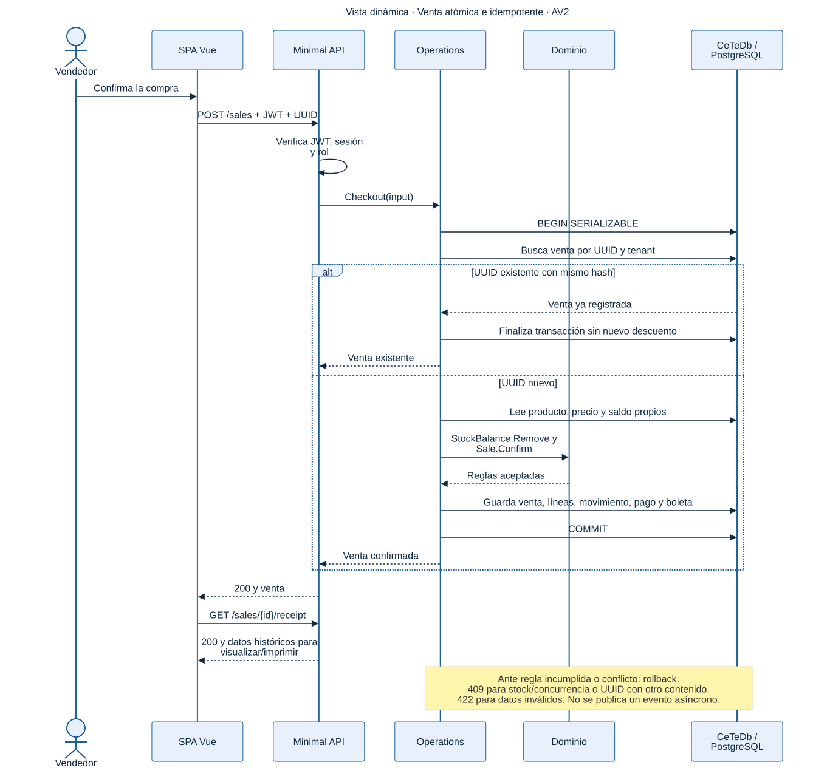

*El UUID identifica la solicitud de venta; el hash distingue un reintento idéntico de una reutilización incompatible. El token de acceso nunca se incluye en el informe.* [Ampliar](diagrams/sequence-checkout.svg) · [Fuente editable](diagrams/sequence-checkout.mmd)

## 4.7. Software Object-Oriented Design

El diseño táctico se evalúa por sus reglas y límites de consistencia. Una tabla o una clase no constituye automáticamente un agregado. Actualmente, `StockBalance`, `Sale` y `Dispatch` encapsulan parte de su estado; las demás entidades mantienen propiedades mutables y varias reglas se coordinan desde `Operations`.

### 4.7.1. Class Diagrams

Los diagramas siguientes muestran **tipos y miembros existentes**, con atributos relevantes para cada operación. `Id` y, salvo `Tenant` y `SubscriptionPlan`, `TenantId` se heredan de `Entity` y `TenantEntity`; no se repiten en todas las cajas. Las asociaciones indican referencias por identificador, no colecciones de navegación ni composición implementada. Los estados marcados `[private set]` tienen lectura pública y escritura restringida.

#### 4.7.1.1. Inventario


*Product identifica y describe el SKU; StockBalance conserva su cantidad por almacén. No existe una clase InventoryItem en la API: ese nombre se conserva en algunos DTO del frontend por compatibilidad.* [Ampliar](diagrams/classes-inventory.svg) · [Fuente editable](diagrams/classes-inventory.mmd)

#### 4.7.1.2. Ventas


*Sale.Confirm calcula el total y Sale.Cancel protege el estado. Operations coordina las líneas, el movimiento, el pago y la boleta en la misma transacción.* [Ampliar](diagrams/classes-sales.svg) · [Fuente editable](diagrams/classes-sales.mmd)

#### 4.7.1.3. Abastecimiento


*Las clases de compra son datos persistentes; la validación de cantidades y el estado parcial se implementan en Operations.Receive. La API actual admite una línea por orden.* [Ampliar](diagrams/classes-procurement.svg) · [Fuente editable](diagrams/classes-procurement.mmd)

#### 4.7.1.4. Logística


*Dispatch.Transition protege las transiciones. DriverName y LicensePlate son instantáneas de texto; aún no son relaciones a los maestros Driver y Vehicle.* [Ampliar](diagrams/classes-logistics.svg) · [Fuente editable](diagrams/classes-logistics.mmd)

### 4.7.2. Agregados, invariantes y responsabilidad

| Límite de consistencia | Regla actual y responsable | Diferencia frente al diseño objetivo |
| :--- | :--- | :--- |
| **Saldo de un SKU en un almacén** | `StockBalance.Receive/Remove`: cantidad positiva; salida no mayor al saldo. Índice único `(TenantId, ProductId, WarehouseId)`. | Candidato a raíz de agregado. Extraer un contrato de inventario para impedir modificaciones ajenas al contexto. |
| **Venta y documentos asociados** | `Sale.Confirm/Cancel` valida total y estado; `Operations.Checkout/CancelSale` coordina detalle, saldo, movimiento, pago y boleta. | La raíz aún no contiene ni controla una colección de líneas. La atomicidad depende del caso de uso y la transacción. |
| **Orden y recepciones** | `Operations.Receive` exige `0 < cantidad ≤ pendiente`; guarda recepción, acumulado y movimiento juntos. | `PurchaseOrder` todavía no encapsula estas reglas. Extraer métodos de dominio y definir recepción de varias líneas antes de ampliar la API. |
| **Despacho y ventas agrupadas** | `Dispatch.Transition` controla estados; `Operations.CreateDispatch` verifica ventas completadas, recursos libres y exclusividad. | La agrupación vive en aplicación. Antes de usar los maestros, incorporar referencias estables a conductor y vehículo. |
| **Acceso de una empresa** | JWT validado contra `UserSession`; roles en endpoints; filtros y FK compuestas por tenant. | `User.Role` gobierna la autorización y también existen `Roles/UserRoles`. Debe definirse una única fuente para futuros cambios de rol. |

**Dinero.** `Rules.Money` redondea a dos decimales con `AwayFromZero`; las columnas decimales usan `numeric(18,2)`. El precio de venta se obtiene del servidor. No existe un objeto de valor `Money` ni cálculo fiscal `CalculateTaxes()` en el código actual.

**Persistencia y concurrencia.** `CeTeDb.Transaction` usa aislamiento serializable. Un conflicto de concurrencia se traduce a HTTP 409 y requiere volver a consultar/reintentar; no se declara un mecanismo automático de reintentos. Las pruebas registradas comprueban que dos ventas de la última unidad producen una confirmación y un conflicto, con saldo final cero.

### 4.7.3. Estados y reglas de transición


*La incidencia se registra desde IN_TRANSIT y permite reanudar la ruta. Las transiciones no dibujadas son rechazadas.* [Ampliar](diagrams/state-dispatch.svg) · [Fuente editable](diagrams/state-dispatch.mmd)

| Entidad | Estados actuales | Regla de transición |
| :--- | :--- | :--- |
| `Sale` | `COMPLETED`, `CANCELLED` | La anulación se realiza una sola vez, repone stock y marca pagos `REVERSED`. Se bloquea si la venta tiene cualquier asignación de despacho. |
| `PurchaseOrder` | `ORDERED`, `PARTIAL`, `RECEIVED` | La recepción aumenta el acumulado; alcanzar lo pedido finaliza la orden. Una orden recibida rechaza otra recepción. |
| `Payment` | `PAID`, `REVERSED` | Registro académico al confirmar/anular venta. No son estados de una pasarela bancaria. |
| `UserSession` | Vigente, vencida o revocada | Se evalúan `ExpiresAt` y `Revoked` al validar el JWT. |

## 4.8. Database Design

### 4.8.1. Esquema físico AV2

El esquema contiene **35 tablas, 182 columnas, 35 claves primarias, 33 claves alternativas por empresa, 67 claves foráneas y ocho índices únicos de negocio**. La comparación del SQL versionado con una exportación estructural de PostgreSQL local coincide en estos elementos. El [diccionario completo](AV2/diccionario-datos.md) detalla cada campo, tipo, nulabilidad, clave y relación.

| Área lógica | Tablas | Capacidad operativa actual |
| :--- | :---: | :--- |
| Identidad y empresa | 7 | Registro, roles, sesiones y empleados. Suscripciones pendientes. |
| Inventario | 8 | Catálogo, saldo, entradas/salidas e historial. Categorías, ubicaciones, variantes y lotes pendientes de flujo completo. |
| Abastecimiento | 5 | Proveedor por nombre, orden de un SKU y recepción parcial. |
| Ventas | 5 | Venta, pago registrado y boleta histórica. Maestro de clientes pendiente. |
| Logística | 7 | Despacho, recursos por texto, estados e incidencias. Maestros, paradas e intentos pendientes. |
| Devoluciones | 2 | Estructura persistente; sin flujo de devolución. |
| Notificaciones | 1 | Estructura persistente; sin generación operativa ni bandeja. |
| **Total** | **35** | **La existencia de una tabla no acredita una funcionalidad completa.** |

**Aislamiento.** Las tablas de empresa incluyen `TenantId`, una FK a `Tenants` y la clave alternativa `(TenantId, Id)`. Las referencias entre ellas usan ambas columnas; así, una fila no puede relacionarse con el identificador de otra empresa. Los filtros EF Core restringen las consultas habituales. El registro, el acceso y la validación de sesiones tienen accesos explícitos que omiten filtros bajo sus comprobaciones específicas; no existe Row-Level Security en PostgreSQL.

**Tipos y eliminación.** Los identificadores son UUID; los importes y cantidades usan `numeric(18,2)`; las fechas usan `timestamp with time zone`. Las FK emplean `ON DELETE RESTRICT`. Archivar un producto cambia `Active` y requiere saldo cero; no borra su historia. Todos los campos son obligatorios salvo `StockLots.ExpiresAt`.

### 4.8.2. Diagramas entidad–relación por área

Los diagramas se derivan de las FK del SQL. `||` significa un padre obligatorio; `o{`, cero o muchos dependientes; `o|`, cero o un dependiente por restricción única. Una FK no exige que una cabecera tenga al menos una línea: ese mínimo lo impone el caso de uso. En las vistas por área se omite el vínculo repetido a `Tenants`, excepto en Identidad; **todas las tablas de empresa conservan esa FK**.

#### 4.8.2.1. Identidad y empresa


*Tenants y SubscriptionPlans son globales. Roles, cuentas, asociaciones y sesiones están delimitados por empresa.* [Ampliar](diagrams/er-identity.svg) · [Fuente editable](diagrams/er-identity.mmd)

#### 4.8.2.2. Inventario


*Categories no tiene vínculo con Products. Variantes y lotes referencian Product, pero no participan todavía en StockBalance ni en InventoryMovement.* [Ampliar](diagrams/er-inventory.svg) · [Fuente editable](diagrams/er-inventory.mmd)

#### 4.8.2.3. Abastecimiento


*Cada recepción referencia una orden; cada línea recibida referencia una línea pedida. El ingreso físico y el movimiento se coordinan en aplicación.* [Ampliar](diagrams/er-procurement.svg) · [Fuente editable](diagrams/er-procurement.mmd)

#### 4.8.2.4. Ventas


*La unicidad de SalesReceipts por venta impone 0..1. Payments admite 0..N en SQL, aunque el caso de uso crea exactamente uno. Customers permanece separado de Sales.* [Ampliar](diagrams/er-sales.svg) · [Fuente editable](diagrams/er-sales.mmd)

#### 4.8.2.5. Logística


*DispatchSales implementa la asociación venta–despacho. El índice único por venta impide asignarla otra vez. Los maestros Drivers y Vehicles no tienen FK hacia Dispatches.* [Ampliar](diagrams/er-logistics.svg) · [Fuente editable](diagrams/er-logistics.mmd)

#### 4.8.2.6. Devoluciones y notificaciones


*Las tablas existen en el esquema; todavía no tienen casos de uso publicados. Notifications solo referencia a la empresa.* [Ampliar](diagrams/er-returns.svg) · [Fuente editable](diagrams/er-returns.mmd)

El [diagrama físico completo](diagrams/er-complete.svg), con [fuente editable](diagrams/er-complete.mmd), reúne las 35 tablas y todas sus FK. Se entrega como vista ampliable; las vistas anteriores son las recomendadas para lectura y sustentación.

### 4.8.3. Integridad y reglas verificables

| Invariante | Protección actual | Evidencia o límite |
| :--- | :--- | :--- |
| Un SKU por empresa | Índice único `(TenantId, Sku)` en `Products`. | Se permiten SKU iguales en empresas distintas. |
| Un saldo por producto y almacén | Índice único `(TenantId, ProductId, WarehouseId)`. | Las cantidades no se almacenan en `Product`. |
| Venta completa o ninguna modificación | Transacción serializable del caso de uso. | Stock insuficiente revierte detalles, pago y boleta. |
| Reintento sin descuento duplicado | `Sales.Id` como PK y `RequestHash` validado por aplicación. | Un UUID con contenido diferente devuelve 409. |
| Boleta única e histórica | UQ por venta y por número; instantáneas en `SalesReceipts` y `SaleLines`. | No tiene validez fiscal ni serie SUNAT. |
| Una venta en un solo despacho | UQ `(TenantId, SaleId)` en `DispatchSales`. | No permite reasignación por eliminación/cancelación en este incremento. |
| Anulación con una sola restitución | `Sale.Cancel`, bloqueo de asignaciones y transacción. | El flujo de devoluciones aún está pendiente. |
| Recepción sin exceder lo pedido | Validación de pendiente y transacción en `Operations.Receive`. | Cantidad recibida, saldo y movimiento se guardan juntos. |

### 4.8.4. Hallazgos y evolución del diseño

La revisión identifica mejoras del código y del esquema que no se resuelven cambiando el diagrama. Se registran como **trabajo pendiente**, sin presentarlas como capacidades actuales.

| Prioridad | Hallazgo concreto | Evolución y criterio de cierre |
| :---: | :--- | :--- |
| Alta | Inicialización con `EnsureCreated`; no hay migraciones versionadas. | Adoptar migraciones EF Core, respaldo y ensayo de actualización conservando datos. |
| Alta | Precios, cantidades y estados no tienen restricciones `CHECK` en SQL. | Incorporar restricciones compatibles con cantidades firmadas de movimientos y con cada máquina de estados; probar inserciones inválidas. |
| Alta | `User.Role` y `UserRoles` representan permisos en dos formas. | Definir una fuente de autorización, sincronizar o retirar la redundancia y probar cambios de rol sobre sesiones vigentes. |
| Alta | Las FK de `GoodsReceiptLines` no garantizan que recepción y línea pertenezcan a la misma orden. | Reforzar el vínculo al diseñar órdenes de varias líneas y probar cruces inválidos. El flujo actual elige la única línea de la orden. |
| Media | Categories, Customers, Drivers y Vehicles no están conectados al flujo que sus nombres sugieren. | Añadir FK y contratos de maestros cuando se implementen esos casos de uso; conservar las instantáneas históricas que correspondan. |
| Media | Lotes, variantes y ubicaciones no intervienen en el saldo. | Definir la unidad de control de stock antes de activar vencimientos, picking o trazabilidad por lote. |
| Media | Movimientos enlazan a su origen mediante `Reason` textual. | Separar motivo y referencia de origen para consultas/auditoría, sin perder registros anteriores. |
| Media | El esquema admite varios pagos y la consulta de boleta espera uno. | Mantener explícito el pago único o implementar pagos divididos con suma y estados consistentes. |
| Media | Repositorio genérico y lecturas completas sin paginación. | Extraer consultas por contexto, filtrar/agrupar en SQL y medir con volúmenes representativos. |
| Media | Entidades mayormente mutables y reglas dispersas en `Operations`. | Encapsular compras y agrupaciones; proteger colecciones y probar invariantes desde el dominio. |

### 4.8.5. Fuentes de diseño y trazabilidad

La notación emplea los niveles de [C4](https://c4model.com/diagrams) y sus [recomendaciones de lectura](https://c4model.com/diagrams/notation). Los límites de responsabilidad se contrastan con la [guía de análisis de dominio](https://learn.microsoft.com/en-us/azure/architecture/microservices/model/domain-analysis); su uso aquí no implica adoptar microservicios. Las FK compuestas siguen las posibilidades de [EF Core](https://learn.microsoft.com/en-us/ef/core/modeling/relationships/foreign-and-principal-keys) y los ER usan [notación Mermaid](https://mermaid.js.org/syntax/entityRelationshipDiagram.html).

Las fuentes del proyecto son [entidades](https://github.com/Nexxus-ops/CeTe-Api/blob/codex/av2-corrections/Domain/Entities.cs), [casos de uso](https://github.com/Nexxus-ops/CeTe-Api/blob/codex/av2-corrections/Application/Operations.cs), [puertos](https://github.com/Nexxus-ops/CeTe-Api/blob/codex/av2-corrections/Application/Ports.cs), [endpoints](https://github.com/Nexxus-ops/CeTe-Api/blob/codex/av2-corrections/Program.cs), [mapeo EF Core](https://github.com/Nexxus-ops/CeTe-Api/blob/codex/av2-corrections/Infrastructure/CeTeDb.cs) y [esquema SQL](https://github.com/Nexxus-ops/CeTe-Api/blob/codex/av2-corrections/schema.sql). El [registro de revisión del informe](AV2/revision-informe.md) resume las correcciones documentales y los asuntos que requieren acuerdo del equipo.
