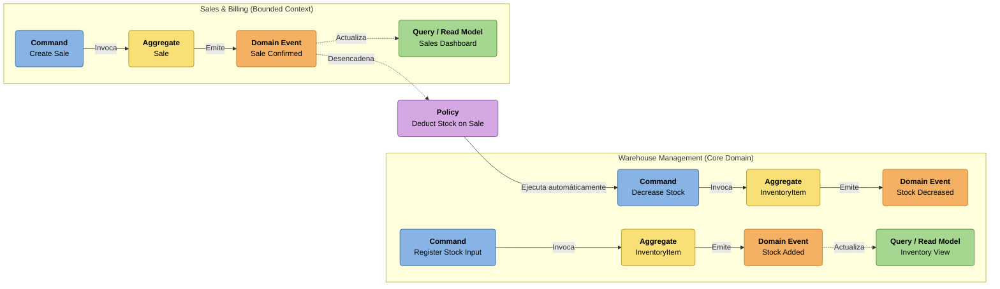
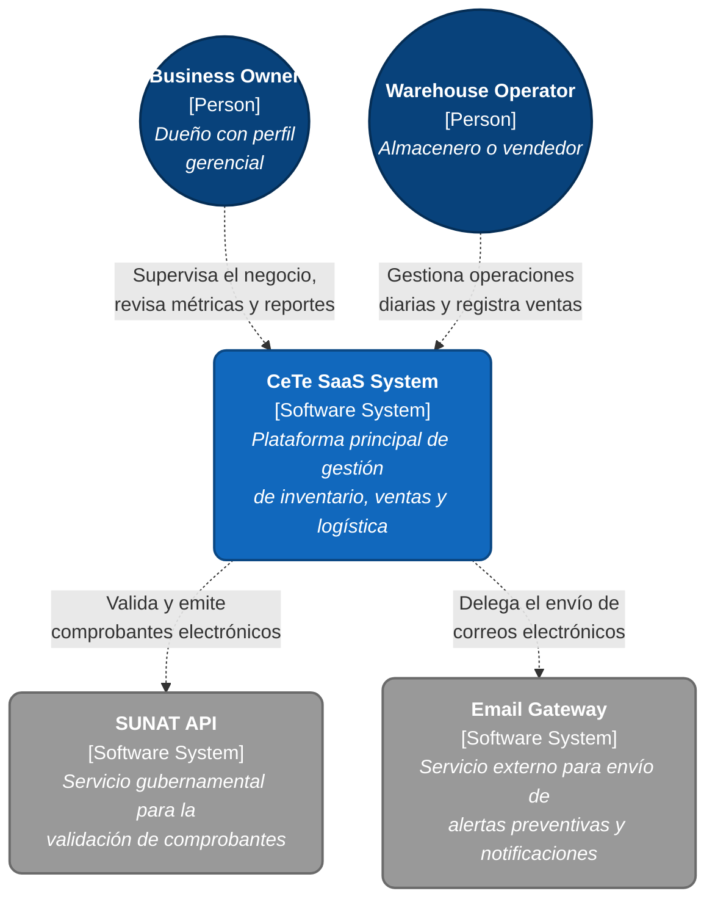
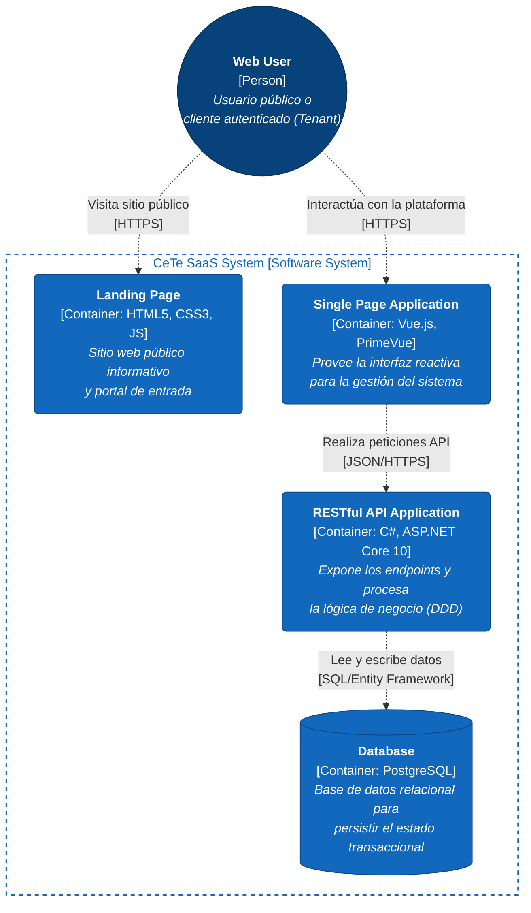
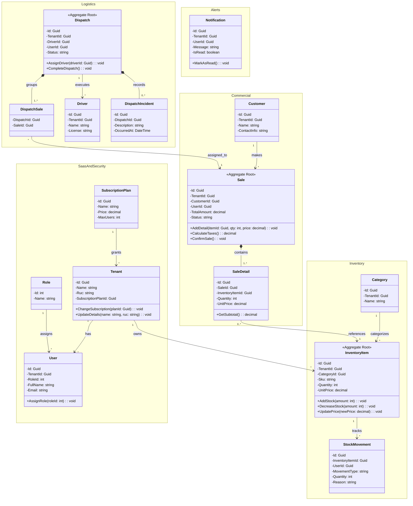
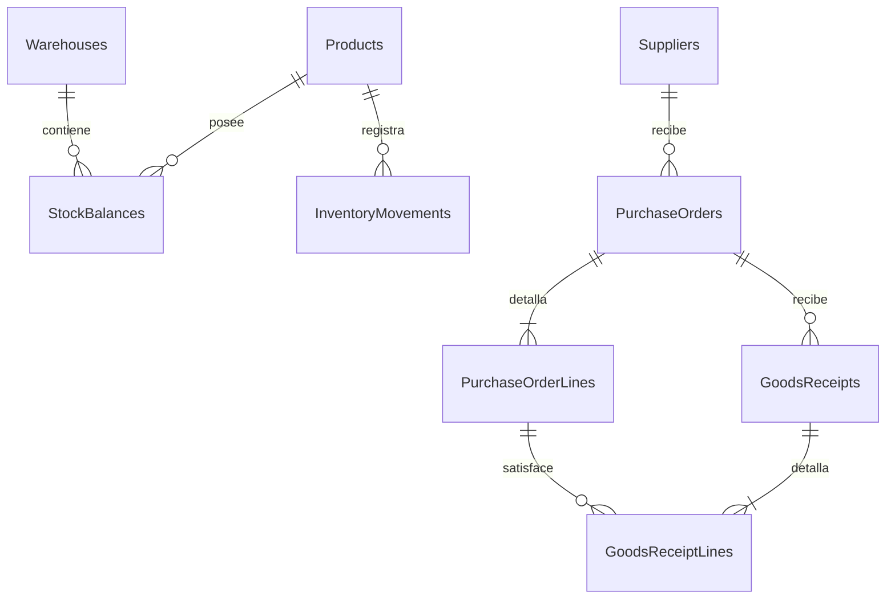
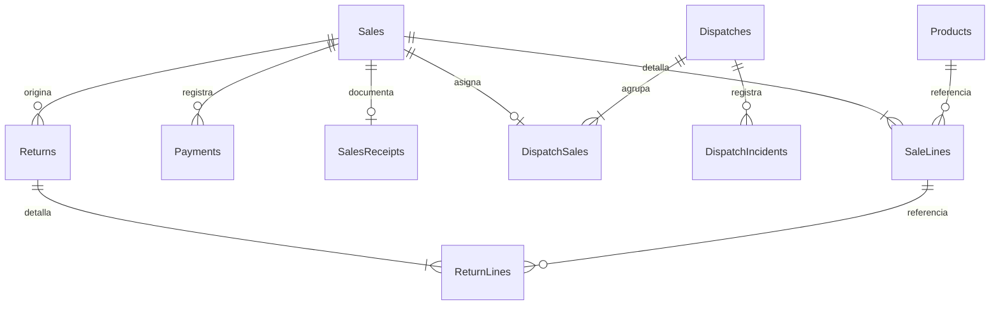

# Capítulo IV: Product Design

En este capítulo detallamos las directrices visuales, arquitectónicas y de experiencia de usuario que guiarán el desarrollo de CeTe. El diseño se fundamenta en heurísticas de usabilidad estandarizadas, garantizando una curva de aprendizaje mínima y alta eficiencia operativa.

## 4.1. Style Guidelines

Para mantener la consistencia visual y técnica en todo el ecosistema (Landing Page y Web Application), hemos definido un *Design System* centralizado, apoyándonos en librerías de componentes estandarizadas para agilizar el desarrollo frontend.

### 4.1.1. General Style Guidelines

Nuestras decisiones de diseño a nivel general se sustentan en la heurística de "Consistencia y estándares", asegurando que la interfaz transmita confianza y productividad en todo momento.

**4.1.1.1. Brand & Tono de Comunicación**

Al ser CeTe una herramienta B2B que maneja datos logísticos y financieros vitales, nuestra comunicación se rige por las siguientes cuatro dimensiones:
* **Seria:** Enfocada en la productividad y en resolver problemas de negocio sin distracciones.
* **Formal:** Transmite el profesionalismo y la seguridad necesarios para ganarnos la confianza de los dueños de negocios.
* **Respetuosa:** Valora el tiempo y el esfuerzo de nuestros usuarios operativos (almaceneros, logísticos).
* **Serena:** Mantiene una interfaz limpia, sin sobreestimulación, reduciendo la carga cognitiva en tareas estresantes.

**4.1.1.2. Typography**

La tipografía de CeTe ha sido definida con el objetivo de mantener una interfaz clara y profesional:
* **Montserrat (Pesos 600 y 700):** Utilizada estrictamente para encabezados (h1, h2, h3). Transmite solidez, modernidad e impacto corporativo.
* **Roboto (Pesos 300, 400 y 500):** Seleccionada para el cuerpo de texto y las tablas de datos. Esta fuente *sans-serif* ofrece una altísima legibilidad en pantallas densas, ideal para leer listados largos de inventario.

**4.1.1.3. Colors (Paleta Corporativa B2B)**

La paleta de colores de CeTe transmite estabilidad y guía el flujo operativo del usuario mediante altos contrastes:
* **Primary Blue (`#0A2540`):** Azul marino oscuro y elegante. Denota estabilidad, seguridad de la información y profesionalismo corporativo.
* **Secondary Blue (`#204066`):** Utilizado para fondos secundarios y jerarquización visual de componentes.
* **Accent Orange (`#FF6A00`):** Un naranja vibrante, reservado estrictamente para llamar la atención en *Call-to-Actions* (CTAs) y botones principales.
* **Backgrounds (`#F6F9FC` & `#FFFFFF`):** Tonos muy claros y neutros para mantener la limpieza visual del sistema.
* **Semantic Colors:** Colores de estado para retroalimentación. Rojo para errores o quiebres de stock (*Stock Out*), y Verde para confirmaciones o transacciones exitosas.

### 4.1.2. Web Style Guidelines

Adoptaremos un sistema de grillas fluidas basadas en Flexbox/CSS Grid. Haremos un uso intensivo de *Cards* para agrupar información lógicamente y *Data Tables* para manejar los altos volúmenes de registros de la MYPE. Asimismo, todos los elementos interactivos tendrán estados *hover* y *focus* claramente definidos, previniendo errores de accesibilidad.

## 4.2. Information Architecture

La arquitectura de información está diseñada para que tanto los usuarios operativos como los gerentes encuentren lo que necesitan con el menor número de clics posible, reduciendo drásticamente la fricción tecnológica.

### 4.2.1. Organization Systems

Aplicaremos diferentes esquemas de organización dependiendo de la vista y la intención del usuario:
* **Organización Jerárquica:** Utilizada en el menú lateral (*Sidebar*). Los módulos principales (Inventario, Ventas, Reportes) revelan submódulos de acción específica (Ingresos, Salidas).
* **Organización Matricial:** Aplicada en las tablas de inventario del núcleo operativo, cruzando y ordenando variables clave como SKU, cantidad y estado.
* **Organización Secuencial:** Empleada en flujos de trabajo críticos, como la elaboración del Manifiesto de Despacho, guiando al operario paso a paso para prevenir omisiones.

### 4.2.2. Labeling Systems

Para asegurar la claridad, nuestras etiquetas reflejan fielmente el **Ubiquitous Language** del dominio operativo, evitando jergas técnicas:
* En lugar del genérico "Crear un nuevo ítem", usaremos la etiqueta directa **"Registrar Entrada"**.
* En lugar de "Módulo de envíos", usaremos **"Despacho y Trazabilidad"**.
* Los botones de confirmación tendrán etiquetas precisas sobre la acción exacta, por ejemplo: **"Aprobar Manifiesto"**.

### 4.2.3. SEO Tags and Meta Tags

Para la optimización de motores de búsqueda (SEO) y accesibilidad de nuestro Landing Page, hemos configurado los siguientes metadatos, cumpliendo con los estándares de diseño inclusivo y buenas prácticas web:

  
   <em>Nota. Metadatos configurados para el posicionamiento orgánico (SEO) de CeTe.</em>

### 4.2.4. Searching Systems

Dada la cantidad de mercadería que maneja una MYPE, el sistema de búsqueda es un pilar fundamental de la usabilidad operativa en CeTe.

| Criterio | Descripción |
| :--- | :--- |
| **Búsqueda Global** | Ubicada en la barra superior. Permite localizar un producto en segundos escaneando su código de barras o escribiendo su SKU/nombre. |
| **Búsqueda Facetada (Filtros)** | Integrada en las tablas de datos, permite aplicar filtros simultáneos y combinados (ej. filtrar por categoría y estado de stock). |
| **Presentación de Resultados** | Muestra resultados en tiempo real con resaltado visual del término buscado. Incluye mensajes claros de *"Not Found"* para evitar confusión. |

<em>Nota. La tabla detalla los mecanismos de búsqueda diseñados para acelerar las tareas de los operarios de almacén.</em>

### 4.2.5. Navigation Systems

El recorrido del usuario estará soportado por elementos de navegación predecibles y persistentes, ajustados al contexto de la aplicación.

| Nombre | Descripción |
| :--- | :--- |
| **Top App Bar (Landing Page)** | Navegación superior anclada (*sticky*). Contiene enlaces ancla hacia las secciones informativas y CTAs persistentes ("Prueba Gratis"). |
| **Side Navigation Drawer (Web App)** | Menú lateral izquierdo colapsable. Su diseño permite maximizar el espacio útil en pantalla, vital para la revisión de tablas de datos. |

<em>Nota. La tabla muestra los sistemas de navegación principales para visitantes y usuarios autenticados.</em>

## 4.3. Landing Page UI Design

En esta sección presentamos el diseño de interfaz de usuario para el Landing Page de CeTe. La propuesta visual prioriza la heurística de "Diseño estético y minimalista", asegurando una propuesta de valor clara orientada a la conversión B2B.

### 4.3.1. Landing Page Wireframe

Nuestros wireframes establecen la jerarquía estructural. El *Hero Section* ataca directamente el dolor del cliente y la estructura modular se adapta de manera nativa a dispositivos móviles.

**Wireframes Desktop de la Landing Page**

  

  

  

  

**Wireframes Mobile de la Landing Page**

  
  

  
  

### 4.3.2. Landing Page Mock-up

Los mock-ups de alta fidelidad aplican nuestro *Design System*. Se evidencia el uso de botones `.btn-primary` (Naranja) sobre fondos oscuros o claros, cumpliendo con los estándares de contraste WCAG para diseño inclusivo.

**Mockups Desktop de la Landing Page**

  

  

  

  

**Mockups Mobile de la Landing Page**

  
  

  
  

## 4.4. Web Applications UX/UI Design

El diseño de la aplicación web interna centra su enfoque en la eficiencia del usuario operativo, minimizando la carga de memoria (reconocer en lugar de recordar) y aplicando una fuerte prevención de errores.

### 4.4.1. Web Applications Wireframes

Se implementó una arquitectura con *Sidebar* colapsable y una amplia área central, con el propósito de maximizar el espacio útil en pantalla, un factor vital al momento de revisar listados extensos de SKUs.

  
   <em>Nota. Distribución estructural y de controles de la aplicación web.</em>

### 4.4.2. Web Applications Wireflow Diagrams

Los wireflows organizan la secuencia de pantallas que recorre el usuario para alcanzar un objetivo dentro de la aplicación web de CeTe. El registro de elaboración incluye estos artefactos, cuya revisión permite relacionar las acciones del usuario con los cambios representados en las interfaces.

Entre los recorridos centrales de CeTe se consideran:

| Wireflow | Usuario y objetivo | Secuencia funcional de referencia |
| :--- | :--- | :--- |
| **W1** | Administrador o trabajador: registrar una entrada de inventario | Acceder al módulo Almacén → seleccionar “Registrar Entrada” → completar código SKU, descripción y cantidad → guardar entrada → visualizar inventario actualizado. |
| **W2** | Administrador: eliminar un producto | Acceder al módulo Almacén → consultar listado de artículos → seleccionar ícono de eliminar → revisar mensaje de confirmación → confirmar eliminación o cancelar → visualizar listado actualizado. |
| **W3** | Administrador o trabajador: consultar ventas | Acceder al menú lateral → seleccionar “Ventas” → visualizar módulo de ventas → consultar las funciones disponibles para registrar o revisar ventas. |
| **W4** | Administrador o trabajador: consultar despachos | Acceder al menú lateral → seleccionar “Despachos” → visualizar módulo de rutas y despachos → consultar las funciones disponibles para organizar y realizar seguimiento de las salidas. |
| **W5** | Administrador: consultar reportes | Acceder al menú lateral → seleccionar “Reportes” → visualizar módulo de balance e inteligencia → consultar información sobre compras, ventas y rentabilidad. |
| **W6** | Administrador o trabajador: revisar notificaciones | Acceder al dashboard de inventario → seleccionar ícono de notificaciones → visualizar panel de notificaciones → revisar alertas de stock y nuevas entradas registradas. |

**W1. Registrar una entrada de inventario**
El usuario accede al módulo Almacén y selecciona la opción “Registrar Entrada”. Luego completa el código SKU, la descripción del producto y la cantidad a ingresar. Finalmente, guarda la entrada para actualizar el inventario.

**W2. Eliminar un producto**
El administrador consulta el listado de artículos y selecciona el ícono de eliminar. El sistema muestra una ventana de confirmación para evitar eliminaciones accidentales. El usuario puede cancelar la acción o confirmar la eliminación.

**W3. Consultar ventas**
El usuario selecciona la opción “Ventas” desde el menú lateral. El sistema muestra el módulo de ventas, donde se podrán consultar y gestionar las operaciones relacionadas con las ventas del negocio.

**W4. Consultar despachos**
El usuario selecciona la opción “Despachos” desde el menú lateral. El sistema muestra el módulo de rutas y despachos, destinado a organizar las salidas y realizar el seguimiento de los productos.

**W5. Consultar reportes**
El administrador selecciona la opción “Reportes” desde el menú lateral. El sistema muestra el módulo de balance e inteligencia, donde se podrá consultar información sobre las compras, ventas y rentabilidad del negocio.

**W6. Revisar notificaciones**
El usuario accede al dashboard de inventario y selecciona el ícono de notificaciones. El sistema muestra alertas relacionadas con quiebres de stock y nuevas entradas registradas.

### 4.4.3. Web Applications Mock-ups

Los mockups de CeTe presentan la propuesta visual de la aplicación web para la gestión de inventario. La interfaz incluye la landing page, el dashboard de almacén, los módulos de ventas, despachos y reportes, el registro de entradas, la confirmación de eliminación y el panel de notificaciones.

El diseño utiliza un menú lateral de navegación, tarjetas de resumen, tablas de productos, botones de acción y alertas visuales. Los estados del inventario se diferencian como óptimo, alerta y quiebre de stock, lo que permite identificar rápidamente los productos que requieren atención.

La siguiente imagen muestra el conjunto de mockups desarrollados para CeTe:

  

### 4.4.4. Web Applications User Flow Diagrams

El diagrama de flujo de usuario es una representación visual de los pasos que un usuario sigue al interactuar con una aplicación o sitio web. Muestra la secuencia de acciones que el usuario realiza para completar una tarea específica, lo que nos ayuda a identificar posibles puntos de fricción y a optimizar la experiencia del usuario.

**Leyenda:**

**Flujo de Usuario:**
Empieza con el usuario ingresando a la página de inicio de CeTe Workspace. Aquí determina si es "Administrador" o "Colaborador".

**Flujo de Administrador:**
El usuario Administrador puede acceder a su perfil, visualizar el panel de control de la MYPE, asignar tareas a sus colaboradores, y acceder a las herramientas de reportes y administración.

**Flujo de Colaborador:**
El usuario Colaborador puede acceder a su perfil, ver los proyectos o tareas asignadas, registrar su avance diario, y acceder a las herramientas operativas de su espacio de trabajo.

**Vista general del flujo de usuario:**

### 4.5. Web Applications Prototyping

Nuestro prototipo navegable fue construido íntegramente en Figma, configurando estados reactivos y modales interactivos para brindar retroalimentación inmediata, simulando con precisión el comportamiento ágil de una SPA (*Single Page Application*).

## 4.6. Domain-Driven Software Architecture

A partir del entendimiento general del negocio logrado en el Big Picture Event Storming, hemos profundizado en la arquitectura del software aplicando Domain-Driven Design (DDD). En esta sección presentamos la transición de los eventos de negocio hacia artefactos de software concretos y su representación estructural utilizando el Modelo C4. El incremento incorpora una primera API C# con ASP.NET Core 10, EF Core y PostgreSQL. Los diagramas de detalle representan el diseño objetivo. El código actual separa Domain, Application e Infrastructure y debe consolidar los límites por bounded context.

## 4.6.1. Design-Level Event Storming

El equipo llevó a cabo una sesión de Design-Level Event Storming para refinar los eventos descubiertos y agruparlos lógicamente. Identificamos los Commands (acciones, notas azules) que disparan los eventos, los Aggregates (entidades de dominio, notas amarillas) que validan las reglas, y las Queries (notas verdes) necesarias para renderizar la UI.

A partir de este análisis, definimos los Bounded Contexts principales del sistema:

* **Warehouse Management (Core Domain):** Gobierna el control de stock, ingresos, salidas y mermas.
* **Sales & Billing:** Administra el ciclo de vida de las transacciones comerciales.

*Nota. Representación del tablero de Design-Level Event Storming ilustrando el flujo desde los comandos hasta la actualización de los modelos de lectura, separados por Bounded Context y conectados mediante una Política (Policy).*

## 4.6.2. Software Architecture Context Diagram

En esta sección se presenta el diagrama de contexto correspondiente al Nivel 1 del Modelo C4. El propósito es ilustrar a CeTe en el centro de su entorno, interactuando con actores y sistemas externos.

* **Usuarios:** Business Owner (dueño con perfil gerencial) y Warehouse Operator (almacenero o vendedor).

* **Sistemas Externos:** El ecosistema se integra con la SUNAT API (para la validación de comprobantes) y con un Email Gateway (para envío de alertas preventivas).

*Nota. Diagrama de Contexto del Sistema elaborado aplicando el Modelo C4.*

## 4.6.3. Software Architecture Container Diagrams

El Diagrama de Contenedores (Nivel 2 del Modelo C4) descompone el sistema central en unidades de despliegue independientes, reflejando nuestras decisiones tecnológicas:

* **Landing Page:** Frontend estático público (HTML5, CSS3, JS).

* **Single Page Application (Frontend Container):** Desarrollada con Vue.js y PrimeVue. Provee la interfaz reactiva y se comunica asíncronamente vía JSON/HTTPS.

* **RESTful API Application (Backend Container):** Desarrollada en C# con ASP.NET Core 10. Este contenedor expone los Endpoints y procesa la lógica de negocio orientada a dominio.

* **Database Container:** Base de datos relacional (PostgreSQL) para persistir el estado transaccional del sistema.

*Nota. Diagrama de Contenedores ilustrando el stack tecnológico de CeTe.*

## 4.6.4. Software Architecture Components Diagrams

El Diagrama de Componentes (Nivel 3 del Modelo C4) hace un acercamiento al interior del contenedor del RESTful API (C#). Este diagrama muestra el flujo de ejecución: las peticiones HTTP entrantes son interceptadas por el SecurityMiddleware, canalizadas hacia un InventoryController (API endpoint), procesadas por el InventoryService (lógica de dominio) y finalmente persistidas utilizando el InventoryRepository (apoyado robustamente en Entity Framework Core).

```mermaid
flowchart LR
    SPA["<b>Single Page Application</b><br/>[Container: Frontend]<br/><i>Interfaz de usuario responsiva</i>"]
    
    subgraph API ["RESTful API Application [Container]"]
        direction LR
        MW["<b>SecurityMiddleware</b><br/>[Component: .NET Core Auth]<br/><i>Valida autenticación y tokens JWT</i>"]
        CTRL["<b>InventoryController</b><br/>[Component: C# REST Controller]<br/><i>Recibe peticiones HTTP GET/POST para el almacén</i>"]
        SVC["<b>InventoryService</b><br/>[Component: C# Service]<br/><i>Aplica lógica y validaciones de negocio</i>"]
        REPO["<b>InventoryRepository</b><br/>[Component: Entity Framework Core]<br/><i>Mapea objetos y ejecuta consultas</i>"]
        
        MW -->|"Pasa peticiones<br/>autorizadas"| CTRL
        CTRL -->|"Invoca métodos<br/>del dominio"| SVC
        SVC -->|"Persiste o consulta<br/>información"| REPO
    end
    
    DB[("<b>Database</b><br/>[Container: PostgreSQL]<br/><i>Almacena el estado relacional de<br/>inventarios y transacciones</i>")]

    SPA -.->|"Envía peticiones HTTP cifradas<br/>con Bearer Token"| MW
    REPO -.->|"Ejecuta consultas<br/>SQL / ORM"| DB

    %% C4 Model Styling
    classDef container fill:#1168bd,stroke:#0b4884,color:#ffffff,rx:5px,ry:5px
    classDef component fill:#85bbf0,stroke:#5b93c5,color:#000000,rx:5px,ry:5px
    classDef database fill:#1168bd,stroke:#0b4884,color:#ffffff
    classDef boundary fill:#ffffff,stroke:#1168bd,stroke-width:2px,color:#1168bd

    class SPA container
    class MW,CTRL,SVC,REPO component
    class DB database
    class API boundary

```

*Nota. Diagrama de Componentes del Backend API de CeTe.*

## 4.7. Software Object-Oriented Design

En esta sección detallamos cómo los conceptos identificados en el DDD (Domain-Driven Design) se traducen en código C#. El diseño orientado a objetos en CeTe protege rigurosamente los invariantes encapsulando el estado y exponiendo únicamente métodos con significado de dominio.

### 4.7.1. Class Diagrams

Los Diagramas de Clases UML mapean de manera precisa nuestras entidades del backend, respetando la separación por *Bounded Contexts*. 

Como regla general de nuestra arquitectura, las propiedades de estado utilizan el modificador de acceso privado `-` (implementado como `{ get; private set; }` en C#) para evitar mutaciones externas directas. Las interacciones con las entidades se realizan exclusivamente a través de métodos públicos `+` ricos en significado de dominio (ej. `AddStock(int amount)` o `CalculateTaxes()`), los cuales evalúan las reglas lógicas internamente antes de alterar el estado.

A continuación, se presenta el modelo de dominio principal:

## 4.8. Database Design

### 4.8.1. Esquema físico AV2

PostgreSQL contiene **35 tablas**, exportadas en [schema.sql](https://github.com/Nexxus-ops/CeTe-Api/blob/codex/av2-corrections/schema.sql). La ampliación agrega trazabilidad de compras, recepciones, stock, sesiones y comprobantes. La cantidad de tablas no sustituye la validación de relaciones ni acredita todos los flujos.

| Contexto lógico | Tablas físicas | Alcance actual |
| :--- | :--- | :--- |
| Identidad y empresa (7) | Tenants, SubscriptionPlans, TenantSubscriptions, Users, Roles, UserRoles, UserSessions | Registro, roles y sesiones operativos. Suscripción pendiente. |
| Inventario (8) | Warehouses, Locations, Categories, Products, ProductVariants, StockLots, StockBalances, InventoryMovements | Catálogo, saldo y movimientos operativos. Lotes, variantes y ubicaciones pendientes de flujo completo. |
| Abastecimiento (5) | Suppliers, PurchaseOrders, PurchaseOrderLines, GoodsReceipts, GoodsReceiptLines | Orden de un SKU y recepción física parcial operativos. |
| Ventas (5) | Customers, Sales, SaleLines, Payments, SalesReceipts | Venta, pago registrado y boleta operativos. Maestro de clientes pendiente. |
| Logística (7) | Drivers, Vehicles, Dispatches, DispatchSales, DispatchStops, DeliveryAttempts, DispatchIncidents | Despacho, recursos por nombre/placa, estados e incidencias operativos. Maestros, paradas e intentos pendientes. |
| Devoluciones (2) | Returns, ReturnLines | Modelo persistido. Flujo pendiente. |
| Notificaciones (1) | Notifications | Modelo persistido. API y bandeja pendientes. |

Las entidades de empresa comparten TenantId. Los filtros toman el tenant de la sesión. Las relaciones usan claves foráneas compuestas (TenantId, Id). Los índices únicos cubren SKU por empresa, saldo por producto/almacén, boleta por venta y exclusividad de venta en despacho.

### 4.8.2. Relaciones transaccionales

### 4.8.3. Invariantes y evolución

Crear una orden no modifica stock. La recepción física registra cabecera, líneas y movimiento juntos. Una venta confirma todas sus líneas o revierte todo. El servidor calcula precios y total. Dos ventas de la última unidad producen una confirmación y un conflicto 409, con stock final cero.

Un UUID repetido no descuenta dos veces. La anulación repone stock una sola vez. La boleta conserva la instantánea comercial y sus líneas conservan nombre, SKU y precio históricos.

Los modelos de expansión no se presentan como flujos terminados. Las siguientes evoluciones requieren migraciones versionadas y respaldo. La inicialización actual prepara una base vacía.
