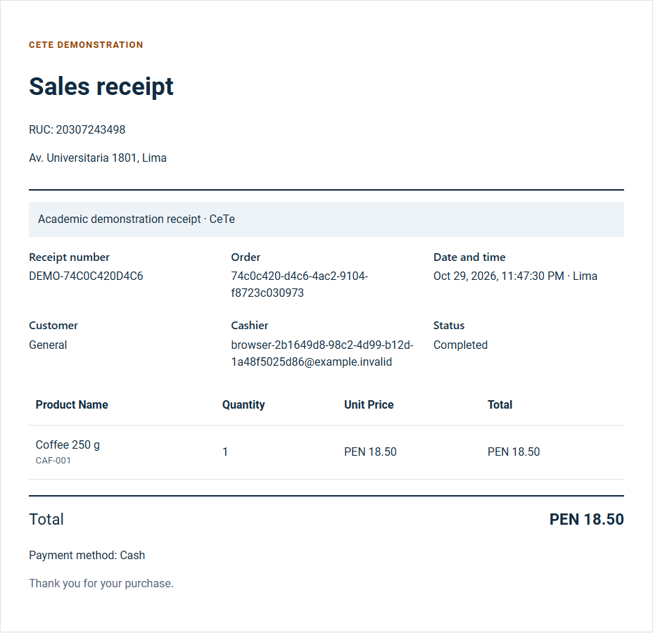

# Capítulo V: Product Implementation, Validation & Deployment

[Configuración](#51-software-configuration-management) · [Sprint 1](#521-sprint-1) · [Sprint 2](#522-sprint-2) · [Sprint 3 / AV2](#523-sprint-3--consolidación-av2) · [Validación](#53-validation-interviews)

## 5.1. Software Configuration Management

La Gestión de Configuración de Software (SCM) es la disciplina que permite identificar, controlar, versionar y auditar los distintos componentes de un sistema durante todo su ciclo de vida. Su aplicación asegura la trazabilidad de los cambios realizados sobre el código fuente, la documentación y los artefactos de diseño, reduciendo la probabilidad de errores de integración y facilitando el trabajo colaborativo del equipo.

En el caso de **CeTe**, la solución está compuesta por una Landing Page informativa, una Frontend Web Application y un RESTful API de elaboración interna. Durante el **Sprint 1** se priorizó la implementación, validación y despliegue de la primera versión de la **Landing Page**, desarrollada con HTML5, CSS3 y JavaScript (ES6+), manteniendo un comportamiento 100% responsive y sin dependencias de frameworks externos.

### 5.1.1. Software Development Environment Configuration

A continuación se listan los productos de software utilizados por el equipo, organizados por tipo de actividad del ciclo de vida. Para cada herramienta se indica su propósito dentro de CeTe y la ruta de referencia o descarga.

**1. Project Management**

*Descripción:* La gestión del proyecto permite organizar las actividades necesarias para alcanzar los objetivos del Sprint, asignar responsables, dar seguimiento al avance y mantener la comunicación entre los integrantes del equipo.

**Jira Software / Trello:**
Utilizado para la gestión del Product Backlog, Sprint Backlog y el seguimiento de las User Stories y Technical Stories. ([Atlassian](https://www.atlassian.com/software/jira))

  

**Google Meet & WhatsApp:**
Empleados para las ceremonias formales de Scrum (Daily, Planning, Review) y como canales de comunicación asincrónica para coordinar avances diarios.

  
  

**2. Requirements Management**

**UXPressia:**
Utilizado para la elaboración de los User Personas, Empathy Maps, Journey Maps e Impact Maps, facilitando la identificación de necesidades de los dueños de MYPEs y operarios logísticos. ([UXPressia](https://uxpressia.com/))

  

**3. Product UX/UI Design**

**Figma:**
Herramienta de diseño colaborativo en la nube empleada para elaborar los wireframes, mockups y el prototipo interactivo de CeTe, documentando nuestro Design System. ([Figma](https://www.figma.com/))

  

**4. Software Development**

**Visual Studio Code / WebStorm:**
Editores principales para el desarrollo Frontend (HTML, CSS, JS, Vue.js). La configuración de formato se estandariza mediante el archivo `.editorconfig`. ([VS Code](https://code.visualstudio.com/))

  

**Visual Studio 2022 / JetBrains Rider:**
Entornos de desarrollo integrados (IDE) robustos utilizados para la programación del Backend en C# con .NET 8.

  

**HTML5 / CSS3 / JavaScript (ES6+):**
Tecnologías base de la Landing Page desplegada en el Sprint 1.

  
  
  

**Vue.js & PrimeVue:**
Framework progresivo y biblioteca de componentes seleccionados para el desarrollo de la Single Page Application (Web App de Inventario y Ventas).

  

**ASP.NET Core & C#:**
Framework y lenguaje utilizados para el desarrollo del RESTful API de CeTe, responsable de la lógica de negocio orientada a dominio (DDD).

  

**Entity Framework Core & PostgreSQL:**
ORM y base de datos relacional definidos para almacenar el estado transaccional, inventario y métricas de CeTe.

  

**Git & GitHub:**
Sistema de control de versiones y plataforma de colaboración para alojar repositorios, aplicar GitFlow y Pull Requests.

  

**5. Software Deployment**

**GitHub Pages:**
Servicio de alojamiento estático utilizado para publicar la primera versión de la Landing Page de CeTe directamente desde la rama `main`.

  

### 5.1.2. Source Code Management

La administración del código fuente es un pilar del trabajo colaborativo del equipo. En este apartado se define el modelo organizativo y de control de versiones aplicado mediante GitHub y el flujo de trabajo GitFlow.

**1. Establecimiento de repositorios en GitHub**

La solución distribuida de CeTe se organiza en repositorios independientes:
* **Landing Page:** Repositorio dedicado al sitio web promocional del producto.
* **Frontend Web Application:** Repositorio destinado a la aplicación web (Vue.js).
* **RESTful API:** Repositorio que aloja la lógica del backend (ASP.NET Core).
* **Project Report:** Repositorio destinado a la redacción del informe en Markdown.

**2. Workflow de control de versiones (GitFlow)**

| Nombre de la rama | Descripción |
| :--- | :--- |
| **Main Branch** (`main`) | Rama base que refleja el estado de producción. Es la rama publicada por GitHub Pages. |
| **Develop Branch** (`develop`) | Rama de integración del equipo. Unifica el código de las funcionalidades en curso. |
| **Feature Branches** (`feature/*`) | Ramas temporales para desarrollar funcionalidades aisladas.   **Convención:** `feature/nombre-de-la-funcionalidad` |
| **Release Branches** (`release/*`) | Ramas de estabilización previas al pase a producción.   **Convención:** `release/vX.Y.Z` |

**3. Versionado Semántico (Semantic Versioning 2.0.0)**

CeTe adopta el estándar **Semantic Versioning 2.0.0** (`MAJOR.MINOR.PATCH`).
* Ejemplo: `v1.0.0` (Primera versión desplegada de la Landing Page).

**4. Convenciones de mensajes de commit (Conventional Commits)**

* `feat:` incorpora una funcionalidad nueva.
* `fix:` corrige un error.
* `docs:` modifica exclusivamente documentación.
* `style:` aplica ajustes de formato visual.
* `refactor:` reestructura código existente sin añadir funcionalidades.
* `chore:` tareas de mantenimiento y configuración.

### 5.1.3. Source Code Style Guide & Conventions

Como regla transversal, **toda la nomenclatura técnica (identificadores, clases, variables, funciones y métodos) se redacta exclusivamente en inglés**.

**HTML & CSS**
* Indentación de 2 espacios.
* Uso de metodología **BEM** (Block, Element, Modifier) para las clases CSS.
* Uso de *Custom Properties* (`:root`) para la paleta de colores corporativa (Primary Blue, Accent Orange).

**C# (.NET Core)**
* Indentación de 4 espacios.
* Nomenclatura `PascalCase` para clases y métodos (`StockBalance`, `Receive`), `camelCase` para variables locales.
* Aplicación estricta de inyección de dependencias y programación asíncrona (`Async`).

### 5.1.4. Software Deployment Configuration

La configuración actual de AV2 utiliza Render para las tres aplicaciones públicas y PostgreSQL administrado. GitHub Pages corresponde al despliegue histórico de la landing documentado en Sprint 1.

| Producto | Construcción y ejecución | Publicación AV2 |
| :--- | :--- | :--- |
| Landing | Archivos estáticos HTML, CSS y JavaScript. | [Static Site en Render](https://cete-landing-av2.onrender.com/). |
| Frontend | Vue/Vite: instalación desde lockfile y compilación a `dist`; navegación por hash. | [Static Site en Render](https://cete-web-av2.onrender.com/). |
| API | Imagen Docker con ASP.NET Core 10, configuración de CORS, JWT y conexión por variables de entorno. | [Web Service en Render](https://cete-api-av2.onrender.com/swagger). |
| Base de datos | PostgreSQL 17; conexión interna desde la API. | Instancia administrada Free con vencimiento registrado en 5.2.3.7. |

En desarrollo, Docker Compose levanta API y PostgreSQL; frontend y landing se ejecutan con sus servidores locales. Docker empaqueta el servicio y Render proporciona alojamiento público. Las credenciales se guardan fuera de Git; los archivos de ejemplo contienen solo nombres y valores de referencia. El [README de la API](https://github.com/Nexxus-ops/CeTe-Api/blob/codex/av2-corrections/README.md) incluye el procedimiento reproducible.

La [vista de despliegue](04-Chapter-4.md#463-software-architecture-container-diagrams) muestra comunicaciones y responsabilidades. Los resultados de construcción, ejecución y persistencia se registran en la [verificación AV2](AV2/verificacion.md); la configuración por sí sola no acredita disponibilidad ni alta disponibilidad.

## 5.2. Landing Page, Services & Applications Implementation

### 5.2.1. Sprint 1

Durante el Sprint 1, el equipo de Nexxus se concentró en la implementación y despliegue de la primera versión funcional y responsive de la Landing Page de CeTe, diseñada para captar a nuestro público objetivo (Dueños de MYPEs y Operarios).

#### 5.2.1.1. Sprint Planning 1

| Sprint # | Sprint 1 |
| :--- | :--- |
| **Sprint Planning Background** | |
| Date | 08/09/2026 |
| Time | 8:00 PM |
| Location | Google Meet (reunión virtual) |
| Prepared By | Salazar Marquina, Kevin Junior |
| Attendees | Anahua Ancachi, Liz Maribel Campoblanco Guzman, Diego Roberto Montes Chang, Piero Francisco Salazar Marquina, Kevin Junior Salazar Quiche, Darikson Bill |
| **Sprint 1 Review Summary** | Durante este primer ciclo el equipo consolidó los artefactos de UX definidos en los capítulos anteriores y los tradujo en una implementación web funcional. Se desarrolló y desplegó la primera versión de la Landing Page de CeTe. Todo el ciclo de vida del desarrollo, desde la asignación de tareas hasta su paso a "Done", fue monitoreado y gestionado mediante nuestro tablero Kanban en Trello, garantizando transparencia en el avance. |
| **Sprint 1 Retrospective Summary** | El equipo evaluó positivamente la distribución del trabajo mediante la convención de ramas feature/* de GitFlow, reduciendo colisiones de código. El uso de Trello facilitó la visualización de los cuellos de botella en la fase de revisión de los Pull Requests. Como oportunidad de mejora, se debe afinar la estimación de las tareas de internacionalización (i18n) en la herramienta para el próximo ciclo. |
| **Sprint Goal & User Stories** | |
| **Sprint 1 Goal** | *Our focus is on* publicar la primera versión funcional y responsive de la Landing Page de CeTe. *We believe it delivers* a las MYPES una comprensión rápida de nuestra solución B2B. *This will be confirmed when* el sitio sea accesible desde cualquier dispositivo, mostrando claramente la propuesta y los planes de suscripción. |
| **Sprint 1 Velocity** | 24 |
| **Sum of Story Points** | 24 |

#### 5.2.1.2. Aspect Leaders and Collaborators

| Team Member | Landing Page (código) | Diseño UI/UX | Documentación | Deployment |
| :--- | :--- | :--- | :--- | :--- |
| Anahua Ancachi, Liz | Colaborador | Líder | Colaborador | Colaborador |
| Campoblanco, Diego | Colaborador | Colaborador | Colaborador | Líder |
| Montes Chang, Piero | Colaborador | Colaborador | Líder | Colaborador |
| Salazar, Kevin | Líder | Colaborador | Colaborador | Colaborador |
| Salazar, Darikson | Colaborador | Colaborador | Colaborador | Colaborador |

#### 5.2.1.3. Sprint Backlog 1

| Story ID | Work Item / Task Title | Description | Est. (h) | Assigned To | Status |
| :--- | :--- | :--- | :---: | :--- | :---: |
| US24 | Estructuración base e implementación del Hero | Creación del esqueleto semántico (`header`, `main`, `section`, `footer`) y propuesta de valor principal. | 4 | Salazar, Kevin | Done |
| US25 | Implementación de la sección de Funcionalidades | Maquetación de la grilla mostrando "Inventario en tiempo real", "Dashboard", etc. | 3 | Anahua, Liz | Done |
| US26 | Maquetación de la sección de Planes | Tarjetas de suscripción con precios para las MYPES. | 3 | Salazar, Darikson | Done |
| US29 | Implementación de navegación responsive | Desarrollo del header fijo, scroll suave y menú hamburguesa para móviles. | 4 | Campoblanco, Diego | Done |
| US33 | Implementación del Footer Institucional | Creación del pie de página con enlaces legales y redes sociales. | 2 | Montes, Piero | Done |
| US34 | Despliegue en GitHub Pages | Configuración del repositorio y publicación de la versión v1.0.0. | 2 | Campoblanco, Diego | Done |

La gestión de las historias de usuario y tareas técnicas correspondientes a este Sprint se realizó a través de la herramienta Trello. A continuación, se presenta la evidencia del tablero Kanban utilizado durante la ejecución del Sprint:

  

Tablero Kanban del Sprint 1 gestionado en Trello, mostrando el flujo de desarrollo de la Landing Page.

Enlace al tablero: https://trello.com/invite/b/6ac45ef9360979a18e3bdcb8/ATTI9b6472f77acb5d72e55d42fac34aa3a7F2643D2F/cete-product-backlog-1

#### 5.2.1.4. Development Evidence for Sprint Review

Esta sección expone la evidencia técnica del progreso alcanzado. La Landing Page de CeTe fue desarrollada utilizando HTML5, CSS3 y JavaScript bajo un enfoque Mobile-First.

**Registro de commits del Sprint 1:**

| Repository | Branch | Commit Id | Commit Message | Commited on |
| :--- | :--- | :--- | :--- | :--- |
| cete-landing-page | `feature/hero-section` | `[COMMIT_ID]` | feat: implement hero section with value proposition | `[DD/MM/2026]` |
| cete-landing-page | `feature/plans-section` | `[COMMIT_ID]` | feat: add B2B subscription plans cards | `[DD/MM/2026]` |
| cete-landing-page | `feature/responsive-nav` | `[COMMIT_ID]` | feat: add mobile burger menu and sticky header | `[DD/MM/2026]` |
| cete-landing-page | `main` | `[COMMIT_ID]` | chore: prepare release v1.0.0 and trigger gh-pages | `[DD/MM/2026]` |

  

  

  

#### 5.2.1.5. Execution Evidence for Sprint Review

Se validó el comportamiento responsive, el menú móvil y las secciones de la Landing Page en navegadores de escritorio y dispositivos móviles.

  

  

  

  
  
  
  

#### 5.2.1.6. Services Documentation Evidence for Sprint Review

Durante el Sprint 1, la Landing Page es un sitio estático informativo. La integración con los servicios RESTful internos (endpoints de autenticación, inventario y despacho documentados mediante Swagger/OpenAPI) se incorporará en los siguientes Sprints desde la Web Application en Vue.js.

#### 5.2.1.7. Software Deployment Evidence for Sprint Review

La versión `v1.0.0` de la Landing Page fue publicada exitosamente utilizando GitHub Pages automatizando el despliegue a partir de la rama `main`.

  

#### 5.2.1.8. Team Collaboration Insights during Sprint

El equipo gestionó el desarrollo utilizando repositorios de GitHub. Se aplicaron Pull Requests con revisiones cruzadas. A continuación, las analíticas de colaboración:

  

### 5.2.2. Sprint 2

> **Registro histórico TB1.** La planificación y la retrospectiva siguientes se conservan como fueron declaradas. Sus referencias a DDD, arquitectura hexagonal y responsabilidades no sustituyen la comprobación de los límites reales ni la evidencia individual. La arquitectura actual se contrasta con el código en el capítulo IV.

#### 5.2.2.1. Sprint Planning 2

| Sprint # | Sprint 2 |
| :--- | :--- |
| **Sprint Planning Background** | |
| Date | 06/10/2026 |
| Time | 8:00 PM |
| Location | Google Meet (reunión virtual) |
| Prepared By | Campoblanco Guzman, Diego Roberto |
| Attendees | Anahua Ancachi, Liz Maribel   Campoblanco Guzman, Diego Roberto   Montes Chang, Piero Francisco   Salazar Marquina, Kevin Junior   Salazar Quiche, Darikson Bill |
| **Sprint 2 Review Summary** | Durante este segundo ciclo, el equipo materializó la arquitectura basada en Domain-Driven Design (DDD) construyendo la Web Application (Frontend) interactiva utilizando Vue.js 3, Vite, y PrimeVue. Se implementaron los Bounded Contexts core de la plataforma: IAM, Inventario, Ventas y Logística, integrados con un servidor de desarrollo mockeado (JSON-Server) para simular la persistencia de datos relacionales y las respuestas de la API. |
| **Sprint 2 Retrospective Summary** | El equipo evaluó positivamente el uso de Pinia para la gestión del estado y la implementación de la Arquitectura Hexagonal en el frontend, lo cual permitió separar claramente la capa de dominio, infraestructura (API calls) y presentación (vistas/componentes). Como oportunidad de mejora, se debe planificar la sustitución progresiva del Mock Backend (`db.json`) por la integración oficial con el RESTful API en C# (ASP.NET Core) en el siguiente ciclo. |
| **Sprint Goal & User Stories** | |
| Sprint 2 Goal | **Our focus is on** publicar la primera versión funcional de la Single Page Application (SPA) para la gestión logística.    **We believe it delivers** a los operarios de almacén y dueños de MYPEs una interfaz de "cero fricción" para registrar inventarios, procesar ventas y programar rutas.    **This will be confirmed when** el sistema permita navegar fluidamente entre módulos mediante el Vue Router, proteger rutas con el `authentication.guard.js`, y soportar la internacionalización (ES/EN) de forma reactiva. |
| Sprint 2 Velocity | 24 |
| Sum of Story Points | 24 |

#### 5.2.2.2. Aspect Leaders and Collaborators

| Team Member | Web App (Frontend) | Diseño UI/UX | Mock API / Arquitectura | Deployment |
| :--- | :--- | :--- | :--- | :--- |
| Anahua Ancachi, Liz | Lider | Colaborador | Colaborador | Colaborador |
| Campoblanco, Diego | Colaborador | Colaborador | Lider | Colaborador |
| Montes Chang, Piero | Colaborador | Colaborador | Colaborador | Lider |
| Salazar, Kevin | Colaborador | Lider | Colaborador | Colaborador |
| Salazar, Darikson | Colaborador | Colaborador | Colaborador | Colaborador |

#### 5.2.2.3. Sprint Backlog 2

> **Aclaración TB1.** Las siete estimaciones suman 25 h (4 + 5 + 5 + 3 + 4 + 2 + 2). Esto no prueba 25 horas reales de trabajo. Tres actividades están por debajo de 4 h y varias agrupan módulos completos. Se conserva el registro histórico. Las asignaciones y estados requieren contraste con commits y tablero y no prueban por sí solos la participación declarada.

| Story ID | Work Item / Task Title | Description | Est. (h) | Assigned To | Status |
| :--- | :--- | :--- | :--- | :--- | :--- |
| **US02** | Implementación de vistas de Autenticación y Guardias (IAM) | Desarrollo de `sign-in-form.vue`, `sign-up-form.vue` y protección de rutas con `authentication.guard.js` y persistencia en LocalStorage usando `iam.store.js`. | 4 | Anahua, Liz | Done |
| **US09 / US10** | Desarrollo del Módulo Core de Inventario | Construcción de `inventory-list.vue` (Kardex interactivo) y `inventory-form.vue` para el registro/ajuste de stock de SKUs y manejo de mermas. | 5 | Montes, Piero | Done |
| **US15 / US16** | Implementación del Punto de Venta (POS) interactivo | Desarrollo de `point-of-sale.vue` incluyendo un carrito de ventas reactivo, buscador integrado y validación/descuento automático de stock agotado (Stock Out). | 5 | Salazar, Darikson | Done |
| **US17** | Maquetación del Historial de Ventas | Implementación de `sales-list.vue` utilizando `pv-data-table` para listar transacciones y procesar anulaciones mediante `sales.store.js`. | 3 | Salazar, Kevin | Done |
| **US19 / US21** | Desarrollo del Módulo de Rutas y Despacho | Construcción de `dispatch-form.vue` para generar nuevos manifiestos asociando ventas completadas, y `dispatch-list.vue` para actualizar el monitoreo de las rutas. | 4 | Campoblanco, Diego | Done |
| **US33** | Configuración de Internacionalización (i18n) | Implementación de `vue-i18n` cargando diccionarios dinámicos (`es.json` y `en.json`) y el componente `language-switcher.vue` para la barra superior. | 2 | Montes, Piero | Done |
| **TS** | Configuración del Mock Backend (JSON-Server) | Creación de base de datos simulada (`db.json`) y rutas RESTful personalizadas (`routes.json`) en el puerto 5222 para proveer datos a la SPA sin depender del servidor C#. | 2 | Anahua, Liz | Done |

  

Tablero Kanban del Sprint 2 gestionado en Trello, mostrando el flujo de desarrollo del Frontend.

Enlace al tablero: https://trello.com/invite/b/6ac48ac544b95ec0d7179e1b/ATTId5582c14f0a61ddde82968ca79935a3f89ED4899/cete-sprint-backlog-2

#### 5.2.2.4. Development Evidence for Sprint Review

Esta sección expone la evidencia técnica del progreso alcanzado. El Frontend de CeTe fue desarrollada utilizando JavaScript, Vue3, CSS y HTML haciendo uso de DDD.

**Registro de commits del Sprint 1:**

  

  

  

  

#### 5.2.2.5. Execution Evidence for Sprint Review

Se validó el comportamiento del Frontend de la aplicacion que respondiera adecuadamente según las US propuestas para este sprint.

  

  

  

  

  

  

  

  

  

  

  

  

  

  

  

  

  

  

  

#### 5.2.2.6. Services Documentation Evidence for Sprint Review

Durante el Sprint 2, la implementación de la Single Page Application (SPA) requirió el diseño de una capa de infraestructura robusta para el consumo de servicios web. Dado que el RESTful API oficial en ASP.NET Core se encuentra en fase de desarrollo, el equipo implementó un Fake API y construyó los Gateways de Infraestructura en el frontend siguiendo los principios de la Arquitectura Hexagonal. Esta separación asegura que el frontend esté listo para conectarse al backend real en los próximos sprints sin necesidad de refactorizar la lógica de negocio.

#### 5.2.2.7. Software Deployment Evidence for Sprint Review

La versión `v1.0.0` del Frontend fue publicada exitosamente utilizando GitHub Pages automatizando el despliegue a partir de la rama `main`.

  

#### 5.2.2.8. Team Collaboration Insights during Sprint

El equipo gestionó el desarrollo utilizando repositorios de GitHub. Se aplicaron Pull Requests con revisiones cruzadas. A continuación, las analíticas de colaboración:

  

### 5.2.3. Sprint 3 / consolidación AV2

#### 5.2.3.1. Sprint Planning 3

**Plan propuesto, pendiente de acuerdo del equipo.** Registrar sesión formal, fechas, capacidad y compromiso. Las correcciones asistidas existen en el código y requieren aceptación. Las horas siguientes estiman revisión y consolidación restante, y no reemplazan horas históricas.

**Sprint Goal propuesto:** demostrar abastecimiento, venta y boleta con API propia y PostgreSQL públicos, validación con usuarios y al menos tres integrantes reales en frontend.

**Confirmación:** recepción que actualiza stock, venta y boleta consultable/imprimible, rechazo de stock insuficiente y acceso ajeno, landing bilingüe, URL pública verificada y evidencias humanas completas.

#### 5.2.3.2. Aspect Leaders and Collaborators

Los responsables siguientes son propuestos, sujetos a acuerdo. No constituyen autoría ni constancia de trabajo realizado. Se recomienda la participación de los cinco integrantes y se requiere como mínimo tres en frontend según el feedback.

#### 5.2.3.3. Sprint Backlog 3 propuesto

| ID | US / TS | Engineering task | Est. restante (h) | Responsable propuesto | Estado |
| :--- | :--- | :--- | :---: | :--- | :--- |
| T3-01 | US35/36, TS11/31 | Revisar cierre atómico, reintento, rollback y última unidad | 8 | Kevin | To Review |
| T3-02 | US39, TS28 | Revisar boleta, impresión, datos históricos y móvil | 6 | Diego | To Review |
| T3-03 | US40/41, TS29/30 | Revisar compra, recepción parcial y movimiento asociado | 6 | Liz | To Review |
| T3-04 | US10/11/14, TS07–09 | Revisar entradas, salidas, motivos e historial | 6 | Piero | To Review |
| T3-05 | US19–22, TS15–17 | Revisar recursos, ventas asignadas, estados e incidencias | 6 | Darikson | To Review |
| T3-06 | US42/34 | Revisar traducciones, footer, teclado y móvil | 6 | Diego | To Review |
| T3-07 | US28/29, TS21/22 | Revisar empleados y permisos desde frontend y API | 6 | Liz | To Review |
| T3-08 | TS33 | Contrastar esquema, relaciones y diagrama con PostgreSQL | 6 | Kevin | To Review |
| T3-09 | TS34 | Revisar y ejecutar pruebas de dominio, HTTP y navegador | 8 | Piero | To Review |
| T3-10 | TS32 | Completar publicación y verificar el recorrido público | 6 | Kevin | To Review |
| T3-11 | Presentación | Revisar PPT y distinguir Sprint 2 de incremento AV2 | 4 | Darikson | To Review |
| T3-12 | Validación | Realizar entrevistas con 3–5 personas por segmento | 6 | Equipo | To Do |
| T3-13 | SO5 | Registrar acuerdos, revisión cruzada y aportes verificables | 4 | Equipo | To Do |
| T3-14 | About-the-Product | Grabar y publicar demo del flujo desplegado | 6 | Darikson | To Do |
| T3-15 | About-the-Team | Grabar aportes individuales y reflexión real | 6 | Equipo | To Do |
| T3-16 | Comunicación | Revisar conclusiones, fuentes, ortografía y coherencia | 4 | Piero | To Review |

Total propuesto: **94 horas-persona**, con tareas de 4 a 8 h. Ajustar a capacidad real. No registrar horas trabajadas sin evidencia. Estados: To Do, In Process, To Review y Done. Un revisor distinto del autor valida criterios y evidencia antes de Done.

#### 5.2.3.4. Development Evidence for Sprint Review

Las correcciones se encuentran en las ramas `codex/av2-corrections`. La API propia se documenta en [CeTe-Api](https://github.com/Nexxus-ops/CeTe-Api). El [registro AV2](AV2/README.md) vincula cada observación con sus archivos, pruebas y pendientes. Las contribuciones individuales se acreditan por separado con commits y revisión.

#### 5.2.3.5. Execution Evidence for Sprint Review

Las siguientes capturas corresponden a ejecución pública con datos ficticios en Render. Presentan el producto y su resultado; la evidencia de participación y validación con usuarios se registra en sus secciones específicas.

**E1 · Dashboard operativo**

*Resumen de ventas y existencias de la empresa autenticada.*

**E2 · Compras y recepción parcial**

*La orden conserva cantidades pedidas y recibidas; el stock aumenta al recibir físicamente.*

**E3 · Boleta de compra en escritorio**

*Empresa, orden, fecha/hora, lugar, responsable, artículos, cantidades, precios y total.*

Ver boleta en pantalla móvil y documento de impresión

**E4 · Landing bilingüe**

*Propuesta comercial, captura del producto y navegación a recursos funcionales.*

| Grupo de pruebas | Resultado registrado | Evidencia |
| :--- | :--- | :--- |
| Dominio y API | Aprobado: stock, tenant, permisos, recepción parcial, rollback, idempotencia, boleta histórica, anulación, revocación, concurrencia y despacho. | [Verificación técnica](AV2/verificacion.md). |
| Integración externa | Consulta de referencia USD/PEN aprobada. | [Resultados y alcance](AV2/revalidacion-2026-10-30.md). |
| Navegador | Recorrido local y público, POS por teclado, boleta, impresión, idiomas, recarga y móvil de 390 px aprobados. | [Pruebas reproducibles](https://github.com/Nexxus-ops/FrontEnd-CeTe/blob/codex/av2-corrections/tests/browser/full-flow.cjs). |
| Landing | Dos idiomas persistentes, cuatro recursos del footer, anclas, captura y menú móvil aprobados. | [Revalidación](AV2/revalidacion-2026-10-30.md). |

#### 5.2.3.6. Services Documentation Evidence for Sprint Review

La documentación pública está en [Swagger UI](https://cete-api-av2.onrender.com/swagger) y en el [contrato OpenAPI](https://cete-api-av2.onrender.com/swagger/v1/swagger.json). Los endpoints protegidos requieren autenticación Bearer. El [README de la API](https://github.com/Nexxus-ops/CeTe-Api/blob/codex/av2-corrections/README.md) contiene instalación y pruebas reproducibles. Los pagos son registros académicos, sin pasarela ni emisión fiscal.

#### 5.2.3.7. Software Deployment Evidence for Sprint Review

Docker Compose ejecuta API y PostgreSQL localmente. El mismo Dockerfile se publica en Render. La API, frontend y landing están publicados en Render. El recorrido público verifica registro, acceso, compra, recepción parcial, venta, selección por teclado, boleta, impresión y persistencia de idioma. Ver [resultado y commits](AV2/verificacion.md). La base Free tiene vencimiento registrado para el **28/11/2026 a las 22:30, hora de Lima** (29/11/2026 a las 03:30 UTC).

#### 5.2.3.8. Team Collaboration Insights during Sprint

La revisión del docente identifica dos participantes acreditados en frontend. Para cerrar la observación se requiere la participación real de al menos tres integrantes, sustentada con commits, archivos, US/TS, revisión cruzada y demostración individual. El [registro de contribuciones AV2](AV2/evidencia-equipo.md) está pendiente de completar con esa evidencia. La ficha histórica de performance conserva sus calificaciones.

## 5.3. Validation Interviews

> **Estado de validación AV2:** se conserva una entrevista registrada por segmento. La ronda requiere 3–5 participantes por segmento con evidencia verificable; las sesiones faltantes siguen pendientes. El protocolo y los criterios de registro se encuentran en la [guía de validación](AV2/validacion.md).

### 5.3.1. Diseño de entrevistas

Para el proceso de validación, hemos diseñado sesiones interactivas donde los usuarios evalúan nuestros productos digitales de CeTe, basándonos en escenarios reales de uso.
* **Segmento 1 (Dueños/Gerentes):** Se evalúa la Landing Page en su versión Desktop, analizando la comprensión de la propuesta de valor, claridad de precios y la intención de conversión.
* **Segmento 2 (Operarios/Logística):** Se evaluará el prototipo interactivo de la Web Application (Módulo de Inventario), midiendo la facilidad de uso y prevención de errores (Stock Out).

### 5.3.2. Registro de Entrevistas

**Entrevista de Validación 1 (Segmento 1 - Dueño/Administrador)**
* **Nombre:** Jesús V.C.
* **Edad:** 28 años
* **Distrito:** San Miguel
* **URL del Video:** [Ver entrevista (OneDrive)](https://1drv.ms/v/c/e88873f5d7dca6f3/IQBGbGRWY2rUQ538hXef1EzLAdgfob7Mw59Zjm2DJZ55iCg?e=hPPCtx)

  

* **Resumen de la evaluación:**
  El usuario interactuó con la Landing Page. Comprendió rápidamente que el sistema centraliza inventario, ventas y facturación. Destacó como funcionalidades más valiosas el "Balance Inteligente" (para cruzar compras y ventas) y el "Monitoreo y Alertas" (para evitar quiebres de stock). Se identificó plenamente con el dolor de no poder estar físicamente en el local todo el día, validando la necesidad del Dashboard. Como sugerencias críticas, indicó que la página carece de una sección explícita de precios o planes y recomendó fuertemente implementar un botón flotante de WhatsApp para consultas rápidas.

**Entrevista de Validación 2 (Segmento 2 - Operario de Almacén)**
* **Nombre:** Luis Llanos
* **Edad:** 28 años
* **Distrito:** Santiago de Surco
* **URL del Video:** [Ver entrevista (OneDrive)](https://1drv.ms/v/c/e88873f5d7dca6f3/IQBrUEoZT2CBRJ2rlCxRdA_zAfMIUn-hNsRdc9TrtVkJP1k?e=bM1yV4)

  

* **Resumen de la evaluación:**
  El usuario interactuó con los mockups de alta fidelidad en Figma. Identificó intuitivamente el menú lateral para la "Gestión de Inventario" y el botón para "Registrar Entrada". Al evaluar el formulario de ingreso, sugirió implementar una función para escanear códigos de barras con la cámara del celular, a fin de agilizar el proceso y evitar errores de tipeo. Al analizar la pantalla de alertas, observó que falta un flujo o botón específico para registrar "Mermas" o productos dañados, lo cual es crítico para no alterar los reportes.

### 5.3.3. Evaluaciones según heurísticas

A partir del feedback recopilado, analizamos la interfaz basándonos en las heurísticas de Nielsen para aplicar mejoras iterativas al producto.

| # | Problema | Escala de severidad | Heurística / Principio violado |
| :---: | :--- | :---: | :--- |
| 1 | La Landing Page no cuenta con una sección explícita de "Precios" o "Planes", lo que frena la decisión de registro del usuario y genera incertidumbre. | 3 (Problema mayor) | Arquitectura de la Información / Coincidencia entre el sistema y el mundo real. |
| 2 | Ausencia de un canal de contacto rápido (botón de WhatsApp o soporte flotante) para resolver dudas antes de crear la cuenta B2B. | 2 (Problema menor) | Usabilidad: Ayuda y documentación. |
| 3 | El formulario de ingreso de mercadería requiere tipear el SKU a mano, lo que aumenta el riesgo de error humano y demora el proceso. | 3 (Problema mayor) | Usabilidad: Flexibilidad y eficiencia de uso. |
| 4 | No existe un botón o flujo específico y claro para registrar productos dañados (Mermas) desde la vista del operario. | 3 (Problema mayor) | Usabilidad: Prevención de errores. |

---

## 5.4. Video About-the-Product

**Enlace del Video Promocional:** [PROMO - CeTe (YouTube)](https://youtu.be/EBS8s4CFWRo)

---
