

    

# UNIVERSIDAD PERUANA DE CIENCIAS APLICADAS

### Facultad de Ingeniería
### Carrera de Ingeniería de Software

 

### **8168**
### **Aplicaciones Web**

 

# **Informe del Trabajo Final**

Docente
### **Sánchez Ponce, Humberto Alex**

 

Equipo
### **Nexxus**

Proyecto
### **CeTe**

 

## **INTEGRANTES**

| Código | Apellidos y Nombres |
| :---: | :--- |
| U202421123 | Anahua Ancachi, Liz Maribel |
| U202414313 | Campoblanco Guzman, Diego Roberto |
| U20241G031 | Montes Chang, Piero Francisco|
| U202417747 | Salazar Marquina, Kevin Junior |
| U202422620 | Salazar Quiche, Darikson Bill |

 

### **Período 2026-02**
### **Noviembre 2026**

## Registro de Versiones del Informe

    <table style="margin: 0 auto; display: inline-table; text-align: left;">
        <tr>
            <th>Versión</th>
            <th>Fecha</th>
            <th>Autor</th>
            <th>Descripción de modificación</th>
        </tr>
        <tr>
            <td><strong>1.0</strong></td>
            <td>28/08/2026</td>
            <td>- Equipo Nexxus</td>
            <td>Estructuración inicial del repositorio de documentación. Redacción del <strong>Capítulo I</strong> (Startup Profile, Antecedentes) y <strong>Capítulo II</strong>.</td>
        </tr>
        <tr>
            <td><strong>AV1 (1.2)</strong></td>
            <td>16/09/2026</td>
            <td>- Equipo Nexxus</td>
            <td>Desarrollo del <strong>Capítulo V</strong>. Despliegue de la Landing Page v1.0.0 (Sprint 1), adición de Student Outcome ABET y consolidación de la primera entrega (AV1).</td>
        </tr>
        <tr><td><strong>TB1 (registro histórico)</strong></td><td>Fecha de entrega por confirmar</td><td>Equipo Nexxus</td><td>Frontend Vue con Fake API y evidencia del Sprint 2. El historial recuperado registra commits del 06/10/2026; esa fecha no sustituye la confirmación de la entrega.</td></tr>
        <tr><td><strong>AV2 (revisión técnica)</strong></td><td>29/10/2026</td><td>Revisión asistida solicitada por Kevin</td><td>Correcciones TB1, API propia, boleta, modelo de datos, backlog con TS y evidencias públicas. Aceptación y evidencias humanas pendientes.</td></tr>
        <tr><td><strong>AV2 (actualización del informe)</strong></td><td>10/11/2026</td><td>Revisión asistida solicitada por Kevin</td><td>EventStorming de diseño, evidencia de despliegue, trazabilidad de commits y catálogo unificado. Validación del equipo en curso.</td></tr>
        <tr><td><strong>AV2 (DDD y continuidad)</strong></td><td>12/11/2026</td><td>Kevin Salazar · consolidación técnica</td><td>Sincronización de C4, EventStorming, clases y contratos con la API refactorizada integrada por el equipo. Despliegue y regresión públicos verificados; respaldo privado restaurado en PostgreSQL aislado.</td></tr>
        <tr><td><strong>AV2 (colaboración y ABET 5)</strong></td><td>12/11/2026</td><td>Kevin Salazar · consolidación del equipo</td><td>Sustento AV2 de los cinco integrantes en los dos criterios de ABET 5; trazabilidad por producto, analíticas de GitHub y distinción de commits e integraciones. Confirmación individual y testimonios pendientes.</td></tr>
        <tr><td><strong>AV2 (revisión editorial y conclusiones)</strong></td><td>12/11/2026</td><td>Kevin Salazar · consolidación del informe</td><td>Índice de cuatro niveles, código de Piero confirmado, herramientas y commits históricos contrastados, conclusiones frente a Lean UX y roadmap. Videos y validaciones se conservan con su estado real.</td></tr>
    </table>

> **Accesos AV2:** [Landing](https://cete-landing-av2.onrender.com/) · [Frontend](https://cete-web-av2.onrender.com/) · [Swagger](https://cete-api-av2.onrender.com/swagger).

> **Lectura de AV2.** Sprint 1 y Sprint 2 conservan el registro histórico. El incremento actual se presenta en [5.2.3. Sprint 3](05-Chapter-5.md#523-sprint-3--consolidación-av2). Las estimaciones propuestas, la evidencia técnica y las contribuciones individuales se documentan por separado.

# Project Report Collaboration Insights

El [repositorio del informe](https://github.com/Nexxus-ops/Report-CeTe) pertenece a la organización Nexxus. El equipo trabajó tanto en GitHub como en sesiones presenciales y por mensajería. Parte del trabajo se integró desde la cuenta de Kevin, que centralizó la publicación. El registro separa los commits con autoría individual visible de los aportes informados por el equipo que se integraron en conjunto.

## Aportes con autoría visible en GitHub

| Integrante | Aporte registrado | Evidencia |
| :--- | :--- | :--- |
| Liz Anahua | Needfinding y análisis competitivo del capítulo II. Consulta histórica de boletas e integración de metadatos del frontend y acceso por segmento en la landing. | [Report-CeTe · `8a4f7e8`](https://github.com/Nexxus-ops/Report-CeTe/commit/8a4f7e8) · [CeTe-Api · `f1b4799`](https://github.com/Nexxus-ops/CeTe-Api/commit/f1b4799) · [Frontend · `f7449ac`](https://github.com/Nexxus-ops/FrontEnd-CeTe/commit/f7449ac) · [Landing · `6495243`](https://github.com/Nexxus-ops/nexxus-landing-page/commit/6495243) |
| Diego Campoblanco | Configuración de Fake API para TB1 y documentación del desarrollo del Sprint 2. Entrevistas de validación a Raúl y Carmen para AV2. Integración de límites de contexto y comprobaciones de compatibilidad DDD. | [FrontEnd-CeTe · `b081cb6`](https://github.com/Nexxus-ops/FrontEnd-CeTe/commit/b081cb6) · [Report-CeTe · `4ca7ec7`](https://github.com/Nexxus-ops/Report-CeTe/commit/4ca7ec7) · [Entrevistas AV2](05-Chapter-5.md#532-registro-de-entrevistas) · [CeTe-Api · `dc266f9`](https://github.com/Nexxus-ops/CeTe-Api/commit/dc266f9) |
| Piero Montes | Flujos de usuario y actualización del capítulo IV. Organización del dominio y contratos de Inventario. | [Report-CeTe · `867158a`](https://github.com/Nexxus-ops/Report-CeTe/commit/867158a) · [CeTe-Api · `f8f2eb3`](https://github.com/Nexxus-ops/CeTe-Api/commit/f8f2eb3) |
| Kevin Salazar | API, integración del frontend y recursos bilingües de la landing para AV2. Separación de Abastecimiento, Identidad e integración externa; consolidación del Sprint 3 y mejora de lectura móvil de boletas. | [CeTe-Api · `8c81227`](https://github.com/Nexxus-ops/CeTe-Api/commit/8c81227) · [FrontEnd-CeTe · `7075e28`](https://github.com/Nexxus-ops/FrontEnd-CeTe/commit/7075e28) · [Landing · `13326ec`](https://github.com/Nexxus-ops/nexxus-landing-page/commit/13326ec) · [CeTe-Api · `00c1ec3`](https://github.com/Nexxus-ops/CeTe-Api/commit/00c1ec3) · [Frontend · `65889d8`](https://github.com/Nexxus-ops/FrontEnd-CeTe/commit/65889d8) · [Informe · `120ec46`](https://github.com/Nexxus-ops/Report-CeTe/commit/120ec46) |
| Darikson Salazar | Diseño C4 y lineamientos UI/UX. Separación de comandos y repositorios de Ventas y Logística; acceso de dueños y operarios desde la landing. | [Report-CeTe · `58fafe9`](https://github.com/Nexxus-ops/Report-CeTe/commit/58fafe9) · [CeTe-Api · `84f14c7`](https://github.com/Nexxus-ops/CeTe-Api/commit/84f14c7) · [Landing · `b5bb09e`](https://github.com/Nexxus-ops/nexxus-landing-page/commit/b5bb09e) |

## Colaboración por producto

La distribución siguiente se basa en el relato de Kevin sobre el trabajo del equipo. Los enlaces ubican los resultados integrados. Cuando el trabajo se hizo en conjunto, el historial identifica quién publicó el commit y la tabla recoge el rol de cada participante.

| Producto | Aportes informados por el equipo | Resultado integrado |
| :--- | :--- | :--- |
| **API** | Piero Montes trabajó en la estructura del backend. Kevin Salazar conectó e integró la API con asistencia técnica. Diego Campoblanco acompañó la revisión y auditoría del código en las sesiones locales. | [Implementación inicial](https://github.com/Nexxus-ops/CeTe-Api/commit/8c81227) · [Refactorización DDD integrada](https://github.com/Nexxus-ops/CeTe-Api/pull/2) |
| **Landing** | Liz Anahua diseñó la versión original. Diego Campoblanco colaboró en el contenido de inventario y en las secciones. Kevin Salazar implementó e integró el resto del sitio. | [Secciones originales](https://github.com/Nexxus-ops/nexxus-landing-page/commit/7385c80) · [Acceso por segmento](https://github.com/Nexxus-ops/nexxus-landing-page/pull/3) |
| **Frontend** | Liz propuso la boleta y definió su flujo. Darikson Salazar trabajó en despacho y ventas y propuso ampliar el modelo de datos para esos flujos. Piero trabajó en la presentación visual. Kevin integró los cambios con asistencia técnica. Diego acompañó la revisión del incremento y orientó las decisiones con DDD. | [Incremento del frontend](https://github.com/Nexxus-ops/FrontEnd-CeTe/commit/7075e28) · [Integración de Liz](https://github.com/Nexxus-ops/FrontEnd-CeTe/pull/4) · [Mejora de ventas y boletas](https://github.com/Nexxus-ops/FrontEnd-CeTe/pull/5) |
| **Informe** | Diego revisa y completa secciones y coordina las entrevistas junto con Piero. Darikson trabaja en Figma y la presentación visual. Liz colabora en los modelos C4 y DDD. Kevin consolida la documentación general con asistencia técnica. | [Diseño e informe de AV2](04-Chapter-4.md) · [Registro de validación](05-Chapter-5.md#53-validation-interviews) |

## Analíticas verificadas de colaboración AV2

El corte siguiente se tomó el **12/11/2026, hora de Lima**, antes de integrar esta actualización. Incluye todo el historial alcanzable de las revisiones indicadas, desde las primeras entregas; no representa solo el Sprint 3. Los commits posteriores no modifican estas cifras de referencia.

| Producto | Rama examinada / revisión del corte | Commits sin merge (S) | Commits de merge (M) | Total |
| :--- | :--- | :---: | :---: | :---: |
| Report-CeTe | `main` · [`7af9253`](https://github.com/Nexxus-ops/Report-CeTe/commit/7af9253d46b13cd32153a6f7e96dd0aaf9de6d72) | 83 | 20 | 103 |
| CeTe-Api | `main` · [`4df092e`](https://github.com/Nexxus-ops/CeTe-Api/commit/4df092e49cef5033476add1c7b2caf410d35eac9) | 13 | 2 | 15 |
| FrontEnd-CeTe | `main` · [`ce72e6a`](https://github.com/Nexxus-ops/FrontEnd-CeTe/commit/ce72e6a0c95f10a469232f4baeab1d0109405c95) | 18 | 5 | 23 |
| nexxus-landing-page | `develop` · [`389ac46`](https://github.com/Nexxus-ops/nexxus-landing-page/commit/389ac468182c5967406d22f48c4a7ff8b31201dc) | 13 | 4 | 17 |
| **Total de los cuatro productos** | **Revisiones fijadas en esta tabla** | **127** | **31** | **158** |

El conteo se obtiene con `git rev-list --count` sobre cada SHA y se contrasta con `git rev-list --count --no-merges`. S incluye los commits iniciales y los de un solo padre; M identifica los de más de un padre. Un merge también puede contener ajustes de integración, como la conservación del título en `f7449ac`. Las variantes de nombre de un mismo integrante se agrupan con la identidad de GitHub contrastada; el contador corresponde al autor del commit, no a todas las personas que participaron en el trabajo.

| Integrante | Informe S/M | API S/M | Frontend S/M | Landing S/M | Total |
| :--- | :---: | :---: | :---: | :---: | :---: |
| Liz Anahua | 11 / 0 | 1 / 0 | 0 / 1 | 0 / 1 | 14 |
| Diego Campoblanco | 38 / 0 | 1 / 0 | 1 / 0 | 0 / 0 | 40 |
| Piero Montes | 10 / 0 | 2 / 0 | 0 / 0 | 0 / 0 | 12 |
| Kevin Salazar | 23 / 20 | 7 / 2 | 17 / 4 | 12 / 3 | 88 |
| Darikson Salazar | 1 / 0 | 2 / 0 | 0 / 0 | 1 / 0 | 4 |
| **Total** | **83 / 20** | **13 / 2** | **18 / 5** | **13 / 4** | **158** |

Estas cifras acreditan registros de autoría e integración; no miden horas, calidad, liderazgo ni porcentaje de esfuerzo. Los aportes de diseño, revisión, entrevistas y trabajo local se describen en la matriz por producto. En frontend aparecen Kevin y Diego como autores de commits sin merge, y Liz como autora de la integración `f7449ac`, cuyo diff incorpora el ajuste de navegación. La participación de Piero y Darikson en este producto procede del reparto informado y necesita sus artefactos o testimonios para quedar acreditada individualmente.

GitHub explica que la gráfica Contributors considera la rama predeterminada y excluye merges y commits vacíos. Por ello, las capturas se complementan con el historial de la rama publicada y con los enlaces a cada cambio. [Criterios de la gráfica Contributors](https://docs.github.com/en/repositories/viewing-activity-and-data-for-your-repository/viewing-a-projects-contributors).

Ver capturas de GitHub: informe, API, frontend y landing

**Informe · Contributors.** La gráfica presenta los cinco integrantes y sus commits sin merge en `main`. [Abrir analíticas](https://github.com/Nexxus-ops/Report-CeTe/graphs/contributors).

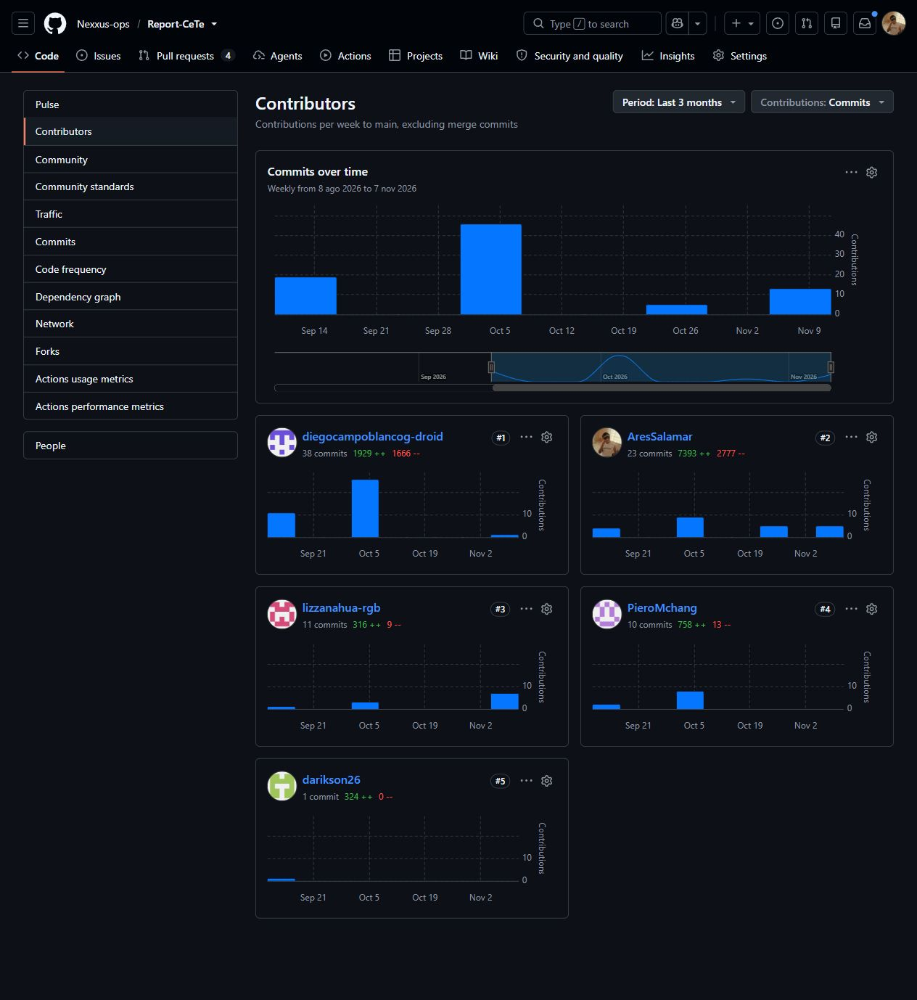

**API · Contributors.** Los cinco integrantes tienen aportes versionados en la API integrada. [Abrir analíticas](https://github.com/Nexxus-ops/CeTe-Api/graphs/contributors).

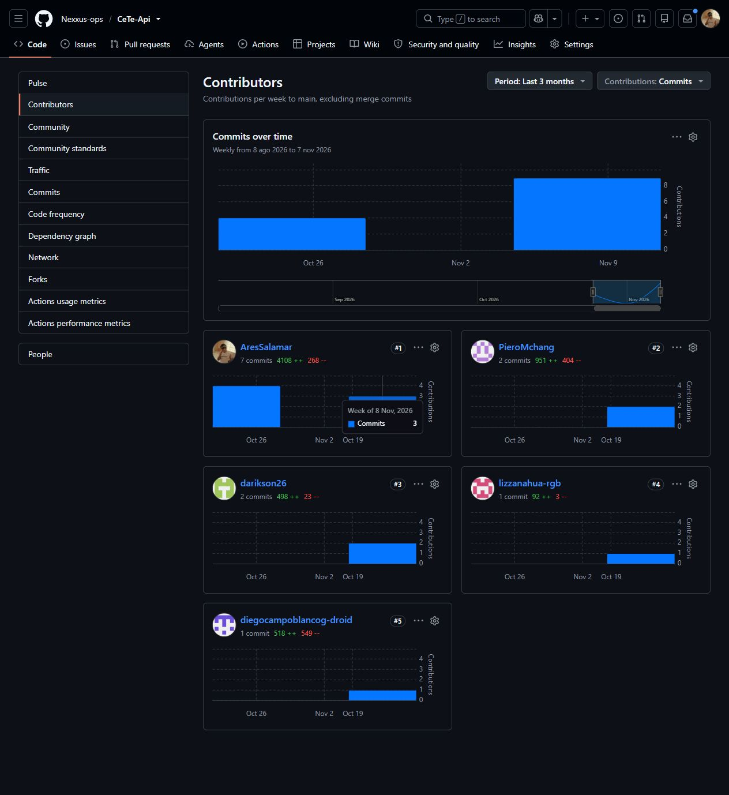

**Frontend · Historial de `main`.** La captura muestra la mejora de Ventas y la integración atribuida a Liz, junto con la publicación de Kevin. El aporte histórico de Diego se enlaza en la tabla individual. [Abrir historial](https://github.com/Nexxus-ops/FrontEnd-CeTe/commits/main/).

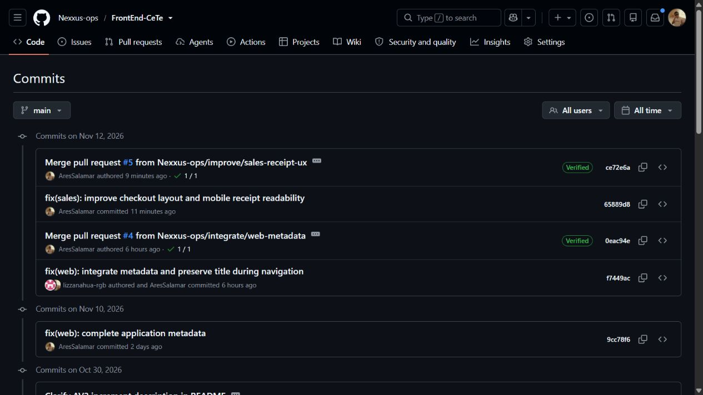

**Landing · Historial de `develop`.** Se distinguen el cambio original de Darikson, la integración de Liz y el merge de Kevin. [Abrir historial](https://github.com/Nexxus-ops/nexxus-landing-page/commits/develop/).

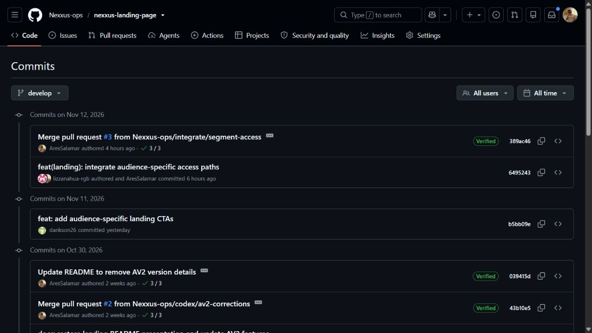

El estado del Sprint 3 se presenta en [5.2.3.8](#5238-team-collaboration-insights-during-sprint). [Organización Nexxus](https://github.com/Nexxus-ops)

---

## Contenido

La tabla conserva cuatro niveles de esquema. Cada capítulo puede desplegarse para consultar sus secciones y subsecciones.

- [Carátula](#universidad-peruana-de-ciencias-aplicadas)
- [Registro de Versiones del Informe](#registro-de-versiones-del-informe)
- [Project Report Collaboration Insights](#project-report-collaboration-insights)
- [Student Outcome ABET 5](#abet---eac---student-outcome-5)

<strong>Capítulo I: Introducción</strong>

- [Capítulo I: Introducción](01-Chapter-1-Presentation.md)
    - [1.1. Startup Profile](01-Chapter-1-Presentation.md#11-startup-profile)
        - [1.1.1. Descripción de la Startup](01-Chapter-1-Presentation.md#111-descripción-de-la-startup)
        - [1.1.2. Perfiles de integrantes del equipo](01-Chapter-1-Presentation.md#112-perfiles-de-integrantes-del-equipo)
    - [1.2. Solution Profile](01-Chapter-1-Presentation.md#12-solution-profile)
        - [1.2.1 Antecedentes y problemática](01-Chapter-1-Presentation.md#121-antecedentes-y-problemática)
        - [1.2.2 Lean UX Process](01-Chapter-1-Presentation.md#122-lean-ux-process)
            - [1.2.2.1. Lean UX Problem Statements](01-Chapter-1-Presentation.md#1221-lean-ux-problem-statements)
            - [1.2.2.2. Lean UX Assumptions](01-Chapter-1-Presentation.md#1222-lean-ux-assumptions)
            - [1.2.2.3. Lean UX Hypothesis Statements](01-Chapter-1-Presentation.md#1223-lean-ux-hypothesis-statements)
            - [1.2.2.4. Lean UX Canvas](01-Chapter-1-Presentation.md#1224-lean-ux-canvas)
    - [1.3. Segmentos objetivo](01-Chapter-1-Presentation.md#13-segmentos-objetivo)
        - [1.3.1. Segmento 1: Dueños y Administradores de Negocio (El Comprador)](01-Chapter-1-Presentation.md#131-segmento-1-dueños-y-administradores-de-negocio-el-comprador)
        - [1.3.2. Segmento 2: Jefes de Logística y Personal Operativo de Almacén (El Usuario Final)](01-Chapter-1-Presentation.md#132-segmento-2-jefes-de-logística-y-personal-operativo-de-almacén-el-usuario-final)

<strong>Capítulo II: Requirements Elicitation & Analysis</strong>

- [Capítulo II: Requirements Elicitation & Analysis](02-Chapter-2.md)
    - [2.1. Competidores](02-Chapter-2.md#21-competidores)
        - [2.1.1. Análisis competitivo](02-Chapter-2.md#211-análisis-competitivo)
            - [2.1.1.1. Análisis de Modelos Tarifarios (Pricing)](02-Chapter-2.md#2111-análisis-de-modelos-tarifarios-pricing)
        - [2.1.2. Estrategias y tácticas frente a competidores](02-Chapter-2.md#212-estrategias-y-tácticas-frente-a-competidores)
    - [2.2. Entrevistas](02-Chapter-2.md#22-entrevistas)
        - [2.2.1. Diseño de entrevistas](02-Chapter-2.md#221-diseño-de-entrevistas)
        - [2.2.2. Registro de entrevistas](02-Chapter-2.md#222-registro-de-entrevistas)
            - [Segmento 1: Tomadores de Decisión (Dueños, Administradores, Gerentes)](02-Chapter-2.md#segmento-1-tomadores-de-decisión-dueños-administradores-gerentes)
            - [Segmento 2: Usuarios Finales (Jefes de Logística, Operarios de Almacén)](02-Chapter-2.md#segmento-2-usuarios-finales-jefes-de-logística-operarios-de-almacén)
        - [2.2.3. Análisis de entrevistas](02-Chapter-2.md#223-análisis-de-entrevistas)
    - [2.3. Needfinding](02-Chapter-2.md#23-needfinding)
        - [2.3.1. User Personas](02-Chapter-2.md#231-user-personas)
        - [2.3.2. User Task Matrix](02-Chapter-2.md#232-user-task-matrix)
        - [2.3.3. User Journey Mapping](02-Chapter-2.md#233-user-journey-mapping)
        - [2.3.4. Empathy Mapping](02-Chapter-2.md#234-empathy-mapping)
    - [2.4. Big Picture EventStorming](02-Chapter-2.md#24-big-picture-eventstorming)
    - [2.5. Ubiquitous Language](02-Chapter-2.md#25-ubiquitous-language)

<strong>Capítulo III: Requirements Specification</strong>

- [Capítulo III: Requirements Specification](03-Chapter-3.md)
    - [3.1. User Stories](03-Chapter-3.md#31-user-stories)
    - [3.2. Impact Mapping](03-Chapter-3.md#32-impact-mapping)
        - [3.2.1. Metas medibles de validación AV2](03-Chapter-3.md#321-metas-medibles-de-validación-av2)
    - [3.3. Product Backlog](03-Chapter-3.md#33-product-backlog)
        - [3.3.1. Prioridades 1–20](03-Chapter-3.md#331-prioridades-120)
        - [3.3.2. Prioridades 21–40](03-Chapter-3.md#332-prioridades-2140)
        - [3.3.3. Prioridades 41–60](03-Chapter-3.md#333-prioridades-4160)
        - [3.3.4. Prioridades 61–77](03-Chapter-3.md#334-prioridades-6177)

<strong>Capítulo IV: Product Design</strong>

- [Capítulo IV: Product Design](04-Chapter-4.md)
    - [4.1. Style Guidelines](04-Chapter-4.md#41-style-guidelines)
        - [4.1.1. General Style Guidelines](04-Chapter-4.md#411-general-style-guidelines)
        - [4.1.2. Web Style Guidelines](04-Chapter-4.md#412-web-style-guidelines)
    - [4.2. Information Architecture](04-Chapter-4.md#42-information-architecture)
        - [4.2.1. Organization Systems](04-Chapter-4.md#421-organization-systems)
        - [4.2.2. Labeling Systems](04-Chapter-4.md#422-labeling-systems)
        - [4.2.3. SEO Tags and Meta Tags](04-Chapter-4.md#423-seo-tags-and-meta-tags)
        - [4.2.4. Searching Systems](04-Chapter-4.md#424-searching-systems)
        - [4.2.5. Navigation Systems](04-Chapter-4.md#425-navigation-systems)
    - [4.3. Landing Page UI Design](04-Chapter-4.md#43-landing-page-ui-design)
        - [4.3.1. Landing Page Wireframe](04-Chapter-4.md#431-landing-page-wireframe)
        - [4.3.2. Landing Page Mock-up](04-Chapter-4.md#432-landing-page-mock-up)
    - [4.4. Web Applications UX/UI Design](04-Chapter-4.md#44-web-applications-uxui-design)
        - [4.4.1. Web Applications Wireframes](04-Chapter-4.md#441-web-applications-wireframes)
        - [4.4.2. Web Applications Wireflow Diagrams](04-Chapter-4.md#442-web-applications-wireflow-diagrams)
        - [4.4.3. Web Applications Mock-ups](04-Chapter-4.md#443-web-applications-mock-ups)
        - [4.4.4. Web Applications User Flow Diagrams](04-Chapter-4.md#444-web-applications-user-flow-diagrams)
    - [4.5. Web Applications Prototyping](04-Chapter-4.md#45-web-applications-prototyping)
    - [4.6. Domain-Driven Software Architecture](04-Chapter-4.md#46-domain-driven-software-architecture)
        - [4.6.1. Design-Level Event Storming](04-Chapter-4.md#461-design-level-event-storming)
            - [4.6.1.1. Subdominios y límites de responsabilidad](04-Chapter-4.md#4611-subdominios-y-límites-de-responsabilidad)
            - [4.6.1.2. Mapa de contextos](04-Chapter-4.md#4612-mapa-de-contextos)
            - [4.6.1.3. Comandos, reglas, hechos y consultas](04-Chapter-4.md#4613-comandos-reglas-hechos-y-consultas)
        - [4.6.2. Software Architecture Context Diagram](04-Chapter-4.md#462-software-architecture-context-diagram)
        - [4.6.3. Software Architecture Container Diagrams](04-Chapter-4.md#463-software-architecture-container-diagrams)
        - [4.6.4. Software Architecture Components Diagrams](04-Chapter-4.md#464-software-architecture-components-diagrams)
            - [4.6.4.1. Vista dinámica de la venta](04-Chapter-4.md#4641-vista-dinámica-de-la-venta)
    - [4.7. Software Object-Oriented Design](04-Chapter-4.md#47-software-object-oriented-design)
        - [4.7.1. Class Diagrams](04-Chapter-4.md#471-class-diagrams)
            - [4.7.1.1. Inventario](04-Chapter-4.md#4711-inventario)
            - [4.7.1.2. Ventas](04-Chapter-4.md#4712-ventas)
            - [4.7.1.3. Abastecimiento](04-Chapter-4.md#4713-abastecimiento)
            - [4.7.1.4. Logística](04-Chapter-4.md#4714-logística)
        - [4.7.2. Agregados, invariantes y responsabilidad](04-Chapter-4.md#472-agregados-invariantes-y-responsabilidad)
        - [4.7.3. Estados y reglas de transición](04-Chapter-4.md#473-estados-y-reglas-de-transición)
    - [4.8. Database Design](04-Chapter-4.md#48-database-design)
        - [4.8.1. Esquema físico AV2](04-Chapter-4.md#481-esquema-físico-av2)
        - [4.8.2. Diagramas entidad–relación por área](04-Chapter-4.md#482-diagramas-entidadrelación-por-área)
            - [4.8.2.1. Identidad y empresa](04-Chapter-4.md#4821-identidad-y-empresa)
            - [4.8.2.2. Inventario](04-Chapter-4.md#4822-inventario)
            - [4.8.2.3. Abastecimiento](04-Chapter-4.md#4823-abastecimiento)
            - [4.8.2.4. Ventas](04-Chapter-4.md#4824-ventas)
            - [4.8.2.5. Logística](04-Chapter-4.md#4825-logística)
            - [4.8.2.6. Devoluciones y notificaciones](04-Chapter-4.md#4826-devoluciones-y-notificaciones)
        - [4.8.3. Integridad y reglas verificables](04-Chapter-4.md#483-integridad-y-reglas-verificables)
        - [4.8.4. Hallazgos y evolución del diseño](04-Chapter-4.md#484-hallazgos-y-evolución-del-diseño)
        - [4.8.5. Fuentes de diseño y trazabilidad](04-Chapter-4.md#485-fuentes-de-diseño-y-trazabilidad)

<strong>Capítulo V: Product Implementation, Validation & Deployment</strong>

- [Capítulo V: Product Implementation, Validation & Deployment](05-Chapter-5.md)
    - [5.1. Software Configuration Management](05-Chapter-5.md#51-software-configuration-management)
        - [5.1.1. Software Development Environment Configuration](05-Chapter-5.md#511-software-development-environment-configuration)
        - [5.1.2. Source Code Management](05-Chapter-5.md#512-source-code-management)
        - [5.1.3. Source Code Style Guide & Conventions](05-Chapter-5.md#513-source-code-style-guide--conventions)
        - [5.1.4. Software Deployment Configuration](05-Chapter-5.md#514-software-deployment-configuration)
    - [5.2. Landing Page, Services & Applications Implementation](05-Chapter-5.md#52-landing-page-services--applications-implementation)
        - [5.2.1. Sprint 1](05-Chapter-5.md#521-sprint-1)
            - [5.2.1.1. Sprint Planning 1](05-Chapter-5.md#5211-sprint-planning-1)
            - [5.2.1.2. Aspect Leaders and Collaborators](05-Chapter-5.md#5212-aspect-leaders-and-collaborators)
            - [5.2.1.3. Sprint Backlog 1](05-Chapter-5.md#5213-sprint-backlog-1)
            - [5.2.1.4. Development Evidence for Sprint Review](05-Chapter-5.md#5214-development-evidence-for-sprint-review)
            - [5.2.1.5. Execution Evidence for Sprint Review](05-Chapter-5.md#5215-execution-evidence-for-sprint-review)
            - [5.2.1.6. Services Documentation Evidence for Sprint Review](05-Chapter-5.md#5216-services-documentation-evidence-for-sprint-review)
            - [5.2.1.7. Software Deployment Evidence for Sprint Review](05-Chapter-5.md#5217-software-deployment-evidence-for-sprint-review)
            - [5.2.1.8. Team Collaboration Insights during Sprint](05-Chapter-5.md#5218-team-collaboration-insights-during-sprint)
        - [5.2.2. Sprint 2](05-Chapter-5.md#522-sprint-2)
            - [5.2.2.1. Sprint Planning 2](05-Chapter-5.md#5221-sprint-planning-2)
            - [5.2.2.2. Aspect Leaders and Collaborators](05-Chapter-5.md#5222-aspect-leaders-and-collaborators)
            - [5.2.2.3. Sprint Backlog 2](05-Chapter-5.md#5223-sprint-backlog-2)
            - [5.2.2.4. Development Evidence for Sprint Review](05-Chapter-5.md#5224-development-evidence-for-sprint-review)
            - [5.2.2.5. Execution Evidence for Sprint Review](05-Chapter-5.md#5225-execution-evidence-for-sprint-review)
            - [5.2.2.6. Services Documentation Evidence for Sprint Review](05-Chapter-5.md#5226-services-documentation-evidence-for-sprint-review)
            - [5.2.2.7. Software Deployment Evidence for Sprint Review](05-Chapter-5.md#5227-software-deployment-evidence-for-sprint-review)
            - [5.2.2.8. Team Collaboration Insights during Sprint](05-Chapter-5.md#5228-team-collaboration-insights-during-sprint)
        - [5.2.3. Sprint 3 / consolidación AV2](05-Chapter-5.md#523-sprint-3--consolidación-av2)
            - [5.2.3.1. Sprint Planning 3](05-Chapter-5.md#5231-sprint-planning-3)
            - [5.2.3.2. Aspect Leaders and Collaborators](05-Chapter-5.md#5232-aspect-leaders-and-collaborators)
            - [5.2.3.3. Sprint Backlog 3](05-Chapter-5.md#5233-sprint-backlog-3)
            - [5.2.3.4. Development Evidence for Sprint Review](05-Chapter-5.md#5234-development-evidence-for-sprint-review)
            - [5.2.3.5. Execution Evidence for Sprint Review](05-Chapter-5.md#5235-execution-evidence-for-sprint-review)
            - [5.2.3.6. Services Documentation Evidence for Sprint Review](05-Chapter-5.md#5236-services-documentation-evidence-for-sprint-review)
            - [5.2.3.7. Software Deployment Evidence for Sprint Review](05-Chapter-5.md#5237-software-deployment-evidence-for-sprint-review)
            - [5.2.3.8. Team Collaboration Insights during Sprint](05-Chapter-5.md#5238-team-collaboration-insights-during-sprint)
    - [5.3. Validation Interviews](05-Chapter-5.md#53-validation-interviews)
        - [5.3.1. Diseño de entrevistas](05-Chapter-5.md#531-diseño-de-entrevistas)
        - [5.3.2. Registro de Entrevistas](05-Chapter-5.md#532-registro-de-entrevistas)
            - [Entrevistas de validación aportadas por Diego Campoblanco](05-Chapter-5.md#entrevistas-de-validación-aportadas-por-diego-campoblanco)
        - [5.3.3. Evaluaciones según heurísticas](05-Chapter-5.md#533-evaluaciones-según-heurísticas)
    - [5.4. Video About-the-Product](05-Chapter-5.md#54-video-about-the-product)

<strong>Conclusiones</strong>

- [Conclusiones](06-Conclusions.md)
    - [Conclusiones y recomendaciones](06-Conclusions.md#conclusiones-y-recomendaciones)
        - [Resultados técnicos del incremento](06-Conclusions.md#resultados-técnicos-del-incremento)
        - [Contraste con Lean UX y los segmentos](06-Conclusions.md#contraste-con-lean-ux-y-los-segmentos)
        - [Recomendaciones y roadmap](06-Conclusions.md#recomendaciones-y-roadmap)
    - [Video About-the-Team](06-Conclusions.md#video-about-the-team)

- [Bibliografía](#bibliografía)
- [Anexos](#anexos)
- [Videos de Exposiciones](#anexo-b-videos-de-exposiciones)
- [Atlas de diagramas](diagrams/README.md)
- [Diccionario de datos](AV2/diccionario-datos.md)

---

# ABET - EAC - Student Outcome 5

El curso contribuye al cumplimiento del Student Outcome ABET:

**Criterio:** _La capacidad de funcionar efectivamente en un equipo cuyos miembros juntos proporcionan liderazgo, crean un entorno de colaboración e inclusivo, establecen objetivos, planifican tareas y cumplen objetivos._

En el siguiente cuadro se describe las acciones realizadas y enunciados de conclusiones por parte del grupo, que permiten sustentar el haber alcanzado el logro del ABET – EAC - Student Outcome 5.

**Sustento AV2.** Las acciones se consolidan a partir de los aportes informados por Kevin y de la evidencia versionada enlazada. Se conserva el registro histórico de AV1/TB1 y se añade AV2 para cada integrante en ambos criterios. La confirmación individual del texto y los testimonios del equipo siguen pendientes; no se presentan como entrevistas o declaraciones personales ya realizadas. [Matriz de roles](#5232-aspect-leaders-and-collaborators) · [Evidencias por producto](#analíticas-verificadas-de-colaboración-av2).

| Criterio específico | Acciones realizadas | Conclusiones |
| :--- | :--- | :--- |
| **Trabaja en equipo para proporcionar liderazgo en forma conjunta** | **Anahua Ancachi, Liz Maribel** AV1: Fomentó el consenso del equipo durante la ideación del diseño, guiando a sus compañeros a comprender las necesidades del usuario y promoviendo la toma de decisiones compartida.  TB1: Facilitó la organización operativa del equipo al definir los líderes de cada aspecto, asegurando que todos comprendieran su rol y fomentando un sentido de responsabilidad compartida.  **AV2:** Aportó el flujo de boleta y los modelos C4/DDD descritos por el equipo. Su consulta histórica de boletas quedó versionada en la API y su integración del frontend preservó los metadatos durante la navegación. Estos aportes conectan diseño y revisión del producto. [API `f1b4799`](https://github.com/Nexxus-ops/CeTe-Api/commit/f1b4799) · [Frontend PR #4](https://github.com/Nexxus-ops/FrontEnd-CeTe/pull/4).  **Campoblanco Guzman, Diego Roberto** AV1: Facilitó el diálogo activo y la resolución de dudas durante las sesiones de EventStorming, asegurando que todas las perspectivas del equipo fueran escuchadas y debatidas antes de definir el modelo. TB1: Asumió el liderazgo durante el desarrollo interactivo en Vue.js, facilitando la toma de decisiones técnicas conjuntas y moderando el Sprint Planning 2 para alinear la visión del equipo. **AV2:** Coordinó la revisión DDD informada por el equipo y la integración de límites de contexto y compatibilidad. Entregó las dos entrevistas nuevas de Raúl y Carmen para incorporar la perspectiva de dueños y administradores. [API `dc266f9`](https://github.com/Nexxus-ops/CeTe-Api/commit/dc266f9) · [Entrevistas](05-Chapter-5.md#532-registro-de-entrevistas).  **Montes Chang, Piero Francisco** AV1: Impulsó la participación equitativa del equipo durante la etapa de investigación, motivando a cada integrante a involucrarse en las entrevistas y guiando la comunicación efectiva con los stakeholders. TB1: Promovió una cultura de calidad dentro del equipo al estructurar y validar las evidencias de desarrollo y ejecución, garantizando que el esfuerzo de todos los miembros fuera documentado de manera transparente. **AV2:** Aportó la organización del dominio y los contratos de Inventario que colaboran con Abastecimiento y Ventas. Su trabajo delimita responsabilidades técnicas y ofrece un contrato compartido para integrar los flujos. [API `5c38d2b`](https://github.com/Nexxus-ops/CeTe-Api/commit/5c38d2b) · [API `f8f2eb3`](https://github.com/Nexxus-ops/CeTe-Api/commit/f8f2eb3).  **Salazar Marquina, Kevin Junior** AV1: Orientó las discusiones grupales hacia la alineación estratégica del modelo de negocio, asumiendo un rol de mediador para integrar las diferentes ideas y lograr un enfoque unificado. TB1: Lideró la estrategia de integración técnica del Front-End, guiando a sus compañeros en la resolución de correcciones arquitectónicas y coordinando el despliegue final para asegurar un entregable funcional. **AV2:** Centralizó la integración técnica y documental de los aportes. Separó Abastecimiento e Identidad, consolidó el Sprint 3 y publicó las mejoras de Ventas y boletas, con asistencia técnica y el reparto comunicado por el equipo. [API `00c1ec3`](https://github.com/Nexxus-ops/CeTe-Api/commit/00c1ec3) · [Informe PR #24](https://github.com/Nexxus-ops/Report-CeTe/pull/24) · [Frontend PR #5](https://github.com/Nexxus-ops/FrontEnd-CeTe/pull/5).  **Salazar Quiche, Darikson Bill** AV1: Asumió un rol formativo al instruir pacientemente a sus compañeros en las prácticas de control de versiones, fortaleciendo la confianza del grupo y el aprendizaje colaborativo. TB1: Impulsó la reflexión crítica del grupo al analizar las dinámicas de colaboración, liderando la sesión de retroalimentación para unificar los aprendizajes en las conclusiones del Sprint. **AV2:** Aportó los flujos de Ventas y Logística y la propuesta de ampliar el modelo de datos, según el reparto informado. Los comandos y repositorios de ambos contextos y los accesos por segmento de la landing tienen cambios versionados a su nombre. [API `bc369f5`](https://github.com/Nexxus-ops/CeTe-Api/commit/bc369f5) · [API `84f14c7`](https://github.com/Nexxus-ops/CeTe-Api/commit/84f14c7) · [Landing `b5bb09e`](https://github.com/Nexxus-ops/nexxus-landing-page/commit/b5bb09e). | AV1: El equipo demostró un liderazgo distribuido eficaz, donde cada integrante asumió la responsabilidad de áreas clave según sus fortalezas. Esto agilizó significativamente la toma de decisiones, reduciendo cuellos de botella en la fase de planeación y diseño.  TB1: El equipo consolidó un liderazgo técnico y organizativo distribuido. La sinergia lograda permitió superar los desafíos de implementar una arquitectura Front-End compleja, demostrando que la delegación basada en la confianza y la revisión cruzada agiliza la toma de decisiones  **AV2:** La distribución de responsabilidades entre dominio, flujos comerciales, experiencia de usuario e integración permitió publicar una API modular con cinco contextos y conservar sus contratos HTTP. Los commits y PR distinguen el aporte original, la integración y la revisión informada. El resultado acredita coordinación técnica dentro de Nexxus; todavía debe complementarse con los testimonios individuales y el acta completa. No se adjunta evidencia de coordinación de ingeniería con otros equipos de proyecto o profesionales de otras áreas, por lo que ese alcance de la rúbrica no se declara demostrado. |
| **Crea un entorno colaborativo e inclusivo, establece metas, planifica tareas y cumple objetivos.** | **Anahua Ancachi, Liz Maribel** AV1: Promovió la inclusión al asegurar que cada miembro tuviera voz en la delegación de responsabilidades, adaptando empáticamente las cargas de trabajo según las fortalezas individuales de cada integrante. TB1: Planificó el Sprint Backlog 2 adaptando equitativamente las tareas a las fortalezas y disponibilidad de sus compañeros, garantizando un flujo de trabajo balanceado y libre de sobrecargas. **AV2:** El flujo de boleta que aportó y sus observaciones de UI/UX se incorporaron a la priorización de mejoras de lectura y acceso. Su integración conservó los cambios originales de Kevin en frontend y Darikson en landing, en lugar de reemplazar sus registros. [Frontend PR #4](https://github.com/Nexxus-ops/FrontEnd-CeTe/pull/4) · [Landing PR #3](https://github.com/Nexxus-ops/nexxus-landing-page/pull/3).  **Campoblanco Guzman, Diego Roberto** AV1: Dinamizó las reuniones de planificación para establecer metas conjuntas, fomentando un ambiente de respeto donde las sugerencias y preocupaciones de todos fueron valoradas para organizar el flujo de trabajo. TB1: Estructuró las metas del Sprint 2 de manera empática, asegurándose de que los objetivos de desarrollo Front-End fueran realistas y escuchando las inquietudes del equipo durante la planificación. **AV2:** Conectó la revisión técnica con la validación de usuarios al entregar grabaciones, capturas y resúmenes de dos entrevistas. La siguiente ronda con Piero sigue en curso; el registro mantiene explícita la cobertura pendiente por segmento. [Registro de entrevistas](05-Chapter-5.md#532-registro-de-entrevistas).  **Montes Chang, Piero Francisco** AV1: Facilitó la coordinación grupal estableciendo acuerdos de comunicación claros, asegurando que todos estuvieran alineados, motivados y comprometidos con los objetivos del primer Sprint. TB1: Contribuyó a la cohesión del grupo al consolidar las pruebas de ejecución de manera inclusiva, validando y celebrando el código aportado por cada integrante del equipo. **AV2:** Contribuyó a que otros contextos utilicen las reglas de Inventario mediante un contrato explícito. El incremento integrado se contrastó con pruebas de stock y recepción parcial. Comparte con Diego la coordinación de la ronda de entrevistas; sus nuevas fichas todavía no se han recibido. [Contrato de Inventario](https://github.com/Nexxus-ops/CeTe-Api/commit/f8f2eb3) · [Ejecución](05-Chapter-5.md#5235-execution-evidence-for-sprint-review).  **Salazar Marquina, Kevin Junior** AV1: Fomentó una cultura de retroalimentación (feedback) constructiva durante la revisión de avances, creando un espacio seguro para debatir correcciones sin fricciones y celebrar los aportes de cada compañero. TB1: Fomentó un entorno de apoyo mutuo al asistir a sus compañeros durante la programación y la configuración del despliegue, asegurando que nadie se quedara atrás ante bloqueos técnicos. **AV2:** Tradujo el feedback del docente y las observaciones de UI/UX en tareas, integraciones y comprobaciones. El backlog diferencia estimación, estado técnico y aceptación; las pruebas verificaron venta, boleta, recepción y permisos, y la última mejora mantuvo la lectura móvil y la impresión. [Sprint Backlog 3](05-Chapter-5.md#5233-sprint-backlog-3) · [Frontend `65889d8`](https://github.com/Nexxus-ops/FrontEnd-CeTe/commit/65889d8).  **Salazar Quiche, Darikson Bill** AV1: Estructuró los objetivos técnicos priorizando el apoyo mutuo, promoviendo sesiones de trabajo colaborativo para asegurar que se cumplieran los plazos establecidos sin sobrecargar a ningún miembro del equipo. TB1: Impulsó la reflexión crítica del grupo al analizar las dinámicas de colaboración, liderando la sesión de retroalimentación para unificar los aprendizajes en las conclusiones del Sprint. **AV2:** Atendió el reparto de Ventas y Despachos y la necesidad de separar el acceso de los segmentos desde la landing. Su cambio de CTA fue integrado por Liz y publicado por Kevin, conservando la autoría del aporte original. [Cambio original](https://github.com/Nexxus-ops/nexxus-landing-page/commit/b5bb09e) · [Integración](https://github.com/Nexxus-ops/nexxus-landing-page/pull/3). | AV1: La aplicación de metodologías ágiles y la comunicación constante permitieron crear un entorno de trabajo altamente transparente e inclusivo. El equipo logró establecer metas conjuntas, planificar entregas realistas y apoyarse mutuamente para cumplir los objetivos del proyecto, demostrando madurez y cohesión. TB1: El equipo consolidó un liderazgo técnico y organizativo distribuido. La sinergia lograda permitió superar los desafíos de implementar una arquitectura Front-End compleja, demostrando que la delegación basada en la confianza y la revisión cruzada agiliza la toma de decisiones  **AV2:** El equipo convirtió observaciones del docente y aportes de diseño en cambios concretos: boleta histórica, acceso por segmento, recursos bilingües, contratos DDD y lectura móvil. El tablero mantiene los pendientes de validación y comunicación, en vez de cerrar todas las historias por tener código publicado. La publicación centralizada facilitó la integración, pero hace necesario conservar también los diseños, revisiones y testimonios de quienes aportaron fuera de Git. Los recuentos no acreditan por sí solos participación equitativa ni horas trabajadas. |

**Evidencias que completan el cierre de ABET 5.** Cada integrante debe confirmar que la descripción de su aporte es correcta y aportar un ejemplo propio al testimonio del equipo. La reunión del 03/11/2026 conserva pendientes el horario, lugar, lista de asistentes y acuerdos; la fotografía aportada por Kevin no reemplaza esos datos. El video About-the-Team y el Participant Performance Report de AV2 se completan en el cierre de la entrega; las notas de desempeño corresponden al líder y no se deducen del conteo de commits.

# Capítulo I: Introducción

[Startup Profile](#11-startup-profile) · [Solution Profile](#12-solution-profile) · [Segmentos objetivo](#13-segmentos-objetivo)

## 1.1. Startup Profile

### 1.1.1. Descripción de la Startup

Nuestra startup nace de la experiencia directa de sus fundadores lidiando con ineficiencias operativas en diferentes rubros comerciales. Habiendo trabajado desde el interior de negocios familiares de gastronomía, almacenes corporativos, empresas textiles recientes y consorcios de distribución de alimentos para el Estado, el equipo identificó un "dolor" compartido: la ausencia crítica de herramientas tecnológicas adaptadas a la realidad de las Micro y Pequeñas Empresas (MYPES).

Tradicionalmente, este sector gestiona su cadena de suministro mediante métodos empíricos (cuadernos, apuntes a mano) o archivos de Excel aislados, lo que desencadena en pérdida de tiempo, extravío de mercadería y falta de trazabilidad. Frente a esto, nuestra startup, Nexxus, se dedica a desarrollar soluciones de software B2B (Business-to-Business) ágiles y generalizables que democraticen la digitalización. Nuestro producto estrella, CeTe (Celer Tech), es el reflejo de esta visión.

> **Misión:** Democratizar el acceso a la tecnología para las MYPES latinoamericanas, proporcionando herramientas digitales intuitivas y centralizadas que optimicen su cadena de suministro y les permitan competir con mayor eficiencia en el mercado.
>
> **Visión:** Convertirnos en el aliado tecnológico líder (el "sistema nervioso central") de la logística y operaciones para pequeñas y medianas empresas, escalando nuestras plataformas hacia la integración con tecnologías avanzadas como el Internet de las Cosas (IoT).
>
> **Valores:**
>* **Empatía:** Entendemos los problemas de nuestros usuarios porque los hemos vivido en carne propia.
>* **Innovación adaptable:** Creamos soluciones que se amoldan a la realidad y tamaño de cada negocio, no al revés.
>* **Transparencia:** Promovemos la claridad de la información tanto en el interior de nuestra startup como en las operaciones de nuestros clientes.
>* **Eficiencia:** Buscamos hacer más con menos, eliminando los procesos repetitivos y manuales.

### 1.1.2. Perfiles de integrantes del equipo

<table border="1" cellspacing="0" cellpadding="8" style="border-collapse: collapse; width: 100%;">
<thead>
<tr style="background-color: #f2f2f2; text-align: center;">
<th>Apellido y nombre</th>
<th>Carrera</th>
<th style="text-align: left;">Perfil</th>
</tr>
</thead>
<tbody>
<tr>
<td align="center" valign="middle">
  <b>Anahua Ancachi, Liz Maribel</b> 
  <small>Código: U202421123</small>
  
</td>
<td align="center">Ingeniería de Software</td>
<td>Estudiante con sólidos conocimientos en el desarrollo frontend y backend. Aporta al equipo habilidades en la implementación de arquitecturas orientadas a dominio (DDD).</td>
</tr>
<tr>
<td align="center" valign="middle">
  <b>Campoblanco Guzman, Diego Roberto</b> 
  <small>Código: U202414313</small>
    
</td>
<td align="center">Ingeniería de Software</td>
<td>Actualmente estudio la carrera de Ingeniería de Software en la UPC. Soy una persona apasionada por la programación, enfocada en la creación de aplicaciones modulares y en la simulación de infraestructuras de red y dispositivos IoT. Busco garantizar que la integración del hardware se comunique de manera eficiente con las bases de datos y la plataforma web.</td>
</tr>
<tr>
<td align="center" valign="middle">
  <b>Montes Chang, Piero Francisco</b> 
  <small>Código: U20241G031</small>
    
</td>
<td align="center">Ingeniería de Software</td>
<td>Estudiante de quinto ciclo de Ingeniería de Software con conocimientos en Domain-Driven Design. En CeTe participa en la organización del backend por contextos y en los contratos de Inventario. Colabora con el equipo en la revisión de los modelos y en las entrevistas de validación.</td>
</tr>
<tr>
<td align="center" valign="middle">
  <b>Salazar Marquina, Kevin Junior</b> 
  <small>Código: U202417747</small>
    
</td>
<td align="center">Ingeniería de Software</td>
<td>Estudiante con sólidos conocimientos en el desarrollo frontend y backend. Aporta al equipo habilidades en el uso de frameworks como Angular y Spring Boot, enfocado en asegurar la escalabilidad del sistema B2B.</td>
</tr>
<tr>
<td align="center" valign="middle">
  <b>Salazar Quiche, Darikson Bill</b> 
  <small>Código: U202422620</small>
    
</td>
<td align="center">Ingeniería de Software</td>
<td>Estudiante de Ingeniería de Software con experiencia en Figma y en la elaboración de propuestas visuales. En CeTe participa en el diseño de experiencias y en los flujos de Ventas y Logística, coordinando su integración con los demás contextos.</td>
</tr>
</tbody>
</table>

## 1.2. Solution Profile

### 1.2.1 Antecedentes y problemática

Históricamente, las Micro y Pequeñas Empresas (MYPES) han administrado su logística mediante procesos rudimentarios, apoyándose en registros manuales o herramientas ofimáticas básicas sin integración. Esta falta de digitalización genera cuellos de botella críticos, tales como la pérdida de trazabilidad en los suministros, desajustes imprevistos en el stock y una visibilidad limitada sobre la rentabilidad real de sus transacciones comerciales.

En el panorama tecnológico actual, las alternativas de software robustas suelen ser inaccesibles para los pequeños empresarios, ya sea por sus elevadas tarifas de licenciamiento o por la complejidad técnica que exige su configuración. Se evidencia, así, una desconexión entre la urgencia de modernización de este sector y la oferta de mercado, que frecuentemente ignora las limitaciones financieras y la agilidad operativa propias de las MYPES.

Con el propósito de profundizar en la naturaleza del problema identificado, hemos empleado la metodología de análisis **The 5 'W's y 2 'H's**:

* **Who (¿Quién lo sufre?):** Propietarios, gestores administrativos y colaboradores operativos de MYPES que carecen de ecosistemas tecnológicos estandarizados para sus procesos.
* **What (¿Cuál es el problema?):** Inexistencia de un entorno digital unificado para articular el inventario, las ventas y el despacho, resultando en una gestión basada en la empirismo o registros aislados.
* **Where (¿Dónde ocurre?):** En el núcleo de las actividades empresariales diarias, particularmente dentro de los almacenes, centros de distribución y puntos críticos de venta.
* **When (¿Cuándo ocurre?):** Se manifiesta durante el control de flujos de mercadería, en la conciliación de existencias y al intentar rastrear la trazabilidad de cada transacción comercial.
* **Why (¿Por qué ocurre?):** Debido a que las soluciones ERP del mercado actual suelen ser financieramente prohibitivas, técnicamente complejas y poco flexibles ante la agilidad que requiere una pequeña empresa.
* **How (¿Cómo se manifiesta?):** Mediante ineficiencias operativas, pérdida de trazabilidad de suministros, descuadres de stock imprevistos y una visibilidad limitada sobre la salud financiera real.
* **How Much (¿Cuánto afecta?):** Provoca mermas económicas por falta de control, vencimientos no gestionados y un elevado costo de oportunidad por la excesiva carga de tareas manuales.

**Objetivo del producto:**
Con el objetivo de cerrar esta brecha, surge CeTe como un ecosistema digital bajo la modalidad SaaS, enfocado en unificar y potenciar la cadena de valor. Nuestra herramienta permite articular los flujos de almacén, transacciones de venta y logística de entrega en un solo entorno, facilitando reportes financieros automáticos y notificaciones preventivas mediante una experiencia de usuario simplificada y adaptable.

> **Alcance de la propuesta.** La descripción anterior expresa la visión del producto. AV2 implementa los flujos descritos en el capítulo V; las alertas automáticas, el control de vencimientos y otros procesos del roadmap aún requieren desarrollo y validación. Su presencia en los modelos no acredita una funcionalidad terminada.

### 1.2.2 Lean UX Process

#### 1.2.2.1. Lean UX Problem Statements

Aplicando la estructura sugerida por el marco de trabajo Lean UX (Brand new initiative), definimos el problema transversal para todos nuestros segmentos objetivo:

> **The current state of** the supply chain and warehouse management in diverse MSEs (restaurants, textile, food consortiums) **has focused mainly on** rudimentary manual methods like physical notebooks or isolated Excel sheets to record what is bought, what is delivered, and the quantities.
>
> **What existing products/services fail to address is** the need for an adaptable, generalized, and intuitive web template system that eliminates manual counting without requiring complex and expensive ERP setups.
>
> **Our product/service will address this gap by** offering "CeTe", an agile SaaS platform that acts as the central nervous system for businesses, unifying warehouse management, sales, and dispatch in one place.
>
> **Our initial focus will be** business owners and logistics managers in sectors suffering from manual chaos.
>
> **We'll know we are successful when we see** a daily adoption of the system replacing notebooks, a significant reduction in time spent searching for or counting merchandise, and clear visibility of goods' destinations.

#### 1.2.2.2. Lean UX Assumptions

En base a la discusión del equipo, planteamos nuestras creencias fundamentales:

**Business Assumptions:**
* Creemos que las MYPES necesitan urgentemente reemplazar los cuadernos y excels por una plataforma web centralizada.
* Creemos que los dueños de negocios estarán dispuestos a pagar una suscripción SaaS accesible para dejar de perder mercadería y tiempo.

**Business Outcome Assumptions:**
* Lograremos captar una base inicial sólida de suscripciones aprovechando la adaptabilidad de CeTe a múltiples rubros (Textil, Alimentos, Restaurantes).
* El nivel de retención será alto porque una vez digitalizado el inventario, volver al cuaderno no es una opción viable.

**User Assumptions:**
* Nuestros usuarios operativos (almaceneros, encargados) saben usar tecnología cotidiana pero necesitan sistemas con cero fricción, casi tan fáciles como usar una red social.
* Los dueños de negocios sienten estrés por la falta de transparencia (no saber "a dónde se fue lo que compró").

**User Outcome and Benefit Assumptions:**
* Los operarios ahorrarán horas a la semana al no tener que buscar productos físicamente a ciegas o contar manualmente.
* Los dueños tendrán la tranquilidad de saber exactamente su estado logístico y financiero en tiempo real.

**Feature Assumptions:**
* Creemos que un módulo ágil de ingresos y salidas reducirá los errores de tipeo o escritura manual.
* Creemos que un panel de control (Dashboard) generalizable permitirá a cualquier rubro ver sus métricas vitales fácilmente.

#### 1.2.2.3. Lean UX Hypothesis Statements

Para validar nuestros Feature Assumptions, planteamos las siguientes hipótesis:

* **Hypothesis 1:**
    * **We believe we will achieve** a massive reduction in time lost searching and counting inventory
    * **If** warehouse and logistics staff
    * **Attain** the ability to record entries and dispatches digitally in seconds, abandoning notebooks
    * **With** a centralized, highly intuitive inbound/outbound module.

* **Hypothesis 2:**
    * **We believe we will achieve** high trust and subscription retention from business owners
    * **If** SME owners and managers
    * **Attain** the peace of mind of knowing exactly where their merchandise is and if they are making a profit
    * **With** a real-time dashboard acting as the central nervous system of their business.

#### 1.2.2.4. Lean UX Canvas

**1. Business Problem (Problema de Negocio)**
* ¿Qué problema tiene el negocio?
    * Las MYPES (restaurantes, textiles, consorcios) sufren pérdidas económicas y de tiempo porque gestionan su logística y almacén con métodos manuales (cuadernos, Excel aislados).
    * Los ERPs actuales son muy costosos, complejos y las MYPES no pueden adoptarlos.

**2. Business Outcomes (Resultados de Negocio)**
* ¿Qué cambios en el comportamiento del cliente indicarán que hemos resuelto el problema?
    * Reducción del 50% del tiempo semanal que las MYPES gastan cuadrando inventario.
    * Adopción diaria del sistema por parte del personal operativo (abandono total del papel).
    * Lograr 30 suscripciones SaaS activas en los primeros 6 meses.

**3. Users / Customers (Usuarios y Clientes)**
* ¿A quiénes estamos resolviendo el problema?
    * Segmento 1 (El Comprador): Dueños y Administradores de negocio (Restaurantes, Textiles, Consorcios) que buscan control y rentabilidad.
    * Segmento 2 (El Usuario): Operarios de almacén y Jefes de Logística que manejan el inventario físico diario.

**4. User Outcomes & Benefits (Beneficios del Usuario)**
* ¿Qué quieren lograr los usuarios? ¿Cuál es su beneficio?
    * Dueños: Quieren tranquilidad mental y saber el estado financiero y logístico de su negocio en tiempo real, desde cualquier lugar, sin sufrir estrés por descuadres.
    * Operarios: Quieren ahorrar horas de trabajo repetitivo, evitar perder el tiempo buscando productos físicamente y terminar su jornada a la hora indicada.

**5. Solutions (Soluciones / Ideas)**
* ¿Qué podemos construir para solucionar los problemas?
    * CeTe SaaS: Una plataforma web que funciona como una "plantilla" logística adaptable.
    * Un Módulo de Ingresos/Salidas ultra intuitivo (cero fricción) para celular/PC en el almacén.
    * Un Dashboard Gerencial en tiempo real con alertas de stock mínimo.
    * Sistema de Roles y Permisos para proteger la información (Vendedor, Almacenero, Admin).

**6. Hypotheses (Hipótesis)**
* ¿Cómo combinamos lo anterior en afirmaciones para validar?
    * Creemos que los dueños confiarán más en su negocio si obtienen un Dashboard en tiempo real mediante CeTe.
    * Creemos que los operarios ahorrarán horas de trabajo si logran registrar ingresos/salidas en segundos mediante nuestro módulo ágil, abandonando los cuadernos.

**7. What's the most important thing we need to learn first? (Supuesto más riesgoso)**
* ¿Cuál es la hipótesis más importante que debemos probar primero?
    * ¿Estarán los operarios de almacén (acostumbrados al papel durante años) dispuestos a usar un sistema web en su día a día sin frustrarse?
    * ¿Están los dueños de las MYPES dispuestos a pagar una suscripción mensual por ordenar su logística?

**8. What's the least amount of work we need to do to learn the next most important thing? (MVP / Experimentos)**
* ¿Cuál es el mínimo esfuerzo para probar nuestro supuesto más riesgoso?
    * Crear un Landing Page con los planes de pago para medir la intención de compra (conversión).
    * Desarrollar un Prototipo interactivo (Figma) del módulo de ingreso rápido de mercadería y testearlo directamente con operarios de almacén para ver si les parece más fácil que usar un cuaderno.

  

## 1.3. Segmentos objetivo

Para el desarrollo de CeTe bajo el modelo B2B SaaS, nos enfocaremos en dos segmentos de usuarios clave, validando que nuestra "plantilla web" cubre tanto las necesidades de control gerencial como la agilidad operativa que requieren rubros como gastronomía, textil y consorcios de alimentos.

### 1.3.1. Segmento 1: Dueños y Administradores de Negocio (El Comprador)

Representan al sector gerencial y administrativo de la MYPE (los fundadores de la marca textil, los dueños de la cadena de restaurantes, los gerentes del consorcio). Son los tomadores de decisiones que adquieren el software buscando rentabilidad y orden. Su principal dolor es la incertidumbre de no saber con exactitud dónde está su mercadería, si realmente se compró lo que se debía, y el estrés de depender de cuadernos informales para conocer el estado de su empresa.

* **Características demográficas:** Hombres y mujeres entre 30 y 55 años de edad. Residentes en zonas urbanas. Emprendedores y empresarios de nivel socioeconómico B y C.
* **Nivel de digitalización:** Medio. Utilizan smartphones constantemente para comunicarse y vender (redes, WhatsApp), pero para la gestión interna siguen dependiendo de que sus empleados les pasen reportes físicos o archivos básicos.
* **Información estadística de sustento:** Según el Ministerio de la Producción y el INEI (2024), las micro y pequeñas empresas representan el 99.5% del tejido empresarial peruano. Sin embargo, el Sondeo de Adopción Digital de Movistar Empresas señala que la mayoría aún gestiona su logística de forma tradicional. El mismo sondeo demuestra que el 27% de las MIPYMES que logran adoptar herramientas digitales orientadas a la gestión y automatización aumentan inmediatamente sus ventas y reducen mermas.

### 1.3.2. Segmento 2: Jefes de Logística y Personal Operativo de Almacén (El Usuario Final)

Representan a la fuerza laboral que interactúa diariamente con el inventario, las compras y los despachos. Suelen ser los encargados de los almacenes del consorcio, los jefes de cocina o los operarios textiles. Su principal dolor es la sobrecarga de trabajo manual (apuntar todo en papel), perder tiempo buscando productos que no saben dónde se ubicaron, y la frustración de tener que hacer conteos manuales tediosos a fin de mes.

* **Características demográficas:** Hombres y mujeres jóvenes y adultos jóvenes, de entre 20 y 45 años. Tienen estudios técnicos, secundarios o universitarios en curso.
* **Nivel de digitalización:** Medio (en el ámbito de software empresarial). Son usuarios activos de aplicaciones móviles comerciales, pero en su entorno de trabajo carecen de sistemas ágiles. Requieren herramientas extremadamente intuitivas que faciliten su trabajo, no que lo compliquen.
* **Información estadística de sustento:** La falta de digitalización operativa en sectores de distribución y manufactura genera cuellos de botella severos. La ausencia de un software unificado es la causa principal de horas-hombre desperdiciadas en cuadres de inventario (ComexPerú, 2024), lo que afecta directamente la productividad del personal operativo en las MYPES peruanas.

# Capítulo II: Requirements Elicitation & Analysis

[Competidores](#21-competidores) · [Entrevistas](#22-entrevistas) · [Needfinding](#23-needfinding) · [EventStorming](#24-big-picture-eventstorming) · [Lenguaje ubicuo](#25-ubiquitous-language)

## 2.1. Competidores

Para validar nuestra propuesta de valor en el ecosistema B2B SaaS, hemos identificado a tres competidores principales que ofrecen soluciones de digitalización para MYPES en la región.

1. **Wally POS:** Startup peruana enfocada fuertemente en el punto de venta (POS) y facturación, orientada principalmente a restaurantes y *retail*.
2. **Alegra:** Plataforma SaaS colombiana enfocada principalmente en la contabilidad y administración financiera para pequeñas empresas, integrando módulos de inventario básicos.
3. **Odoo:** Un sistema ERP de código abierto con módulos para ventas, almacén y manufactura. Representa a la competencia de software robusto, complejo y de difícil adopción.

### 2.1.1. Análisis competitivo

**¿Por qué llevar a cabo este análisis?**
Entender el panorama actual para identificar cómo CeTe puede diferenciarse siendo una plataforma más generalizable, amigable y menos restrictiva que un ERP tradicional.

| | Nombre | Wally POS | Alegra | Odoo | CeTe (Nexxus) |
| :--- | :--- | :--- | :--- | :--- | :--- |
| **Perfil** | **Ventaja competitiva** | Súper simplificado para el punto de venta (POS) rápido. | Enfoque contable maduro, ideal para contadores. | Altamente modular y robusto (ERP completo). | "Plantilla" adaptable, unificando almacén y logística como sistema nervioso central intuitivo. |
| | **¿Qué valor ofrece?** | Vender rápido en tiendas y cumplir con la SUNAT. | Mantener las finanzas e impuestos en orden. | Tener todas las aplicaciones de gestión interconectadas. | Eliminar los cuadernos y excels, sabiendo exactamente dónde está la mercadería y ahorrando horas. |
| | **Mercado objetivo** | Restaurantes y tiendas minoristas en Perú. | MYPES que priorizan el orden contable. | Desde PYMES hasta grandes corporaciones globales. | Dueños y operarios de MYPES (consorcios, textiles, restaurantes) agobiados por procesos manuales. |
| **Producto** | **Productos & Servicios** | Punto de venta web, inventario básico, facturación. | Facturación, contabilidad, gestión de inventario. | CRM, eCommerce, Almacén avanzado, Contabilidad. | Gestión de Almacén, Ventas, Despacho, Dashboard en tiempo real y proyección IoT. |
| | **Precios & Costos** | Desde S/ 149.00/mes (Plan Básico 1 caja). Hardware y terminales extra se cotizan por separado. | Desde S/ 99.00/mes (Plan Pyme con límite de facturas). Plan Pro (inventario full) escala a S/ 249.00/mes. | Versión Standard Cloud: $24.90 (S/ 95 aprox.) por usuario/mes. Requiere alto costo de consultoría para la implementación inicial. | Tarifa plana MYPE: S/ 80.00/mes. Sin cobro por usuario adicional operativo. Implementación a costo cero (Plug & Play). |
| | **Distribución** | Web Application y App móvil POS. | Plataforma Web Cloud. | Plataforma Web, Apps móviles y software de escritorio. | Web Application (Cloud) responsiva (Mobile/Desktop). |
| **SWOT** | **Fortalezas** | Excelente usabilidad y presencia local. | Gran ecosistema de integraciones contables. | Código abierto, infinidad de funcionalidades. | Diseño inspirado en dolores reales, alta adaptabilidad (plantilla general). |
| | **Debilidades** | Módulo logístico básico, no apto para distribución compleja. | Enfoque muy administrativo, pesado para el almacenero. | Configuración inicial compleja, requiere consultores. | Startup emergente sin marca establecida aún. |
| | **Oportunidades** | MYPES buscando formalizarse y facturar rápido. | Leyes de facturación electrónica en LATAM. | Empresas en crecimiento que necesitan unificar sistemas. | Alta tasa de negocios que aún usan cuadernos y buscan dar su primer salto digital. |
| | **Amenazas** | Nuevos competidores POS de bajo costo. | Cambios en normativas tributarias. | Soluciones locales de nicho. | Resistencia al cambio del personal acostumbrado al papel. |

<em>Nota: Análisis competitivo de CeTe en comparación con las principales soluciones del mercado.</em>

#### 2.1.1.1. Análisis de Modelos Tarifarios (Pricing)

Para sustentar la viabilidad comercial y el diseño de la tarifa plana de CeTe, se investigó el modelo de monetización de los competidores directos, evidenciando barreras económicas estructurales para la adopción tecnológica en el segmento MYPE:

* **Cobro por Terminal de Venta (Wally POS):** El mercado de POS tradicional exige un pago base aproximado de S/ 149.00 mensuales anclado a un único dispositivo o punto de emisión. Si una MYPE (ej. un consorcio de alimentos) necesita aperturar un almacén secundario o una segunda caja, el costo de suscripción se duplica automáticamente, penalizando la expansión física del negocio.
* **Cobro por Volumen de Transacciones (Alegra):** Los sistemas con enfoque contable atraen a las MYPES con planes de entrada (S/ 99.00/mes) que imponen límites estrictos en la cantidad de comprobantes emitidos. Para que un negocio acceda a métricas gerenciales completas y gestión multi-almacén, es forzado a migrar al plan Pro (S/ 249.00/mes), lo que representa un salto financiero superior al 150%.
* **Cobro por Usuario Nombrado (Odoo):** El modelo tradicional de ERP en la nube cobra una licencia individual por cada trabajador. Aunque la tarifa base ronda los S/ 95.00 mensuales ($24.90 USD), una pequeña empresa que requiera accesos para un administrador, dos almaceneros y dos vendedores enfrentaría un costo operativo de S/ 475.00 mensuales, sin contar las elevadas horas de consultoría necesarias para parametrizar el ecosistema.
* **Nuestra Propuesta de Valor (CeTe):** Se introduce un modelo SaaS de *Tarifa Plana* de S/ 80.00 mensuales diseñado para la realidad financiera peruana. CeTe absorbe la ventaja competitiva al no cobrar licencias adicionales por cada operario logístico registrado ni limitar el volumen de ingresos de SKUs. Esto elimina la fricción económica y permite que el dueño del negocio digitalice a toda su fuerza laboral de almacén bajo una sola suscripción centralizada.eTe en comparación con las principales soluciones del mercado.</em>

### 2.1.2. Estrategias y tácticas frente a competidores

A partir del análisis competitivo, el equipo de Nexxus ha identificado las siguientes estrategias para posicionar a CeTe en el mercado:

**Estrategia 1: Profundidad en el módulo logístico**
* *Frente a:* Wally POS.
* *Táctica:* Resaltaremos la profundidad de nuestro módulo logístico y de despacho, atrayendo a quienes la gestión de almacén de un POS básico ya les quedó corta (ej. Consorcios de alimentos).

**Estrategia 2: Accesibilidad y despliegue inmediato (Plug & Play)**
* *Frente a:* Odoo.
* *Táctica:* Promoveremos CeTe como un sistema "plantilla" lista para usar que no requiere semanas de parametrización ni consultores costosos, eliminando la fricción de entrada tecnológica.

**Estrategia 3: Usabilidad centrada en el operario logístico**
* *Frente a:* Alegra.
* *Táctica:* Centraremos nuestra usabilidad en el operario de almacén. Si el sistema es fácil para el usuario final (cero fricción), los reportes llegarán solos al dueño, diferenciándonos de los sistemas diseñados exclusivamente para contadores.

## 2.2. Entrevistas

### 2.2.1. Diseño de entrevistas

Para recolectar información cualitativa y descubrir competidores reales, hemos diseñado una batería de preguntas para nuestros dos segmentos objetivos.

**Preguntas Generales (Demografía, Tecnología, Marcas):**
1. *Demografía y Perfil:* ¿Cuál es tu nombre, edad, rol en el negocio y cuánto tiempo llevas trabajando en tu rubro?
2. *Tecnología:* ¿Qué dispositivo usas más en tu día a día (celular, laptop), y cuáles son tus aplicaciones favoritas?
3. *Contexto:* Descríbeme brevemente cómo es un día normal de trabajo para ti, desde que llegas hasta que te vas.

**Preguntas de Problema (Core del Negocio):**
1. *Dolor:* Actualmente, ¿cómo llevas el control de lo que entra, lo que sale y lo que tienes en el almacén? (¿Cuadernos, Excel, memoria?)
2. *Dolor:* ¿Cuál es el mayor dolor de cabeza o problema que enfrentas al rastrear mercadería o hacer inventarios? ¿Cuánto tiempo pierdes en esto?
3. *Competencia:* ¿Alguna vez has buscado o intentado usar algún software para solucionar esto? Si es así, ¿cuál fue y por qué funcionó o no?
4. *Validación:* Si te presentamos una plataforma web (como una plantilla adaptable) fácil de usar que centralice tu almacén, ventas y despacho, ¿estarías dispuesto a probarla?

**Preguntas Específicas por Segmento:**
* **Para el Segmento 1 (Dueños, Administradores):**
    1. ¿Te genera desconfianza o estrés no saber a dónde se fue exactamente la mercadería o los insumos que compraste?
    2. ¿Sientes que hay un descuadre frecuente entre lo que inviertes y lo que rinde el negocio?
* **Para el Segmento 2 (Jefes de Logística, Operarios):**
    1. ¿Qué tan frustrante es para ti tener que contar producto por producto o transcribir apuntes de cuadernos a fin de mes?
    2. Cuando despachan o reparten mercadería, ¿cómo se aseguran de que no haya confusiones y llegue correctamente?

### 2.2.2. Registro de entrevistas

Como evidencia de nuestra investigación cualitativa, hemos consolidado las entrevistas de nuestros dos segmentos

#### Segmento 1: Tomadores de Decisión (Dueños, Administradores, Gerentes)

| Campo | Detalle |
| :--- | :--- |
| **Nombres y Apellidos** | Carlos Mendoza |
| **ID** | E-S1-01 |
| **Edad / Distrito** | 45 años / Santiago de Surco |
| **Timing del video** | 00:00 - 04:15 min |
| **Evidencia fotográfica** | 

 |
| **Resumen descriptivo** | Carlos está casado y tiene dos hijos. Administra una pequeña cadena de tres restaurantes. Su dispositivo principal es una Laptop con Windows, pero revisa todo el día su celular (iPhone). Se informa vía LinkedIn y WhatsApp, y admira marcas que proyectan estatus como Apple y a referentes locales como Gastón Acurio. Sufre de estrés porque confía en reportes de Excel elaborados a mano por su administrador, lo que genera un descuadre constante (merma). Su mayor expectativa es un panel de control (Dashboard) que le muestre en su celular si el negocio está ganando o perdiendo dinero en tiempo real. |

| Campo | Detalle |
| :--- | :--- |
| **Nombres y Apellidos** | Lucía Valdivia |
| **ID** | E-S1-02 |
| **Edad / Distrito** | 38 años / San Borja |
| **Timing del video** | 04:16 - 08:30 min |
| **Evidencia fotográfica** | 

 |
| **Resumen descriptivo** | Lucía es soltera y fundadora de una MYPE textil. Pasa casi todo su día en su Smartphone (Android de gama alta) y utiliza mucho Instagram y WhatsApp Business para vender. Su mayor frustración es que se le ha paralizado la producción varias veces porque olvidó comprar hilos o botones específicos, ya que el control lo lleva en un cuaderno. Expresó que aprender sistemas nuevos le asusta un poco, por lo que pide que la solución tenga botones muy claros y alertas de colores cuando falte mercadería. |

| Campo | Detalle |
| :--- | :--- |
| **Nombres y Apellidos** | Diego Ramirez |
| **ID** | E-S1-03 |
| **Edad / Distrito** | 26 años / San Martín de Porres |
| **Timing del video** | 00:00 - 05:29 min |
| **Evidencia fotográfica** | 

 |
| **Resumen descriptivo** | Diego es dueño y administrador del restaurante familiar “Sabor Peruano”, ubicado en San Martín de Porres. Tiene cuatro años de experiencia administrando el negocio y se encarga de supervisar las compras, las ventas, los productos y la coordinación con los trabajadores. Actualmente controla el inventario mediante Excel, formatos de Google y apuntes en un cuaderno. Su principal problema es que algunas entradas y salidas no se registran a tiempo, lo que genera diferencias entre el inventario físico y la información digital, pérdidas por productos vencidos y compras innecesarias. Necesita una plataforma web sencilla y económica que le permita consultar las ventas del día, el stock disponible, los productos próximos a agotarse, las pérdidas y las ganancias. |

| Campo | Detalle |
| :--- | :--- |
| **Nombres y Apellidos** | Carmen Soto |
| **ID** | E-S1-04 |
| **Edad / Distrito** | 52 años / Los Olivos |
| **Enlace del video** | [Entrevista Drive](https://drive.google.com/file/d/1D22M_Bdm9QgKvZ8YXwEYe_2a9G290HcO/view?usp=sharing) |
| **Evidencia fotográfica** | 

 |
| **Resumen descriptivo** | Carmen administra su minimarket desde hace quince años. Su mayor desafío es el control visual del inventario, lo que le genera frustración al rastrear fechas de vencimiento y quiebres de stock. Tras abandonar Excel por ser lento, busca una solución ágil que le permita usar la cámara de su teléfono para escanear códigos y monitorear su negocio a distancia. |

| Campo | Detalle |
| :--- | :--- |
| **Nombres y Apellidos** | Raúl Delgado |
| **ID** | E-S1-05 |
| **Edad / Distrito** | 48 años / San Juan de Lurigancho |
| **Enlace del video** | [Entrevista Drive](https://drive.google.com/file/d/1f0I67_yf-Q2PPMHoIbk0-b8B4F1FAHAd/view?usp=sharing) |
| **Evidencia fotográfica** | 

 |
| **Resumen descriptivo** | Raúl dirige su propia pollería desde hace ocho años, gestionando su operación casi exclusivamente a través de su celular. Su mayor dolor de cabeza es el control manual del inventario mediante cuadernos y memoria, un método que le hace perder horas semanales y le genera descuadres financieros. Tras haber descartado un software de POS por ser complejo, busca una solución económica, móvil y sencilla que le envíe alertas automáticas de reabastecimiento. |

#### Segmento 2: Usuarios Finales (Jefes de Logística, Operarios de Almacén)

| Campo | Detalle |
| :--- | :--- |
| **Nombres y Apellidos** | María Morales |
| **ID** | E-S2-01 |
| **Edad / Distrito** | 24 años / Ate, Lima |
| **Enlace del video** | [Ver entrevista de María Morales](https://www.youtube.com/watch?v=-meI6Cyn0IA) |
| **Evidencia fotográfica** | 

 |
| **Resumen descriptivo** | María Morales tiene 24 años y trabaja como encargada de almacén y despachos en la distribuidora de productos alimenticios “Comercial Santa Rosa”. Sus principales actividades son recibir productos, verificar cantidades, ordenar la mercadería y preparar pedidos. Actualmente, el registro de entradas y salidas se realiza en cuadernos y luego se pasa a Excel. Debido a la cantidad de pedidos, algunas cantidades pueden registrarse tarde o incorrectamente. Su principal dificultad es realizar el inventario mensual y comparar las cantidades físicas con la información de Excel. Considera necesario contar con una aplicación sencilla para tablet o celular que permita registrar rápidamente las entradas y salidas, buscar productos por nombre o código y escanear códigos de barras para evitar errores. |

| Campo | Detalle |
| :--- | :--- |
| **Nombres y Apellidos** | Sebastián Ramírez |
| **ID** | E-S2-02 |
| **Edad / Distrito** | 22 años / La Victoria, Lima |
| **Enlace del video** | [Ver entrevista de Sebastián Ramírez](https://www.youtube.com/watch?v=AItYU4_ckvU) |
| **Evidencia fotográfica** | 

 |
| **Resumen descriptivo** | Sebastián Ramírez tiene 22 años y trabaja como vendedor y encargado de inventario en la tienda de ropa “Moda Urbana”. Durante su jornada atiende a los clientes y revisa las prendas disponibles. Actualmente, la tienda utiliza Excel, aunque cuando hay muchos clientes las ventas se anotan primero en un cuaderno. Esta situación genera diferencias entre el inventario registrado y las prendas disponibles, especialmente en tallas y colores. Sebastián considera útil una aplicación móvil con un buscador por modelo, talla y color, actualización automática del stock y alertas de pocas unidades. |

| Campo | Detalle |
| :--- | :--- |
| **Nombres y Apellidos** | Jorge Quispe |
| **ID** | E-S2-03 |
| **Edad / Distrito** | 31 años / Ate Vitarte |
| **Enlace del video** | [Ver entrevista de Jorge Quispe](https://www.youtube.com/watch?v=AItYU4_ckvU) |
| **Evidencia fotográfica** | 

 |
| **Resumen descriptivo** | Jorge es encargado de despachos en un consorcio de alimentos. Tiene habilidades tecnológicas moderadas y prefiere herramientas simples. Su dolor principal radica en el registro de mermas y devoluciones: el trámite en papel es tan tedioso que a veces no lo anota, generando el descuadre. Desea un sistema que con dos toques le permita registrar una merma. |

### 2.2.3. Análisis de entrevistas

Con base en la información cualitativa extraída de las 8 entrevistas registradas, hemos realizado un análisis estadístico para definir las características que moldearán nuestros User Personas.

**Análisis del Segmento 1: Tomadores de Decisión (Dueños/Administradores)**
* **Demografía y Perfil:** El 100% de los entrevistados tiene entre 26 y 52 años. La mayoría tiene responsabilidades familiares y administra su propio negocio.
* **Tecnología y Canales:** El 100% utiliza Smartphones para la supervisión diaria. WhatsApp es la herramienta de comunicación dominante para negocios.
* **Dolores (Pain Points):** El 100% coincide en que la **"falta de transparencia en los datos"** y los **"descuadres entre compras y caja"** son su mayor dolor. El alto nivel de estrés por registros manuales es una constante.
* **Expectativas (Gains):** El 100% espera visibilidad del negocio a distancia (Dashboard) y alertas automáticas para evitar quiebres de stock.

**Análisis del Segmento 2: Usuarios Finales (Operarios/Logística)**
* **Demografía y Perfil:** Un público más joven, oscilan entre los 22 y 31 años.
* **Tecnología y Canales:** El 100% utiliza dispositivos móviles Android. Son receptivos a interfaces visuales modernas (similares a redes sociales).
* **Dolores (Pain Points):** El 100% considera que los **reportes manuales (cuadernos/papeles)** son su mayor pérdida de tiempo y frustración, propiciando errores en tallas, colores o cantidades.
* **Expectativas (Gains):** El 100% exige una herramienta que reduzca su carga de trabajo (simplicidad extrema, pocos clics, buscadores ágiles y escaneo de códigos).

## 2.3. Needfinding

### 2.3.1. User Personas

**User Persona 1: Carlos Mendoza - El "Dueño Estresado" (Segmento 1)**
> *"Necesito saber si gano o pierdo dinero sin tener que contar cada tomate del almacén."*
* **Gains:** Quiere visibilidad en tiempo real (Dashboard) y seguridad (Roles y Permisos).
* **Pains:** Descuadres a fin de mes, estrés por depender de reportes en Excel.

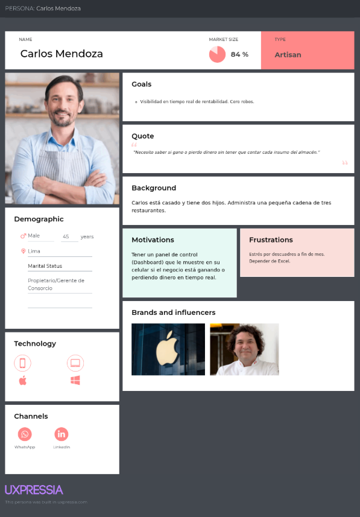

**User Persona 2: Miguel Rojas - El "Almacenero Frustrado" (Segmento 2)**
> *"Si registrar un ingreso fuera tan fácil como subir un TikTok, saldría temprano a casa."*
* **Gains:** Desea un sistema extremadamente simple y un buscador inteligente.
* **Pains:** Hacer inventario de madrugada, perder hojas de despacho.

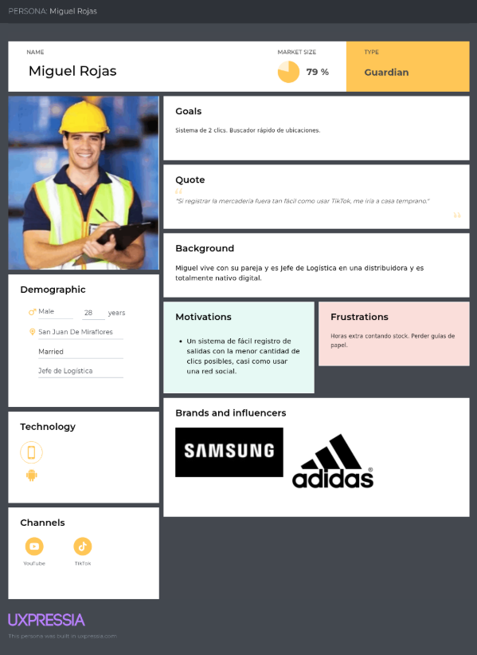

### 2.3.2. User Task Matrix

<table border="1" cellpadding="8" cellspacing="0" style="border-collapse: collapse; text-align: center; width: 100%;">
  <tr style="background-color:#f2f2f2;">
    <th rowspan="2">Task / Tarea</th>
    <th colspan="2">User Persona 1: Carlos (Dueño)</th>
    <th colspan="2">User Persona 2: Miguel (Almacenero)</th>
  </tr>
  <tr style="background-color:#f2f2f2;">
    <th>Frequency</th>
    <th>Importance</th>
    <th>Frequency</th>
    <th>Importance</th>
  </tr>
  <tr>
    <td style="text-align: left;">1. Registrar ingresos físicos de mercadería</td>
    <td>Baja</td>
    <td>Media</td>
    <td>Alta</td>
    <td>Alta</td>
  </tr>
  <tr>
    <td style="text-align: left;">2. Registrar salidas/despachos de mercadería</td>
    <td>Baja</td>
    <td>Media</td>
    <td>Alta</td>
    <td>Alta</td>
  </tr>
  <tr>
    <td style="text-align: left;">3. Buscar productos físicamente en estantes</td>
    <td>Rara vez</td>
    <td>Baja</td>
    <td>Alta</td>
    <td>Alta</td>
  </tr>
  <tr>
    <td style="text-align: left;">4. Calcular mermas / productos dañados</td>
    <td>Media</td>
    <td>Alta</td>
    <td>Media</td>
    <td>Media</td>
  </tr>
  <tr>
    <td style="text-align: left;">5. Elaborar cuadre financiero/inventario</td>
    <td>Media (Mensual)</td>
    <td>Alta</td>
    <td>Baja (a fin de mes)</td>
    <td>Alta</td>
  </tr>
  <tr>
    <td style="text-align: left;">6. Autorizar compras a proveedores</td>
    <td>Alta</td>
    <td>Alta</td>
    <td>Baja</td>
    <td>Baja</td>
  </tr>
  <tr>
    <td style="text-align: left;">7. Revisar estado general del negocio</td>
    <td>Alta (Diario)</td>
    <td>Alta</td>
    <td>Baja</td>
    <td>Baja</td>
  </tr>
</table>

 
**Análisis de la Matriz:**
La matriz evidencia que Miguel requiere interfaces móviles hiper-optimizadas para rapidez en tareas frecuentes (ingresos/salidas), mientras que Carlos requiere un Dashboard gerencial como pantalla principal para revisar el estado general. Ambos sufren con el cuadre de inventario, por lo que automatizarlo es una prioridad arquitectónica para CeTe.

### 2.3.3. User Journey Mapping

**Segmento 1: Oportunidad Carlos** (Automatizar la consolidación de datos y ofrecer Dashboard).

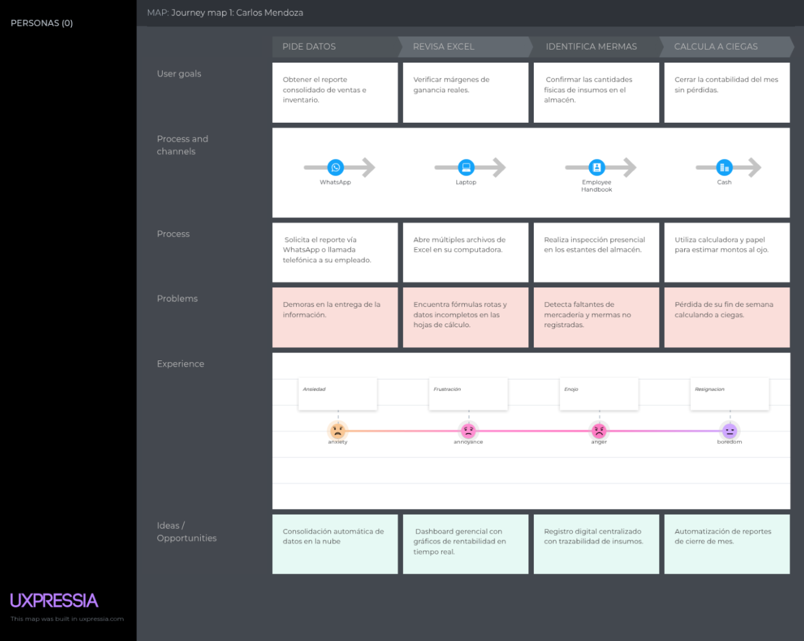

**Segmento 2: Oportunidad Miguel** (Reemplazar cuaderno por app móvil y buscador inteligente).

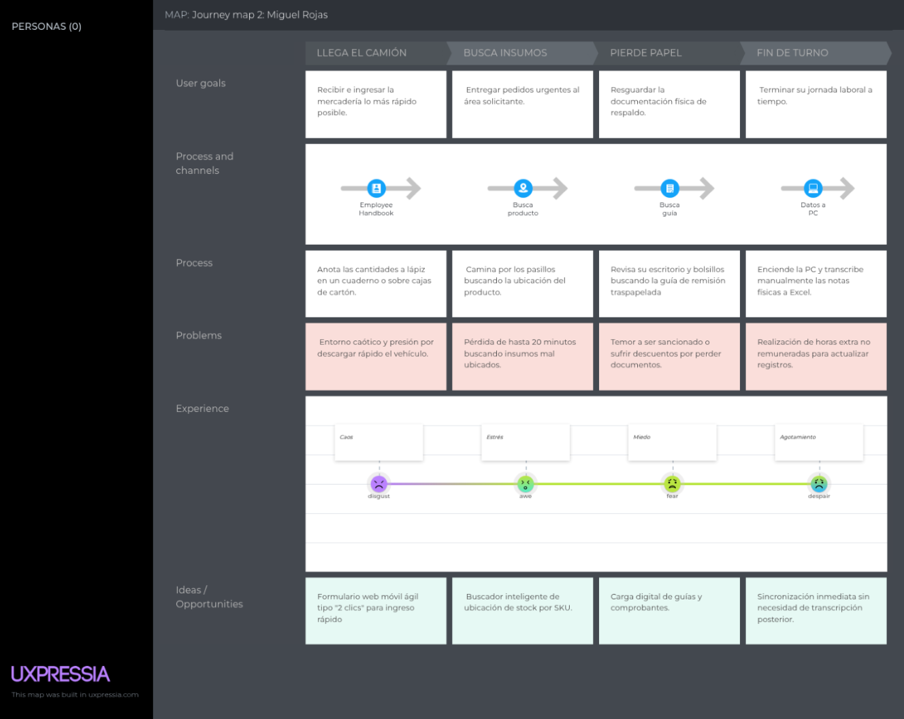

### 2.3.4. Empathy Mapping

**Empathy Map: Carlos Mendoza (Tomador de Decisión)**

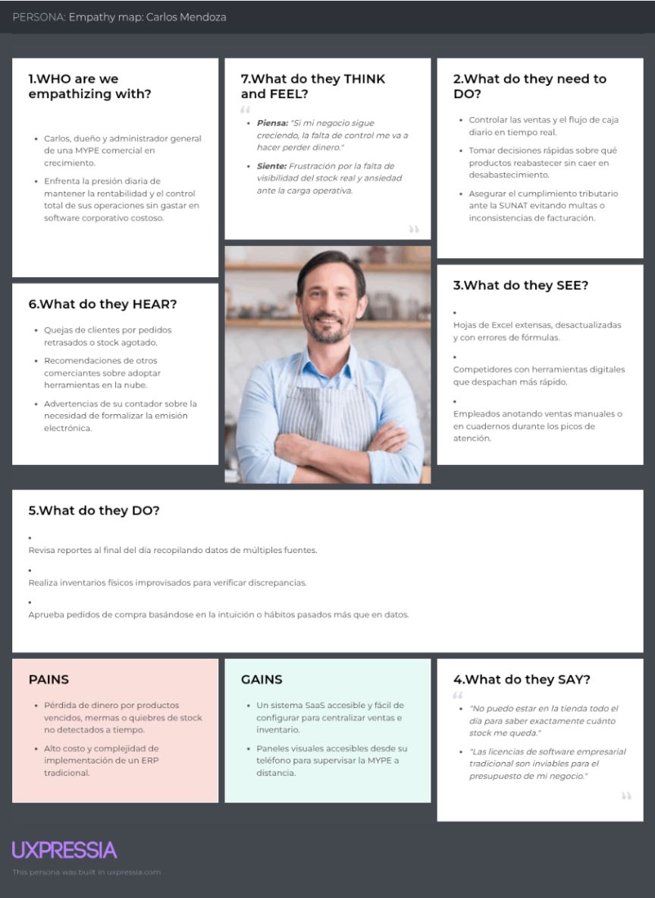

**Empathy Map: Miguel Rojas (Usuario Final)**

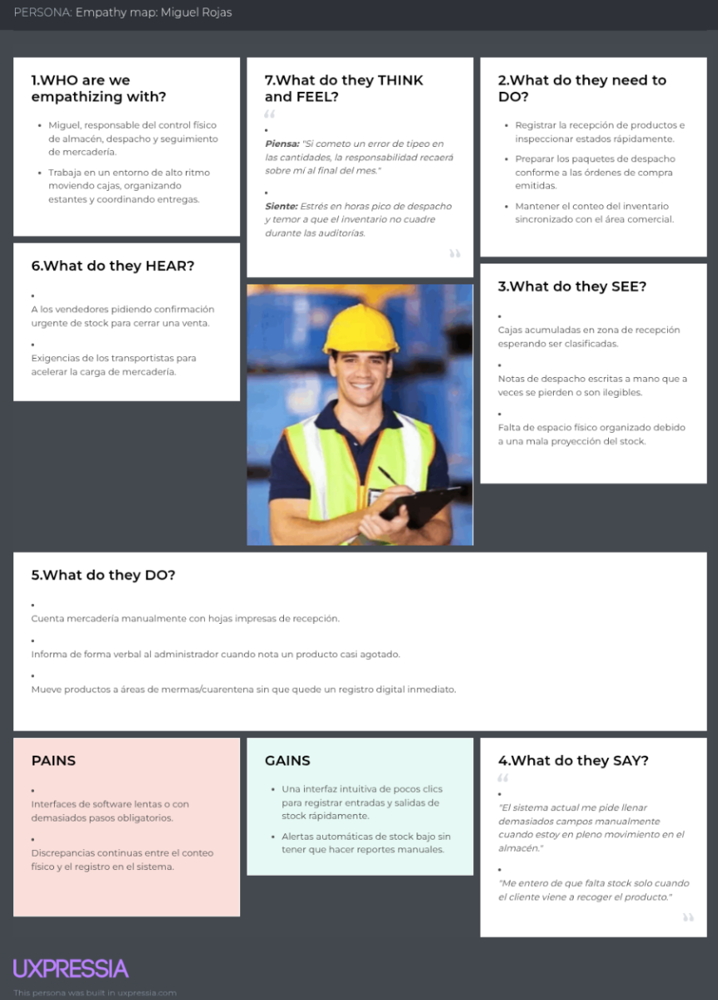

## 2.4. Big Picture EventStorming

El tablero histórico explora la operación logística y sirve como insumo de descubrimiento. La revisión AV2 precisa la secuencia del negocio: **registrar una compra no equivale a recibirla**, y confirmar una venta produce una boleta académica, no una factura fiscal. Los avisos y vencimientos identificados durante el descubrimiento siguen siendo oportunidades de evolución.


*Vista conceptual del negocio contrastada con los casos de uso actuales. Los hechos no corresponden a eventos publicados en un bus de mensajería.* [Ampliar](diagrams/business-timeline.svg) · [Fuente editable](diagrams/business-timeline.mmd)

Ver tablero histórico de descubrimiento

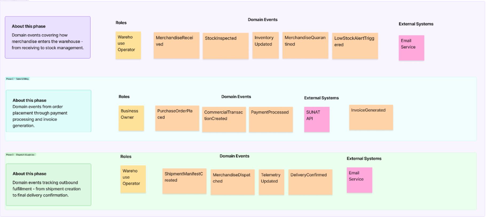

El tablero se conserva como evidencia de la etapa de descubrimiento. La secuencia AV2 y el alcance implementado se explican en el diagrama anterior y en el capítulo IV.

## 2.5. Ubiquitous Language

El lenguaje ubicuo distingue la identidad del producto, la cantidad disponible y los documentos de cada operación. Los términos se usan según su contexto; no se interpreta cada sustantivo como un agregado o una tabla independiente.

| Término de negocio | Contexto | Significado y representación actual |
| :--- | :--- | :--- |
| **Empresa / tenant** | Identidad | Organización propietaria de los datos, representada por `Tenant`. `TenantId` delimita sus operaciones. |
| **Cuenta y sesión** | Identidad | `User` identifica a la persona que accede; `UserSession` determina vigencia y revocación. No son la misma entidad. |
| **Producto / artículo** | Inventario | `Product` conserva SKU, nombre, precio y estado. `InventoryItem` es un nombre de compatibilidad en DTO, no una entidad de la API. |
| **SKU** | Inventario | Código de producto único dentro de una empresa; puede repetirse en otra. |
| **Almacén** | Inventario | `Warehouse` identifica el lugar de operación. El saldo distingue producto y almacén. |
| **Saldo disponible** | Inventario | `StockBalance.Quantity`; cantidad que puede retirarse o venderse sin quedar negativa. |
| **Movimiento** | Inventario | `InventoryMovement`; variación con signo, motivo, usuario y fecha. No sustituye al producto ni al saldo. |
| **Ingreso / salida** | Inventario | Aumento o disminución física. La salida requiere motivo y saldo suficiente. |
| **Orden de compra** | Abastecimiento | `PurchaseOrder` y sus líneas representan lo pedido al proveedor; no aumentan existencias. |
| **Recepción física** | Abastecimiento | `GoodsReceipt` y sus líneas registran lo entregado; pueden cubrir solo parte de la orden. |
| **Pendiente de recepción** | Abastecimiento | Cantidad pedida menos cantidad acumulada recibida de una línea. |
| **Venta** | Ventas | `Sale` y `SaleLine` conservan la transacción comercial y sus precios históricos. |
| **Pago registrado** | Ventas | `Payment` anota método y monto; no ejecuta cobros en tarjeta ni transferencias bancarias. |
| **Boleta académica** | Ventas | `SalesReceipt` conserva datos comerciales para visualizar e imprimir el detalle de compra. Sin emisión fiscal. |
| **Anulación de venta** | Ventas | Cambio a `CANCELLED`, restitución única de stock y reversión del registro de pago; se rechaza si tiene asignación logística. |
| **Despacho / manifiesto** | Logística | `Dispatch` agrupa ventas completadas mediante `DispatchSale`; controla conductor, placa, estado e incidencias. No es una guía fiscal. |
| **Incidencia de ruta** | Logística | `DispatchIncident` documenta un contratiempo del despacho en tránsito. |
| **Quiebre de stock** | Inventario | Ausencia de unidades disponibles. La API impide confirmar una salida que exceda el saldo. |
| **Merma / cuarentena** | Evolución del inventario | Conceptos de descubrimiento. No existe todavía un flujo de cuarentena ni valoración contable de mermas. |

La correspondencia entre estos términos, clases y tablas se desarrolla en [DDD y diseño de datos](04-Chapter-4.md#46-domain-driven-software-architecture).

# Capítulo III: Requirements Specification

La especificación reúne los requisitos de CeTe y sus habilitadores técnicos. Las historias conservan su identificador para mantener trazabilidad con el backlog, los casos de uso y las evidencias. Los criterios de aceptación usan Given–When–Then; describen lo que debe cumplirse y no equivalen a una declaración de implementación.

[Catálogo de épicas e historias](#31-user-stories) · [Impact Mapping](#32-impact-mapping) · [Product Backlog](#33-product-backlog)

## 3.1. User Stories

El catálogo reúne **10 épicas, 42 historias de usuario y 35 historias técnicas**. El Product Backlog registra su estado y prioridad por separado.

| Epic / Story ID | Título | Descripción | Criterios de aceptación | Relacionado con (Epic ID) |
| :--- | :--- | :--- | :--- | :--- |
| **EPIC-01** | Autenticación y cuenta | **Como** usuario de CeTe, **deseo** gestionar el registro, inicio, cierre y recuperación de mi cuenta, **para** acceder de forma segura a la plataforma según mi plan. | **Escenario: Validación del alcance de autenticación y cuenta** **Given** que las historias US01, US02, US03, US04 pertenecen a este epic, **When** el equipo evalúa el cumplimiento de EPIC-01, **Then** el epic se considera aceptado únicamente cuando las historias incluidas cumplen sus criterios de aceptación; el epic por sí solo no acredita implementación. | — |
| **US01** | Registro de cuenta | **Como** visitante, **deseo** registrar los datos de mi empresa, **para** crear una cuenta administradora en CeTe. | **Escenario 1: Flujo esperado** **Given** datos válidos y un RUC no registrado, **When** solicita registro, **Then** se crea la cuenta administradora y se informa el siguiente paso.  **Escenario 2: Validación** **Given** un correo o RUC ya existente, **When** solicita registro, **Then** no se crea otra cuenta y se informa el error. | EPIC-01 |
| **US02** | Inicio de sesión | **Como** usuario registrado, **deseo** autenticarme, **para** acceder al espacio de trabajo de mi empresa. | **Escenario 1: Flujo esperado** **Given** credenciales válidas, **When** solicita acceso, **Then** obtiene una sesión con su rol.  **Escenario 2: Validación** **Given** credenciales incorrectas, **When** solicita acceso, **Then** recibe un error genérico sin revelar la existencia de la cuenta. | EPIC-01 |
| **US03** | Cierre de sesión | **Como** usuario autenticado, **deseo** terminar mi sesión, **para** proteger mi cuenta y la información del negocio. | **Escenario 1: Flujo esperado** **Given** una sesión vigente, **When** solicita cerrarla, **Then** la sesión queda invalidada y es redirigido.  **Escenario 2: Validación** **Given** una sesión ya cerrada, **When** solicita un recurso protegido, **Then** se rechaza el acceso. | EPIC-01 |
| **US04** | Recuperación de contraseña | **Como** usuario registrado, **deseo** restablecer mi contraseña, **para** recuperar acceso si la he olvidado. | **Escenario 1: Flujo esperado** **Given** una solicitud con correo válido, **When** la procesa el sistema, **Then** devuelve confirmación genérica y envía enlace seguro.  **Escenario 2: Validación** **Given** un enlace vencido o utilizado, **When** intenta restablecer la contraseña, **Then** se rechaza el cambio. | EPIC-01 |
| **TS01** | POST /api/v1/authentication/sign-up | **Como** Developer, **deseo** disponer de este contrato **para** soportar el flujo de negocio asociado. | **Escenario 1: Flujo esperado** **Given** datos nuevos de cuenta y empresa, **When** ejecuta el contrato, **Then** obtiene 200 con cuenta y empresa.  **Escenario 2: Validación** **Given** correo o RUC duplicado, **When** ejecuta el contrato, **Then** obtiene 409. | EPIC-01 |
| **TS02** | POST /api/v1/authentication/sign-in | **Como** Developer, **deseo** disponer de este contrato **para** soportar el flujo de negocio asociado. | **Escenario 1: Flujo esperado** **Given** credenciales correctas, **When** ejecuta el contrato, **Then** obtiene 200 con token y perfil.  **Escenario 2: Validación** **Given** contraseña incorrecta, **When** ejecuta el contrato, **Then** obtiene 401 genérico. | EPIC-01 |
| **TS03** | POST /api/v1/authentication/sign-out | **Como** Developer, **deseo** disponer de este contrato **para** soportar el flujo de negocio asociado. | **Escenario 1: Flujo esperado** **Given** sesión vigente, **When** ejecuta el contrato, **Then** obtiene 204 y sesión revocada.  **Escenario 2: Validación** **Given** token ya revocado en una consulta posterior, **When** ejecuta el contrato, **Then** obtiene 401. | EPIC-01 |
| **TS04** | POST /api/v1/auth/password-reset | **Como** Developer, **deseo** disponer de este contrato **para** soportar US04. | **Escenario 1: Flujo esperado** **Given** solicitud válida, **When** servidor procesa, **Then** responde 202 Accepted genérico.  **Escenario 2: Validación** **Given** solicitudes masivas, **When** procesa, **Then** limita reintentos por rate limiting. | EPIC-01 |
| **TS32** | Docker y publicación de API y PostgreSQL | **Como** Developer, **deseo** soportar US01 mediante este habilitador. | **Escenario 1: Flujo esperado** **Given** API y PostgreSQL configurados, **When** ejecuta el contrato, **Then** obtiene 200 en /health y persistencia tras reinicio.  **Escenario 2: Validación** **Given** base inaccesible después de iniciar el servidor, **When** ejecuta el contrato, **Then** obtiene 503 en /health sin exponer secretos. | EPIC-01 |
| **EPIC-02** | Gestión de Inventario | **Como** operario de almacén, **deseo** gestionar las existencias, artículos y mermas, **para** mantener el stock actualizado y evitar descuadres físicos y lógicos. | **Escenario: Validación del alcance de gestión de inventario** **Given** que las historias US09, US10, US11, US12, US13, US14 pertenecen a este epic, **When** el equipo evalúa el cumplimiento de EPIC-02, **Then** el epic se considera aceptado únicamente cuando dichas historias cumplen sus criterios y respetan las reglas lógicas del stock. | — |
| **US09** | Registro de Artículo (SKU) | **Como** operario, **deseo** dar de alta un nuevo producto, **para** que esté disponible **para** futuras transacciones. | **Escenario 1: Flujo esperado** **Given** datos válidos, **When** guarda el registro, **Then** el artículo se crea con stock inicial 0.  **Escenario 2: Validación** **Given** un SKU ya existente, **When** intenta registrarlo, **Then** se rechaza la duplicación en la empresa. | EPIC-02 |
| **US10** | Ingreso de Mercadería | **Como** operario, **deseo** sumar unidades físicas a un SKU existente, **para** reflejar el abastecimiento del almacén. | **Escenario 1: Flujo esperado** **Given** cantidad positiva, **When** registra la entrada, **Then** el stock total del SKU se incrementa atómicamente.  **Escenario 2: Validación** **Given** cantidad negativa o nula, **When** intenta registrar, **Then** se impide la transacción. | EPIC-02 |
| **US11** | Salida Manual de Mercadería | **Como** operario, **deseo** registrar el retiro manual de productos, **para** reflejar consumos internos o ajustes. | **Escenario 1: Flujo esperado** **Given** stock suficiente y motivo válido, **When** registra la salida, **Then** el inventario disminuye.  **Escenario 2: Validación** **Given** retiro mayor al stock, **When** solicita la acción, **Then** emite alerta de insuficiencia. | EPIC-02 |
| **US12** | Registro de Mermas | **Como** operario, **deseo** apartar productos dañados o caducados, **para** evitar que sean vendidos por error. | **Escenario 1: Flujo esperado** **Given** producto en mal estado, **When** lo marca como merma, **Then** se descuenta del stock y se registra como pérdida.  **Escenario 2: Validación** **Given** producto marcado como merma, **When** consulta Dashboard, **Then** el costo impacta negativamente la rentabilidad. | EPIC-02 |
| **US13** | Buscador de Inventario | **Como** operario, **deseo** buscar productos por nombre o SKU, **para** localizarlos rápidamente sin listas largas. | **Escenario 1: Flujo esperado** **Given** término coincidente, **When** ingresa al menos 3 caracteres, **Then** filtra la tabla en tiempo real.  **Escenario 2: Validación** **Given** término sin coincidencias, **When** busca, **Then** obtiene resultado vacío sin errores. | EPIC-02 |
| **US14** | Historial de Movimientos | **Como** participante autorizado, **deseo** ver el Kardex de un producto, **para** auditar discrepancias o mermas. | **Escenario 1: Flujo esperado** **Given** SKU con movimientos, **When** consulta historial, **Then** obtiene lista cronológica.  **Escenario 2: Validación** **Given** producto recién creado, **When** consulta historial, **Then** tabla vacía sin error. | EPIC-02 |
| **TS05** | GET /api/v1/inventory | **Como** Developer, **deseo** disponer de este contrato **para** soportar el flujo de negocio asociado. | **Escenario 1: Flujo esperado** **Given** sesión vigente, **When** ejecuta el contrato, **Then** obtiene 200 con productos de la empresa.  **Escenario 2: Validación** **Given** petición sin token, **When** ejecuta el contrato, **Then** obtiene 401. | EPIC-02 |
| **TS06** | POST /api/v1/inventory | **Como** Developer, **deseo** disponer de este contrato **para** soportar el flujo de negocio asociado. | **Escenario 1: Flujo esperado** **Given** SKU nuevo y precio válido, **When** ejecuta el contrato, **Then** obtiene 200 con producto de stock cero.  **Escenario 2: Validación** **Given** SKU ya registrado, **When** ejecuta el contrato, **Then** obtiene 409. | EPIC-02 |
| **TS07** | POST /api/v1/inventory/{id}/entries | **Como** Developer, **deseo** disponer de este contrato **para** soportar el flujo de negocio asociado. | **Escenario 1: Flujo esperado** **Given** producto propio, cantidad positiva y motivo, **When** ejecuta el contrato, **Then** obtiene 200 con stock y movimiento.  **Escenario 2: Validación** **Given** producto de otra empresa, **When** ejecuta el contrato, **Then** obtiene 404. | EPIC-02 |
| **TS08** | POST /api/v1/inventory/{id}/exits | **Como** Developer, **deseo** disponer de este contrato **para** soportar el flujo de negocio asociado. | **Escenario 1: Flujo esperado** **Given** stock suficiente, cantidad positiva y motivo, **When** ejecuta el contrato, **Then** obtiene 200 con stock y movimiento.  **Escenario 2: Validación** **Given** cantidad mayor al stock, **When** ejecuta el contrato, **Then** obtiene 409 sin cambios parciales. | EPIC-02 |
| **TS09** | GET /api/v1/inventory/{id}/history | **Como** Developer, **deseo** disponer de este contrato **para** soportar el flujo de negocio asociado. | **Escenario 1: Flujo esperado** **Given** producto propio, **When** ejecuta el contrato, **Then** obtiene 200 con historial.  **Escenario 2: Validación** **Given** producto ajeno, **When** ejecuta el contrato, **Then** obtiene 404. | EPIC-02 |
| **EPIC-03** | Transacciones Comerciales | **Como** dueño de negocio, **deseo** gestionar el ciclo de vida de las ventas y transacciones diarias, **para** registrar los ingresos y descontar productos del almacén. | **Escenario: Validación del ciclo de vida de una transacción** **Given** que las historias US15, US16, US17, US18, US35, US36, US39 pertenecen a este epic, **When** el equipo valida EPIC-03, **Then** las operaciones respetan el flujo de ventas, impactan directamente en el inventario disponible y liberan o retornan stock si la venta es anulada. | — |
| **US15** | Armado de Orden de Venta | **Como** vendedor, **deseo** agregar y editar productos en un listado de nueva venta, **para** calcular el subtotal y total a cobrar. | **Escenario 1: Flujo esperado** **Given** un catálogo con productos disponibles, **When** selecciona artículos y cantidades, **Then** se listan en la orden actualizando el subtotal.  **Escenario 2: Validación** **Given** un intento de agregar un producto inactivo o inexistente, **When** procesa la orden, **Then** muestra un mensaje de error y bloquea la adición. | EPIC-03 |
| **US16** | Validación Automática de Stock | **Como** vendedor, **deseo** bloqueo de productos agotados en caja, **para** no prometer mercadería inexistente. | **Escenario 1: Flujo esperado** **Given** producto con stock cero, **When** intenta añadirlo, **Then** botón se deshabilita preventivamente.  **Escenario 2: Validación** **Given** 5 unidades y venta de 6, **When** ingresa cantidad, **Then** alerta exceso y ajusta al máximo. | EPIC-03 |
| **US17** | Historial de Ventas | **Como** participante autorizado, **deseo** consultar transacciones pasadas, **para** llevar el control de ingresos diarios. | **Escenario 1: Flujo esperado** **Given** ventas registradas, **When** consulta módulo, **Then** las obtiene ordenadas por fecha.  **Escenario 2: Validación** **Given** filtro de fechas invertido, **When** intenta aplicar, **Then** solicita corregir el rango. | EPIC-03 |
| **US18** | Anulación de Venta | **Como** dueño, **deseo** revertir una venta equivocada, **para** corregir métricas y devolver stock. | **Escenario 1: Flujo esperado** **Given** venta completada, **When** solicita anulación, **Then** estado pasa a "Anulada" y stock se reintegra atómicamente.  **Escenario 2: Validación** **Given** venta ya anulada, **When** intenta anularla, **Then** bloquea acción para evitar duplicidad. | EPIC-03 |
| **US35** | Procesamiento de Pago de Venta | **Como** vendedor, **deseo** confirmar el método de pago y finalizar la transacción, **para** formalizar el ingreso comercial. | **Escenario 1: Flujo esperado** **Given** una orden armada y válida, **When** confirma el método de pago, **Then** la venta pasa a estado completado y se genera el comprobante.  **Escenario 2: Validación** **Given** problemas de conexión con el servicio de cobro, **When** la transacción falla, **Then** aplica rollback al pago y notifica el error sin alterar la orden. | EPIC-03 |
| **US36** | Descuento Automático de Stock | **Como** dueño, **deseo** que al confirmar una venta se reduzca automáticamente el inventario, **para** evitar el doble registro manual y descuadres. | **Escenario 1: Flujo esperado** **Given** una venta completada exitosamente, **When** el sistema procesa el cierre de la transacción, **Then** se descuentan atómicamente las unidades vendidas del stock del almacén.  **Escenario 2: Validación** **Given** una venta que supera el stock físico de un producto en el último segundo, **When** intenta descontar, **Then** bloquea la finalización, aplica rollback y alerta al vendedor. | EPIC-03 |
| **US39** | Visualizar e imprimir boleta | **Como** vendedor, **deseo** consultar e imprimir el comprobante de una venta, **para** entregar al cliente el detalle de su compra. | **Escenario 1: Flujo esperado** **Given** una venta confirmada, **When** abro la boleta, **Then** veo empresa, RUC, orden, fecha/hora de Lima, dirección, vendedor, cliente, productos, cantidades, precios y total.  **Escenario 2: Validación** **Given** cambios posteriores de catálogo, **When** consulto la boleta, **Then** conserva sus datos históricos.  **Escenario 3: Validación** **Given** una venta ajena, **When** solicito la boleta, **Then** responde 404. | EPIC-03 |
| **TS10** | GET /api/v1/sales | **Como** Developer, **deseo** disponer de este contrato **para** soportar el flujo de negocio asociado. | **Escenario 1: Flujo esperado** **Given** sesión vigente, **When** ejecuta el contrato, **Then** obtiene 200 con ventas propias.  **Escenario 2: Validación** **Given** petición sin token, **When** ejecuta el contrato, **Then** obtiene 401. | EPIC-03 |
| **TS11** | POST /api/v1/sales | **Como** Developer, **deseo** disponer de este contrato **para** soportar el flujo de negocio asociado. | **Escenario 1: Flujo esperado** **Given** orden válida y stock suficiente, **When** ejecuta el contrato, **Then** obtiene 200 con venta, pago registrado y boleta atómicos.  **Escenario 2: Validación** **Given** stock insuficiente en una línea, **When** ejecuta el contrato, **Then** obtiene 409 y rollback completo. | EPIC-03 |
| **TS12** | GET /api/v1/sales/{id} | **Como** Developer, **deseo** disponer de este contrato **para** soportar detalle de venta. | **Escenario 1: Flujo esperado** **Given** solicitud de ID, **When** servidor procesa, **Then** responde 200 OK con ítems asociados.  **Escenario 2: Validación** **Given** venta de otro tenant, **When** procesa, **Then** responde 403 Forbidden. | EPIC-03 |
| **TS13** | PATCH /api/v1/sales/{id}/cancel | **Como** Developer, **deseo** disponer de este contrato **para** soportar el flujo de negocio asociado. | **Escenario 1: Flujo esperado** **Given** administrador y venta completada sin despacho, **When** ejecuta el contrato, **Then** obtiene 200 con anulación y reposición única.  **Escenario 2: Validación** **Given** venta ya anulada, **When** ejecuta el contrato, **Then** obtiene 409 sin reponer nuevamente. | EPIC-03 |
| **TS28** | GET /api/v1/sales/{id}/receipt | **Como** Developer, **deseo** soportar US39 mediante este habilitador. | **Escenario 1: Flujo esperado** **Given** venta propia confirmada, **When** ejecuta el contrato, **Then** obtiene 200 con instantánea histórica.  **Escenario 2: Validación** **Given** venta de otra empresa, **When** ejecuta el contrato, **Then** obtiene 404. | EPIC-03 |
| **TS31** | Idempotencia y transacción serializable | **Como** Developer, **deseo** soportar US35 mediante este habilitador. | **Escenario 1: Flujo esperado** **Given** UUID ya procesado y mismo contenido, **When** ejecuta el contrato, **Then** obtiene 200 con la venta existente sin duplicar stock ni pago.  **Escenario 2: Validación** **Given** mismo UUID con contenido diferente, **When** ejecuta el contrato, **Then** obtiene 409. | EPIC-03 |
| **TS34** | Pruebas de dominio, HTTP y navegador | **Como** Developer, **deseo** soportar US39 mediante este habilitador. | **Escenario 1: Flujo esperado** **Given** servicios de prueba disponibles, **When** ejecuta el contrato, **Then** obtiene suite de dominio, HTTP y navegador aprobada.  **Escenario 2: Validación** **Given** incumplimiento de un resultado esperado, **When** ejecuta el contrato, **Then** obtiene código de salida no cero y diagnóstico sin credenciales. | EPIC-03 |
| **EPIC-04** | Logística y Despacho | **Como** jefe de logística, **deseo** gestionar guías, manifiestos de despacho e incidencias, **para** organizar la salida de mercadería y mantener la trazabilidad. | **Escenario: Validación de la gestión de despachos e incidencias** **Given** que las historias US19, US20, US21, US22 pertenecen a este epic, **When** se registra un manifiesto o una incidencia en ruta, **Then** la información queda asociada a una venta verificada, es trazable y actualiza el estado logístico correctamente. | — |
| **US19** | Manifiesto de Despacho | **Como** logístico, **deseo** agrupar ventas en un manifiesto, **para** ordenar la ruta de entrega. | **Escenario 1: Flujo esperado** **Given** ventas pendientes, **When** selecciona y crea manifiesto, **Then** se genera documento consolidado.  **Escenario 2: Validación** **Given** ventas ya despachadas, **When** intenta agruparlas, **Then** el sistema las oculta o bloquea. | EPIC-04 |
| **US20** | Asignación de Conductor | **Como** logístico, **deseo** vincular recursos al manifiesto, **para** establecer responsables de entrega. | **Escenario 1: Flujo esperado** **Given** manifiesto y recursos disponibles, **When** asigna chofer y placa, **Then** datos quedan vinculados al despacho.  **Escenario 2: Validación** **Given** chofer ocupado, **When** intenta asignarlo, **Then** advierte sobre superposición. | EPIC-04 |
| **US21** | Actualización de Estado | **Como** logístico, **deseo** cambiar el estado del envío, **para** notificar su entrega efectiva. | **Escenario 1: Flujo esperado** **Given** despacho "En Ruta", **When** lo marca "Entregado", **Then** ventas asociadas finalizan su ciclo.  **Escenario 2: Validación** **Given** estado ilógico, **When** intenta retroceder, **Then** impide la transición. | EPIC-04 |
| **US22** | Incidencia en Ruta | **Como** logístico, **deseo** anotar contratiempos logísticos, **para** auditar retrasos en entregas. | **Escenario 1: Flujo esperado** **Given** despacho activo, **When** reporta incidente, **Then** nota queda vinculada a la ruta.  **Escenario 2: Validación** **Given** ruta sin eventos, **When** consulta incidencias, **Then** vista limpia sin errores. | EPIC-04 |
| **TS14** | GET /api/v1/dispatches | **Como** Developer, **deseo** disponer de este contrato **para** soportar el flujo de negocio asociado. | **Escenario 1: Flujo esperado** **Given** sesión vigente, **When** ejecuta el contrato, **Then** obtiene 200 con despachos propios.  **Escenario 2: Validación** **Given** petición sin token, **When** ejecuta el contrato, **Then** obtiene 401. | EPIC-04 |
| **TS15** | POST /api/v1/dispatches | **Como** Developer, **deseo** disponer de este contrato **para** soportar el flujo de negocio asociado. | **Escenario 1: Flujo esperado** **Given** ventas y recursos disponibles, **When** ejecuta el contrato, **Then** obtiene 200 con despacho y asociaciones.  **Escenario 2: Validación** **Given** venta ya asignada, **When** ejecuta el contrato, **Then** obtiene 409. | EPIC-04 |
| **TS16** | PUT /api/v1/dispatches/{id} | **Como** Developer, **deseo** disponer de este contrato **para** soportar el flujo de negocio asociado. | **Escenario 1: Flujo esperado** **Given** despacho PENDING y estado solicitado IN_TRANSIT, **When** ejecuta el contrato, **Then** obtiene 200 con transición.  **Escenario 2: Validación** **Given** despacho PENDING y salto a DELIVERED, **When** ejecuta el contrato, **Then** obtiene 409. | EPIC-04 |
| **TS17** | POST /api/v1/dispatches/{id}/incidents | **Como** Developer, **deseo** disponer de este contrato **para** soportar el flujo de negocio asociado. | **Escenario 1: Flujo esperado** **Given** despacho IN_TRANSIT y descripción no vacía, **When** ejecuta el contrato, **Then** obtiene 200 con incidencia y estado INCIDENT.  **Escenario 2: Validación** **Given** descripción vacía, **When** ejecuta el contrato, **Then** obtiene 422. | EPIC-04 |
| **EPIC-05** | Dashboard y Rentabilidad | **Como** dueño de negocio, **deseo** visualizar métricas clave y reportes en tiempo real, **para** localizar información financiera relevante y tomar decisiones. | **Escenario: Validación de reportes y dashboard** **Given** que las historias US23, US24, US25, US37, US38 pertenecen a este epic, **When** el usuario consulta sus KPIs o exporta datos, **Then** el sistema devuelve únicamente información consolidada y autorizada que refleja el cruce exacto entre ventas e inventario. | — |
| **US23** | Dashboard: Tarjetas de Indicadores (KPIs) | **Como** dueño, **deseo** visualizar tarjetas numéricas con métricas clave (ingresos del día, número de ventas), **para** conocer el estado actual de un vistazo. | **Escenario 1: Flujo esperado** **Given** datos financieros activos, **When** carga el dashboard, **Then** visualiza tarjetas con los totales de ingresos y operaciones al día de hoy.  **Escenario 2: Validación** **Given** un negocio reciente sin datos procesados, **When** carga las tarjetas, **Then** visualiza los montos en cero sin que el sistema arroje errores. | EPIC-05 |
| **US24** | Reporte de Top Productos | **Como** dueño, **deseo** identificar los artículos más vendidos, **para** priorizar abastecimiento. | **Escenario 1: Flujo esperado** **Given** ventas en el mes, **When** consulta ranking, **Then** obtiene lista descendente precisa.  **Escenario 2: Validación** **Given** empate en ventas, **When** genera reporte, **Then** comparten posición alfabéticamente. | EPIC-05 |
| **US25** | Exportación de Datos | **Como** participante autorizado, **deseo** descargar mis tablas a CSV, **para** enviarlas a contabilidad. | **Escenario 1: Flujo esperado** **Given** tabla filtrada en pantalla, **When** hace clic en exportar, **Then** descarga CSV respetando filtro activo.  **Escenario 2: Validación** **Given** tabla vacía, **When** intenta exportar, **Then** archivo contiene solo cabeceras. | EPIC-05 |
| **US37** | Dashboard: Gráfico de Tendencias | **Como** dueño, **deseo** visualizar un gráfico de barras/líneas con los ingresos en el tiempo, **para** analizar el comportamiento financiero de la MYPE. | **Escenario 1: Flujo esperado** **Given** transacciones históricas registradas, **When** consulta el gráfico en el panel, **Then** visualiza la tendencia de ventas agrupada por día o mes.  **Escenario 2: Validación** **Given** un rango de fechas filtrado donde no hubo operaciones, **When** filtra el gráfico, **Then** muestra el lienzo en blanco con un mensaje amigable indicando que no hay datos. | EPIC-05 |
| **US38** | Dashboard: Panel de Resumen de Inventario | **Como** dueño, **deseo** ver una sección en el dashboard que liste rápidamente los productos próximos a agotarse, **para** tomar decisiones inmediatas de reabastecimiento. | **Escenario 1: Flujo esperado** **Given** productos con stock por debajo de su cantidad mínima establecida, **When** carga el panel principal, **Then** los lista ordenados por nivel de criticidad (del más urgente al menos urgente).  **Escenario 2: Validación** **Given** un inventario en estado óptimo, **When** carga el panel de resumen, **Then** muestra un indicador visual confirmando que todo el stock está saludable. | EPIC-05 |
| **TS18** | GET /api/v1/analytics/dashboard | **Como** Developer, **deseo** disponer de este contrato **para** soportar el flujo de negocio asociado. | **Escenario 1: Flujo esperado** **Given** administrador autenticado, **When** ejecuta el contrato, **Then** obtiene 200 con métricas propias y día de Lima.  **Escenario 2: Validación** **Given** rol Warehouse, **When** ejecuta el contrato, **Then** obtiene 403. | EPIC-05 |
| **TS35** | GET /api/v1/integrations/exchange-rates | **Como** Developer, **deseo** soportar US23 mediante este habilitador. | **Escenario 1: Flujo esperado** **Given** proveedor externo disponible, **When** ejecuta el contrato, **Then** obtiene 200 con USD/PEN, fuente y actualización.  **Escenario 2: Validación** **Given** error HTTP o timeout del proveedor, **When** ejecuta el contrato, **Then** obtiene 503. | EPIC-05 |
| **EPIC-06** | Notificaciones y Alertas | **Como** participante autorizado, **deseo** recibir notificaciones sobre stock mínimo y vencimientos, **para** reabastecer a tiempo sin monitorear manualmente cada producto. | **Escenario: Validación de notificaciones y alertas preventivas** **Given** que las historias US26, US27 pertenecen a este epic, **When** ocurre un evento notificable como un quiebre de stock, **Then** el sistema genera avisos solo para los destinatarios autorizados y evita alertas duplicadas para el mismo evento. | — |
| **US26** | Alerta de Stock Mínimo | **Como** participante autorizado, **deseo** recibir avisos al acercarme a cero, **para** reponer mercadería a tiempo. | **Escenario 1: Flujo esperado** **Given** SKU con límite configurado, **When** stock perfora límite, **Then** dispara alerta visual.  **Escenario 2: Validación** **Given** alerta ya enviada, **When** stock baja más, **Then** no duplica notificación. | EPIC-06 |
| **US27** | Alerta de Producto Vencido | **Como** almacenero, **deseo** avisos preventivos de caducidad, **para** ofertar artículos perecibles. | **Escenario 1: Flujo esperado** **Given** lotes con caducidad, **When** alcanza umbral de 7 días, **Then** artículos se resaltan en rojo.  **Escenario 2: Validación** **Given** producto ya vencido, **When** intenta vender, **Then** emite doble alerta de confirmación. | EPIC-06 |
| **TS19** | GET /api/v1/notifications | **Como** Developer, **deseo** disponer de este contrato **para** soportar alertas de sistema. | **Escenario 1: Flujo esperado** **Given** solicitud autorizada, **When** servidor procesa, **Then** responde 200 OK con array de alertas no leídas.  **Escenario 2: Validación** **Given** sin sesión, **When** procesa, **Then** responde 401 Unauthorized sin cruzar datos. | EPIC-06 |
| **TS20** | PATCH /api/v1/notifications/{id}/read | **Como** Developer, **deseo** disponer de este contrato **para** marcar alertas leídas. | **Escenario 1: Flujo esperado** **Given** ID de alerta válido, **When** servidor procesa, **Then** responde 200 OK actualizando isRead.  **Escenario 2: Validación** **Given** alerta ajena, **When** procesa, **Then** responde 404 Not Found. | EPIC-06 |
| **EPIC-07** | Roles y Permisos | **Como** administrador de la cuenta, **deseo** gestionar los accesos y crear usuarios empleados, **para** proteger la confidencialidad financiera de la empresa. | **Escenario: Validación de seguridad de roles** **Given** que las historias US28, US29 pertenecen a este epic, **When** un usuario intenta acceder a un recurso, **Then** el epic exige que el sistema verifique el rol del usuario y deniegue o autorice el acceso a módulos específicos (ej. reportes). | — |
| **US28** | Creación de Usuarios | **Como** administrador, **deseo** crear cuentas **para** mis trabajadores, **para** delegar accesos seguros. | **Escenario 1: Flujo esperado** **Given** correo nuevo y rol elegido, **When** envía invitación, **Then** empleado recibe acceso.  **Escenario 2: Validación** **Given** correo que ya pertenece a la empresa, **When** intenta agregarlo, **Then** indica que el usuario ya existe. | EPIC-07 |
| **US29** | Restricción por Roles | **Como** administrador, **deseo** definir niveles de acceso operacionales, **para** bloquear módulos confidenciales. | **Escenario 1: Flujo esperado** **Given** usuario con rol almacenero, **When** navega por menú, **Then** no visualiza enlace a reportes.  **Escenario 2: Validación** **Given** intento de acceso directo por URL a recurso prohibido, **When** ejecuta petición, **Then** API devuelve 403 Forbidden. | EPIC-07 |
| **TS21** | GET /api/v1/users | **Como** Developer, **deseo** disponer de este contrato **para** soportar el flujo de negocio asociado. | **Escenario 1: Flujo esperado** **Given** administrador autenticado, **When** ejecuta el contrato, **Then** obtiene 200 con usuarios sin contraseñas ni hashes.  **Escenario 2: Validación** **Given** rol Warehouse, **When** ejecuta el contrato, **Then** obtiene 403. | EPIC-07 |
| **TS22** | POST /api/v1/users | **Como** Developer, **deseo** disponer de este contrato **para** soportar el flujo de negocio asociado. | **Escenario 1: Flujo esperado** **Given** administrador y empleado nuevo con rol permitido, **When** ejecuta el contrato, **Then** obtiene 200 con perfil.  **Escenario 2: Validación** **Given** rol no permitido, **When** ejecuta el contrato, **Then** obtiene 422. | EPIC-07 |
| **TS33** | Aislamiento de empresa y relaciones compuestas | **Como** Developer, **deseo** soportar US29 mediante este habilitador. | **Escenario 1: Flujo esperado** **Given** sesión de empresa A y recurso de A, **When** ejecuta el contrato, **Then** obtiene 200 para la operación permitida.  **Escenario 2: Validación** **Given** sesión de A y boleta de B, **When** ejecuta el contrato, **Then** obtiene 404 sin revelar datos ajenos. | EPIC-07 |
| **EPIC-08** | Perfil y preferencias | **Como** usuario registrado, **deseo** administrar mis datos de empresa, contraseña e idioma, **para** mantener mi cuenta actualizada y adaptar la interfaz. | **Escenario: Validación de perfil y preferencias** **Given** que las historias US30, US31, US33 pertenecen a este epic, **When** el usuario modifica información permitida de su cuenta, **Then** el sistema valida los cambios, conserva las restricciones de seguridad y persiste las preferencias admitidas como el idioma. | — |
| **US30** | Edición de Perfil Empresa | **Como** administrador, **deseo** actualizar mis datos comerciales, **para** mantener facturas e interfaz personalizadas. | **Escenario 1: Flujo esperado** **Given** datos válidos, **When** guarda actualización, **Then** header refleja cambios.  **Escenario 2: Validación** **Given** intento de modificar RUC base, **When** guarda, **Then** bloquea acción por seguridad fiscal. | EPIC-08 |
| **US31** | Cambio de Contraseña | **Como** usuario registrado, **deseo** actualizar mi clave, **para** asegurar mi cuenta. | **Escenario 1: Flujo esperado** **Given** clave actual correcta y nueva válida, **When** confirma cambio, **Then** actualiza y cierra otras sesiones activas.  **Escenario 2: Validación** **Given** contraseña actual incorrecta, **When** intenta cambiarla, **Then** rechaza la acción. | EPIC-08 |
| **US33** | Idioma de la aplicación | **Como** usuario, **deseo** elegir inglés o español, **para** comprender la interfaz a mi gusto. | **Escenario 1: Flujo esperado** **Given** selector de idioma, **When** elige "English", **Then** textos estáticos se traducen al instante.  **Escenario 2: Validación** **Given** contenido ingresado por usuario, **When** cambia idioma, **Then** dicho texto no se altera. | EPIC-08 |
| **TS23** | GET /api/v1/users/profile | **Como** Developer, **deseo** disponer de este contrato **para** cargar la vista de cuenta. | **Escenario 1: Flujo esperado** **Given** solicitud válida, **When** servidor procesa, **Then** responde 200 OK con datos personales e idioma.  **Escenario 2: Validación** **Given** condición inválida, **When** procesa, **Then** responde 401 sin sesión válida. | EPIC-08 |
| **TS24** | PUT /api/v1/users/profile | **Como** Developer, **deseo** disponer de este contrato **para** soportar US30. | **Escenario 1: Flujo esperado** **Given** datos editables válidos, **When** servidor procesa, **Then** responde 200 OK persistiendo cambios.  **Escenario 2: Validación** **Given** payload inyectando cambio de rol, **When** procesa, **Then** ignora el campo o responde 400 Bad Request. | EPIC-08 |
| **TS25** | PUT /api/v1/users/password | **Como** Developer, **deseo** disponer de este contrato **para** soportar US31. | **Escenario 1: Flujo esperado** **Given** claves correctas, **When** servidor procesa, **Then** responde 204 No Content hasheando y guardando.  **Escenario 2: Validación** **Given** hash actual incorrecto, **When** procesa, **Then** responde 400 Bad Request sin alterar credenciales. | EPIC-08 |
| **EPIC-09** | Landing page | **Como** visitante de CeTe, **deseo** conocer la propuesta, funcionalidades, testimonios y planes, **para** evaluar la solución antes de continuar a la plataforma. | **Escenario: Validación del contenido y navegación del landing page** **Given** que las historias US05, US06, US07, US08, US32, US34, US42 pertenecen a este epic, **When** el visitante navega por el landing page, **Then** el contenido es accesible, no presenta funciones proyectadas como implementadas y permite continuar el recorrido de registro. | — |
| **US05** | Propuesta de valor en landing | **Como** visitante, **deseo** conocer la propuesta de valor de CeTe, **para** evaluar si soluciona mis problemas operativos. | **Escenario 1: Flujo esperado** **Given** acceso a la landing, **When** consulta la propuesta, **Then** identifica el problema logístico y la solución centralizada.  **Escenario 2: Validación** **Given** acceso desde móvil, **When** consulta la propuesta, **Then** el contenido conserva legibilidad y diseño responsivo. | EPIC-09 |
| **US06** | Funcionalidades de landing | **Como** visitante, **deseo** conocer las capacidades del producto, **para** comprobar si cubre mis necesidades de negocio. | **Escenario 1: Flujo esperado** **Given** consulta de capacidades, **When** revisa su alcance, **Then** encuentra módulos de inventario, ventas y reportes descritos.  **Escenario 2: Validación** **Given** un usuario navegando, **When** hace clic en funcionalidad en construcción, **Then** el sistema informa que estará disponible próximamente. | EPIC-09 |
| **US07** | Modelo comercial y planes | **Como** visitante, **deseo** consultar modalidades y planes de suscripción, **para** evaluar una posible contratación **para** mi MYPE. | **Escenario 1: Flujo esperado** **Given** modalidades publicadas, **When** las consulta, **Then** distingue límites de usuarios y costos.  **Escenario 2: Validación** **Given** selección de un plan, **When** continúa el flujo, **Then** es dirigido al registro con plan preseleccionado sin ejecutar cobros inmediatos. | EPIC-09 |
| **US08** | Contacto B2B | **Como** visitante corporativo, **deseo** enviar un mensaje a ventas, **para** solicitar una demostración personalizada. | **Escenario 1: Flujo esperado** **Given** datos de contacto válidos, **When** envía el formulario, **Then** confirma el envío y notifica al equipo.  **Escenario 2: Validación** **Given** un correo con formato inválido, **When** intenta enviar, **Then** resalta el error y bloquea el envío. | EPIC-09 |
| **US32** | Testimonios (Landing) | **Como** visitante, **deseo** consultar experiencias de otras MYPES, **para** ganar confianza. | **Escenario 1: Flujo esperado** **Given** testimonios aprobados, **When** hace scroll, **Then** visualiza tarjetas.  **Escenario 2: Validación** **Given** fallo de conexión, **When** carga testimonios, **Then** se oculta elegantemente. | EPIC-09 |
| **US34** | Términos del Servicio | **Como** visitante, **deseo** leer las condiciones legales, **para** conocer el uso de mi data. | **Escenario 1: Flujo esperado** **Given** enlace en el footer, **When** hace clic, **Then** despliega políticas.  **Escenario 2: Validación** **Given** lectura en móvil, **When** abre términos, **Then** texto es totalmente responsivo y legible. | EPIC-09 |
| **US42** | Idioma de landing y recursos | **Como** visitante, **deseo** usar la landing y sus recursos en inglés o español, **para** comprender la propuesta y continuar al producto. | **Escenario 1: Flujo esperado** **Given** una primera visita, **When** abro la landing, **Then** usa en_US.  **Escenario 2: Validación** **Given** es_419 seleccionado, **When** recargo o abro guía, términos, privacidad y ética, **Then** conserva el español.  **Escenario 3: Validación** **Given** un móvil de 390px, **When** navego, **Then** el menú funciona sin desbordamiento. | EPIC-09 |
| **TS26** | POST /api/v1/contact-messages | **Como** Developer, **deseo** disponer de este contrato **para** soportar US08. | **Escenario 1: Flujo esperado** **Given** formulario público válido, **When** servidor procesa, **Then** responde 201 Created guardando solicitud.  **Escenario 2: Validación** **Given** ataques por bots, **When** procesa, **Then** devuelve 429 Too Many Requests. | EPIC-09 |
| **TS27** | GET /api/v1/landing/plans | **Como** Developer, **deseo** disponer de este contrato **para** soportar US07. | **Escenario 1: Flujo esperado** **Given** petición pública a la landing, **When** servidor procesa, **Then** responde 200 OK renderizando planes actuales.  **Escenario 2: Validación** **Given** error de conectividad interna, **When** procesa, **Then** responde 500 Internal Server Error seguro. | EPIC-09 |
| **EPIC-10** | Abastecimiento | **Como** encargado de almacén, **deseo** controlar compras y recepciones, **para** reponer mercadería con trazabilidad. | **Escenario 1: Flujo esperado** **Given** una compra pendiente, **When** recibo físicamente, **Then** actualiza saldo y stock juntos. | — |
| **US40** | Registrar orden de compra | **Como** encargado de almacén, **deseo** registrar una orden a un proveedor, **para** organizar el reabastecimiento sin confundirlo con la recepción física. | **Escenario 1: Flujo esperado** **Given** proveedor y un producto con cantidad y costo válidos, **When** creo la orden, **Then** queda pendiente sin modificar stock.  **Escenario 2: Validación** **Given** datos inválidos, **When** envío la orden, **Then** se rechaza sin crear registros. | EPIC-10 |
| **US41** | Recibir compra parcialmente | **Como** encargado de almacén, **deseo** registrar entregas parciales, **para** controlar el stock recibido y el saldo de una compra. | **Escenario 1: Flujo esperado** **Given** una compra de 10 unidades, **When** recibo 4 y luego 6, **Then** registra ambas recepciones y suma 10 al stock.  **Escenario 2: Validación** **Given** 6 pendientes, **When** intento recibir 7, **Then** rechaza sin modificar stock. | EPIC-10 |
| **TS29** | GET y POST /api/v1/purchases | **Como** Developer, **deseo** soportar US40 mediante este habilitador. | **Escenario 1: Flujo esperado** **Given** proveedor, producto, cantidad y costo válidos, **When** ejecuta el contrato, **Then** obtiene 200 con orden sin aumentar stock.  **Escenario 2: Validación** **Given** cantidad no positiva, **When** ejecuta el contrato, **Then** obtiene 422. | EPIC-10 |
| **TS30** | POST /api/v1/purchases/{id}/receive | **Como** Developer, **deseo** soportar US41 mediante este habilitador. | **Escenario 1: Flujo esperado** **Given** compra con seis unidades pendientes y recepción de seis, **When** ejecuta el contrato, **Then** obtiene 200 con compra recibida y stock actualizado.  **Escenario 2: Validación** **Given** seis pendientes e intento de recibir siete, **When** ejecuta el contrato, **Then** obtiene 422 sin alterar stock. | EPIC-10 |

## 3.2. Impact Mapping

En esta sección se presenta el Impact Mapping del modelo de negocio CeTe. Esto nos permite visualizar de manera estructurada los objetivos estratégicos del proyecto y cómo estos se relacionan con los actores involucrados y las funcionalidades que se implementarán, asegurándonos de que cada característica del producto tenga un propósito claro y medible.

  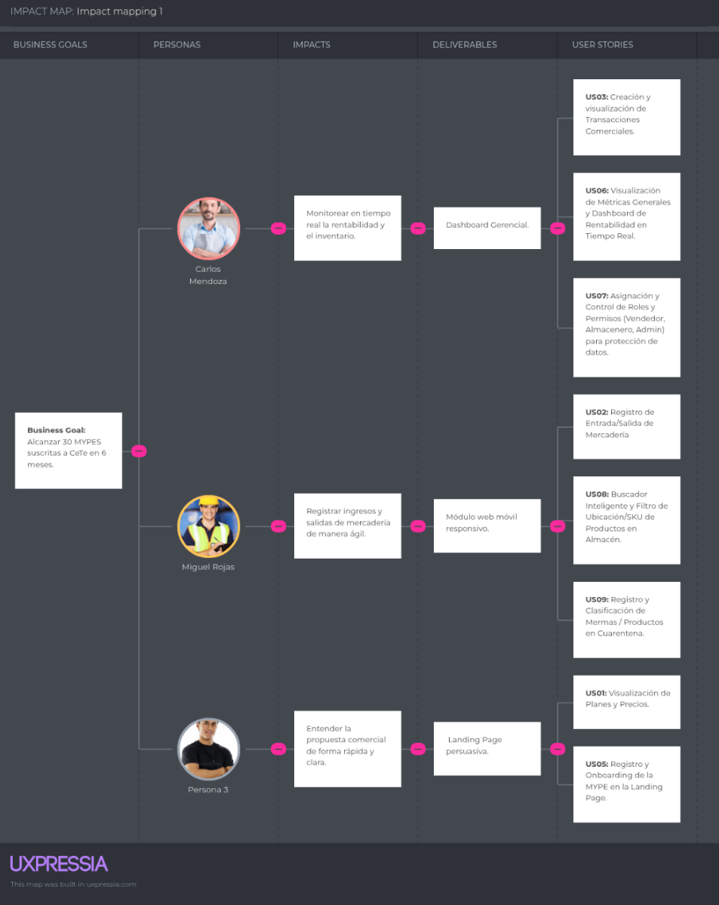
   <em>Figura 1: Captura del Impact Mapping hecho en UXPressia</em>

El Impact Mapping elaborado para CeTe ilustra de manera estratégica cómo las funcionalidades de nuestra plataforma tecnológica contribuyen a alcanzar nuestros objetivos de negocio. Para esta fase del proyecto, hemos definido un objetivo SMART (Business Goal) enfocado tanto en la adopción empresarial como en la penetración en el usuario final.

**Alineación del Business Goal 1:** Alcanzar 30 negocios (MYPES) suscritos a los planes de pago de CeTe en los primeros 6 meses tras el lanzamiento oficial de la plataforma. Para alcanzar esta meta, hemos identificado a tres actores clave del sector comercial que nos permitirán materializarla: los dueños/administradores de negocio, el personal logístico/almaceneros y los visitantes potenciales.
- En el caso de los dueños/administradores de negocio, el impacto que necesitamos generar es que monitoreen la salud y rentabilidad de su empresa en tiempo real, dejando atrás la incertidumbre de no saber dónde está su mercadería o si están ganando dinero. Como solución digital, provocaremos este impacto construyendo un Dashboard Gerencial y Analítico (Deliverable), el cual se materializa en historias de usuario enfocadas en consolidar métricas financieras, visualizar top de ventas y gestionar los roles de acceso (US23, US24, US25, US28, US29).
- Por el lado del personal logístico/almaceneros, el impacto esperado es que adopten CeTe como su canal centralizado para registrar ingresos y salidas, abandonando totalmente los conteos manuales y reportes en cuadernos. Para facilitar este comportamiento, implementaremos un Módulo de Inventario Inteligente (Deliverable), soportado por funcionalidades que permiten registrar entradas y mermas en segundos, buscar artículos ágilmente y generar notificaciones automáticas de stock mínimo y vencimientos (US09, US10, US11, US12, US13, US14, US26, US27).
- En cuanto a los visitantes MYPE, el impacto deseado es la comprensión rápida de la propuesta de valor para motivarlos a suscribirse. Para ello, implementaremos un Landing Page persuasivo (Deliverable), soportado por historias para visualizar planes, testimonios y el formulario de registro (US05, US06, US07, US08, US32, US34).

### 3.2.1. Metas medibles de validación AV2

Son hipótesis propuestas, todavía sin resultados ni línea base.

| Meta y plazo | Actor e impacto | Medición | US |
| :--- | :--- | :--- | :--- |
| G1. Reducir 30% el tiempo de una venta durante la ronda AV2. | Vendedor entrega una boleta con menos pasos. | Cronometrar el mismo caso antes y con CeTe y comparar medianas. | US15, US35, US36, US39 |
| G2. Lograr 90% de coincidencia del stock durante la validación AV2. | Operario distingue orden de compra y recepción física. | Conciliar inicial + recepciones - ventas - salidas + anulaciones con 3–5 operativos. | US10, US11, US14, US40, US41 |
| G3. Lograr 80% de éxito sin ayuda al consultar boleta y cambiar idioma en AV2. | Ambos segmentos comprenden el producto. | Registrar éxito, tiempo y errores con 3–5 personas por segmento. | US33, US39, US42 |

## 3.3. Product Backlog

La prioridad parte del valor de los flujos de venta, inventario, abastecimiento y entrega. La autenticación es una dependencia técnica. Esta revisión incluye 42 US y 35 TS como filas explícitas.

Los SP propuestos estiman complejidad e incertidumbre, no horas. Las TS vinculadas se incluyen en sus US para evitar una doble suma. Las tareas de ingeniería y horas se presentan por separado en 5.2.3. El estado «En revisión» señala que existe un incremento técnico relacionado; la aceptación completa de la historia requiere revisar todos sus criterios con el equipo. Los contratos que no existen siguen como pendientes.

### 3.3.1. Prioridades 1–20

| Orden | ID | Tipo | Título | Descripción / US asociada | SP propuestos | Estado verificable |
| :---: | :--- | :--- | :--- | :--- | :---: | :--- |
| 1 | US15 | US | Armado de Orden de Venta | **Como** vendedor, **deseo** agregar y editar productos en un listado de nueva venta, **para** calcular el subtotal y total a cobrar. | 3 | En revisión |
| 2 | US35 | US | Procesamiento de Pago de Venta | **Como** vendedor, **deseo** confirmar el método de pago y finalizar la transacción, **para** formalizar el ingreso comercial. | 3 | Parcial: pago registrado, sin pasarela |
| 3 | TS11 | TS | POST /api/v1/sales | US35 | Incluido en US | En revisión |
| 4 | TS31 | TS | Idempotencia y transacción serializable | US35 | Incluido en US | En revisión |
| 5 | US36 | US | Descuento Automático de Stock | **Como** dueño, **deseo** que al confirmar una venta se reduzca automáticamente el inventario, **para** evitar el doble registro manual y descuadres. | 2 | En revisión |
| 6 | US39 | US | Visualizar e imprimir boleta | **Como** vendedor, **deseo** consultar e imprimir el comprobante de una venta, **para** entregar al cliente el detalle de su compra. | 5 | En revisión |
| 7 | TS12 | TS | GET /api/v1/sales/{id} | US39 | Incluido en US | Pendiente |
| 8 | TS28 | TS | GET /api/v1/sales/{id}/receipt | US39 | Incluido en US | En revisión |
| 9 | TS34 | TS | Pruebas de dominio, HTTP y navegador | US39 | Incluido en US | En revisión |
| 10 | US09 | US | Registro de Artículo (SKU) | **Como** operario, **deseo** dar de alta un nuevo producto, **para** que esté disponible **para** futuras transacciones. | 3 | En revisión |
| 11 | TS06 | TS | POST /api/v1/inventory | US09 | Incluido en US | En revisión |
| 12 | US10 | US | Ingreso de Mercadería | **Como** operario, **deseo** sumar unidades físicas a un SKU existente, **para** reflejar el abastecimiento del almacén. | 5 | En revisión |
| 13 | TS07 | TS | POST /api/v1/inventory/{id}/entries | US10 | Incluido en US | En revisión |
| 14 | US11 | US | Salida Manual de Mercadería | **Como** operario, **deseo** registrar el retiro manual de productos, **para** reflejar consumos internos o ajustes. | 3 | En revisión |
| 15 | TS08 | TS | POST /api/v1/inventory/{id}/exits | US11 | Incluido en US | En revisión |
| 16 | US14 | US | Historial de Movimientos | **Como** participante autorizado, **deseo** ver el Kardex de un producto, **para** auditar discrepancias o mermas. | 3 | En revisión |
| 17 | TS09 | TS | GET /api/v1/inventory/{id}/history | US14 | Incluido en US | En revisión |
| 18 | US40 | US | Registrar orden de compra | **Como** encargado de almacén, **deseo** registrar una orden a un proveedor, **para** organizar el reabastecimiento sin confundirlo con la recepción física. | 5 | En revisión |
| 19 | TS29 | TS | GET y POST /api/v1/purchases | US40 | Incluido en US | En revisión |
| 20 | US41 | US | Recibir compra parcialmente | **Como** encargado de almacén, **deseo** registrar entregas parciales, **para** controlar el stock recibido y el saldo de una compra. | 5 | En revisión |

### 3.3.2. Prioridades 21–40

| Orden | ID | Tipo | Título | Descripción / US asociada | SP propuestos | Estado verificable |
| :---: | :--- | :--- | :--- | :--- | :---: | :--- |
| 21 | TS30 | TS | POST /api/v1/purchases/{id}/receive | US41 | Incluido en US | En revisión |
| 22 | US19 | US | Manifiesto de Despacho | **Como** logístico, **deseo** agrupar ventas en un manifiesto, **para** ordenar la ruta de entrega. | 5 | En revisión |
| 23 | TS14 | TS | GET /api/v1/dispatches | US19 | Incluido en US | En revisión |
| 24 | TS15 | TS | POST /api/v1/dispatches | US19 | Incluido en US | En revisión |
| 25 | US20 | US | Asignación de Conductor | **Como** logístico, **deseo** vincular recursos al manifiesto, **para** establecer responsables de entrega. | 3 | En revisión |
| 26 | US21 | US | Actualización de Estado | **Como** logístico, **deseo** cambiar el estado del envío, **para** notificar su entrega efectiva. | 3 | En revisión |
| 27 | TS16 | TS | PUT /api/v1/dispatches/{id} | US21 | Incluido en US | En revisión |
| 28 | US22 | US | Incidencia en Ruta | **Como** logístico, **deseo** anotar contratiempos logísticos, **para** auditar retrasos en entregas. | 3 | En revisión |
| 29 | TS17 | TS | POST /api/v1/dispatches/{id}/incidents | US22 | Incluido en US | En revisión |
| 30 | US23 | US | Dashboard: Tarjetas de Indicadores (KPIs) | **Como** dueño, **deseo** visualizar tarjetas numéricas con métricas clave (ingresos del día, número de ventas), **para** conocer el estado actual de un vistazo. | 3 | En revisión |
| 31 | TS18 | TS | GET /api/v1/analytics/dashboard | US23 | Incluido en US | En revisión |
| 32 | TS35 | TS | GET /api/v1/integrations/exchange-rates | US23 | Incluido en US | En revisión |
| 33 | US38 | US | Dashboard: Panel de Resumen de Inventario | **Como** dueño, **deseo** ver una sección en el dashboard que liste rápidamente los productos próximos a agotarse, **para** tomar decisiones inmediatas de reabastecimiento. | 2 | En revisión |
| 34 | US17 | US | Historial de Ventas | **Como** participante autorizado, **deseo** consultar transacciones pasadas, **para** llevar el control de ingresos diarios. | 3 | Parcial: filtro de fechas pendiente |
| 35 | TS10 | TS | GET /api/v1/sales | US17 | Incluido en US | En revisión |
| 36 | US18 | US | Anulación de Venta | **Como** dueño, **deseo** revertir una venta equivocada, **para** corregir métricas y devolver stock. | 5 | En revisión |
| 37 | TS13 | TS | PATCH /api/v1/sales/{id}/cancel | US18 | Incluido en US | En revisión |
| 38 | US26 | US | Alerta de Stock Mínimo | **Como** participante autorizado, **deseo** recibir avisos al acercarme a cero, **para** reponer mercadería a tiempo. | 5 | Parcial: alerta visual, bandeja pendiente |
| 39 | TS19 | TS | GET /api/v1/notifications | US26 | Incluido en US | Pendiente |
| 40 | TS20 | TS | PATCH /api/v1/notifications/{id}/read | US26 | Incluido en US | Pendiente |

### 3.3.3. Prioridades 41–60

| Orden | ID | Tipo | Título | Descripción / US asociada | SP propuestos | Estado verificable |
| :---: | :--- | :--- | :--- | :--- | :---: | :--- |
| 41 | US28 | US | Creación de Usuarios | **Como** administrador, **deseo** crear cuentas **para** mis trabajadores, **para** delegar accesos seguros. | 5 | Parcial: alta directa, correo de invitación pendiente |
| 42 | TS21 | TS | GET /api/v1/users | US28 | Incluido en US | En revisión |
| 43 | TS22 | TS | POST /api/v1/users | US28 | Incluido en US | En revisión |
| 44 | US29 | US | Restricción por Roles | **Como** administrador, **deseo** definir niveles de acceso operacionales, **para** bloquear módulos confidenciales. | 5 | En revisión |
| 45 | TS33 | TS | Aislamiento de empresa y relaciones compuestas | US29 | Incluido en US | En revisión |
| 46 | US05 | US | Propuesta de valor en landing | **Como** visitante, **deseo** conocer la propuesta de valor de CeTe, **para** evaluar si soluciona mis problemas operativos. | 2 | En revisión |
| 47 | US06 | US | Funcionalidades de landing | **Como** visitante, **deseo** conocer las capacidades del producto, **para** comprobar si cubre mis necesidades de negocio. | 2 | En revisión |
| 48 | US42 | US | Idioma de landing y recursos | **Como** visitante, **deseo** usar la landing y sus recursos en inglés o español, **para** comprender la propuesta y continuar al producto. | 3 | En revisión |
| 49 | US34 | US | Términos del Servicio | **Como** visitante, **deseo** leer las condiciones legales, **para** conocer el uso de mi data. | 2 | En revisión |
| 50 | US07 | US | Modelo comercial y planes | **Como** visitante, **deseo** consultar modalidades y planes de suscripción, **para** evaluar una posible contratación **para** mi MYPE. | 2 | Parcial: propuesta sin suscripción ni cobro |
| 51 | TS27 | TS | GET /api/v1/landing/plans | US07 | Incluido en US | Pendiente |
| 52 | US01 | US | Registro de cuenta | **Como** visitante, **deseo** registrar los datos de mi empresa, **para** crear una cuenta administradora en CeTe. | 3 | En revisión |
| 53 | TS01 | TS | POST /api/v1/authentication/sign-up | US01 | Incluido en US | En revisión |
| 54 | TS32 | TS | Docker y publicación de API y PostgreSQL | US01 | Incluido en US | Público, aceptación del equipo pendiente |
| 55 | US02 | US | Inicio de sesión | **Como** usuario registrado, **deseo** autenticarme, **para** acceder al espacio de trabajo de mi empresa. | 3 | En revisión |
| 56 | TS02 | TS | POST /api/v1/authentication/sign-in | US02 | Incluido en US | En revisión |
| 57 | US03 | US | Cierre de sesión | **Como** usuario autenticado, **deseo** terminar mi sesión, **para** proteger mi cuenta y la información del negocio. | 2 | En revisión |
| 58 | TS03 | TS | POST /api/v1/authentication/sign-out | US03 | Incluido en US | En revisión |
| 59 | US04 | US | Recuperación de contraseña | **Como** usuario registrado, **deseo** restablecer mi contraseña, **para** recuperar acceso si la he olvidado. | 5 | Pendiente |
| 60 | TS04 | TS | POST /api/v1/auth/password-reset | US04 | Incluido en US | Pendiente |

### 3.3.4. Prioridades 61–77

| Orden | ID | Tipo | Título | Descripción / US asociada | SP propuestos | Estado verificable |
| :---: | :--- | :--- | :--- | :--- | :---: | :--- |
| 61 | US08 | US | Contacto B2B | **Como** visitante corporativo, **deseo** enviar un mensaje a ventas, **para** solicitar una demostración personalizada. | 3 | Parcial: contacto GitHub, sin formulario B2B |
| 62 | TS26 | TS | POST /api/v1/contact-messages | US08 | Incluido en US | Pendiente |
| 63 | US12 | US | Registro de Mermas | **Como** operario, **deseo** apartar productos dañados o caducados, **para** evitar que sean vendidos por error. | 2 | Pendiente |
| 64 | US13 | US | Buscador de Inventario | **Como** operario, **deseo** buscar productos por nombre o SKU, **para** localizarlos rápidamente sin listas largas. | 3 | En revisión |
| 65 | TS05 | TS | GET /api/v1/inventory | US13 | Incluido en US | En revisión |
| 66 | US16 | US | Validación Automática de Stock | **Como** vendedor, **deseo** bloqueo de productos agotados en caja, **para** no prometer mercadería inexistente. | 5 | En revisión |
| 67 | US24 | US | Reporte de Top Productos | **Como** dueño, **deseo** identificar los artículos más vendidos, **para** priorizar abastecimiento. | 3 | Pendiente |
| 68 | US25 | US | Exportación de Datos | **Como** participante autorizado, **deseo** descargar mis tablas a CSV, **para** enviarlas a contabilidad. | 5 | Pendiente |
| 69 | US27 | US | Alerta de Producto Vencido | **Como** almacenero, **deseo** avisos preventivos de caducidad, **para** ofertar artículos perecibles. | 3 | Pendiente |
| 70 | US30 | US | Edición de Perfil Empresa | **Como** administrador, **deseo** actualizar mis datos comerciales, **para** mantener facturas e interfaz personalizadas. | 2 | Pendiente |
| 71 | TS23 | TS | GET /api/v1/users/profile | US30 | Incluido en US | Pendiente |
| 72 | TS24 | TS | PUT /api/v1/users/profile | US30 | Incluido en US | Pendiente |
| 73 | US31 | US | Cambio de Contraseña | **Como** usuario registrado, **deseo** actualizar mi clave, **para** asegurar mi cuenta. | 3 | Pendiente |
| 74 | TS25 | TS | PUT /api/v1/users/password | US31 | Incluido en US | Pendiente |
| 75 | US32 | US | Testimonios (Landing) | **Como** visitante, **deseo** consultar experiencias de otras MYPES, **para** ganar confianza. | 2 | Pendiente |
| 76 | US33 | US | Idioma de la aplicación | **Como** usuario, **deseo** elegir inglés o español, **para** comprender la interfaz a mi gusto. | 2 | En revisión |
| 77 | US37 | US | Dashboard: Gráfico de Tendencias | **Como** dueño, **deseo** visualizar un gráfico de barras/líneas con los ingresos en el tiempo, **para** analizar el comportamiento financiero de la MYPE. | 3 | Parcial: tendencia diaria, filtros pendientes |

Las 42 US suman **139 SP propuestos**. Las 38 US anteriores sumaban 121 SP; se corrige el texto que indicaba 34 historias. El equipo debe ratificar las estimaciones y capacidad. El tablero histórico enlazado es Trello; una captura de Jira no demuestra uso actual de Jira. Actualizar la herramienta realmente utilizada.

# Capítulo IV: Product Design

[Estilo](#41-style-guidelines) · [UX/UI](#44-web-applications-uxui-design) · [DDD y C4](#46-domain-driven-software-architecture) · [Clases](#47-software-object-oriented-design) · [Base de datos](#48-database-design)

En este capítulo detallamos las directrices visuales, arquitectónicas y de experiencia de usuario que guiarán el desarrollo de CeTe. El diseño se fundamenta en heurísticas de usabilidad estandarizadas, con el objetivo de facilitar el aprendizaje y las tareas operativas; estas metas requieren validación con usuarios.

## 4.1. Style Guidelines

Para mantener la consistencia visual y técnica en todo el ecosistema (Landing Page y Web Application), hemos definido un *Design System* centralizado, apoyándonos en librerías de componentes estandarizadas para agilizar el desarrollo frontend.

### 4.1.1. General Style Guidelines

Nuestras decisiones de diseño a nivel general se sustentan en la heurística de "Consistencia y estándares", asegurando que la interfaz transmita confianza y productividad en todo momento.

**4.1.1.1. Brand & Tono de Comunicación**

Al ser CeTe una herramienta B2B que maneja datos logísticos y financieros vitales, nuestra comunicación se rige por las siguientes cuatro dimensiones:
* **Seria:** Enfocada en la productividad y en resolver problemas de negocio sin distracciones.
* **Formal:** Transmite el profesionalismo y la seguridad necesarios para ganarnos la confianza de los dueños de negocios.
* **Respetuosa:** Valora el tiempo y el esfuerzo de nuestros usuarios operativos (almaceneros, logísticos).
* **Serena:** Mantiene una interfaz limpia, sin sobreestimulación, reduciendo la carga cognitiva en tareas estresantes.

**4.1.1.2. Typography**

La tipografía de CeTe ha sido definida con el objetivo de mantener una interfaz clara y profesional:
* **Montserrat (Pesos 600 y 700):** Utilizada estrictamente para encabezados (h1, h2, h3). Transmite solidez, modernidad e impacto corporativo.
* **Roboto (Pesos 300, 400 y 500):** Seleccionada para el cuerpo de texto y las tablas de datos. Esta fuente *sans-serif* ofrece una altísima legibilidad en pantallas densas, ideal para leer listados largos de inventario.

**4.1.1.3. Colors (Paleta Corporativa B2B)**

La paleta de colores de CeTe transmite estabilidad y guía el flujo operativo del usuario mediante altos contrastes:
* **Primary Blue (`#0A2540`):** Azul marino oscuro y elegante. Denota estabilidad, seguridad de la información y profesionalismo corporativo.
* **Secondary Blue (`#204066`):** Utilizado para fondos secundarios y jerarquización visual de componentes.
* **Accent Orange:** el diseño inicial usa `#FF6A00`; la landing AV2 utiliza `#A94300` en CTAs y foco para mejorar el contraste con texto blanco.
* **Backgrounds (`#F6F9FC` & `#FFFFFF`):** Tonos muy claros y neutros para mantener la limpieza visual del sistema.
* **Semantic Colors:** Colores de estado para retroalimentación. Rojo para errores o quiebres de stock (*Stock Out*), y Verde para confirmaciones o transacciones exitosas.

### 4.1.2. Web Style Guidelines

Adoptaremos un sistema de grillas fluidas basadas en Flexbox/CSS Grid. Haremos un uso intensivo de *Cards* para agrupar información lógicamente y *Data Tables* para manejar los altos volúmenes de registros de la MYPE. Asimismo, todos los elementos interactivos tendrán estados *hover* y *focus* claramente definidos, previniendo errores de accesibilidad.

## 4.2. Information Architecture

La arquitectura de información está diseñada para que tanto los usuarios operativos como los gerentes encuentren lo que necesitan con el menor número de clics posible, reduciendo drásticamente la fricción tecnológica.

### 4.2.1. Organization Systems

Aplicaremos diferentes esquemas de organización dependiendo de la vista y la intención del usuario:
* **Organización Jerárquica:** Utilizada en el menú lateral (*Sidebar*). Los módulos principales (Inventario, Ventas, Reportes) revelan submódulos de acción específica (Ingresos, Salidas).
* **Organización Matricial:** Aplicada en las tablas de inventario del núcleo operativo, cruzando y ordenando variables clave como SKU, cantidad y estado.
* **Organización Secuencial:** Empleada en flujos de trabajo críticos, como la elaboración del Manifiesto de Despacho, guiando al operario paso a paso para prevenir omisiones.

### 4.2.2. Labeling Systems

Para asegurar la claridad, nuestras etiquetas reflejan fielmente el **Ubiquitous Language** del dominio operativo, evitando jergas técnicas:
* **"Registrar producto"** crea la identidad del SKU; **"Registrar entrada"** aumenta la existencia de un producto ya registrado. Son acciones distintas.
* En lugar de "Módulo de envíos", usaremos **"Despacho y Trazabilidad"**.
* Los botones de confirmación tendrán etiquetas precisas sobre la acción exacta, por ejemplo: **"Aprobar Manifiesto"**.

### 4.2.3. SEO Tags and Meta Tags

La landing y la aplicación web tienen metadatos para sus páginas de entrada. La tabla registra los valores de la landing y de la configuración del frontend integrada y publicada el 12/11/2026. La aplicación también actualiza el título al navegar entre sus vistas.

| Elemento | Landing | Aplicación web |
| :--- | :--- | :--- |
| `title` | CeTe by Nexxus · Inventory, sales and deliveries | CeTe by Nexxus &#124; Gestión logística para MYPE |
| `description` | CeTe connects inventory, purchasing, sales receipts and deliveries for small businesses. | Gestiona inventario, compras, ventas y despachos de tu MYPE en CeTe. |
| `keywords` | CeTe, Nexxus, inventory, MYPES, logistics, sales | CeTe, Nexxus, MYPE, inventario, compras, ventas, despachos |
| `author` | Nexxus | Nexxus |

### 4.2.4. Searching Systems

Dada la cantidad de mercadería que maneja una MYPE, el sistema de búsqueda es un pilar fundamental de la usabilidad operativa en CeTe.

| Criterio | Descripción |
| :--- | :--- |
| **Búsqueda por nombre o SKU** | Disponible en las listas y el POS. El escaneo por cámara o código de barras es una evolución pendiente. |
| **Filtros facetados propuestos** | El filtrado combinado por categoría y estado requiere completar el modelo y su implementación; no se acredita como función actual. |
| **Presentación de resultados** | Las listas permiten filtrar resultados; el resaltado de coincidencias forma parte del diseño propuesto. |

<em>Nota. La tabla detalla los mecanismos de búsqueda diseñados para acelerar las tareas de los operarios de almacén.</em>

### 4.2.5. Navigation Systems

El recorrido del usuario estará soportado por elementos de navegación predecibles y persistentes, ajustados al contexto de la aplicación.

| Nombre | Descripción |
| :--- | :--- |
| **Top App Bar (Landing Page)** | Navegación superior anclada (*sticky*). Contiene enlaces ancla hacia las secciones informativas y CTAs persistentes ("Prueba Gratis"). |
| **Side Navigation Drawer (Web App)** | Menú lateral izquierdo colapsable. Su diseño permite maximizar el espacio útil en pantalla, vital para la revisión de tablas de datos. |

<em>Nota. La tabla muestra los sistemas de navegación principales para visitantes y usuarios autenticados.</em>

## 4.3. Landing Page UI Design

En esta sección presentamos el diseño de interfaz de usuario para el Landing Page de CeTe. La propuesta visual prioriza la heurística de "Diseño estético y minimalista", asegurando una propuesta de valor clara orientada a la conversión B2B.

### 4.3.1. Landing Page Wireframe

Nuestros wireframes establecen la jerarquía estructural. El *Hero Section* ataca directamente el dolor del cliente y la estructura modular se adapta de manera nativa a dispositivos móviles.

**Wireframes Desktop de la Landing Page**

  

  

  

  

**Wireframes Mobile de la Landing Page**

  
  

  
  

### 4.3.2. Landing Page Mock-up

Los mock-ups de alta fidelidad aplican nuestro *Design System*. Se evidencia el uso de botones `.btn-primary` (Naranja) sobre fondos oscuros o claros, cumpliendo con los estándares de contraste WCAG para diseño inclusivo.

**Mockups Desktop de la Landing Page**

  

  

  

  

**Mockups Mobile de la Landing Page**

  
  

  
  

## 4.4. Web Applications UX/UI Design

> **Alcance de los artefactos visuales.** Los wireframes, wireflows y mockups siguientes conservan el diseño inicial. Las capacidades implementadas y las pendientes se distinguen en las secciones 4.6–4.8 y en las evidencias del incremento AV2.

El diseño de la aplicación web interna centra su enfoque en la eficiencia del usuario operativo, minimizando la carga de memoria (reconocer en lugar de recordar) y aplicando una fuerte prevención de errores.

### 4.4.1. Web Applications Wireframes

Se implementó una arquitectura con *Sidebar* colapsable y una amplia área central, con el propósito de maximizar el espacio útil en pantalla, un factor vital al momento de revisar listados extensos de SKUs.

  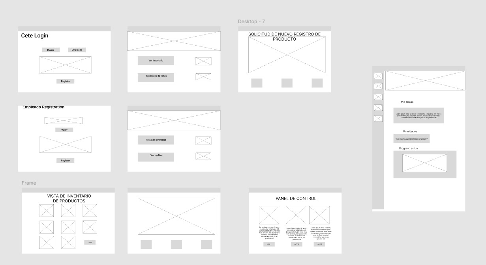
   <em>Nota. Distribución estructural y de controles de la aplicación web.</em>

### 4.4.2. Web Applications Wireflow Diagrams

Los wireflows organizan la secuencia de pantallas que recorre el usuario para alcanzar un objetivo dentro de la aplicación web de CeTe. El registro de elaboración incluye estos artefactos, cuya revisión permite relacionar las acciones del usuario con los cambios representados en las interfaces.

Entre los recorridos centrales de CeTe se consideran:

| Wireflow | Usuario y objetivo | Secuencia funcional de referencia |
| :--- | :--- | :--- |
| **W1** | Administrador o trabajador: registrar una entrada de inventario | Acceder al módulo Almacén → seleccionar “Registrar Entrada” → completar código SKU, descripción y cantidad → guardar entrada → visualizar inventario actualizado. |
| **W2** | Administrador: eliminar un producto | Acceder al módulo Almacén → consultar listado de artículos → seleccionar ícono de eliminar → revisar mensaje de confirmación → confirmar eliminación o cancelar → visualizar listado actualizado. |
| **W3** | Administrador o trabajador: consultar ventas | Acceder al menú lateral → seleccionar “Ventas” → visualizar módulo de ventas → consultar las funciones disponibles para registrar o revisar ventas. |
| **W4** | Administrador o trabajador: consultar despachos | Acceder al menú lateral → seleccionar “Despachos” → visualizar módulo de rutas y despachos → consultar las funciones disponibles para organizar y realizar seguimiento de las salidas. |
| **W5** | Administrador: consultar reportes | Acceder al menú lateral → seleccionar “Reportes” → visualizar módulo de balance e inteligencia → consultar información sobre compras, ventas y rentabilidad. |
| **W6** | Administrador o trabajador: revisar notificaciones | Acceder al dashboard de inventario → seleccionar ícono de notificaciones → visualizar panel de notificaciones → revisar alertas de stock y nuevas entradas registradas. |

**W1. Registrar una entrada de inventario**
El usuario accede al módulo Almacén y selecciona la opción “Registrar Entrada”. Luego completa el código SKU, la descripción del producto y la cantidad a ingresar. Finalmente, guarda la entrada para actualizar el inventario.

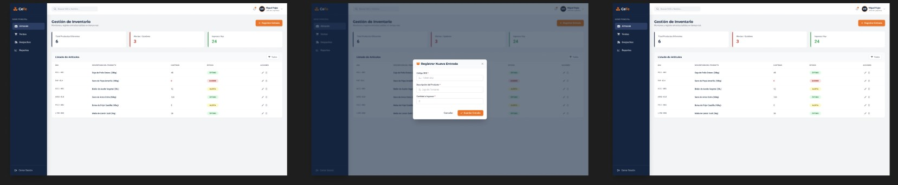

**W2. Eliminar un producto**
El administrador consulta el listado de artículos y selecciona el ícono de eliminar. El sistema muestra una ventana de confirmación para evitar eliminaciones accidentales. El usuario puede cancelar la acción o confirmar la eliminación.

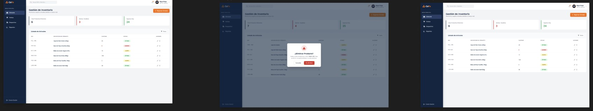

**W3. Consultar ventas**
El usuario selecciona la opción “Ventas” desde el menú lateral. El sistema muestra el módulo de ventas, donde se podrán consultar y gestionar las operaciones relacionadas con las ventas del negocio.

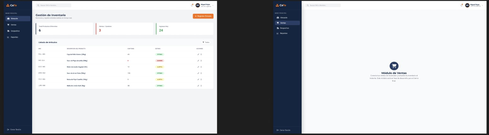

**W4. Consultar despachos**
El usuario selecciona la opción “Despachos” desde el menú lateral. El sistema muestra el módulo de rutas y despachos, destinado a organizar las salidas y realizar el seguimiento de los productos.

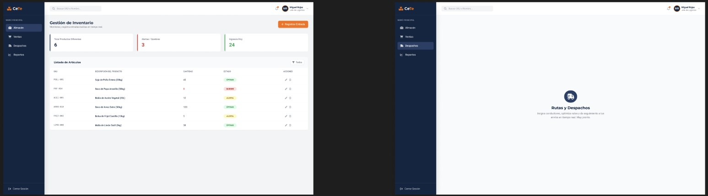

**W5. Consultar reportes**
El administrador selecciona la opción “Reportes” desde el menú lateral. El sistema muestra el módulo de balance e inteligencia, donde se podrá consultar información sobre las compras, ventas y rentabilidad del negocio.

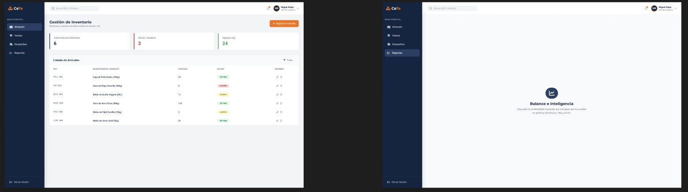

**W6. Revisar notificaciones**
El usuario accede al dashboard de inventario y selecciona el ícono de notificaciones. El sistema muestra alertas relacionadas con quiebres de stock y nuevas entradas registradas.

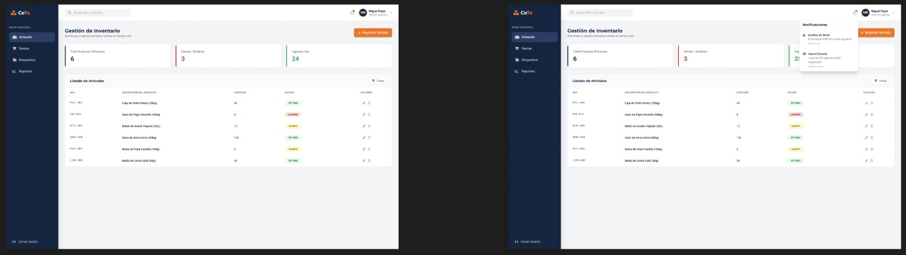

### 4.4.3. Web Applications Mock-ups

Los mockups de CeTe presentan la propuesta visual de la aplicación web para la gestión de inventario. La interfaz incluye la landing page, el dashboard de almacén, los módulos de ventas, despachos y reportes, el registro de entradas, la confirmación de eliminación y el panel de notificaciones.

El diseño utiliza un menú lateral de navegación, tarjetas de resumen, tablas de productos, botones de acción y alertas visuales. Los estados del inventario se diferencian como óptimo, alerta y quiebre de stock, lo que permite identificar rápidamente los productos que requieren atención.

La siguiente imagen muestra el conjunto de mockups desarrollados para CeTe:

  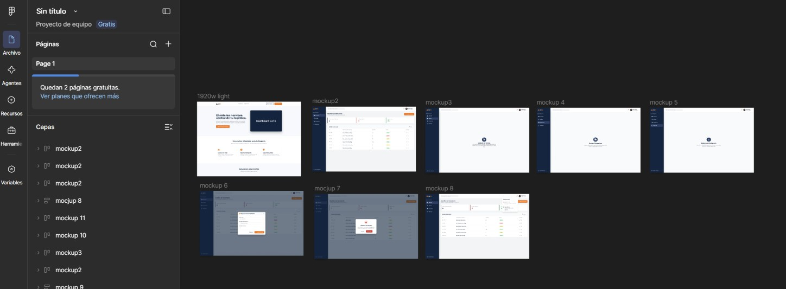

### 4.4.4. Web Applications User Flow Diagrams

El diagrama de flujo de usuario es una representación visual de los pasos que un usuario sigue al interactuar con una aplicación o sitio web. Muestra la secuencia de acciones que el usuario realiza para completar una tarea específica, lo que nos ayuda a identificar posibles puntos de fricción y a optimizar la experiencia del usuario.

**Leyenda:**

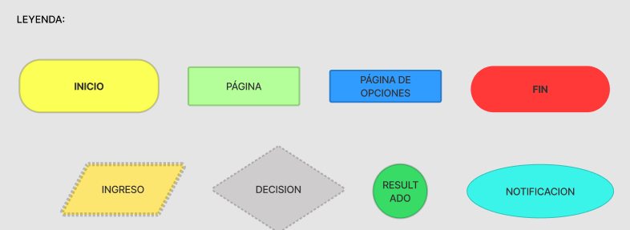

**Flujo de Usuario:**
Empieza con el usuario ingresando a la página de inicio de CeTe Workspace. Aquí determina si es "Administrador" o "Colaborador".

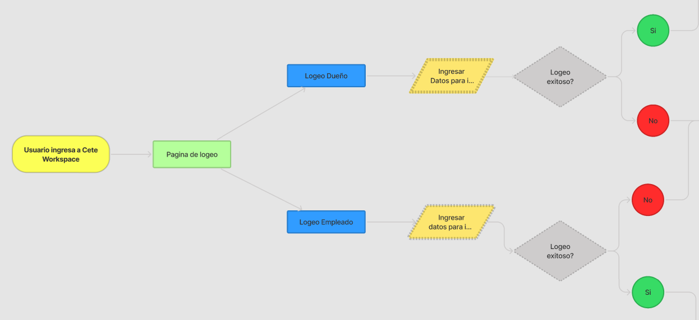

**Flujo de Administrador:**
El usuario Administrador puede acceder a su perfil, visualizar el panel de control de la MYPE, asignar tareas a sus colaboradores, y acceder a las herramientas de reportes y administración.

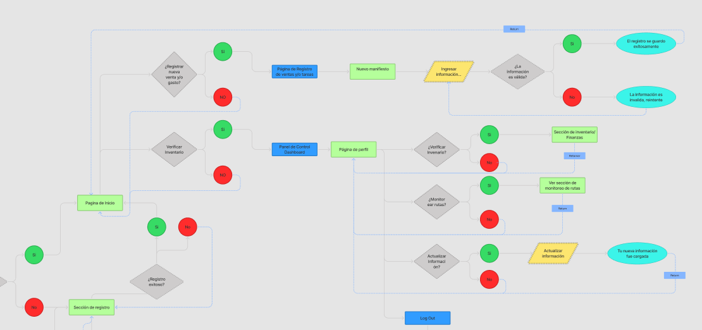

**Flujo de Colaborador:**
El usuario Colaborador puede acceder a su perfil, ver los proyectos o tareas asignadas, registrar su avance diario, y acceder a las herramientas operativas de su espacio de trabajo.

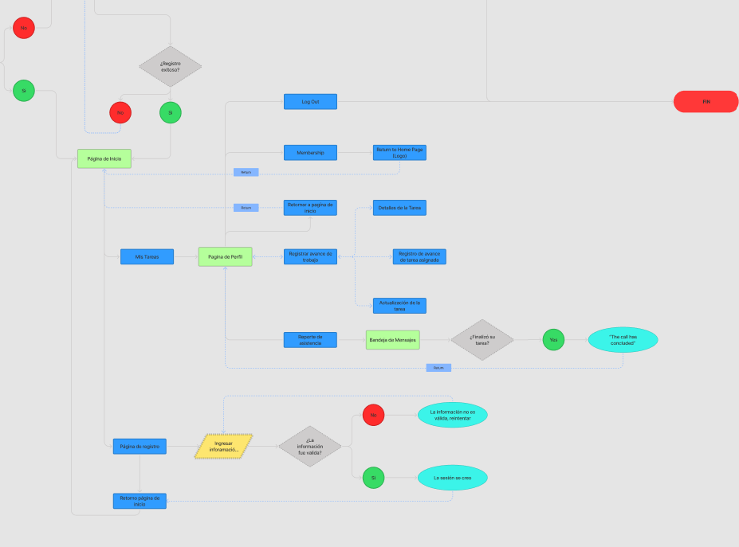

**Vista general del flujo de usuario:**

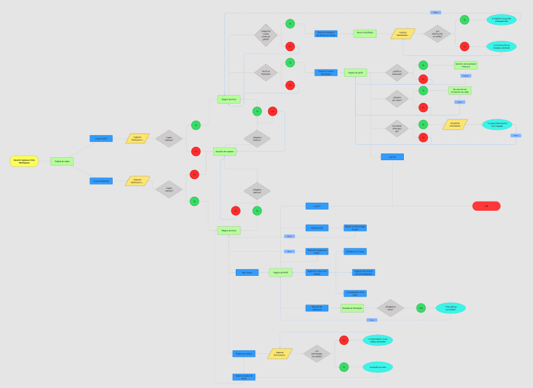

## 4.5. Web Applications Prototyping

Nuestro prototipo navegable fue construido íntegramente en Figma, configurando estados reactivos y modales interactivos para brindar retroalimentación inmediata, simulando con precisión el comportamiento ágil de una SPA (*Single Page Application*).

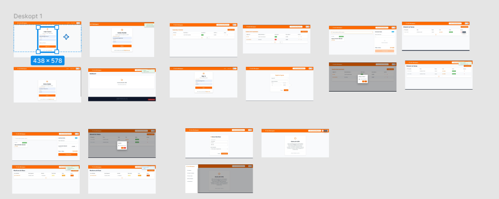

## 4.6. Domain-Driven Software Architecture

El incremento AV2 tiene una API en ASP.NET Core 10, PostgreSQL y una SPA Vue. La refactorización integrada en [PR #2](https://github.com/Nexxus-ops/CeTe-Api/pull/2), publicada el **12/11/2026**, organiza cinco contextos operativos: `Inventory`, `Procurement`, `Sales`, `Logistics` e `Identity`. Cada contexto separa dominio, aplicación, infraestructura e interfaces REST, con contratos de repositorio y servicios de comandos y consultas. Se retiraron el coordinador global `Operations` y el puerto genérico `ICeTeRepository`.

La arquitectura es un **monolito modular con DDD**: los contextos comparten proceso, `CeTeDb` y una unidad de trabajo. Los contratos delimitan la colaboración entre módulos; la base no está separada por contexto ni se implementa mensajería distribuida. El código de referencia corresponde al commit desplegado [`4df092e`](https://github.com/Nexxus-ops/CeTe-Api/commit/4df092e49cef5033476add1c7b2caf410d35eac9).

**Criterio de lectura.** Los diagramas C4, de clases y de datos siguientes describen el código actual. Los eventos de EventStorming nombran hechos del negocio para el análisis; no representan clases de eventos publicadas, colas ni consistencia eventual. Las mejoras propuestas se identifican al final de cada sección. Todos los diagramas tienen [fuente editable y versión SVG](diagrams/README.md).

### 4.6.1. Design-Level Event Storming

#### 4.6.1.1. Subdominios y límites de responsabilidad

El núcleo diferenciador es la coherencia entre existencia física y operación comercial. Por eso Inventario conserva la autoridad sobre el saldo, mientras Abastecimiento y Ventas solicitan sus cambios dentro de una transacción coordinada. Una recepción y una venta no son el mismo concepto, aunque ambas generen movimientos.

| Bounded context | Responsabilidad y lenguaje propio | Entidades principales | Alcance AV2 |
| :--- | :--- | :--- | :--- |
| **Inventario — núcleo** | Identificar productos y controlar saldos por almacén. SKU, saldo, ingreso, salida y movimiento. | `Product`, `Warehouse`, `StockBalance`, `InventoryMovement` | Catálogo, entradas/salidas, archivo e historial. |
| **Abastecimiento — soporte** | Registrar lo pedido y distinguirlo de lo recibido físicamente. Orden, pendiente y recepción. | `Supplier`, `PurchaseOrder`, `PurchaseOrderLine`, `GoodsReceipt`, `GoodsReceiptLine` | Una línea por orden y recepciones parciales. |
| **Ventas — soporte** | Confirmar una transacción con precios del servidor y conservar su documento histórico. Venta, detalle, pago registrado y boleta. | `Sale`, `SaleLine`, `Payment`, `SalesReceipt` | Venta atómica, consulta, anulación y boleta académica. |
| **Logística — soporte** | Agrupar ventas elegibles, asignar recursos y controlar el estado de entrega. Despacho e incidencia. | `Dispatch`, `DispatchSale`, `DispatchIncident` | Conductor/placa como texto, exclusividad y transiciones. |
| **Identidad y empresa — genérico** | Resolver quién opera, para qué empresa y con qué permisos. Cuenta, rol, sesión y tenant. | `Tenant`, `User`, `Role`, `UserRole`, `UserSession` | Registro, acceso, cierre, alta de empleados y autorización. |

El dashboard es una **proyección de lectura transversal**, no un agregado de rentabilidad: suma ventas completadas y consulta existencias y despachos. Todavía no calcula costo de ventas, margen neto ni pérdida contable por merma. Suscripciones, devoluciones y notificaciones tienen tablas preparadas, pero sus flujos no están implementados. La landing comunica la propuesta; no constituye un contexto transaccional de la API.

#### 4.6.1.2. Mapa de contextos


*Las flechas señalan al proveedor y a su consumidor. Los contratos se ejecutan dentro de la misma API; cada contexto conserva su responsabilidad de negocio.* [Ampliar](diagrams/ddd-context-map.svg) · [Fuente editable](diagrams/ddd-context-map.mmd)

Ventas y Abastecimiento consumen `IInventoryFacade`: reciben instantáneas de producto y almacén y solicitan ajustes de stock dentro de la unidad de trabajo del caso de uso. Logística consulta el estado de venta mediante `ISalesQueryService`; Ventas consulta asignaciones mediante `ISaleDispatchPolicy`, implementado en la capa anticorrupción de Logística. Identidad aporta `ICurrentUser` y `ICompanyQueryService`. Los módulos consumidores no modifican directamente los repositorios de otros contextos.

| Contrato entre contextos | Proveedor | Consumidor y responsabilidad |
| :--- | :--- | :--- |
| `IInventoryFacade` | Inventario | Ventas y Abastecimiento consultan instantáneas y solicitan movimientos; Identidad aprovisiona el almacén inicial. |
| `ISalesQueryService` | Ventas | Logística verifica que cada venta esté completada. |
| `ISaleDispatchPolicy` | Puerto de Ventas, adaptador de Logística | Ventas comprueba asignaciones antes de anular. |
| `ICompanyQueryService` | Identidad | Ventas obtiene los datos de empresa para la instantánea de la boleta. |
| `ICurrentUser` / `IUnitOfWork` | Contratos compartidos | Identidad resuelve los claims; EF Core implementa la transacción que integra las modificaciones. |

#### 4.6.1.3. Comandos, reglas, hechos y consultas


*El descuento y la confirmación pertenecen a una única transacción. Si falla una validación o el commit, el conjunto se revierte.* [Ampliar](diagrams/event-storming-sale.svg) · [Fuente editable](diagrams/event-storming-sale.mmd)


*Crear la orden no modifica existencias. Cada recepción registra su cantidad y aumenta el saldo físico una sola vez por operación confirmada.* [Ampliar](diagrams/event-storming-receipt.svg) · [Fuente editable](diagrams/event-storming-receipt.mmd)


*El despacho controla la entrega de una venta que ya descontó stock.* [Ampliar](diagrams/event-storming-dispatch.svg) · [Fuente editable](diagrams/event-storming-dispatch.mmd)

| Actor y comando | Autoridad sobre las reglas | Hechos tras confirmar | Consulta posterior |
| :--- | :--- | :--- | :--- |
| Vendedor confirma venta | Ventas valida líneas y total. Inventario valida saldo y aplica la salida. | Venta confirmada, stock descontado, pago registrado y boleta disponible. | Ventas y boleta. |
| Operario registra recepción | Abastecimiento valida el pendiente y decide si la orden queda parcial o recibida. Inventario aplica el ingreso. | Recepción registrada, saldo aumentado y estado de orden actualizado. | Compras, kardex y existencias. |
| Operador crea o actualiza despacho | Logística valida ventas elegibles, recursos disponibles y transiciones. Ventas bloquea anulaciones cuando hay asignación. | Despacho creado, en ruta, entregado o con incidencia registrada. | Ventas elegibles y despachos. |

**Puntos abiertos.** Un reenvío de una recepción puede registrar otro ingreso si aún queda cantidad pendiente, porque ese comando carece de clave de idempotencia. La devolución posterior al despacho y la merma como flujo propio quedan pendientes. Las tarjetas de diseño de AV2 se reconstruyeron desde el código para su revisión con el equipo. El capítulo II conserva la evidencia del taller histórico.

Estos diagramas refinan el [Big Picture del capítulo II](02-Chapter-2.md#24-big-picture-eventstorming). Las consultas leen el estado confirmado de PostgreSQL. No hay publicación de eventos de dominio, outbox ni proyecciones asíncronas implementadas.

### 4.6.2. Software Architecture Context Diagram

El nivel 1 del modelo C4 ubica a CeTe como sistema único frente a sus personas y su integración externa actual. El personal operativo se distingue por los roles `Warehouse`, `Sales` y `Logistics`; `Admin` administra la empresa y consulta indicadores.


*La integración externa implementada es ExchangeRate-API. SUNAT y un gateway de correo no forman parte del despliegue AV2.* [Ampliar](diagrams/c4-context.svg) · [Fuente editable](diagrams/c4-context.mmd)

La consulta de tipo de cambio es informativa: no convierte importes ni altera la moneda de la venta, que permanece en PEN. La boleta es un comprobante académico de demostración; no acredita emisión electrónica fiscal.

### 4.6.3. Software Architecture Container Diagrams

El nivel 2 distingue las unidades de ejecución y persistencia. En C4, «contenedor» significa una aplicación o almacén de datos; no exige que cada elemento use Docker. La landing y el frontend se publican como sitios estáticos; la API usa una imagen Docker y PostgreSQL es administrado por Render.


*Las relaciones indican responsabilidad, dirección y protocolo. La landing enlaza al frontend; no llama a una API de planes ni de contacto.* [Ampliar](diagrams/c4-containers.svg) · [Fuente editable](diagrams/c4-containers.mmd)

**Vista complementaria de despliegue.** El navegador descarga la SPA y realiza las peticiones a la API. El sitio estático no actúa como proxy. La API accede a PostgreSQL mediante la conexión interna configurada en Render.


*La ejecución local con Docker Compose contiene API y PostgreSQL; el navegador usa los servidores locales de frontend y landing.* [Ampliar](diagrams/c4-deployment.svg) · [Fuente editable](diagrams/c4-deployment.mmd)

| Recurso | Dirección pública | Función verificable |
| :--- | :--- | :--- |
| Landing | [cete-landing-av2.onrender.com](https://cete-landing-av2.onrender.com/) | Propuesta, idiomas y acceso a la aplicación. |
| Frontend | [cete-web-av2.onrender.com](https://cete-web-av2.onrender.com/) | Interfaz de operación autenticada. |
| API | [Swagger](https://cete-api-av2.onrender.com/swagger) · [Health](https://cete-api-av2.onrender.com/health) | Contratos y estado de conexión a la base. |

La evidencia de ejecución se encuentra en [5.2.3.5. Execution Evidence](05-Chapter-5.md#5235-execution-evidence-for-sprint-review). La base Free tiene vencimiento registrado para el **28/11/2026 a las 22:30, hora de Lima** (29/11/2026, 03:30 UTC). La continuidad posterior requiere respaldo y renovación o migración; el diagrama no implica disponibilidad permanente.

### 4.6.4. Software Architecture Components Diagrams

El nivel 3 amplía exclusivamente el contenedor CeTe API. `Program.cs` configura inyección de dependencias, CORS, JWT, Swagger y middleware; los controladores de `Interfaces/REST` reciben recursos HTTP y los ensambladores crean comandos. Los servicios de aplicación coordinan el dominio a través de contratos de repositorio propios y de `IUnitOfWork`.


*Los componentes agrupan tipos por responsabilidad para conservar la legibilidad. Los repositorios EF Core implementan los puertos de cada contexto; SessionValidator consulta CeTeDb desde infraestructura.* [Ampliar](diagrams/c4-components.svg) · [Fuente editable](diagrams/c4-components.mmd)

La aplicación depende de interfaces de repositorio y de servicios, sin importar EF Core ni infraestructura. `IPasswordService` e `ITokenService` se implementan en los adaptadores de autenticación de Identidad. `ExchangeRatesController` adapta la consulta HTTP al proveedor cambiario. Reporting conserva una proyección transversal de solo lectura en infraestructura. Permanecen pendientes las migraciones versionadas, la paginación y una separación más estricta de la propiedad de los datos; los contratos actuales no equivalen a bases independientes ni a aislamiento físico entre módulos.

#### 4.6.4.1. Vista dinámica de la venta

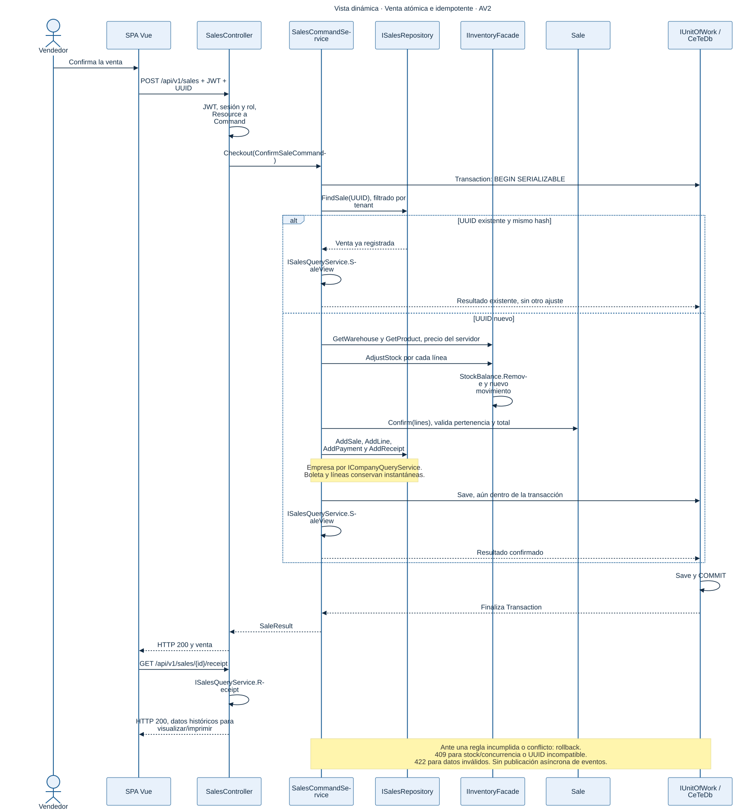

*El UUID identifica la solicitud de venta; el hash distingue un reintento idéntico de una reutilización incompatible. El token de acceso nunca se incluye en el informe.* [Ampliar](diagrams/sequence-checkout.svg) · [Fuente editable](diagrams/sequence-checkout.mmd)

## 4.7. Software Object-Oriented Design

El diseño táctico se evalúa por sus reglas y límites de consistencia. Una tabla o una clase ubicada en `Model/Aggregates` no constituye automáticamente una raíz de agregado. `Product`, `StockBalance`, `Sale`, `PurchaseOrder`, `PurchaseOrderLine` y `Dispatch` protegen reglas mediante métodos de dominio y escritura restringida. Los servicios de aplicación coordinan las operaciones que afectan varios objetos dentro de una transacción.

### 4.7.1. Class Diagrams

Los diagramas siguientes muestran **tipos y miembros existentes**, con atributos relevantes para cada operación. `Id` y, salvo `Tenant` y `SubscriptionPlan`, `TenantId` se heredan de `Entity` y `TenantEntity`; no se repiten en todas las cajas. Las asociaciones indican referencias por identificador, no colecciones de navegación ni composición implementada. Los estados marcados `[private set]` tienen lectura pública y escritura restringida.

#### 4.7.1.1. Inventario


*Product.UpdateDetails recibe los objetos de valor Sku y Money; Product.Archive exige ausencia de stock. StockBalance controla ingresos y salidas. InventoryItemResult es un DTO de compatibilidad, no una entidad de dominio.* [Ampliar](diagrams/classes-inventory.svg) · [Fuente editable](diagrams/classes-inventory.mmd)

#### 4.7.1.2. Ventas


*Sale.Confirm valida la pertenencia de las líneas y calcula el total; Sale.Cancel protege el estado. SalesCommandService coordina movimiento, pago y boleta en la misma transacción. SaleLine y SalesReceipt conservan sus instantáneas con escritura restringida.* [Ampliar](diagrams/classes-sales.svg) · [Fuente editable](diagrams/classes-sales.mmd)

#### 4.7.1.3. Abastecimiento


*PurchaseOrder.Receive comprueba el estado y que la línea pertenezca a la orden. PurchaseOrderLine.Receive valida la cantidad pendiente. ProcurementCommandService registra la recepción y solicita el ingreso a Inventario. La API actual admite una línea por orden.* [Ampliar](diagrams/classes-procurement.svg) · [Fuente editable](diagrams/classes-procurement.mmd)

#### 4.7.1.4. Logística


*Dispatch.Transition protege las transiciones. DriverName y LicensePlate son instantáneas de texto; aún no son relaciones a los maestros Driver y Vehicle.* [Ampliar](diagrams/classes-logistics.svg) · [Fuente editable](diagrams/classes-logistics.mmd)

### 4.7.2. Agregados, invariantes y responsabilidad

| Límite de consistencia | Regla actual y responsable | Diferencia frente al diseño objetivo |
| :--- | :--- | :--- |
| **Saldo de un SKU en un almacén** | `StockBalance.Receive/Remove`: cantidad positiva; salida no mayor al saldo. `IInventoryFacade` delimita los ajustes de otros contextos. Índice único `(TenantId, ProductId, WarehouseId)`. | Consolidar la propiedad del saldo y medir el comportamiento con mayor volumen; el almacenamiento continúa compartido. |
| **Venta y documentos asociados** | `Sale.Confirm/Cancel` valida líneas, total y estado; `SalesCommandService.Checkout/CancelSale` coordina detalle, saldo, movimiento, pago y boleta. | La raíz valida las líneas recibidas, pero no mantiene una colección propia. La atomicidad depende también de la unidad de trabajo. |
| **Orden y recepciones** | `PurchaseOrder.Receive` protege el estado y la pertenencia de la línea; `PurchaseOrderLine.Receive` exige `0 < cantidad ≤ pendiente`. `ProcurementCommandService` coordina recepción y stock. | Extender a varias líneas e introducir idempotencia de recepción antes de ampliar el contrato. |
| **Despacho y ventas agrupadas** | `Dispatch.Transition` controla estados; `LogisticsCommandService.CreateDispatch` verifica ventas completadas mediante `ISalesQueryService`, recursos libres y exclusividad. | La agrupación vive en aplicación. Antes de usar los maestros, incorporar referencias estables a conductor y vehículo. |
| **Acceso de una empresa** | JWT validado contra `UserSession`; roles en endpoints; filtros y FK compuestas por tenant. | `User.Role` gobierna la autorización y también existen `Roles/UserRoles`. Debe definirse una única fuente para futuros cambios de rol. |

**Objetos de valor.** `Money` rechaza importes negativos y redondea con `Rules.Money` a dos decimales usando `AwayFromZero`; las columnas decimales usan `numeric(18,2)`. `Sku` normaliza espacios exteriores y mayúsculas y rechaza valores vacíos. El precio de venta proviene del servidor. `Money` todavía no modela una moneda ni impuestos: la operación actual usa PEN y boletas académicas.

**Persistencia y concurrencia.** `CeTeDb.Transaction` usa aislamiento serializable. Un conflicto de concurrencia se traduce a HTTP 409 y requiere volver a consultar/reintentar; no se declara un mecanismo automático de reintentos. Las pruebas registradas comprueban que dos ventas de la última unidad producen una confirmación y un conflicto, con saldo final cero.

### 4.7.3. Estados y reglas de transición


*La incidencia se registra desde IN_TRANSIT y permite reanudar la ruta. Las transiciones no dibujadas son rechazadas.* [Ampliar](diagrams/state-dispatch.svg) · [Fuente editable](diagrams/state-dispatch.mmd)

| Entidad | Estados actuales | Regla de transición |
| :--- | :--- | :--- |
| `Sale` | `DRAFT` durante construcción; `COMPLETED` y `CANCELLED` persistidos | Confirmar valida y totaliza las líneas. La anulación se realiza una sola vez, repone stock y marca pagos `REVERSED`; se bloquea si existe cualquier asignación de despacho. |
| `PurchaseOrder` | `ORDERED`, `PARTIAL`, `RECEIVED` | La recepción aumenta el acumulado; alcanzar lo pedido finaliza la orden. Una orden recibida rechaza otra recepción. |
| `Payment` | `PAID`, `REVERSED` | Registro académico al confirmar/anular venta. No son estados de una pasarela bancaria. |
| `UserSession` | Vigente, vencida o revocada | Se evalúan `ExpiresAt` y `Revoked` al validar el JWT. |

## 4.8. Database Design

### 4.8.1. Esquema físico AV2

El esquema contiene **35 tablas, 182 columnas, 35 claves primarias, 33 claves alternativas por empresa, 67 claves foráneas y ocho índices únicos de negocio**. La comparación del SQL versionado con una exportación estructural de PostgreSQL local coincide en estos elementos. El [diccionario completo](AV2/diccionario-datos.md) detalla cada campo, tipo, nulabilidad, clave y relación.

| Área lógica | Tablas | Capacidad operativa actual |
| :--- | :---: | :--- |
| Identidad y empresa | 7 | Registro, roles, sesiones y empleados. Suscripciones pendientes. |
| Inventario | 8 | Catálogo, saldo, entradas/salidas e historial. Categorías, ubicaciones, variantes y lotes pendientes de flujo completo. |
| Abastecimiento | 5 | Proveedor por nombre, orden de un SKU y recepción parcial. |
| Ventas | 5 | Venta, pago registrado y boleta histórica. Maestro de clientes pendiente. |
| Logística | 7 | Despacho, recursos por texto, estados e incidencias. Maestros, paradas e intentos pendientes. |
| Devoluciones | 2 | Estructura persistente; sin flujo de devolución. |
| Notificaciones | 1 | Estructura persistente; sin generación operativa ni bandeja. |
| **Total** | **35** | **La existencia de una tabla no acredita una funcionalidad completa.** |

**Aislamiento.** Las tablas de empresa incluyen `TenantId`, una FK a `Tenants` y la clave alternativa `(TenantId, Id)`. Las referencias entre ellas usan ambas columnas; así, una fila no puede relacionarse con el identificador de otra empresa. Los filtros EF Core restringen las consultas habituales. El registro, el acceso y la validación de sesiones tienen accesos explícitos que omiten filtros bajo sus comprobaciones específicas; no existe Row-Level Security en PostgreSQL.

**Tipos y eliminación.** Los identificadores son UUID; los importes y cantidades usan `numeric(18,2)`; las fechas usan `timestamp with time zone`. Las FK emplean `ON DELETE RESTRICT`. Archivar un producto cambia `Active` y requiere saldo cero; no borra su historia. Todos los campos son obligatorios salvo `StockLots.ExpiresAt`.

### 4.8.2. Diagramas entidad–relación por área

Los diagramas se derivan de las FK del SQL. `||` significa un padre obligatorio; `o{`, cero o muchos dependientes; `o|`, cero o un dependiente por restricción única. Una FK no exige que una cabecera tenga al menos una línea: ese mínimo lo impone el caso de uso. En las vistas por área se omite el vínculo repetido a `Tenants`, excepto en Identidad; **todas las tablas de empresa conservan esa FK**.

#### 4.8.2.1. Identidad y empresa


*Tenants y SubscriptionPlans son globales. Roles, cuentas, asociaciones y sesiones están delimitados por empresa.* [Ampliar](diagrams/er-identity.svg) · [Fuente editable](diagrams/er-identity.mmd)

#### 4.8.2.2. Inventario


*Categories no tiene vínculo con Products. Variantes y lotes referencian Product, pero no participan todavía en StockBalance ni en InventoryMovement.* [Ampliar](diagrams/er-inventory.svg) · [Fuente editable](diagrams/er-inventory.mmd)

#### 4.8.2.3. Abastecimiento


*Cada recepción referencia una orden; cada línea recibida referencia una línea pedida. El ingreso físico y el movimiento se coordinan en aplicación.* [Ampliar](diagrams/er-procurement.svg) · [Fuente editable](diagrams/er-procurement.mmd)

#### 4.8.2.4. Ventas


*La unicidad de SalesReceipts por venta impone 0..1. Payments admite 0..N en SQL, aunque el caso de uso crea exactamente uno. Customers permanece separado de Sales.* [Ampliar](diagrams/er-sales.svg) · [Fuente editable](diagrams/er-sales.mmd)

#### 4.8.2.5. Logística


*DispatchSales implementa la asociación venta–despacho. El índice único por venta impide asignarla otra vez. Los maestros Drivers y Vehicles no tienen FK hacia Dispatches.* [Ampliar](diagrams/er-logistics.svg) · [Fuente editable](diagrams/er-logistics.mmd)

#### 4.8.2.6. Devoluciones y notificaciones


*Las tablas existen en el esquema; todavía no tienen casos de uso publicados. Notifications solo referencia a la empresa.* [Ampliar](diagrams/er-returns.svg) · [Fuente editable](diagrams/er-returns.mmd)

El [diagrama físico completo](diagrams/er-complete.svg), con [fuente editable](diagrams/er-complete.mmd), reúne las 35 tablas y todas sus FK. Se entrega como vista ampliable; las vistas anteriores son las recomendadas para lectura y sustentación.

### 4.8.3. Integridad y reglas verificables

| Invariante | Protección actual | Evidencia o límite |
| :--- | :--- | :--- |
| Un SKU por empresa | Índice único `(TenantId, Sku)` en `Products`. | Se permiten SKU iguales en empresas distintas. |
| Un saldo por producto y almacén | Índice único `(TenantId, ProductId, WarehouseId)`. | Las cantidades no se almacenan en `Product`. |
| Venta completa o ninguna modificación | Transacción serializable del caso de uso. | Stock insuficiente revierte detalles, pago y boleta. |
| Reintento sin descuento duplicado | `Sales.Id` como PK y `RequestHash` validado por aplicación. | Un UUID con contenido diferente devuelve 409. |
| Boleta única e histórica | UQ por venta y por número; instantáneas en `SalesReceipts` y `SaleLines`. | No tiene validez fiscal ni serie SUNAT. |
| Una venta en un solo despacho | UQ `(TenantId, SaleId)` en `DispatchSales`. | No permite reasignación por eliminación/cancelación en este incremento. |
| Anulación con una sola restitución | `Sale.Cancel`, bloqueo de asignaciones y transacción. | El flujo de devoluciones aún está pendiente. |
| Recepción sin exceder lo pedido | `PurchaseOrder.Receive`, `PurchaseOrderLine.Receive` y transacción en `ProcurementCommandService.Receive`. | Cantidad recibida, saldo y movimiento se guardan juntos. |

### 4.8.4. Hallazgos y evolución del diseño

La revisión identifica mejoras del código y del esquema que no se resuelven cambiando el diagrama. Se registran como **trabajo pendiente**, sin presentarlas como capacidades actuales.

| Prioridad | Hallazgo concreto | Evolución y criterio de cierre |
| :---: | :--- | :--- |
| Alta | Inicialización con `EnsureCreated`; no hay migraciones versionadas. | Adoptar migraciones EF Core y ensayar la actualización conservando datos. El respaldo manual del 12/11/2026 ya fue restaurado en un PostgreSQL aislado; no sustituye las migraciones ni un plan periódico. |
| Alta | Precios, cantidades y estados no tienen restricciones `CHECK` en SQL. | Incorporar restricciones compatibles con cantidades firmadas de movimientos y con cada máquina de estados; probar inserciones inválidas. |
| Alta | `User.Role` y `UserRoles` representan permisos en dos formas. | Definir una fuente de autorización, sincronizar o retirar la redundancia y probar cambios de rol sobre sesiones vigentes. |
| Alta | Las FK de `GoodsReceiptLines` no garantizan que recepción y línea pertenezcan a la misma orden. | Reforzar el vínculo al diseñar órdenes de varias líneas y probar cruces inválidos. El flujo actual elige la única línea de la orden. |
| Media | Categories, Customers, Drivers y Vehicles no están conectados al flujo que sus nombres sugieren. | Añadir FK y contratos de maestros cuando se implementen esos casos de uso; conservar las instantáneas históricas que correspondan. |
| Media | Lotes, variantes y ubicaciones no intervienen en el saldo. | Definir la unidad de control de stock antes de activar vencimientos, picking o trazabilidad por lote. |
| Media | Movimientos enlazan a su origen mediante `Reason` textual. | Separar motivo y referencia de origen para consultas/auditoría, sin perder registros anteriores. |
| Media | El esquema admite varios pagos y la consulta de boleta espera uno. | Mantener explícito el pago único o implementar pagos divididos con suma y estados consistentes. |
| Media | Los repositorios ya están separados por contexto, pero varias consultas cargan colecciones completas sin paginación. | Filtrar/agrupar en SQL, paginar y medir con volúmenes representativos. |
| Media | Las cabeceras principales encapsulan reglas, pero las colecciones y algunas entidades auxiliares siguen coordinadas en aplicación. | Consolidar límites de agregado y métodos de colección sin alterar la atomicidad entre operaciones de inventario y negocio. |

### 4.8.5. Fuentes de diseño y trazabilidad

La notación emplea los niveles de [C4](https://c4model.com/diagrams) y sus [recomendaciones de lectura](https://c4model.com/diagrams/notation). Los límites de responsabilidad se contrastan con la [guía de análisis de dominio](https://learn.microsoft.com/en-us/azure/architecture/microservices/model/domain-analysis); su uso aquí no implica adoptar microservicios. Las FK compuestas siguen las posibilidades de [EF Core](https://learn.microsoft.com/en-us/ef/core/modeling/relationships/foreign-and-principal-keys) y los ER usan [notación Mermaid](https://mermaid.js.org/syntax/entityRelationshipDiagram.html).

Las fuentes se fijan al commit desplegado `4df092e49cef5033476add1c7b2caf410d35eac9`: [dominio de ventas](https://github.com/Nexxus-ops/CeTe-Api/tree/4df092e49cef5033476add1c7b2caf410d35eac9/Sales/Domain/Model/Aggregates), [servicio de venta](https://github.com/Nexxus-ops/CeTe-Api/blob/4df092e49cef5033476add1c7b2caf410d35eac9/Sales/Application/Internal/CommandServices/SalesCommandService.cs), [contrato de inventario](https://github.com/Nexxus-ops/CeTe-Api/blob/4df092e49cef5033476add1c7b2caf410d35eac9/Inventory/Application/Services/IInventoryFacade.cs), [controlador REST](https://github.com/Nexxus-ops/CeTe-Api/blob/4df092e49cef5033476add1c7b2caf410d35eac9/Sales/Interfaces/REST/SalesController.cs), [unidad de trabajo](https://github.com/Nexxus-ops/CeTe-Api/blob/4df092e49cef5033476add1c7b2caf410d35eac9/Shared/Domain/Repositories/IUnitOfWork.cs), [mapeo EF Core](https://github.com/Nexxus-ops/CeTe-Api/blob/4df092e49cef5033476add1c7b2caf410d35eac9/Shared/Infrastructure/Persistence/EFC/Configuration/CeTeDb.cs) y [esquema SQL](https://github.com/Nexxus-ops/CeTe-Api/blob/4df092e49cef5033476add1c7b2caf410d35eac9/schema.sql).

# Capítulo V: Product Implementation, Validation & Deployment

[Configuración](#51-software-configuration-management) · [Sprint 1](#521-sprint-1) · [Sprint 2](#522-sprint-2) · [Sprint 3 / AV2](#523-sprint-3--consolidación-av2) · [Validación](#53-validation-interviews)

## 5.1. Software Configuration Management

La Gestión de Configuración de Software (SCM) es la disciplina que permite identificar, controlar, versionar y auditar los distintos componentes de un sistema durante todo su ciclo de vida. Su aplicación asegura la trazabilidad de los cambios realizados sobre el código fuente, la documentación y los artefactos de diseño, reduciendo la probabilidad de errores de integración y facilitando el trabajo colaborativo del equipo.

En el caso de **CeTe**, la solución está compuesta por una Landing Page informativa, una Frontend Web Application y un RESTful API de elaboración interna. Durante el **Sprint 1** se priorizó la implementación, validación y despliegue de la primera versión de la **Landing Page**, desarrollada con HTML5, CSS3 y JavaScript (ES6+), manteniendo un comportamiento 100% responsive y sin dependencias de frameworks externos.

### 5.1.1. Software Development Environment Configuration

A continuación se listan los productos de software utilizados por el equipo, organizados por tipo de actividad del ciclo de vida. Para cada herramienta se indica su propósito dentro de CeTe y la ruta de referencia o descarga.

**1. Project Management**

*Descripción:* La gestión del proyecto permite organizar las actividades necesarias para alcanzar los objetivos del Sprint, asignar responsables, dar seguimiento al avance y mantener la comunicación entre los integrantes del equipo.

**Trello y GitHub Projects:**
Los sprints históricos conservan sus capturas de Trello. El seguimiento actual de Sprint 3 se consulta en el [tablero público de Nexxus](https://github.com/orgs/Nexxus-ops/projects/1/views/1), creado el 12/11/2026 para consolidar tareas, estados y evidencias. La imagen de Jira siguiente pertenece al registro inicial de herramientas y no acredita que Sprint 3 se haya gestionado allí.

  

**Google Meet & WhatsApp:**
Empleados para las ceremonias formales de Scrum (Daily, Planning, Review) y como canales de comunicación asincrónica para coordinar avances diarios.

  
  

**2. Requirements Management**

**UXPressia:**
Utilizado para la elaboración de los User Personas, Empathy Maps, Journey Maps e Impact Maps, facilitando la identificación de necesidades de los dueños de MYPEs y operarios logísticos. ([UXPressia](https://uxpressia.com/))

  

**3. Product UX/UI Design**

**Figma:**
Herramienta de diseño colaborativo en la nube empleada para elaborar los wireframes, mockups y el prototipo interactivo de CeTe, documentando nuestro Design System. ([Figma](https://www.figma.com/))

  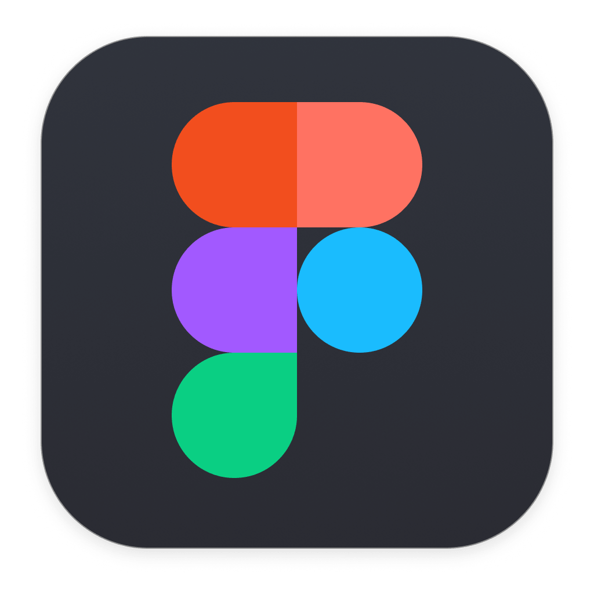

**4. Software Development**

**Visual Studio Code / WebStorm:**
Editores principales para el desarrollo Frontend (HTML, CSS, JS, Vue.js). La configuración de formato se estandariza mediante el archivo `.editorconfig`. ([VS Code](https://code.visualstudio.com/))

  

**JetBrains Rider / Visual Studio:**
Entornos contemplados por el equipo para trabajar con C#. El backend actual tiene como destino `net10.0` y utiliza ASP.NET Core 10; requiere un IDE y un SDK compatibles. La imagen de Visual Studio 2022 se conserva como referencia del entorno inicial, sin atribuirle compatibilidad con toda versión del proyecto.

  

**HTML5 / CSS3 / JavaScript (ES6+):**
Tecnologías base de la Landing Page desplegada en el Sprint 1.

  
  
  

**Vue.js & PrimeVue:**
Framework progresivo y biblioteca de componentes seleccionados para el desarrollo de la Single Page Application (Web App de Inventario y Ventas).

  

**ASP.NET Core & C#:**
Framework y lenguaje utilizados para el desarrollo del RESTful API de CeTe, responsable de la lógica de negocio orientada a dominio (DDD).

  

**Entity Framework Core & PostgreSQL:**
Entity Framework Core 10 con Npgsql y PostgreSQL 17 proporcionan la persistencia del incremento AV2. El esquema físico se documenta con 35 tablas; los módulos todavía previstos se distinguen de los flujos implementados en el capítulo IV.

  

**Git & GitHub:**
Sistema de control de versiones y plataforma de colaboración para alojar repositorios, aplicar GitFlow y Pull Requests.

  

**5. Software Deployment**

**GitHub Pages:**
Servicio de alojamiento estático utilizado para publicar la primera versión de la Landing Page de CeTe directamente desde la rama `main`.

  

**Render y Docker:**
Render publica la landing y el frontend como sitios estáticos y la API como servicio Docker conectado a PostgreSQL administrado. Docker Compose reproduce API y base de datos en el entorno local. Las ramas de despliegue vigentes se indican en 5.1.4.

**Swagger / OpenAPI y herramientas de verificación:**
Swagger documenta los contratos HTTP de la API. Las comprobaciones de dominio en C#, las pruebas HTTP en Python y los recorridos de navegador respaldan la evidencia técnica; no reemplazan la validación con usuarios. El [repositorio de la API](https://github.com/Nexxus-ops/CeTe-Api) conserva las instrucciones reproducibles.

### 5.1.2. Source Code Management

La administración del código fuente es un pilar del trabajo colaborativo del equipo. En este apartado se define el modelo organizativo y de control de versiones aplicado mediante GitHub y el flujo de trabajo GitFlow.

**1. Establecimiento de repositorios en GitHub**

La solución distribuida de CeTe se organiza en repositorios independientes:
* **Landing Page:** Repositorio dedicado al sitio web promocional del producto.
* **Frontend Web Application:** Repositorio destinado a la aplicación web (Vue.js).
* **RESTful API:** Repositorio que aloja la lógica del backend (ASP.NET Core).
* **Project Report:** Repositorio destinado a la redacción del informe en Markdown.

**2. Workflow de control de versiones (GitFlow)**

| Nombre de la rama | Descripción |
| :--- | :--- |
| **Main Branch** (`main`) | Base integrada del informe, frontend y API. Render publica frontend y API desde `main`; no se generaliza esa configuración a la landing. |
| **Develop Branch** (`develop`) | Rama de integración cuando existe en el repositorio. En la landing es, además, la rama configurada para la publicación actual en Render. |
| **Feature Branches** (`feature/*`) | Ramas temporales para desarrollar funcionalidades aisladas.   **Convención:** `feature/nombre-de-la-funcionalidad` |
| **Release Branches** (`release/*`) | Ramas de estabilización previas al pase a producción.   **Convención:** `release/vX.Y.Z` |
| **Hotfix Branches** (`hotfix/*`) | Convención prevista para correcciones urgentes sobre una versión publicada. No se acredita su uso únicamente por definir el nombre. |

El flujo anterior es la convención del equipo. Las integraciones AV2 también emplean ramas `refactor/*`, `fix/*`, `improve/*`, `integrate/*` y `docs/*`, con Pull Requests enlazados en 5.2.3.4. El historial de cada repositorio determina qué ramas y revisiones se utilizaron realmente.

**3. Versionado Semántico (Semantic Versioning 2.0.0)**

CeTe adopta el estándar **Semantic Versioning 2.0.0** (`MAJOR.MINOR.PATCH`).
* Ejemplo: `v1.0.0` (Primera versión desplegada de la Landing Page).

**4. Convenciones de mensajes de commit (Conventional Commits)**

* `feat:` incorpora una funcionalidad nueva.
* `fix:` corrige un error.
* `docs:` modifica exclusivamente documentación.
* `style:` aplica ajustes de formato visual.
* `refactor:` reestructura código existente sin añadir funcionalidades.
* `chore:` tareas de mantenimiento y configuración.

### 5.1.3. Source Code Style Guide & Conventions

Como regla transversal, **toda la nomenclatura técnica (identificadores, clases, variables, funciones y métodos) se redacta exclusivamente en inglés**.

**HTML & CSS**
* Indentación de 2 espacios.
* Uso de metodología **BEM** (Block, Element, Modifier) para las clases CSS.
* Uso de *Custom Properties* (`:root`) para la paleta de colores corporativa (Primary Blue, Accent Orange).

**C# (.NET Core)**
* Indentación de 4 espacios.
* Nomenclatura `PascalCase` para clases y métodos (`StockBalance`, `Receive`), `camelCase` para variables locales.
* Aplicación estricta de inyección de dependencias y programación asíncrona (`Async`).

### 5.1.4. Software Deployment Configuration

El incremento AV2 se publica en Render. La landing y el frontend se sirven como sitios estáticos. La API se ejecuta en Docker y se conecta internamente a PostgreSQL administrado.

| Producto | Construcción y ejecución | Publicación AV2 | Captura |
| :--- | :--- | :--- | :--- |
| Landing | HTML, CSS y JavaScript. Rama `develop`. | [Sitio público](https://cete-landing-av2.onrender.com/) · [Release v1.1.0](https://github.com/Nexxus-ops/nexxus-landing-page/releases/tag/v1.1.0). | [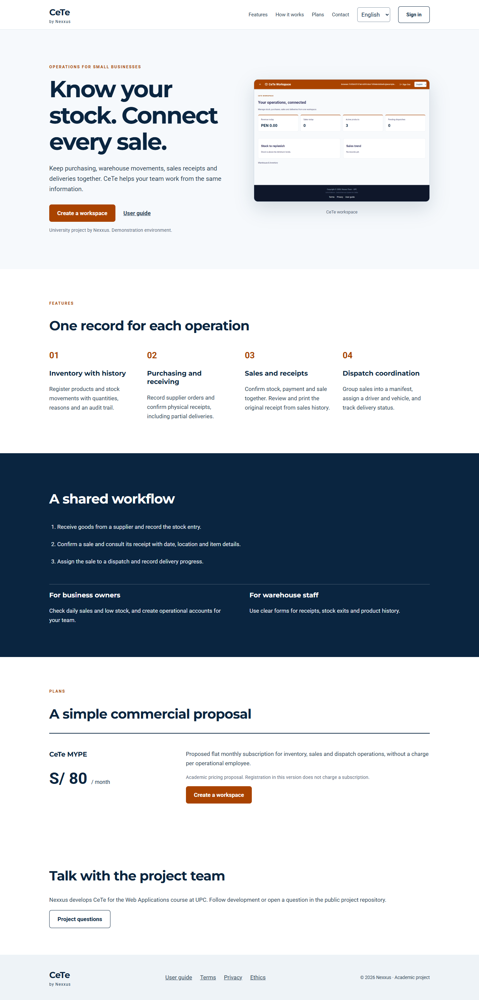](AV2/evidence/landing-desktop.png) |
| Frontend | Vue/Vite, compilación a `dist` y navegación por hash. Rama `main`. | [Aplicación pública](https://cete-web-av2.onrender.com/) · [Release v1.1.0](https://github.com/Nexxus-ops/FrontEnd-CeTe/releases/tag/v1.1.0). | [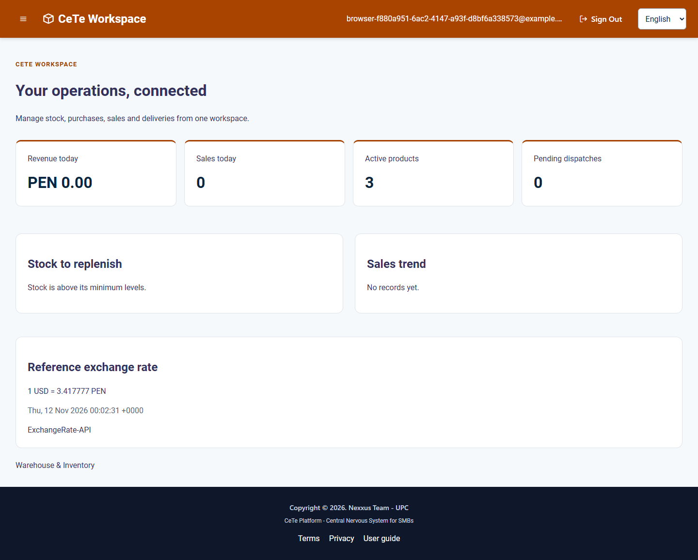](AV2/evidence/dashboard-desktop.png) |
| API | Docker, ASP.NET Core 10, CORS, JWT y configuración por variables de entorno. Rama `main`. | [Swagger público](https://cete-api-av2.onrender.com/swagger) · [Salud](https://cete-api-av2.onrender.com/health). |  |
| Base de datos | PostgreSQL 17. Conexión interna desde la API. | Servicio administrado. El endpoint de salud comprueba la conexión. | La evidencia se observa a través de la API y sus flujos persistidos. |

Para desarrollo, Docker Compose inicia la API y PostgreSQL. La [vista de despliegue](04-Chapter-4.md#463-software-architecture-container-diagrams) detalla la comunicación entre servicios. El [README de la API](https://github.com/Nexxus-ops/CeTe-Api/blob/4df092e49cef5033476add1c7b2caf410d35eac9/README.md) incluye los pasos reproducibles. Las capturas del frontend corresponden a la revalidación pública del 12/11/2026 con datos ficticios.

**Versión de API publicada.** La refactorización DDD integrada por el equipo en [PR #2](https://github.com/Nexxus-ops/CeTe-Api/pull/2) se desplegó desde `main`, commit [`4df092e`](https://github.com/Nexxus-ops/CeTe-Api/commit/4df092e49cef5033476add1c7b2caf410d35eac9), el 12/11/2026 a las 11:35 (Lima). Se conservaron las 28 operaciones HTTP y el esquema físico. La prueba de continuidad recuperó una sesión y una boleta creadas antes del despliegue. Sus resultados se presentan en [5.2.3.5. Execution Evidence](#5235-execution-evidence-for-sprint-review).

## 5.2. Landing Page, Services & Applications Implementation

### 5.2.1. Sprint 1

Durante el Sprint 1, el equipo de Nexxus se concentró en la implementación y despliegue de la primera versión funcional y responsive de la Landing Page de CeTe, diseñada para captar a nuestro público objetivo (Dueños de MYPEs y Operarios).

#### 5.2.1.1. Sprint Planning 1

| Sprint # | Sprint 1 |
| :--- | :--- |
| **Sprint Planning Background** | |
| Date | 08/09/2026 |
| Time | 8:00 PM |
| Location | Google Meet (reunión virtual) |
| Prepared By | Salazar Marquina, Kevin Junior |
| Attendees | Anahua Ancachi, Liz Maribel Campoblanco Guzman, Diego Roberto Montes Chang, Piero Francisco Salazar Marquina, Kevin Junior Salazar Quiche, Darikson Bill |
| **Sprint 1 Review Summary** | Durante este primer ciclo el equipo consolidó los artefactos de UX definidos en los capítulos anteriores y los tradujo en una implementación web funcional. Se desarrolló y desplegó la primera versión de la Landing Page de CeTe. Todo el ciclo de vida del desarrollo, desde la asignación de tareas hasta su paso a "Done", fue monitoreado y gestionado mediante nuestro tablero Kanban en Trello, garantizando transparencia en el avance. |
| **Sprint 1 Retrospective Summary** | El equipo evaluó positivamente la distribución del trabajo mediante la convención de ramas feature/* de GitFlow, reduciendo colisiones de código. El uso de Trello facilitó la visualización de los cuellos de botella en la fase de revisión de los Pull Requests. Como oportunidad de mejora, se debe afinar la estimación de las tareas de internacionalización (i18n) en la herramienta para el próximo ciclo. |
| **Sprint Goal & User Stories** | |
| **Sprint 1 Goal** | *Our focus is on* publicar la primera versión funcional y responsive de la Landing Page de CeTe. *We believe it delivers* a las MYPES una comprensión rápida de nuestra solución B2B. *This will be confirmed when* el sitio sea accesible desde cualquier dispositivo, mostrando claramente la propuesta y los planes de suscripción. |
| **Sprint 1 Velocity** | 24 |
| **Sum of Story Points** | 24 |

#### 5.2.1.2. Aspect Leaders and Collaborators

| Team Member | Landing Page (código) | Diseño UI/UX | Documentación | Deployment |
| :--- | :--- | :--- | :--- | :--- |
| Anahua Ancachi, Liz | Colaborador | Líder | Colaborador | Colaborador |
| Campoblanco, Diego | Colaborador | Colaborador | Colaborador | Líder |
| Montes Chang, Piero | Colaborador | Colaborador | Líder | Colaborador |
| Salazar, Kevin | Líder | Colaborador | Colaborador | Colaborador |
| Salazar, Darikson | Colaborador | Colaborador | Colaborador | Colaborador |

#### 5.2.1.3. Sprint Backlog 1

| Story ID | Work Item / Task Title | Description | Est. (h) | Assigned To | Status |
| :--- | :--- | :--- | :---: | :--- | :---: |
| US24 | Estructuración base e implementación del Hero | Creación del esqueleto semántico (`header`, `main`, `section`, `footer`) y propuesta de valor principal. | 4 | Salazar, Kevin | Done |
| US25 | Implementación de la sección de Funcionalidades | Maquetación de la grilla mostrando "Inventario en tiempo real", "Dashboard", etc. | 3 | Anahua, Liz | Done |
| US26 | Maquetación de la sección de Planes | Tarjetas de suscripción con precios para las MYPES. | 3 | Salazar, Darikson | Done |
| US29 | Implementación de navegación responsive | Desarrollo del header fijo, scroll suave y menú hamburguesa para móviles. | 4 | Campoblanco, Diego | Done |
| US33 | Implementación del Footer Institucional | Creación del pie de página con enlaces legales y redes sociales. | 2 | Montes, Piero | Done |
| US34 | Despliegue en GitHub Pages | Configuración del repositorio y publicación de la versión v1.0.0. | 2 | Campoblanco, Diego | Done |

La gestión de las historias de usuario y tareas técnicas correspondientes a este Sprint se realizó a través de la herramienta Trello. A continuación, se presenta la evidencia del tablero Kanban utilizado durante la ejecución del Sprint:

  

Tablero Kanban del Sprint 1 gestionado en Trello, mostrando el flujo de desarrollo de la Landing Page.

Enlace al tablero: https://trello.com/invite/b/6ac45ef9360979a18e3bdcb8/ATTI9b6472f77acb5d72e55d42fac34aa3a7F2643D2F/cete-product-backlog-1

#### 5.2.1.4. Development Evidence for Sprint Review

Esta sección expone la evidencia técnica del progreso alcanzado. La Landing Page de CeTe fue desarrollada utilizando HTML5, CSS3 y JavaScript bajo un enfoque Mobile-First.

**Registro recuperado del historial de Sprint 1:**

Los commits siguientes corresponden a la implementación inicial de la landing. La rama consultada identifica dónde son alcanzables actualmente; el historial no permite atribuirles los nombres de ramas de trabajo consignados en la tabla anterior. Las fechas son las del commit, no horas de trabajo ni fechas de aceptación.

| Repositorio | Rama consultada | Commit | Mensaje original | Cuerpo original | Fecha y hora de commit (Lima) |
| :--- | :--- | :--- | :--- | :--- | :--- |
| nexxus-landing-page | `develop` | [`30cf770`](https://github.com/Nexxus-ops/nexxus-landing-page/commit/30cf770e4699ea705ac9ef87b4e6ee68210e64eb) | chore: setup of html structure and global styles | Sin cuerpo adicional. | 14/09/2026 23:35:04 -0500 |
| nexxus-landing-page | `develop` | [`69a5775`](https://github.com/Nexxus-ops/nexxus-landing-page/commit/69a5775ad6b29b26306194a87f7fb149701b02a2) | feat: implement navbar and main hero section | Sin cuerpo adicional. | 14/09/2026 23:38:20 -0500 |
| nexxus-landing-page | `develop` | [`7385c80`](https://github.com/Nexxus-ops/nexxus-landing-page/commit/7385c80bf2840b332184f89433174eb6aae1d091) | feat: add benefits, solutions and cta sections | Sin cuerpo adicional. | 14/09/2026 23:39:57 -0500 |
| nexxus-landing-page | `develop` | [`47cef62`](https://github.com/Nexxus-ops/nexxus-landing-page/commit/47cef62ff73586b341c47d611733e517aa7106f7) | feat: add footer, responsive design and mobile menu logic | Sin cuerpo adicional. | 14/09/2026 23:42:04 -0500 |

  

  

  

#### 5.2.1.5. Execution Evidence for Sprint Review

Se validó el comportamiento responsive, el menú móvil y las secciones de la Landing Page en navegadores de escritorio y dispositivos móviles.

  

  

  

  
  
  
  

#### 5.2.1.6. Services Documentation Evidence for Sprint Review

Durante el Sprint 1, la Landing Page es un sitio estático informativo. La integración con los servicios RESTful internos (endpoints de autenticación, inventario y despacho documentados mediante Swagger/OpenAPI) se incorporará en los siguientes Sprints desde la Web Application en Vue.js.

#### 5.2.1.7. Software Deployment Evidence for Sprint Review

La versión `v1.0.0` de la Landing Page fue publicada exitosamente utilizando GitHub Pages automatizando el despliegue a partir de la rama `main`.

  

#### 5.2.1.8. Team Collaboration Insights during Sprint

El equipo gestionó el desarrollo utilizando repositorios de GitHub. Se aplicaron Pull Requests con revisiones cruzadas. A continuación, las analíticas de colaboración:

  

### 5.2.2. Sprint 2

> **Registro histórico TB1.** La planificación y la retrospectiva siguientes se conservan como fueron declaradas. Sus referencias a DDD, arquitectura hexagonal y responsabilidades no sustituyen la comprobación de los límites reales ni la evidencia individual. La arquitectura actual se contrasta con el código en el capítulo IV.

#### 5.2.2.1. Sprint Planning 2

| Sprint # | Sprint 2 |
| :--- | :--- |
| **Sprint Planning Background** | |
| Date | 06/10/2026 |
| Time | 8:00 PM |
| Location | Google Meet (reunión virtual) |
| Prepared By | Campoblanco Guzman, Diego Roberto |
| Attendees | Anahua Ancachi, Liz Maribel   Campoblanco Guzman, Diego Roberto   Montes Chang, Piero Francisco   Salazar Marquina, Kevin Junior   Salazar Quiche, Darikson Bill |
| **Sprint 2 Review Summary** | Durante este segundo ciclo, el equipo materializó la arquitectura basada en Domain-Driven Design (DDD) construyendo la Web Application (Frontend) interactiva utilizando Vue.js 3, Vite, y PrimeVue. Se implementaron los Bounded Contexts core de la plataforma: IAM, Inventario, Ventas y Logística, integrados con un servidor de desarrollo mockeado (JSON-Server) para simular la persistencia de datos relacionales y las respuestas de la API. |
| **Sprint 2 Retrospective Summary** | El equipo evaluó positivamente el uso de Pinia para la gestión del estado y la implementación de la Arquitectura Hexagonal en el frontend, lo cual permitió separar claramente la capa de dominio, infraestructura (API calls) y presentación (vistas/componentes). Como oportunidad de mejora, se debe planificar la sustitución progresiva del Mock Backend (`db.json`) por la integración oficial con el RESTful API en C# (ASP.NET Core) en el siguiente ciclo. |
| **Sprint Goal & User Stories** | |
| Sprint 2 Goal | **Our focus is on** publicar la primera versión funcional de la Single Page Application (SPA) para la gestión logística.    **We believe it delivers** a los operarios de almacén y dueños de MYPEs una interfaz de "cero fricción" para registrar inventarios, procesar ventas y programar rutas.    **This will be confirmed when** el sistema permita navegar fluidamente entre módulos mediante el Vue Router, proteger rutas con el `authentication.guard.js`, y soportar la internacionalización (ES/EN) de forma reactiva. |
| Sprint 2 Velocity | 24 |
| Sum of Story Points | 24 |

#### 5.2.2.2. Aspect Leaders and Collaborators

| Team Member | Web App (Frontend) | Diseño UI/UX | Mock API / Arquitectura | Deployment |
| :--- | :--- | :--- | :--- | :--- |
| Anahua Ancachi, Liz | Lider | Colaborador | Colaborador | Colaborador |
| Campoblanco, Diego | Colaborador | Colaborador | Lider | Colaborador |
| Montes Chang, Piero | Colaborador | Colaborador | Colaborador | Lider |
| Salazar, Kevin | Colaborador | Lider | Colaborador | Colaborador |
| Salazar, Darikson | Colaborador | Colaborador | Colaborador | Colaborador |

#### 5.2.2.3. Sprint Backlog 2

> **Aclaración TB1.** Las siete estimaciones suman 25 h (4 + 5 + 5 + 3 + 4 + 2 + 2). Esto no prueba 25 horas reales de trabajo. Tres actividades están por debajo de 4 h y varias agrupan módulos completos. Se conserva el registro histórico. Las asignaciones y estados requieren contraste con commits y tablero y no prueban por sí solos la participación declarada.

| Story ID | Work Item / Task Title | Description | Est. (h) | Assigned To | Status |
| :--- | :--- | :--- | :--- | :--- | :--- |
| **US02** | Implementación de vistas de Autenticación y Guardias (IAM) | Desarrollo de `sign-in-form.vue`, `sign-up-form.vue` y protección de rutas con `authentication.guard.js` y persistencia en LocalStorage usando `iam.store.js`. | 4 | Anahua, Liz | Realizado/Revisado/Hecho |
| **US09 / US10** | Desarrollo del Módulo Core de Inventario | Construcción de `inventory-list.vue` (Kardex interactivo) y `inventory-form.vue` para el registro/ajuste de stock de SKUs y manejo de mermas. | 5 | Montes, Piero | Realizado/Revisado/Hecho |
| **US15 / US16** | Implementación del Punto de Venta (POS) interactivo | Desarrollo de `point-of-sale.vue` incluyendo un carrito de ventas reactivo, buscador integrado y validación/descuento automático de stock agotado (Stock Out). | 5 | Salazar, Darikson | Realizado/Revisado/Hecho |
| **US17** | Maquetación del Historial de Ventas | Implementación de `sales-list.vue` utilizando `pv-data-table` para listar transacciones y procesar anulaciones mediante `sales.store.js`. | 3 | Salazar, Kevin | Realizado/Revisado/Hecho |
| **US19 / US21** | Desarrollo del Módulo de Rutas y Despacho | Construcción de `dispatch-form.vue` para generar nuevos manifiestos asociando ventas completadas, y `dispatch-list.vue` para actualizar el monitoreo de las rutas. | 4 | Campoblanco, Diego | Realizado/Revisado/Hecho |
| **US33** | Configuración de Internacionalización (i18n) | Implementación de `vue-i18n` cargando diccionarios dinámicos (`es.json` y `en.json`) y el componente `language-switcher.vue` para la barra superior. | 2 | Montes, Piero | Realizado/Revisado/Hecho |
| **TS** | Configuración del Mock Backend (JSON-Server) | Creación de base de datos simulada (`db.json`) y rutas RESTful personalizadas (`routes.json`) en el puerto 5222 para proveer datos a la SPA sin depender del servidor C#. | 2 | Anahua, Liz | Realizado/Revisado/Hecho |

  

Tablero Kanban del Sprint 2 gestionado en Trello, mostrando el flujo de desarrollo del Frontend.

Enlace al tablero: https://trello.com/invite/b/6ac48ac544b95ec0d7179e1b/ATTId5582c14f0a61ddde82968ca79935a3f89ED4899/cete-sprint-backlog-2

#### 5.2.2.4. Development Evidence for Sprint Review

Esta sección expone la evidencia técnica del progreso alcanzado. El Frontend de CeTe fue desarrollada utilizando JavaScript, Vue3, CSS y HTML haciendo uso de DDD.

**Registro recuperado del historial de Sprint 2:**

Se conserva el mensaje original de cada commit. La referencia a DDD en el historial describe lo declarado en esa entrega; la revisión de los límites actuales se encuentra en el capítulo IV. `main` es la rama consultada para recuperar los commits, sin reconstruir nombres de ramas históricas no acreditados.

| Repositorio | Rama consultada | Commit | Mensaje original | Cuerpo original | Fecha y hora de commit (Lima) |
| :--- | :--- | :--- | :--- | :--- | :--- |
| FrontEnd-CeTe | `main` | [`b081cb6`](https://github.com/Nexxus-ops/FrontEnd-CeTe/commit/b081cb67ae6dda0977d59a2e9a33ee47fbc2a6a3) | chore: Mock API configuration (json-server) and environment documentation | Sin cuerpo adicional. | 06/10/2026 00:12:57 -0500 |
| FrontEnd-CeTe | `main` | [`fba33be`](https://github.com/Nexxus-ops/FrontEnd-CeTe/commit/fba33be4489f09844d08087445a420d3a95895ef) | feat: Implementation of DDD architecture (IAM, Inventory, Logistics, Sales) and base configuration of Vue/Vite | Sin cuerpo adicional. | 06/10/2026 00:14:46 -0500 |
| FrontEnd-CeTe | `main` | [`b663e5a`](https://github.com/Nexxus-ops/FrontEnd-CeTe/commit/b663e5a13de43a90a27407b06a7b2c87ec538df4) | ci: configuración de despliegue automático con GitHub Actions | Sin cuerpo adicional. | 06/10/2026 00:32:29 -0500 |
| FrontEnd-CeTe | `main` | [`be033a3`](https://github.com/Nexxus-ops/FrontEnd-CeTe/commit/be033a308ec4652e35a5ba06ba4bc0b4d9c86b50) | Update README with project structure and contexts | Added project structure and bounded contexts to README. | 06/10/2026 01:06:46 -0500 |

  

  

  

  

#### 5.2.2.5. Execution Evidence for Sprint Review

Se validó el comportamiento del Frontend de la aplicacion que respondiera adecuadamente según las US propuestas para este sprint.

  

  

  

  

  

  

  

  

  

  

  

  

  

  

  

  

  

  

  

#### 5.2.2.6. Services Documentation Evidence for Sprint Review

Durante el Sprint 2, la implementación de la Single Page Application (SPA) requirió el diseño de una capa de infraestructura robusta para el consumo de servicios web. Dado que el RESTful API oficial en ASP.NET Core se encuentra en fase de desarrollo, el equipo implementó un Fake API y construyó los Gateways de Infraestructura en el frontend siguiendo los principios de la Arquitectura Hexagonal. Esta separación asegura que el frontend esté listo para conectarse al backend real en los próximos sprints sin necesidad de refactorizar la lógica de negocio.

#### 5.2.2.7. Software Deployment Evidence for Sprint Review

La versión `v1.0.0` del Frontend fue publicada exitosamente utilizando GitHub Pages automatizando el despliegue a partir de la rama `main`.

  

#### 5.2.2.8. Team Collaboration Insights during Sprint

El equipo gestionó el desarrollo utilizando repositorios de GitHub. Se aplicaron Pull Requests con revisiones cruzadas. A continuación, las analíticas de colaboración:

  

### 5.2.3. Sprint 3 / consolidación AV2

Material de sustentación: [presentación técnica AV2 editable](AV2/CeTe-AV2-revision-tecnica.pptx). Las evidencias de participación y validación se completan en sus secciones correspondientes.

#### 5.2.3.1. Sprint Planning 3

Este registro consolida el incremento AV2 y su situación al **12/11/2026**. Integra la reunión informada por el equipo, los cambios versionados y las pruebas realizadas. El calendario se estima a solicitud de Kevin porque el equipo no conserva las fechas exactas; no se presenta como un acta de planificación redactada al inicio del sprint.

| Sprint # | Sprint 3 · AV2 |
| :--- | :--- |
| **Sprint Planning Background** | **Registro de consolidación** |
| Fecha de reunión informada | Martes **03/11/2026**, confirmada por Kevin. |
| Horario y lugar | Pendientes de confirmación. |
| Preparado por | Salazar Marquina, Kevin Junior, el 12/11/2026. |
| Asistentes | Pendiente la confirmación de la lista de asistentes. La matriz siguiente describe al equipo y sus aportes; no sustituye la asistencia a esta sesión. |
| Calendario estimado | **16/10/2026–12/11/2026**, 28 días calendario inclusivos. Se toma como referencia el intervalo de 28 días entre las planificaciones históricas del 08/09 y 06/10 y se fija el corte en la entrega AV2 del 12/11. Es una aproximación pendiente de confirmación, no una duración histórica comprobada. |
| **Sprint 2 Review Summary** | El registro TB1 muestra el frontend integrado con una Fake API. El feedback exige revisar las estimaciones, internacionalización y footer, Technical Stories, modelo de datos, evidencias de ejecución, boleta y participación de al menos tres integrantes en frontend. |
| **Sprint 2 Retrospective Summary** | La revisión del feedback evidencia la necesidad de conectar el flujo completo a una API persistente, contrastar DDD con el código y vincular cada tarea con criterios y pruebas. Es la síntesis documental del feedback recibido; no se atribuyen acuerdos verbales a la reunión del 03/11. |
| Sprint 3 Goal | **Our focus is on** permitir a una MYPE registrar abastecimiento, vender con stock consistente y entregar una boleta consultable, accediendo desde una landing bilingüe. **We believe it delivers** trazabilidad de compras y ventas y menor doble registro para el dueño y el operario. **This will be confirmed when** el recorrido público conserve los datos, rechace stock insuficiente y acceso ajeno, y las validaciones de ambos segmentos documenten resultados y mejoras. |
| Sprint 3 Velocity | **Pendiente de cierre y aceptación por el equipo.** Las pruebas técnicas no permiten asignar automáticamente puntos a historias con criterios incompletos. La velocidad declarada de Sprint 2 fue 24 SP; no se extrapola como resultado de Sprint 3. |
| Sum of Story Points | **60 SP de alcance de referencia** en 16 US: US10, US11, US14, US19–22, US28–29, US34–36 y US39–42. Son las estimaciones existentes del Product Backlog, no un compromiso retrospectivo ni puntos terminados. Las TS no suman puntos adicionales. |
| Capacidad | **94 horas-persona estimadas**, distribuidas en tareas de 4 a 8 h. No existe un registro consolidado de horas efectivamente trabajadas ni disponibilidad individual para contrastar la capacidad. |

**Criterios de aceptación del incremento.** Crear una compra sin incrementar stock; recibir parcialmente y conservar el saldo; vender una sola vez ante reintentos; consultar e imprimir una boleta histórica; aislar empresas y permisos; navegar en ambos idiomas y desde móvil. Los casos técnicos se documentan en 5.2.3.5. La validación con usuarios, los videos y la aceptación de historias parciales mantienen su estado pendiente o en curso.

**Definition of Done de una tarea técnica.** Cambio integrado en la rama de publicación, criterio de la tarea comprobado y evidencia enlazada. Esto no cierra toda una US ni acredita validación de usabilidad. Para el cierre del sprint, el equipo debe aceptar el alcance, registrar la revisión y completar los entregables académicos restantes.

#### 5.2.3.2. Aspect Leaders and Collaborators

Los aspectos se organizan por bounded context y por los productos que permiten demostrar el flujo. La matriz LACX refleja el reparto explicado por Kevin y los aportes integrados. **L** indica liderazgo del aspecto; **C**, colaboración; **—**, sin responsabilidad específica informada. Diego coordina la revisión DDD transversal. La matriz no equivale a un conteo de commits ni atribuye a todos la autoría de todos los archivos.

| Team Member (Last Name, First Name) | GitHub Username | Estructura DDD / Inventory | Procurement / Identity e integración | Sales / Logistics | UI/UX, boleta y landing | Informe / validación |
| :--- | :--- | :---: | :---: | :---: | :---: | :---: |
| Anahua Ancachi, Liz Maribel | [lizzanahua-rgb](https://github.com/lizzanahua-rgb) | C | — | C | L | C |
| Campoblanco Guzman, Diego Roberto | [diegocampoblancog-droid](https://github.com/diegocampoblancog-droid) | L | C | C | C | L |
| Montes Chang, Piero Francisco | [PieroMchang](https://github.com/PieroMchang) | L | C | — | C | C |
| Salazar Marquina, Kevin Junior | [AresSalamar](https://github.com/AresSalamar) | C | L | C | C | L |
| Salazar Quiche, Darikson Bill | [darikson26](https://github.com/darikson26) | — | — | L | C | C |

Piero estructura los contextos y las reglas de inventario; Kevin integra abastecimiento, identidad, frontend/API y publicación; Darikson aporta Ventas y Logística; Liz aporta el flujo de boleta y diseño e integra las mejoras de acceso y metadatos; Diego revisa los límites DDD y coordina con Piero las entrevistas. Los commits y PR enlazados en 5.2.3.4 permiten distinguir la implementación, la integración y la revisión informadas por el equipo.

#### 5.2.3.3. Sprint Backlog 3

El backlog descompone el objetivo en tareas de ingeniería y entregables de validación, colaboración y comunicación. El [tablero público del Sprint 3](https://github.com/orgs/Nexxus-ops/projects/1/views/1) se creó el **12/11/2026** para registrar el estado actual. No se presenta como evidencia de movimientos anteriores en Trello ni como un historial reconstruido de trabajo diario.

*Vista izquierda: To Do e In Process, con validaciones, colaboración y comunicación en curso.*

*Vista derecha: Done y To Review. Las dos capturas corresponden al mismo tablero; las tarjetas detallan el criterio, responsable, estimación y evidencia enlazada.*

| US / TS y título | Task ID | Task Title | Task Description / resultado al corte | Estimation (h) | Assigned To | Status |
| :--- | :--- | :--- | :--- | :---: | :--- | :--- |
| US35/36 · Pago registrado y descuento de stock; TS11/31 | T3-01 | Sales: cierre atómico e idempotencia | Comprobar rollback, reintento y última unidad. Pruebas aprobadas; US35 conserva el límite de pago académico sin pasarela. [Evidencia](https://github.com/Nexxus-ops/CeTe-Api/commit/bc369f5). | 8 | Kevin | To Review |
| US39 · Visualizar e imprimir boleta; TS28 | T3-02 | Sales: boleta histórica e impresión | Contrastar cabecera, detalle, consulta histórica e impresión móvil con el flujo de diseño aportado por Liz. Ejecución aprobada; aceptación de usabilidad pendiente. [Evidencia](https://github.com/Nexxus-ops/CeTe-Api/commit/f1b4799). | 6 | Liz | To Review |
| US40/41 · Orden de compra y recepción parcial; TS29/30 | T3-03 | Procurement: compra y recepción parcial | Verificar que crear una orden no mueva stock y que cada recepción incremente solo lo recibido. Flujo público y rechazo de exceso comprobados. [Evidencia](https://github.com/Nexxus-ops/CeTe-Api/commit/00c1ec3). | 6 | Kevin | Done |
| US10/11/14 · Entradas, salidas e historial; TS07–09 | T3-04 | Inventory: entradas, salidas e historial | Verificar invariantes de saldo, motivo e historial y el contrato IInventoryFacade. Reglas encapsuladas y pruebas de stock aprobadas. [Evidencia](https://github.com/Nexxus-ops/CeTe-Api/commit/f8f2eb3). | 6 | Piero | Done |
| US19–22 · Despachos, recursos, estados e incidencias; TS14–17 | T3-05 | Logistics: recursos, estados e incidencias | Contrastar elegibilidad de ventas y transiciones con el frontend. API probada; revisión funcional del conjunto de historias pendiente. [Evidencia](https://github.com/Nexxus-ops/CeTe-Api/commit/84f14c7). | 6 | Darikson | To Review |
| US42/34 · Idioma y términos de la landing | T3-06 | Landing: idioma, footer y acceso por segmento | Verificar ambos idiomas, recarga, cuatro recursos del footer, teclado y 390 px; comprobar CTA de dueño a registro y operario a acceso. Publicación comprobada. [Evidencia](https://github.com/Nexxus-ops/nexxus-landing-page/pull/3). | 6 | Liz | Done |
| US28/29 · Usuarios y roles; TS21/22 | T3-07 | Identity: empleados y permisos | Verificar alta directa y aislamiento desde cliente y API. Pruebas aprobadas; correo de invitación de US28 todavía pendiente. [Evidencia](https://github.com/Nexxus-ops/CeTe-Api/commit/2930433). | 6 | Kevin | To Review |
| US29 · Restricción por roles; TS33 | T3-08 | Datos: esquema y aislamiento de empresa | Contrastar las 35 tablas, 182 columnas y 67 claves foráneas con diccionario, diagrama y código; comprobar aislamiento por empresa. Verificación técnica aprobada. [Evidencia](https://github.com/Nexxus-ops/Report-CeTe/blob/main/AV2/diccionario-datos.md). | 6 | Piero | Done |
| TS34 · Pruebas de dominio, HTTP y navegador | T3-09 | Calidad: pruebas de dominio, HTTP y navegador | Ejecutar compilación, reglas, integración con PostgreSQL y flujo público. Comprobar continuidad de sesión/boleta e idempotencia tras desplegar. Resultado aprobado el 12/11. [Evidencia](https://github.com/Nexxus-ops/CeTe-Api/blob/4df092e49cef5033476add1c7b2caf410d35eac9/tests/api_smoke.py). | 8 | Kevin | Done |
| TS32 · Docker y publicación | T3-10 | Deployment: publicación y recorrido público | Publicar API refactorizada, frontend integrado y landing por segmento. Confirmar los commits desplegados y acceso público. Continuidad futura de PostgreSQL fuera de este cierre. [Evidencia](https://github.com/Nexxus-ops/FrontEnd-CeTe/pull/4). | 6 | Kevin | Done |
| Presentación · Evidencia del incremento | T3-11 | Presentación: incremento AV2 y Sprint 2 | Existe una presentación técnica editable. Faltan revisión conjunta, actualización de resultados de validación y preparación de la sustentación final. [Evidencia](https://github.com/Nexxus-ops/Report-CeTe/blob/main/AV2/CeTe-AV2-revision-tecnica.pptx). | 4 | Darikson | To Review |
| Validación · Dos segmentos | T3-12 | Validación: 3–5 entrevistas por segmento | Diego entregó dos entrevistas nuevas del segmento dueño/administrador, incorporadas al informe. Piero está realizando la siguiente ronda; faltan fichas y cobertura por segmento. [Evidencia](https://github.com/Nexxus-ops/Report-CeTe/blob/main/05-Chapter-5.md#532-registro-de-entrevistas). | 6 | Diego y Piero | In Process |
| SO5 · Colaboración y revisión | T3-13 | Colaboración: acuerdos y evidencias SO5 | Vincular aportes, revisión y resultados con evidencia individual. Reunión del 03/11 informada por Kevin; faltan horario, lugar, asistentes confirmados y acuerdos de la sesión. [Evidencia](https://github.com/Nexxus-ops/Report-CeTe#colaboración-por-producto). | 4 | Diego | In Process |
| About-the-Product · Video del producto | T3-14 | About-the-Product: verificar video y enlace | El enlace recibido corresponde al promocional de 10 segundos. Preparar la versión AV2 de 1–3 minutos con interacción real y una opinión por segmento; publicar en Stream y YouTube e incrustar en la landing. [Evidencia](https://github.com/Nexxus-ops/Report-CeTe/blob/main/05-Chapter-5.md#54-video-about-the-product). | 6 | Darikson | To Review |
| About-the-Team · Video del equipo | T3-15 | About-the-Team: aportes y reflexión | Kevin confirma que todavía no se ha grabado. Preparar la retrospectiva y los cinco testimonios, publicar en Stream y YouTube e incrustar en la landing. No se acredita publicación con una carpeta de evidencias. [Evidencia](https://github.com/Nexxus-ops/Report-CeTe/blob/main/06-Conclusions.md). | 6 | Equipo | To Do |
| Comunicación · Informe y conclusiones | T3-16 | Comunicación: conclusiones y coherencia | Se corrigieron formato, diagramas y correspondencia DDD/código. Falta cierre conjunto de conclusiones, bibliografía y resultados de validación antes de exportar la entrega. [Evidencia](https://github.com/Nexxus-ops/Report-CeTe/pull/22). | 4 | Kevin | In Process |

**Total estimado: 94 horas-persona.** Se conserva la base de estimación de la versión anterior; no es tiempo restante ni tiempo efectivamente consumido. Las tareas técnicas completadas suman 38 h estimadas, no 38 h trabajadas. El resto del esfuerzo sigue distribuido entre revisión y entregables pendientes. Los responsables identifican la coordinación de cada tarea y pueden recibir los aportes indicados en la matriz LACX.

**Estado al corte:** 6 tareas Done, 6 To Review, 3 In Process y 1 To Do. US35 conserva el alcance de pago académico sin pasarela y US28 mantiene pendiente el correo de invitación. Los estados de las tareas no elevan estas historias a completadas. Faltan por confirmar el horario, lugar, asistentes y acuerdos de la reunión; estos datos no se estiman.

#### 5.2.3.4. Development Evidence for Sprint Review

Los siguientes commits acreditan el incremento técnico. Los mensajes seleccionados constan de asunto y carecen de cuerpo. Los registros de octubre documentan la implementación inicial; la refactorización del 12/11/2026 fue integrada en `main` mediante el commit `4df092e`.

| Repositorio | Rama integrada | Commit | Mensaje | Cuerpo | Fecha |
| :--- | :--- | :--- | :--- | :--- | :--- |
| CeTe-Api | `main` | [`8c81227`](https://github.com/Nexxus-ops/CeTe-Api/commit/8c81227) | feat: implement CeTe AV2 API with PostgreSQL and Docker | — | 29/10/2026 |
| FrontEnd-CeTe | `main` | [`7075e28`](https://github.com/Nexxus-ops/FrontEnd-CeTe/commit/7075e28) | feat: connect CeTe AV2 to real API and add historical sales receipts | — | 29/10/2026 |
| FrontEnd-CeTe | `main` | [`711fe93`](https://github.com/Nexxus-ops/FrontEnd-CeTe/commit/711fe93) | feat: receive purchase orders partially from the web interface | — | 29/10/2026 |
| nexxus-landing-page | `develop` | [`13326ec`](https://github.com/Nexxus-ops/nexxus-landing-page/commit/13326ec) | feat: improve CeTe landing internationalization and functional resources | — | 29/10/2026 |
| Report-CeTe | `main` | [`8d87183`](https://github.com/Nexxus-ops/Report-CeTe/commit/8d87183) | docs: reconcile CeTe AV2 backlog, evidence and presentation | — | 29/10/2026 |
| CeTe-Api | `main` | [`5c38d2b`](https://github.com/Nexxus-ops/CeTe-Api/commit/5c38d2b) | refactor(domain): organize existing models by bounded context | — | 12/11/2026 |
| CeTe-Api | `main` | [`f8f2eb3`](https://github.com/Nexxus-ops/CeTe-Api/commit/f8f2eb3) | refactor(inventory): encapsulate stock rules and expose context contracts | — | 12/11/2026 |
| CeTe-Api | `main` | [`f1b4799`](https://github.com/Nexxus-ops/CeTe-Api/commit/f1b4799) | refactor(receipts): isolate historical receipt queries and snapshots | — | 12/11/2026 |
| CeTe-Api | `main` | [`bc369f5`](https://github.com/Nexxus-ops/CeTe-Api/commit/bc369f5) | refactor(sales): separate checkout commands and sales persistence | — | 12/11/2026 |
| CeTe-Api | `main` | [`84f14c7`](https://github.com/Nexxus-ops/CeTe-Api/commit/84f14c7) | refactor(logistics): isolate dispatch lifecycle and sales integration | — | 12/11/2026 |
| CeTe-Api | `main` | [`00c1ec3`](https://github.com/Nexxus-ops/CeTe-Api/commit/00c1ec3) | refactor(procurement): separate purchase and receiving use cases | — | 12/11/2026 |
| CeTe-Api | `main` | [`2930433`](https://github.com/Nexxus-ops/CeTe-Api/commit/2930433) | refactor(identity): isolate account services and credential adapters | — | 12/11/2026 |
| CeTe-Api | `main` | [`b5a6ad6`](https://github.com/Nexxus-ops/CeTe-Api/commit/b5a6ad6) | refactor(integrations): move exchange rate endpoint to REST adapter | — | 12/11/2026 |
| CeTe-Api | `main` | [`dc266f9`](https://github.com/Nexxus-ops/CeTe-Api/commit/dc266f9) | refactor(shared): integrate context boundaries and compatibility checks | — | 12/11/2026 |
| FrontEnd-CeTe | `main` | [`9cc78f6`](https://github.com/Nexxus-ops/FrontEnd-CeTe/commit/9cc78f6) | fix(web): complete application metadata | — | 10/11/2026 |
| FrontEnd-CeTe | `main` | [`f7449ac`](https://github.com/Nexxus-ops/FrontEnd-CeTe/commit/f7449ac) | fix(web): integrate metadata and preserve title during navigation | — | 12/11/2026 |
| nexxus-landing-page | `develop` | [`b5bb09e`](https://github.com/Nexxus-ops/nexxus-landing-page/commit/b5bb09e) | feat: add audience-specific landing CTAs | — | 11/11/2026 |
| nexxus-landing-page | `develop` | [`6495243`](https://github.com/Nexxus-ops/nexxus-landing-page/commit/6495243) | feat(landing): integrate audience-specific access paths | — | 12/11/2026 |
| FrontEnd-CeTe | `main` | [`65889d8`](https://github.com/Nexxus-ops/FrontEnd-CeTe/commit/65889d8) | fix(sales): improve checkout layout and mobile receipt readability | — | 12/11/2026 |

Las integraciones de frontend y landing fueron incorporadas mediante [PR #4 de FrontEnd-CeTe](https://github.com/Nexxus-ops/FrontEnd-CeTe/pull/4) y [PR #3 de la landing](https://github.com/Nexxus-ops/nexxus-landing-page/pull/3). Liz figura como autora de la integración; se conservaron los commits originales de Kevin y Darikson. El frontend conserva el título y los metadatos al navegar, y la landing distingue el acceso de dueños y operarios en ambos idiomas.

La recepción parcial ejecuta `PurchaseOrder.Receive`, registra su evidencia y solicita el ingreso mediante `IInventoryFacade`, dentro de la transacción de `IUnitOfWork`. [Código versionado](https://github.com/Nexxus-ops/CeTe-Api/blob/4df092e49cef5033476add1c7b2caf410d35eac9/Procurement/Application/Internal/CommandServices/ProcurementCommandService.cs)

El contrato de Inventario entrega instantáneas y concentra los ajustes de saldo solicitados por otros contextos. La captura siguiente reproduce el [contrato de la versión publicada](https://github.com/Nexxus-ops/CeTe-Api/blob/4df092e49cef5033476add1c7b2caf410d35eac9/Inventory/Application/Services/IInventoryFacade.cs).

#### 5.2.3.5. Execution Evidence for Sprint Review

Las siguientes capturas corresponden a ejecución pública con datos ficticios en Render. Presentan el producto y su resultado; la evidencia de participación y validación con usuarios se registra en sus secciones específicas.

La revalidación del **12/11/2026** comprobó la API refactorizada mediante compilación, pruebas de dominio, suite HTTP con PostgreSQL y el recorrido completo desde el frontend publicado. Las capturas de dashboard, compras y boleta se renovaron durante esa ejecución. La prueba de continuidad recuperó, después del despliegue, una sesión y una boleta creadas previamente; reenviar la venta con el mismo UUID no volvió a descontar stock. `/health` respondió HTTP 200 con estado `healthy`. El endpoint conserva `version: 0.2.0`; el commit publicado en [5.1.4](#514-software-deployment-configuration) identifica la revisión del código.

**E1 · Dashboard operativo**

*Resumen de ventas y existencias de la empresa autenticada.*

**E2 · Compras y recepción parcial**

*La orden conserva cantidades pedidas y recibidas; el stock aumenta al recibir físicamente.*

**E3 · Boleta de compra en escritorio**

*Empresa, orden, fecha/hora, lugar, responsable, artículos, cantidades, precios y total.*

Ver boleta en pantalla móvil y documento de impresión

**E4 · Landing bilingüe**

*Propuesta comercial, captura del producto y navegación a recursos funcionales.*

| Grupo de pruebas | Resultado registrado | Evidencia |
| :--- | :--- | :--- |
| Dominio y API | Aprobado: stock, tenant, permisos, recepción parcial, rollback, idempotencia, boleta histórica, anulación, revocación, concurrencia y despacho. | [Pruebas HTTP](https://github.com/Nexxus-ops/CeTe-Api/blob/4df092e49cef5033476add1c7b2caf410d35eac9/tests/api_smoke.py) · [Comprobaciones de dominio](https://github.com/Nexxus-ops/CeTe-Api/blob/4df092e49cef5033476add1c7b2caf410d35eac9/tests/Domain/Program.cs). |
| Integración externa | Consulta informativa USD/PEN aprobada; no modifica la moneda de las ventas. | [Adaptador cambiario](https://github.com/Nexxus-ops/CeTe-Api/blob/4df092e49cef5033476add1c7b2caf410d35eac9/Integrations/Interfaces/REST/ExchangeRatesController.cs) y caso incluido en las pruebas HTTP. |
| Navegador | Recorrido local y público, POS por teclado, boleta, impresión, idiomas, recarga y móvil de 390 px aprobados. | [Pruebas reproducibles](https://github.com/Nexxus-ops/FrontEnd-CeTe/blob/a1e594fc0f6b3d6d8bc8376955c36c9000cc4179/tests/browser/full-flow.cjs). |
| Landing | Dos idiomas persistentes, cuatro recursos del footer, anclas, captura, menú móvil y CTA por segmento aprobados. | [Captura del producto](AV2/evidence/landing-desktop.png) · [Landing publicada](https://cete-landing-av2.onrender.com/). |

La comprobación adicional del 12/11/2026 sobre las integraciones publicadas verificó las etiquetas y destinos de los CTA en `en_US` y `es_419`, navegación por teclado, persistencia de idioma, los cuatro recursos del footer, menú móvil y ausencia de desbordamiento a 390 px. Se comprobó el título del frontend al pasar entre acceso y registro. Se repitió el recorrido desde la landing de Render y la publicación de GitHub Pages.

Las pruebas utilizan empresas y datos ficticios. Acreditan los casos registrados; no equivalen a una auditoría integral de accesibilidad, rendimiento o preparación para producción. El build del frontend informa un bundle principal mayor de 500 kB, pendiente de optimización. El cliente espera hasta 90 s al iniciar la API Free; conviene comprobar Swagger antes de la sustentación. Las instrucciones para reproducir las pruebas están en el [README de la API](https://github.com/Nexxus-ops/CeTe-Api/blob/4df092e49cef5033476add1c7b2caf410d35eac9/README.md).

#### 5.2.3.6. Services Documentation Evidence for Sprint Review

El flujo integrado de AV2 se documenta en [Swagger](https://cete-api-av2.onrender.com/swagger) y en el [contrato OpenAPI](https://cete-api-av2.onrender.com/swagger/v1/swagger.json). Los endpoints de la tabla requieren token Bearer y los permisos del contexto. Los ejemplos son extractos ilustrativos de las respuestas.

| Método y ruta | Datos de entrada | Respuesta de ejemplo |
| :--- | :--- | :--- |
| `POST /api/v1/purchases` | `supplierName`, `productId` (UUID), `quantity`, `unitCost` y `warehouseId` opcional. | `200 {"status":"ORDERED"}` — crea la orden sin mover stock. |
| `POST /api/v1/purchases/{id}/receive` | `id` de la orden y cuerpo `{"quantity":2}`. | `200 {"status":"PARTIAL"}` — conserva saldo pendiente cuando aún faltan unidades. |
| `POST /api/v1/sales` | `id` de idempotencia, `customerName`, `items` con `inventoryItemId` y `quantity`, `paymentMethod` y `warehouseId` opcional. | `200 {"status":"COMPLETED","totalAmount":290}` — confirma la venta y registra el pago académico. |
| `GET /api/v1/sales/{id}/receipt` | `id` de la venta en la ruta. | `200 {"currency":"PEN","total":290,"documentType":"DEMONSTRATION_RECEIPT"}` — además devuelve el detalle histórico. |
| `POST /api/v1/dispatches` | `driverName`, `licensePlate` y `saleIds` como lista de UUID. | `200 {"status":"PENDING"}` — asigna ventas elegibles sin descontar nuevamente el stock. |

La captura de Swagger en [5.1.4](#514-software-deployment-configuration) muestra los servicios publicados. El commit [`4df092e`](https://github.com/Nexxus-ops/CeTe-Api/commit/4df092e49cef5033476add1c7b2caf410d35eac9) integra los controladores, recursos y resultados tipados sin cambiar las rutas consumidas por el frontend. La [boleta del recorrido de prueba](AV2/evidence/receipt-document.png) muestra el resultado del contrato de consulta desde la aplicación.

#### 5.2.3.7. Software Deployment Evidence for Sprint Review

Docker Compose ejecuta API y PostgreSQL localmente. El mismo Dockerfile se publica en Render. La API, frontend y landing están publicados en Render. El recorrido público verifica registro, acceso, compra, recepción parcial, venta, selección por teclado, boleta, impresión y persistencia de idioma. Ver [resultados de ejecución](#5235-execution-evidence-for-sprint-review) y [commits del incremento](#5234-development-evidence-for-sprint-review). La base Free tiene vencimiento registrado para el **28/11/2026 a las 22:30, hora de Lima** (29/11/2026 a las 03:30 UTC).

| Producto | Rama y commit publicado | Fecha/hora de publicación (Lima) | Acceso |
| :--- | :--- | :--- | :--- |
| API | `main` · [`4df092e`](https://github.com/Nexxus-ops/CeTe-Api/commit/4df092e49cef5033476add1c7b2caf410d35eac9) | 12/11/2026 · 11:35 | [Swagger](https://cete-api-av2.onrender.com/swagger) |
| Frontend | `main` · [`ce72e6a`](https://github.com/Nexxus-ops/FrontEnd-CeTe/commit/ce72e6a0c95f10a469232f4baeab1d0109405c95) | 12/11/2026 · 19:19 | [Aplicación](https://cete-web-av2.onrender.com/) |
| Landing | `develop` · [`389ac46`](https://github.com/Nexxus-ops/nexxus-landing-page/commit/389ac468182c5967406d22f48c4a7ff8b31201dc) | 12/11/2026 · 14:43 | [Landing](https://cete-landing-av2.onrender.com/) |

**Respaldo comprobado.** El 12/11/2026 se exportó la base pública con `pg_dump` 17 en formato custom y TLS con verificación del servidor. El archivo se restauró con `pg_restore --exit-on-error` en un PostgreSQL 17 aislado: se recuperaron las 35 tablas y 67 claves foráneas, además de ventas, boletas y sesiones. La autorización de red externa se retiró al finalizar. El respaldo y su manifiesto SHA-256 se conservan de forma privada fuera de Git. Esta prueba acredita recuperación al momento de la copia; siguen pendientes una periodicidad de respaldo y la continuidad del servicio antes del vencimiento Free.

#### 5.2.3.8. Team Collaboration Insights during Sprint

Los cinco integrantes aportaron al incremento mediante diseño, implementación, integración o revisión técnica, según el reparto informado por Kevin. La [matriz LACX](#5232-aspect-leaders-and-collaborators) relaciona aspectos, líderes y colaboradores. Las [analíticas de colaboración](README.md#analíticas-verificadas-de-colaboración-av2) fijan las revisiones examinadas, los recuentos y las capturas de los cuatro repositorios. El [cuadro ABET 5](README.md#abet---eac---student-outcome-5) relaciona las acciones de cada integrante con ambos criterios del outcome.

| Observación / necesidad | Colaboración y decisión aplicada | Resultado verificable |
| :--- | :--- | :--- |
| Consolidar DDD en el backend | Piero aporta estructura e Inventario; Darikson, Ventas y Logística; Liz, consulta histórica de boletas; Kevin, Abastecimiento, Identidad e integración; Diego, revisión e integración transversal. | [API PR #2](https://github.com/Nexxus-ops/CeTe-Api/pull/2): cinco contextos, repositorios y servicios por módulo, manteniendo las 28 operaciones HTTP. |
| Corregir acceso y recorrido desde la landing | Darikson aporta CTA para dueños y operarios, Liz integra el cambio y Kevin publica la versión. Se conserva la autoría de cada registro. | [Landing PR #3](https://github.com/Nexxus-ops/nexxus-landing-page/pull/3): destinos reales, ambos idiomas, teclado y móvil comprobados. |
| Mejorar boleta y claridad de la interfaz | El equipo incorpora el flujo de boleta propuesto por Liz, los aportes de Ventas y la integración del frontend. Kevin consolida la mejora de lectura y controles tras priorizar los comentarios de UI/UX. | [Frontend PR #5](https://github.com/Nexxus-ops/FrontEnd-CeTe/pull/5): carrito adaptable, acción visible de boleta y detalle móvil legible, conservando la impresión. Build y recorrido con API local aprobados; nueva versión publicada en Render. |
| Dar trazabilidad a la participación | La documentación distingue diseño, implementación, revisión e integración. No se altera el historial para igualar contadores. | En frontend constan Kevin y Diego como autores de commits sin merge y Liz como autora de la integración [`f7449ac`](https://github.com/Nexxus-ops/FrontEnd-CeTe/commit/f7449ac), que incluye un ajuste de navegación. Las gráficas de GitHub excluyen los merges. Los aportes informados de Piero y Darikson requieren sus artefactos o testimonios individuales. |
| Contrastar el producto con usuarios | Diego entrega las entrevistas de Raúl y Carmen; Piero prepara la siguiente ronda. Las recomendaciones se registran antes de decidir las siguientes mejoras. | [Entrevistas incorporadas](#532-registro-de-entrevistas). La cobertura de 3–5 participantes por segmento sigue en curso. |

**Lectura del resultado.** Las integraciones publicadas y la evidencia enlazada permiten seguir la colaboración entre aspectos del producto. No acreditan automáticamente que todos hayan trabajado el mismo número de horas o en todos los archivos. La aceptación individual del cuadro ABET, los detalles de la reunión del 03/11 y los testimonios del equipo siguen pendientes; no se registran como realizados. El tablero conserva T3-13 en In Process hasta completar esa evidencia humana.

## 5.3. Validation Interviews

> **Validación AV2 en curso.** Se conservan dos entrevistas históricas y se incorporan las entrevistas de Raúl y Carmen, realizadas por Diego Campoblanco para el segmento de dueños y administradores. La ronda requiere de 3 a 5 participantes por segmento usando la landing y la aplicación desplegadas, con tareas, captura, enlace a Stream, marcas de tiempo y hallazgos según el Anexo D.

### 5.3.1. Diseño de entrevistas

Para el proceso de validación, hemos diseñado sesiones interactivas donde los usuarios evalúan nuestros productos digitales de CeTe, basándonos en escenarios reales de uso.
El protocolo de la siguiente ronda utiliza la landing y la aplicación desplegadas para **ambos segmentos**, según los permisos de cada rol. Las dos entrevistas históricas conservan las condiciones en que se realizaron, incluida la evaluación de Figma por Luis; no se reclasifican como pruebas de la aplicación AV2.

| Segmento | Tareas en la landing | Tareas en la aplicación | Registro esperado |
| :--- | :--- | :--- | :--- |
| Dueños y administradores | Explicar la propuesta, localizar la propuesta comercial, cambiar idioma e ingresar por el acceso del segmento. | Interpretar las métricas, registrar una venta con datos ficticios, consultar su boleta académica y ubicar el despacho relacionado. | Éxito sin ayuda, tiempo, errores, comprensión y comentarios espontáneos. |
| Operarios de almacén y logística | Identificar para quién sirve CeTe, cambiar idioma y localizar el acceso de operarios. | Buscar un producto, distinguir orden de compra de recepción, recibir parcialmente y consultar el saldo y los movimientos; revisar un despacho si el rol lo permite. | Éxito sin ayuda, tiempo, errores y comprensión de las cantidades recibidas y pendientes. |

Las tareas se realizarán sin guiar al participante hacia la respuesta. Los hallazgos se registrarán con captura, severidad, heurística y recomendación según el Anexo D, distinguiendo propuestas de funcionalidades ya implementadas.

### 5.3.2. Registro de Entrevistas

**Entrevista de Validación 1 (Segmento 1 - Dueño/Administrador)**
* **Nombre:** Jesús V.C.
* **Edad:** 28 años
* **Distrito:** San Miguel
* **URL del Video:** [Ver entrevista (OneDrive)](https://1drv.ms/v/c/e88873f5d7dca6f3/IQBGbGRWY2rUQ538hXef1EzLAdgfob7Mw59Zjm2DJZ55iCg?e=hPPCtx)

  

* **Resumen de la evaluación:**
  El usuario interactuó con la Landing Page. Comprendió rápidamente que el sistema centraliza inventario, ventas y facturación. Destacó como funcionalidades más valiosas el "Balance Inteligente" (para cruzar compras y ventas) y el "Monitoreo y Alertas" (para evitar quiebres de stock). Se identificó plenamente con el dolor de no poder estar físicamente en el local todo el día, validando la necesidad del Dashboard. Como sugerencias críticas, indicó que la página carece de una sección explícita de precios o planes y recomendó fuertemente implementar un botón flotante de WhatsApp para consultas rápidas.

**Entrevista de Validación 2 (Segmento 2 - Operario de Almacén)**
* **Nombre:** Luis Llanos
* **Edad:** 28 años
* **Distrito:** Santiago de Surco
* **URL del Video:** [Ver entrevista (OneDrive)](https://1drv.ms/v/c/e88873f5d7dca6f3/IQBrUEoZT2CBRJ2rlCxRdA_zAfMIUn-hNsRdc9TrtVkJP1k?e=bM1yV4)

  

* **Resumen de la evaluación:**
  El usuario interactuó con los mockups de alta fidelidad en Figma. Identificó intuitivamente el menú lateral para la "Gestión de Inventario" y el botón para "Registrar Entrada". Al evaluar el formulario de ingreso, sugirió implementar una función para escanear códigos de barras con la cámara del celular, a fin de agilizar el proceso y evitar errores de tipeo. Al analizar la pantalla de alertas, observó que falta un flujo o botón específico para registrar "Mermas" o productos dañados, lo cual es crítico para no alterar los reportes.

#### Entrevistas de validación aportadas por Diego Campoblanco

Diego Campoblanco realizó las dos entrevistas y elaboró los siguientes resúmenes. Las grabaciones corresponden al segmento de dueños y administradores. Los enlaces conservan el destino de Google Drive entregado por el entrevistador.

**Entrevista de Validación 3 (Segmento 1 - Dueño/Administrador)**

* **Nombre:** Raúl
* **Edad:** 48 años
* **Distrito:** San Juan de Lurigancho
* **URL del Video:** [Ver entrevista en Google Drive](https://drive.google.com/file/d/1Gbca9G1cy2FEQeqxRSqb1tDTqoGmf4Eq/view?usp=sharing)

  

* **Resumen de la evaluación:** El usuario interactuó con la Landing Page y la plataforma de prueba. Comprendió rápidamente que el sistema busca centralizar el control del almacén y la caja, reemplazando su actual método con cuadernos. Destacó como muy valiosa la visualización directa de las ventas del día ("Revenue today") en la pantalla de inicio. Sin embargo, encontró confusa y abrumadora la navegación por el menú lateral para ver detalles de boletas o registrar ingresos manuales. Como sugerencias críticas, enfatizó la necesidad de recibir notificaciones y alertas automáticas directas sobre pedidos incompletos, y recalcó que el sistema debe estar pensado para un uso cien por ciento móvil, ya que él opera exclusivamente desde su celular.

---

**Entrevista de Validación 4 (Segmento 1 - Dueña/Administradora)**

* **Nombre:** Carmen
* **Edad:** 52 años
* **Distrito:** Los Olivos
* **URL del Video:** [Ver entrevista en Google Drive](https://drive.google.com/file/d/1wLylfhxjysJQac-Uy6r0eAj5kVPu48L1/view?usp=sharing)

  

* **Resumen de la evaluación:** La usuaria interactuó con la Landing Page y valoró positivamente la propuesta de unificar compras y ventas, especialmente para monitorear el negocio a distancia. Destacó el Dashboard por su facilidad para visualizar los ingresos diarios al instante. No obstante, mostró frustración con el flujo de registro de mercancías por ser manual y basado en texto, recordando las razones por las que abandonó Excel. Como sugerencias críticas, exigió la integración de una función para escanear códigos de barras usando la cámara del celular, la necesidad imperativa de un campo para rastrear fechas de vencimiento, y la implementación de alertas visuales automáticas para productos pendientes o a punto de quebrar stock.

#### Entrevistas de validación aportadas por Piero Montes

Piero Montes entregó las fichas, enlaces y capturas de las siguientes entrevistas. La entrevista de Nicol corresponde al segmento de dueños y administradores; la de Jaime, al de operarios. Los resúmenes se incorporan como material del entrevistador. Se comprobaron los títulos y las duraciones de los videos, sin atribuirles una evaluación independiente del contenido completo.

**Entrevista de Validación 5 (Segmento 1 - Dueña/Administradora)**

* **Nombre:** Nicol Loyola
* **Edad:** 34 años
* **Distrito:** Santiago de Surco
* **Fecha de realización:** 07/11/2026, confirmada por Kevin al incorporar la ficha.
* **Entrevistador y autor del resumen:** Piero Montes.
* **URL del video:** [Ver entrevista en YouTube](https://youtu.be/b9s07-VS1xE).
* **Duración del archivo individual:** `00:05:27`, comprobada en el reproductor el 12/11/2026.
* **Referencia temporal:** archivo individual desde `00:00:00`; inicio en el video consolidado de validaciones pendiente de registrar.
* **Microsoft Stream:** enlace pendiente de incorporar.

  

* **Resumen de la evaluación (aportado por Piero):** La usuaria interactuó con la Landing Page y la plataforma de prueba asumiendo el rol de dueña de negocio. Comprendió de inmediato el valor de la herramienta para centralizar el control de stock, compras y ventas, destacando que le permitiría dejar de usar hojas de Excel y sumar todo automáticamente en tiempo real. Valoró mucho encontrar el resumen de "Ventas del día" apenas ingresó al Dashboard. Sin embargo, al realizar la tarea de buscar el detalle de una boleta, presentó una leve confusión intuitiva: intentó hacer clic sobre la fila entera de la venta en lugar de usar el botón específico de "Ver detalle / Comprobante" a la derecha. Como sugerencias críticas, mencionó la necesidad de visualizar de forma más grande y clara el método de pago utilizado (Yape, tarjeta, efectivo) y el estado de envío del comprobante. Además, recomendó fuertemente que el cuadro de "Ventas del día" en el inicio sea cliqueable, para que la dirija directamente a las boletas de la fecha sin necesidad de navegar a través del menú lateral.

---

**Entrevista de Validación 6 (Segmento 2 - Operario de Almacén)**

* **Nombre:** Jaime Ronceros
* **Edad:** 29 años
* **Distrito:** Callao
* **Fecha de realización:** 11/11/2026, confirmada por Kevin al incorporar la ficha.
* **Entrevistador y autor del resumen:** Piero Montes.
* **URL del video:** [Ver entrevista en YouTube](https://youtu.be/9EMUt0QUeOk).
* **Duración del archivo individual:** `00:05:43`, comprobada en el reproductor el 12/11/2026.
* **Referencia temporal:** archivo individual desde `00:00:00`; inicio en el video consolidado de validaciones pendiente de registrar.
* **Microsoft Stream:** enlace pendiente de incorporar.

  

* **Resumen de la evaluación (aportado por Piero):** El usuario interactuó con la Landing Page y la plataforma de prueba asumiendo el rol de operario de almacén. Comprendió rápidamente que el sistema está enfocado en organizar la parte operativa, controlando entradas, salidas y órdenes de compra. Durante la tarea de registrar una recepción parcial de mercadería (llegaron 4 de 10 unidades), presentó una leve confusión en la navegación inicial: se dirigió primero a la pestaña de "Inventario" intentando sumar los productos de forma directa, hasta darse cuenta de que debía ir a "Compras" para descontar desde el pedido original al proveedor. Valoró mucho que el sistema actualice los saldos pendientes al instante, ya que esto le evitaría tener que marcar guías físicas y avisar por WhatsApp a otras áreas. Como sugerencias críticas, señaló que hace falta un mensaje de alerta visible tras guardar que confirme el nuevo stock total ("El stock subió de X a Y"), para no tener que ir a verificarlo al inventario. Además, recomendó implementar un botón de acceso directo en el inicio que diga "Recibir mercadería pendiente" para agilizar la recepción cuando el proveedor ya está en la puerta.

Las cuatro primeras fichas conservan pendientes sus fechas, marcas de tiempo, duración y enlaces a Microsoft Stream. Las fichas 5 y 6 incorporan las fechas confirmadas y la duración de cada archivo individual; el video consolidado en Stream y sus marcas de inicio siguen pendientes. Los resúmenes recogen apreciaciones de los entrevistados, no métricas de efectividad medidas por el equipo.

### 5.3.3. Evaluaciones según heurísticas

A partir del feedback recopilado, analizamos la interfaz basándonos en las heurísticas de Nielsen para aplicar mejoras iterativas al producto.

| # | Problema | Escala de severidad | Heurística / Principio violado |
| :---: | :--- | :---: | :--- |
| 1 | La Landing Page no cuenta con una sección explícita de "Precios" o "Planes", lo que frena la decisión de registro del usuario y genera incertidumbre. | 3 (Problema mayor) | Arquitectura de la Información / Coincidencia entre el sistema y el mundo real. |
| 2 | Ausencia de un canal de contacto rápido (botón de WhatsApp o soporte flotante) para resolver dudas antes de crear la cuenta B2B. | 2 (Problema menor) | Usabilidad: Ayuda y documentación. |
| 3 | El formulario de ingreso de mercadería requiere tipear el SKU a mano, lo que aumenta el riesgo de error humano y demora el proceso. | 3 (Problema mayor) | Usabilidad: Flexibilidad y eficiencia de uso. |
| 4 | No existe un botón o flujo específico y claro para registrar productos dañados (Mermas) desde la vista del operario. | 3 (Problema mayor) | Usabilidad: Prevención de errores. |

---

## 5.4. Video About-the-Product

CeTe cuenta con un recurso promocional introductorio que presenta la identidad del producto. La versión de AV2 debe ampliar esta presentación con el modelo de negocio, las características y beneficios, escenas de interacción con la aplicación y al menos una opinión real por cada segmento objetivo.

**Recurso disponible:** [PROMO - CeTe (YouTube)](https://youtu.be/EBS8s4CFWRo). El reproductor indica una duración de **00:00:10**, comprobada el 12/11/2026. Se conserva como promocional introductorio; todavía no acredita el About-the-Product de **1 a 3 minutos** solicitado en el Anexo C del enunciado.

  

| Evidencia de entrega | Estado al 12/11/2026 |
| :--- | :--- |
| Versión AV2 de 1–3 minutos | Pendiente de edición y publicación. Además del promocional disponible, se generaron tres clips ilustrativos de aproximadamente diez segundos cada uno, conservados localmente como material de montaje. No representan navegación real ni testimonios. |
| Interacción con el producto y opiniones | Incorporar una demostración real y al menos una opinión de dueño/administrador y otra de operario de almacén. Las entrevistas de Raúl y Carmen corresponden al primer segmento. |
| Publicación en Microsoft Stream y YouTube | El enlace disponible corresponde al recurso de diez segundos; faltan los enlaces de la versión AV2 completa. |
| Captura y duración del video AV2 | La captura anterior documenta el recurso existente; reemplazar o complementar con evidencia de la edición final. |
| Incrustación en la landing | Pendiente de disponer del video AV2 publicado. |

La publicación del promocional y la ejecución técnica de CeTe no sustituyen esta evidencia audiovisual. Los ejemplos de la aplicación utilizan datos ficticios y la boleta es académica, sin emisión fiscal.

---

## Conclusiones

### Conclusiones y recomendaciones

El incremento AV2 conecta la aplicación Vue con una API propia en C# y PostgreSQL y amplía el recorrido de inventario, compras, recepción, ventas, boletas y despachos. Las pruebas técnicas y las fichas de entrevistas aportan evidencias diferentes: las primeras comprueban comportamientos del software; las segundas permiten identificar dificultades de uso y revisar las hipótesis del producto. Este cierre se basa en lo documentado al 12/11/2026; no atribuye resultados a entrevistas aún no recibidas.

#### Resultados técnicos del incremento

1. **Trazabilidad operativa.** La orden de compra y la recepción física están separadas. La venta confirma conjuntamente detalle, stock, pago registrado y boleta académica. La consulta conserva nombres y precios históricos; no existe emisión fiscal ni cobro electrónico integrado.
2. **Protección de las operaciones.** Las verificaciones documentadas cubren aislamiento por empresa, permisos, reintentos, recepción parcial, anulación y concurrencia sobre la última unidad. Estos resultados no equivalen a una auditoría completa de seguridad ni a una garantía de operación en producción.
3. **Coherencia de DDD.** El backend se organiza como un monolito modular con cinco contextos activos: Identity, Inventory, Procurement, Sales y Logistics. Los contratos y servicios de cada contexto se contrastan con EventStorming, C4, clases y esquema físico. Persisten una base de datos y una unidad de trabajo compartidas; no se presenta el diseño como microservicios ni como una implementación de eventos distribuidos.
4. **Diseño y experiencia.** La landing mantiene inglés/español, recursos funcionales en el footer y accesos por segmento. Ventas y boletas incorporan mejoras de alineación, acceso visible y lectura móvil. La regresión de navegador respalda su funcionamiento; falta comprobar con nuevos participantes si resuelve las dificultades observadas.
5. **Alcance del modelo.** Las 35 tablas documentan el esquema, no 35 capacidades terminadas. Lotes, vencimientos, variantes, ubicaciones avanzadas, devoluciones completas y suscripciones siguen delimitados como evolución. Aumentar tablas por sí solo no demuestra mayor calidad del dominio.

#### Contraste con Lean UX y los segmentos

| Planteamiento de los capítulos I y III | Evidencia disponible | Conclusión y siguiente comprobación |
| :--- | :--- | :--- |
| Problem Statement: seguimiento disperso mediante cuadernos y hojas de cálculo. | La ficha de Raúl relaciona el producto con su registro en cuadernos; Carmen valora reunir compras y ventas y explica sus dificultades con el ingreso manual. | Existe una señal cualitativa de relevancia para dueños y administradores. No demuestra reemplazo de sus herramientas ni adopción diaria. Observar el uso repetido y registrar una línea base. |
| Hypothesis 1: reducir el tiempo y esfuerzo del registro y control operativo. | Luis evaluó Figma; Carmen y Luis solicitaron escaneo y Carmen señaló vencimientos y alertas. El incremento separa compra y recepción, pero el registro continúa siendo manual. | La hipótesis no está validada. No hay comparación de tiempos con la aplicación AV2; las sugerencias identifican fricción y oportunidades que deben priorizarse antes de prometer ahorro. |
| Hypothesis 2: aumentar confianza y retención mediante visibilidad del negocio. | Raúl y Carmen valoran las ventas del día y el dashboard. También aparecen dificultades con navegación, notificaciones y registro de mercancía. | La utilidad percibida del panel es una señal inicial. No se midieron retención, confianza sostenida ni disposición a pagar; la propuesta de S/80 mensuales continúa siendo una hipótesis comercial. |
| G1: reducir 30% el tiempo de una venta. | Existe el flujo con boleta y su comprobación técnica. No se registraron mediciones comparables antes y después. | Meta pendiente: cronometrar el mismo caso y comparar medianas; no informar el 30% como resultado. |
| G2: lograr 90% de coincidencia del stock. | Las pruebas técnicas comprueban recepciones, ventas y anulaciones con datos ficticios. No hay conciliación observada con la muestra de operarios de la ronda. | Meta pendiente: conciliar las cantidades durante las sesiones y documentar coincidencias y diferencias. |
| G3: lograr 80% de éxito sin ayuda al consultar boleta y cambiar idioma. | Hay pruebas de navegador de boleta, teclado e idioma. No se dispone del registro de éxito por participante en ambos segmentos. | Meta pendiente: medir éxito, tiempo y errores sin asistencia con la muestra requerida; la automatización no sustituye esa medición. |

El registro contiene tres fichas de dueños/administradores —Jesús, Raúl y Carmen— y una de operario —Luis—. Las dos primeras fichas históricas se conservaron junto con las nuevas; por ello, ese conteo no acredita por sí solo la ronda de AV2 de 3–5 participantes por segmento usando todos los componentes. Faltan completar la cobertura, los metadatos y las evidencias audiovisuales indicadas en 5.3.

#### Recomendaciones y roadmap

| Prioridad | Próximo resultado | Criterio para considerarlo cerrado |
| :--- | :--- | :--- |
| Cierre de AV2 | Completar la ronda de validación y relacionar cada hallazgo con una decisión. | Entrevistas requeridas por segmento, tareas sobre los sitios desplegados, registros completos y evaluación conforme al Anexo D. |
| Cierre de AV2 | Editar y publicar Product, grabar Team y enlazar la navegación del incremento. | Evidencias en los destinos solicitados, capturas y tiempos reales; Product y Team incrustados en la landing. Los clips de IA son solo material ilustrativo. |
| Cierre de AV2 | Consolidar colaboración y entregables. | Confirmación de aportes, datos del acta, performance revisado por el líder y coherencia entre informe, PDF y presentación. No deducir desempeño de horas estimadas o cantidad de commits. |
| Siguiente iteración | Evaluar la navegación móvil, el ingreso manual y las alertas priorizadas por usuarios. | Prototipar y validar una solución, vincularla al backlog y medir si disminuye la dificultad observada. |
| Siguiente iteración | Evolucionar agregados, integridad y mantenimiento de datos. | Aplicar los criterios del capítulo IV: migraciones ensayadas, restricciones consistentes, referencias de origen y responsabilidades de contexto verificadas. |

El avance demuestra un incremento técnico integrado y una base para continuar la validación. La aceptación de AV2 requiere cerrar las evidencias humanas y de entrega pendientes; todavía no permite concluir que las hipótesis de adopción, ahorro y retención se hayan confirmado.

## Video About-the-Team

El About-the-Team documentará el proceso real de trabajo de Nexxus: distribución de responsabilidades, decisiones de diseño con DDD, revisión de cambios, integración y aprendizajes individuales. Incluirá escenas de sesiones reales de trabajo acompañadas de narración y el testimonio ante cámara de los cinco integrantes.

**Estado al 12/11/2026:** Kevin confirma que el video todavía no se ha grabado. La [carpeta registrada de evidencias](https://drive.google.com/drive/folders/1xVEEo9wgbIuEtw1UIYaJLxzBtxMa2upI?usp=sharing) se conserva como recurso de coordinación; no acredita un video terminado ni publicado.

| Evidencia de entrega | Estado |
| :--- | :--- |
| Retrospectiva grupal y escenas reales de trabajo | Pendiente de grabación y edición. |
| Testimonio individual | Pendiente para Diego, Piero, Darikson, Liz y Kevin. Cada participante describirá sus actividades, resultados y competencias con un ejemplo propio. |
| Duración | Por registrar tras la edición. El Anexo C orienta a considerar cinco minutos de retrospectiva y un minuto por integrante; la duración depende del contenido. |
| Pauta de secuencias | Pendiente de registrar los inicios reales de cada sección en formato `hh:mm:ss`. |
| Captura representativa y enlaces | Pendientes la captura del video y las publicaciones en Microsoft Stream y YouTube. |
| Incrustación en la landing | Pendiente de disponer del video publicado. |

La primera versión se solicita desde AV2, conforme a las consideraciones de entrega y al Anexo C del enunciado. Las descripciones documentadas de los aportes y las capturas de GitHub complementan esta evidencia, pero no reemplazan los testimonios ni permiten dar por completado el video.

---

## Bibliografía

* C4 model. (s. f.). *Diagrams*. Recuperado el 12 de noviembre de 2026, de https://c4model.com/diagrams
* Centro Nacional de Planeamiento Estratégico. (2023). *Políticas y estrategias nacionales de desarrollo agroalimentario*. CEPLAN. https://www.ceplan.gob.pe/documentos_/politicas-y-estrategias-nacionales/
* Evans, E. (2003). *Domain-driven design: Tackling complexity in the heart of software*. Addison-Wesley Professional.
* Gothelf, J., & Seiden, J. (2021). *Lean UX* (3.ª ed.). O’Reilly Media. https://www.oreilly.com/library/view/lean-ux-3rd/9781098116293/
* Instituto Nacional de Estadística e Informática. (2022). *Producción nacional: Informe técnico*. INEI. https://www.inei.gob.pe/media/MenuRecursivo/boletines/boletin-estadistico-del-sector-servicios-n-12-diciembre-2022.pdf
* Mermaid. (s. f.). *Entity relationship diagrams*. Recuperado el 12 de noviembre de 2026, de https://mermaid.js.org/syntax/entityRelationshipDiagram.html
* Microsoft. (2026, 14 de abril). *Foreign and principal keys in relationships*. Microsoft Learn. https://learn.microsoft.com/en-us/ef/core/modeling/relationships/foreign-and-principal-keys
* Microsoft. (2026, 25 de febrero). *Use domain analysis to model microservices*. Microsoft Learn. https://learn.microsoft.com/en-us/azure/architecture/microservices/model/domain-analysis
* Ministerio de Trabajo y Promoción del Empleo. (2023). *Informe anual del empleo en el Perú 2022*. MTPE. https://cdn.www.gob.pe/uploads/document/file/4558080/Informe_Anual_del_Empleo_Peru_2022.pdf
* Ministerio de Transportes y Comunicaciones. (2022). *Anuario estadístico 2022*. MTC. https://portal.mtc.gob.pe/estadisticas/publicaciones/anuarios/ANUARIO_ESTADISTICO_2022.pdf

---

## Anexos

### Anexo A. Recursos del proyecto

| Producto | Repositorio | Acceso o artefacto |
| :--- | :--- | :--- |
| Informe | [Report-CeTe](https://github.com/Nexxus-ops/Report-CeTe) | Capítulos, evidencias y fuentes de diagramas. |
| Landing | [nexxus-landing-page](https://github.com/Nexxus-ops/nexxus-landing-page) | [Sitio publicado](https://cete-landing-av2.onrender.com/). |
| Frontend | [FrontEnd-CeTe](https://github.com/Nexxus-ops/FrontEnd-CeTe) | [Aplicación publicada](https://cete-web-av2.onrender.com/). |
| Backend | [CeTe-Api](https://github.com/Nexxus-ops/CeTe-Api) | [Swagger](https://cete-api-av2.onrender.com/swagger). |

**Recursos audiovisuales registrados:**

* **Repositorio de Landing Page:** https://github.com/Nexxus-ops/nexxus-landing-page.git
* **Promocional introductorio de 10 segundos:** https://youtu.be/EBS8s4CFWRo
* **Carpeta registrada de evidencias (no acredita About-the-Team publicado):** https://drive.google.com/drive/folders/1xVEEo9wgbIuEtw1UIYaJLxzBtxMa2upI?usp=sharing

### Anexo B. Videos de Exposiciones

Esta relación corresponde a las sustentaciones de cada entrega. Los videos de exposición son diferentes de About-the-Product, About-the-Team y la navegación del producto. Solo se incorporarán enlaces de grabaciones efectivamente entregadas y accesibles para el docente.

| Entrega | Estado de la evidencia en este informe | Microsoft Stream / Clipchamp |
| :--- | :--- | :--- |
| AV1 | Enlace no registrado. | Por incorporar a partir de la grabación original. |
| TB1 | Enlace no registrado. | Por incorporar a partir de la grabación original. |
| AV2 | Exposición y enlace pendientes de incorporar. | No se ha proporcionado una grabación de la sustentación AV2. |
